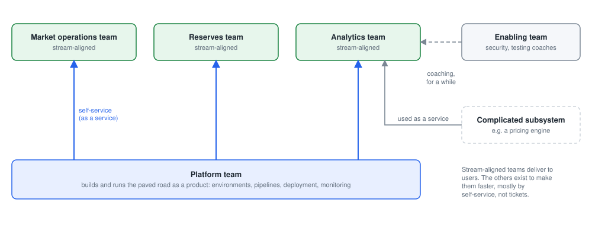
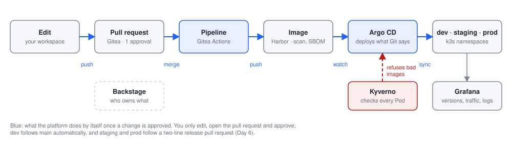
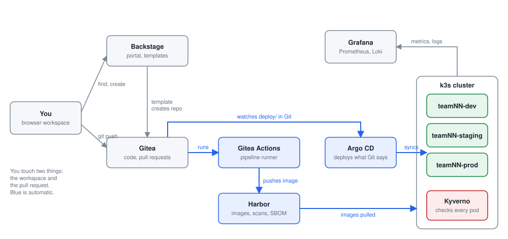
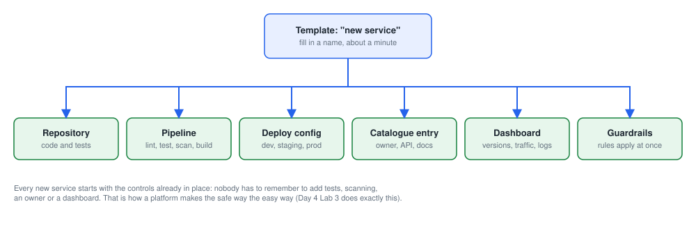
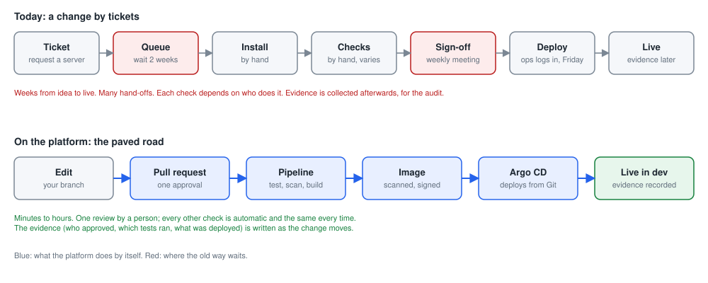
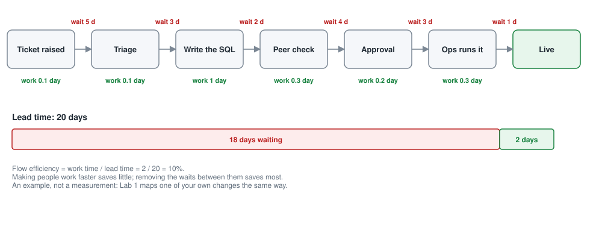
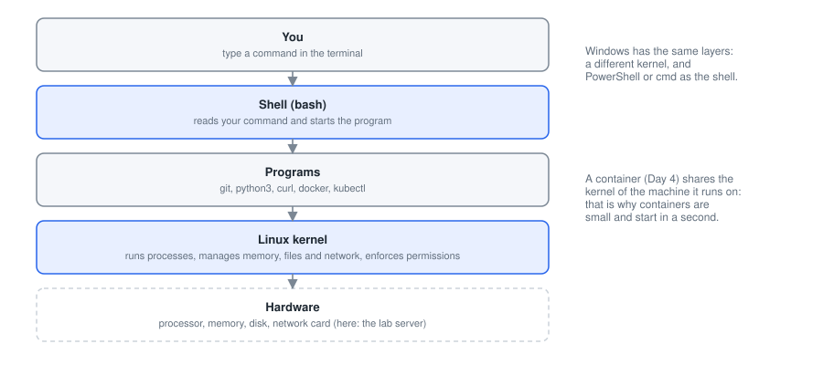
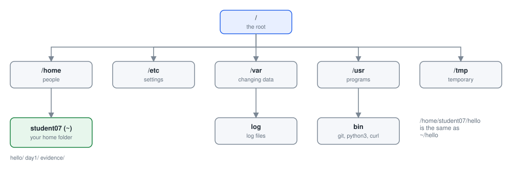
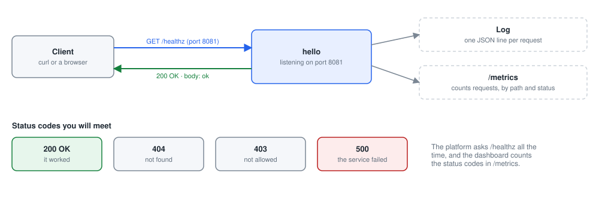
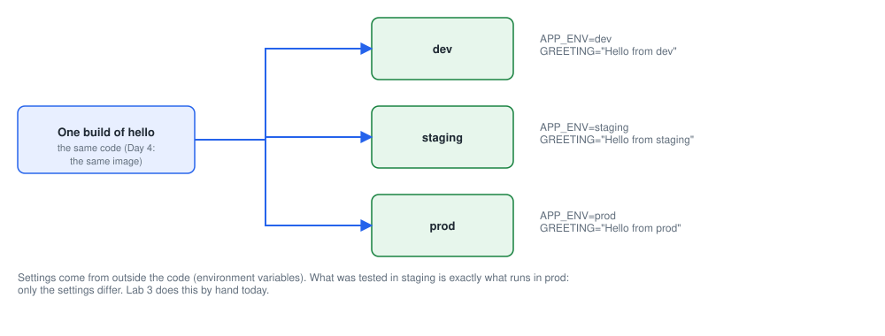

# Day 1: Platform engineering and Linux basics

> **Never used a terminal before?** Read [Start here](../start-here.md) first (15 minutes). It shows what the screen looks like, how to paste a command, how to tell it has finished, and what to do when something goes wrong.

### The week: six days, one small app, a whole platform

Each day adds one layer of the platform. The same hello app travels all the way: by hand on Day 1, in a container on Day 4, deployed automatically to dev, staging and prod on Day 6.

| Day | Theme | Working at the end of the day |
| --- | --- | --- |
| 1 | Platform engineering and Linux basics | The hello app runs by hand in your workspace and reports its environment |
| 2 | Git and working together | An approved change of yours is live in dev |
| 3 | Infrastructure as Code from a template | Your team has staging and prod, built from code |
| 4 | Containers and the packaging template | A second service exists, in the catalog and in dev |
| 5 | CI/CD, testing and security | Pipeline green, image scanned with an SBOM, a bad deployment blocked |
| 6 | Deploy, observe and the capstone | The new service runs in prod, with an evidence pack, presented to a panel |

**Goal:** Understand what a platform and an Internal Developer Platform are, and be at home on a Linux command line.

By the end of the day you can:

- Explain platform engineering and an IDP in two sentences
- Use the Linux terminal for everyday tasks: files, permissions, processes, services, logs
- Run the hello app by hand, see it report its environment, and count the manual steps

### Today's plan

One small app, hello, travels the whole week. Today: what a platform is, then enough Linux to be at home in your workspace. Lab 3 is the "before" picture for everything that follows.

| Topic | Labs |
| --- | --- |
| Getting to know each other | [Icebreaker: two truths and a lie](#icebreaker-two-truths-and-a-lie) (in teams) |
| Platform engineering | [Lab 1: map how a change reaches production today](#lab-1-map-how-a-change-reaches-production-today) (in teams) |
| Linux basics | [Lab 2: Linux warm-up in your workspace](#lab-2-linux-warm-up-in-your-workspace)<br>[Lab 3: run hello by hand, and count the steps](#lab-3-run-hello-by-hand-and-count-the-steps) |

## Getting to know each other

*One short icebreaker before any technology: two truths and a lie, in your team. By the end you will know who you are working with all week.*

### Icebreaker: two truths and a lie

*in teams*

#### The idea, in plain words

Before any technology, meet the people you will work with all week. Each of you tells your team three short things about your work, two true and one false, and the team guesses which is false. It is a gentle way to learn names, roles and a bit about each other.

Then each person names one tool they wish existed at work. Those wishes matter: most of them are about not waiting, and not waiting is exactly what a platform gives teams. You will come back to them in Lab 1 and on Day 2.

**What you do:** Get to know your own team: share two true facts and one false one about your work, and the one tool you wish existed.

**At the end you will have:** A team that knows each other, a team name, and a list of wishes for the platform.

**You will learn:**

- The names and roles of your teammates.
- What your team wishes it had at work: the start of thinking about a platform as a product.

**Words you will meet:**

- **Wish list:** The tools you wish existed. On Day 2 it becomes what your team's platform must make easy.

**Before you start:**

1. Sit with your team: 4 or 5 people.
2. A note or a sheet, a pen and your table card.

#### Step 1. Write two truths and one lie

> **In plain words:** Write three short things about your work: two true, one false.

*Where: On your own*

**Why:** Short, personal facts are easier to remember than a job title, and guessing makes everyone listen.

**Do this:**

1. On your note, write three short statements about your work.
2. Make two true and one false. For example: "I have worked at SARB for 12 years", "I have never used Excel", "My first job was in a bank in London".

**You should see:** Three statements on your note; only you know which is false.

**Check before you go on:** You have three statements ready.

#### Step 2. Take turns and guess

> **In plain words:** Introduce yourself and read your three statements; the team guesses the false one.

*Where: Your team*

**Why:** Everyone speaks once, and you all learn names and roles.

**Do this:**

1. Take turns: say your name and your role in FMD, then read your three statements.
2. The team agrees on a guess. Then reveal which one was false.

**You should see:** Everyone has had a turn, with a few surprises.

**Check before you go on:** You know every teammate's name and role.

#### Step 3. One tool you wish existed

> **In plain words:** Each person says one tool they wish they had at work.

*Where: Your team*

**Why:** The wishes show what a platform should do for real people. Most are about removing a wait or a ticket.

**Do this:**

1. Each person names one tool they wish existed at work, for example "a button that gives me a test environment" or "a report that builds itself".
2. One person writes all the wishes on a sheet.

**You should see:** One wish per person on the sheet.

**Check before you go on:** Every teammate's wish is written down.

#### Step 4. Choose a team name

> **In plain words:** Agree a name for your team for the week.

*Where: Your team*

**Why:** A name makes the team yours; you will use it all week.

**Do this:**

1. Agree a team name, inspired by your wishes if you like.
2. Write it on your table card.

**You should see:** A team name on the table card.

**Check before you go on:** Your table card shows your team name.

#### Step 5. Share with the room

> **In plain words:** Tell the room your team name and your favourite wish.

*Where: In front of the room*

**Why:** Hearing every team's wishes shows which ones the whole of FMD shares: those are where a common platform pays off.

**Do this:**

1. One person reads your team name and your favourite wish.
2. The instructor writes the wishes on the board.

**You should see:** Every team's wish on the board.

**Check before you go on:** Your team's wish is on the board. Keep your sheet: you need it in Lab 1 and on Day 2.

**Done when:** Your team has a name, knows each other, and has a written list of wishes.

**What this lab showed:** Most wishes are about not waiting: for an environment, a sign-off, an answer. Those wishes are what a platform is for. You meet them again in Lab 1 (the waits on your map) and on Day 2 (your platform charter).

## Platform engineering

### Why platform engineering exists

In most organisations every team builds its own road to production: its own scripts, its own servers, its own checks. Each road is slightly different, slow to build, and hard for anyone else to audit.

Platform engineering builds one shared road and runs it as a product. Teams use the road; the platform team maintains it, improves it, and puts the controls inside it so that the safe way is also the easy way.

The result: faster delivery, fewer incidents, less duplicated tooling, and evidence produced by default. That is exactly what the SARB brief asks for.

> **In one sentence:** Platform engineering builds and runs the shared road to production so teams ship safely without re-solving the same problems.

**In the lab**

- Open the portal. Every team already has a hello service running in dev.
- Nobody raised a ticket for it. Nobody ran a deployment by hand.
- The platform team built the road once; the teams travel on it.
- This week you learn to travel on it, and to see how it is built.

### How we got here: from silos to platforms

Each step solved a real problem and left a new one. Platform engineering is the answer to the problem DevOps left.

| Era | The idea | What it solved | What it left hard |
| --- | --- | --- | --- |
| Separate teams (before 2009) | Developers write the code; operations run it. Work is "thrown over the wall". | Clear specialist roles. | Slow hand-offs, blame between teams, releases a few times a year. |
| DevOps (from 2009) | One team builds and runs its software ("you build it, you run it"), with automation and CI/CD. | Faster, shared responsibility. | Every team must master dozens of tools: too much to know. |
| SRE (Google from 2003, book 2016) | Run operations as software engineering: service level objectives and error budgets. | Reliability that is measured, not hoped for. | Needs scarce specialist skills in every team. |
| Cloud and containers (Docker 2013, Kubernetes 2014) | Infrastructure on demand, through code and APIs. | Minutes instead of weeks for a server. | Tool sprawl: every team builds its own pipeline, cluster and rules. |
| Platform engineering (from about 2018) | A platform team builds one paved road as a product; teams use it by self-service. | Speed and safety for every team, with the controls inside. | The platform must be run like a product, with users and a roadmap. |

### Cognitive load: the hidden cost of "you build it, you run it"

Cognitive load is how much a person must hold in their head to do the work. Psychology splits it in three: intrinsic (the problem itself), extraneous (everything around it: tools, forms, waiting for access) and germane (learning that makes you better).

A team that wants to change one report should spend its effort on the report. If it must also learn the pipeline tool, the cluster, the scanner and the firewall rules, extraneous load crowds out the real work.

A platform takes extraneous load off the teams: the hard parts are solved once, by the platform team, and offered as simple, safe defaults.

> **In one sentence:** A platform lowers the load on every team by solving the undifferentiated hard parts once, for everyone.

**In this course**

- To ship hello, a team touches ten tools: Git, Gitea, a pipeline, Harbor, Trivy, Kyverno, OpenTofu, Kubernetes, Argo CD, Grafana.
- With the platform, the team writes code and opens a pull request. The template wires up the rest.
- By Day 6 you will know what each tool does, but you will not need to configure them for every change.

### Team Topologies: four kinds of team

A widely used model (Skelton and Pais, 2019) for who does what. A platform team exists to make the other teams faster.

- **Stream-aligned team:** Owns a flow of work for users from start to finish, for example the team behind a market-operations service. Most teams are this kind; the others exist to help them.
- **Platform team:** Builds and runs the internal platform as a product, so stream-aligned teams can self-serve: environments, pipelines, deployment, monitoring. Measured by how much it speeds the others up.
- **Enabling team:** Specialists who coach other teams for a while, for example in security or testing, then step back. This course is an enabling activity.
- **Complicated-subsystem team:** Owns a part that needs deep specialist knowledge, such as a pricing model or a payments engine, so other teams do not have to master it.

### How the teams work together



*Stream-aligned teams deliver to users; the platform team serves them by self-service; enabling teams coach for a while.*

- The platform team's customers are the other teams.
- Good platforms are used "as a service": no ticket, no meeting.
- Enabling teams, like this course, step back once teams can work alone.

### Who builds and runs a platform: the brief's eight role families

Platform engineering is a team sport. The brief groups the skills into eight families, each with its own career path.

| Family | What they do | Example roles |
| --- | --- | --- |
| Platform product leadership | Decide what the platform offers, for whom, and in what order | Platform product manager, service owner |
| Platform architecture | Design how the pieces fit: cloud, APIs, data, security | Platform architect, solution architect |
| Platform engineering | Build the templates, environments and automation | Platform engineer, automation engineer |
| DevSecOps engineering | Build safe pipelines and protect the software supply chain | DevSecOps engineer, release engineer |
| Reliability engineering | Keep services up: SLOs, monitoring, incidents, recovery | Site reliability engineer, operations engineer |
| Data and integration | Data pipelines, APIs, events, data quality and access | Data platform engineer, API engineer |
| Governance and assurance | Turn rules into controls, and produce evidence | Control engineer, technology assurance analyst |
| Developer enablement | Docs, training and support so teams can use the platform | Developer advocate, technical writer, trainer |

### What an Internal Developer Platform (IDP) is

An IDP is the product teams use to get what they need by self-service: a code repository, environments, a pipeline, a deployment, a dashboard. The rules of the bank are built into it, so self-service is safe.

It is not one tool. It is a set of tools joined together by templates, so that a team fills in a few values and gets the whole result.

The portal is the front door. Behind it: Git, the pipeline runners, the image registry, the GitOps deployer, the cluster, and the monitoring.

> **In one sentence:** An IDP is the self-service product that gives teams code, environments, pipelines and deployments with the controls already inside.

**In the lab**

- Front door: Backstage (the portal and catalog).
- Code and pipelines: Gitea.
- Images and scans: Harbor.
- Deployment: Argo CD onto k3s (Kubernetes), with Kyverno guardrails.
- Watching it run: Prometheus, Grafana and Loki.

### The layers of an Internal Developer Platform

Industry reference architectures describe an IDP in five layers. Every layer has a tool in this course.

| Layer | What it does | In this course | Day |
| --- | --- | --- | --- |
| Developer control plane | Where teams start and change things: the portal, the templates, the code | Backstage, golden-path templates, Gitea | 1, 2, 4 |
| Integration and delivery | Builds, tests, scans and stores every change, then deploys it | Gitea Actions, Harbor, Trivy, Argo CD | 2, 4, 5, 6 |
| Resource plane | The compute, networks and environments the software runs on | k3s (Kubernetes), OpenTofu environments | 3, 6 |
| Monitoring and logging | Shows what runs where, whether it is healthy and what went wrong | Prometheus, Grafana, Loki | 6 |
| Security and policy | Identity, secrets, and the rules every deployment must pass | Kyverno guardrails, scanners, protected branches | 2, 5 |

### The mini platform you will use all week



*The golden path: from a commit to prod. You edit, open the pull request and approve; the platform does the rest.*

| Piece | Tool | What it does |
| --- | --- | --- |
| Workspace | Linux, Docker, Git | Write and try code in your browser |
| Portal | Backstage | Find services and templates |
| Template | Golden path | Creates a service or an environment |
| Repository | Gitea | Protected main, pull requests |
| Pipeline | Gitea Actions | Lint, test, scan, build |
| Registry | Harbor | Images, scans, SBOM |
| GitOps | Argo CD | Deploys what Git says |
| Environments | k3s + Kyverno | dev, staging, prod |
| Observe | Grafana, Loki | Dashboards, logs, alerts |

A change travels left to right along the top row, then along the bottom row. Today you use the first two pieces.

### Inside the platform: how the pieces talk



*The lab platform on one page. You touch the workspace and the pull request; everything in blue runs by itself.*

- Backstage: find services and start new ones from a template.
- Gitea: the code, and the pull request where people decide.
- Actions and Harbor: test, scan and store every change.
- Argo CD: makes the cluster run what Git says. Kyverno checks every pod.
- Grafana: shows what runs where, and whether it is healthy.

### Platform as a product, and golden paths

A platform is a product: it has users (the teams), an owner, a roadmap, service levels and measures of success. The brief calls this "platform as a product".

A golden path (the brief also says paved road) is the approved, easy route for a common job, such as creating a new service, with the controls already inside it.

A template is a golden path packaged so a team fills in a few values and gets the whole result. This week you use three: environments, application packaging, and the pipeline.

> **In one sentence:** A golden path is the approved, easy route for a common job; a template is how the platform hands it to you.

**In the lab**

- The platform team (your instructors) built the three templates.
- You will request environments from one (Day 3), create a service from one (Day 4) and read the pipeline one (Day 5).
- On Day 6 you say what you would add to the road next.

### Golden paths, not golden cages

**A golden path (what to build)**

- The easiest way to do a common job is also the safe way
- Optional: a team may leave the path, and then owns what it built
- Self-service: no ticket, no waiting for another team
- Starts as the "thinnest viable platform": one useful path, then grows
- Has users, a product owner, a roadmap and measures

**Anti-patterns (what to avoid)**

- Golden cage: one mandatory path, with no room for real exceptions
- Ticket-ops: "self-service" that is really a form sent to a queue
- Tool-led: buying tools before knowing what users need
- Shadow platforms: every team builds its own because the official one is too slow
- Platform built for the platform team, never measured by its users

### What one golden-path request gives a team



*One template, about a minute: six things a team would otherwise build and agree by hand, each with the controls inside.*

- Nobody has to remember tests, scanning, an owner or a dashboard: they come with the service.
- Every service looks the same, so anyone can find their way in it.
- On Day 4 Lab 3 you request one and watch all six appear.

### What a delegate does on this platform: the week in five steps

- **Find:** Open the portal; see your team, its services, who owns them and where they run.
- **Create:** Make a new service or request an environment from a template. A few values, no ticket.
- **Change:** Edit on a branch, open a pull request, get one approval, merge. Nothing reaches main any other way.
- **Ship:** The pipeline checks and builds; the registry scans; Argo CD deploys to dev, and to staging and prod after an approved promotion.
- **Watch:** The dashboard shows versions, traffic, errors and logs per environment. Evidence of every step is kept.

### Getting a change live: today versus the paved road

**How it often works today**

- Raise a ticket for a server or an environment; wait
- Someone installs software by hand and copies files
- Checks depend on who is doing the work that day
- A deployment is a person logging in and running commands
- Nobody is sure which version runs where
- Evidence is assembled afterwards, for the audit

**On the paved road**

- An environment is a few lines in a template, approved in a pull request
- The pipeline runs the same checks on every change
- The image is built once, scanned, and kept with its ingredients list
- Deployment happens because Git changed, not because someone logged in
- The dashboard shows which version runs in dev, staging and prod
- Evidence is a by-product: every run, approval and decision is recorded

### A change before and after the platform



*Same change, two roads. Blue is what the platform does by itself; red is where the old way waits.*

- The old road is slow because of the waiting between people, not the work.
- On the paved road one person reviews; every other check is automatic and identical every time.
- Evidence is written as the change moves, not gathered for the audit later.
- Lab 1 maps your own change on the top road.

### Measuring delivery: the four DORA metrics

Ten years of State of DevOps research (DORA) found four measures that predict both speed and stability. The brief asks for the same measures.

| Metric | Question it answers | Best-performing teams (DORA) | Where the course shows it |
| --- | --- | --- | --- |
| Deployment frequency | How often do we release to production? | On demand, many times a day | Day 6: promotion by pull request |
| Lead time for changes | How long from a committed change to production? | Less than a day | Day 2: merge to dev in minutes |
| Change failure rate | What share of releases cause a problem? | Around 5% | Day 5: the pipeline blocks bad changes |
| Time to restore service | How fast do we recover from a failure? | Less than an hour | Day 6: Lab 4 measures it |

### Why a central bank needs this: the brief's six principles

The FMD brief sets these principles for every platform product. Each one becomes something you do this week.

| Principle | What it means | Where you do it this week |
| --- | --- | --- |
| Security and resilience by design | Controls, recovery and monitoring are part of the product, not added later | Day 5 guardrails, Day 6 recovery |
| Platform as a product | Known users, an owner, a roadmap, service levels and feedback | Day 2 Lab 6: your charter |
| Self-service with guardrails | Teams act alone, within approved patterns and automated rules | Days 3 and 4: templates |
| Open standards and portability | No unjustified lock-in; data and workloads can move | Open-source tools throughout |
| Evidence by default | Every pipeline run leaves traceable, tamper-evident evidence for audit | Day 5 evidence, Day 6 capstone pack |
| Continuous learning | Skills kept up through practice, incidents and communities | Every lab; the community of practice after |

### The maturity journey: five levels

The brief measures the capability on five levels, with objective evidence. A good tool score never makes up for weak ownership or controls.

| Level | What it looks like | Evidence to move up |
| --- | --- | --- |
| 1. Initial | Local, manual, person-dependent work; risks and duplication not visible | Inventory, risk assessment, a sponsor and a team |
| 2. Repeatable | Common practices and some reusable automation for priority cases | Minimum standards, pilot paved roads, service owners |
| 3. Defined | Platform products and standard workflows, broadly adopted | Service catalogue, roadmaps, SLOs, controls built in |
| 4. Managed | Performance, risk, cost and reliability managed with numbers | Dashboards, error budgets, recovery tests |
| 5. Optimising | Continuous experiment and improvement across the portfolio | Learning loops, automation, external benchmarks |

### Value streams: where the time really goes

A value stream is every step a piece of work goes through, from the first idea to the user having it. Lean thinking, from manufacturing, maps it to see where time is lost.

Two numbers matter. Lead time is the calendar time from idea to live. Process time is the time someone was actually working on it. The rest is waiting: in queues, for approvals, for hand-offs.

Flow efficiency is process time divided by lead time. In office and IT work it is often low: most of the calendar time, the work is waiting, not being worked on.

> **In one sentence:** Most delivery time is waiting between people, so the biggest gains come from removing hand-offs and queues.

**A worked example**

```
Lead time:     20 days (idea to live)
Process time:   2 days (actual work)
Flow efficiency: 2 / 20 = 10%

18 days of waiting:
  tickets, queues, sign-offs, hand-offs
```

- Lab 1 maps one of your own changes like this.
- The platform attacks the waiting, not the working.

### A value stream, mapped: where the time goes



*A made-up example of the map you draw in Lab 1: work time under each step, waiting time between them.*

- Work time: when someone is actually working on it.
- Wait time: in a queue, for a meeting, for a sign-off.
- Flow efficiency = work / lead time. Here 2 / 20 = 10%.
- In Lab 1, mark the waits on your own map, and estimate both numbers.

## Lab 1: map your delivery

### Lab 1: map how a change reaches production today

*in teams*

**This lab puts into practice:** [Value streams: where the time really goes](#value-streams-where-the-time-really-goes) · [A value stream, mapped: where the time goes](#a-value-stream-mapped-where-the-time-goes) · [A change before and after the platform](#a-change-before-and-after-the-platform) · [Measuring delivery: the four DORA metrics](#measuring-delivery-the-four-dora-metrics)

#### The idea, in plain words

Think of the last time something you needed changed at work: a new column in a report, a fix to a spreadsheet model, a new script. You asked, and some days or weeks later it was there. In between it passed through several people, waited in queues, and was checked by hand. Most of that time nobody was working on it: it was waiting.

In this lab every team draws that road on paper, then looks at the other teams' roads. You will find that everyone built almost the same road, each in their own way. That discovery, made by the room itself, is the whole case for a platform. No computer is needed.

**What you do:** As a team, map your road from a request to a live change, mark where it waits, compare it with the other teams' roads, and see that the shared steps are what a platform builds once.

**At the end you will have:** Your road with its waits, ticks from the other teams on what is the same, and one shared road on the wall with what the platform does instead of each shared step.

**You will learn:**

- How to see delivery as a chain of steps, with waits and hand-offs between them.
- That most of the time a change takes is waiting, not working.
- That different teams build almost the same road, each on its own: the case for a platform.

**Words you will meet:**

- **Change:** Anything that has to reach users: a new report column, a fix to a model, a new script, a configuration setting.
- **Production (live):** Where real users use it. "In production" means "live".
- **Wait:** Time when nobody is working on the change: in a queue, waiting for a sign-off, a server or a meeting.
- **Hand-off:** The moment work passes from one person or team to another, often with a ticket or an e-mail.
- **Value stream map:** The name for the drawing you make in step 1: the steps a change goes through, with the waits marked.

**Before you start:**

1. Your team around one table, with an A3 sheet, yellow and pink sticky notes, and markers. No computer needed.
2. Choose a timekeeper: the instructor tells you how long each of the four steps takes.
3. Every team maps the same job: a small change to a report or a script, from "someone asks for it" to "it is live".

#### Step 1. List your road, and mark the waits

> **In plain words:** Draw every step your change goes through, and mark where it waits and why.

*Where: Your team, on the A3 sheet*

**Why:** You cannot improve a road you have not drawn. Writing every step makes the hidden ones visible: the e-mails, the queues, the sign-off nobody remembers.

**Do this:**

1. Write one step per yellow sticky note and put them left to right: who asks, who writes it, who tests it, who approves it, who puts it live, who tells the users.
2. Wherever the change waits, add a pink note: how long, and why. For example "Sign-off: 3 days, the approver was away".
3. Add up two numbers and write them in the corner: total days from request to live, and the days someone was actually working on it.

**You should see:** A row of 8 to 20 notes, with pink waits between them, and two numbers in the corner, for example:

```
[Request by e-mail] -> pink: 2 days, in the inbox -> [Ticket raised] -> pink: 5 days, weekly triage
  -> [Analyst writes the SQL] -> [Peer check by e-mail] -> pink: 3 days, sign-off
  -> [Ops runs the script on Friday] -> [Live]

Total: 14 days.  Working: 2 days.
```

**Check before you go on:** Your road goes from "someone asks" to "live", with at least one pink wait and two numbers in the corner.

#### Step 2. Walk round and tick what you recognise

> **In plain words:** One of you looks at the other teams' roads and ticks every step you recognise.

*Where: The other teams' boards*

**Why:** Seeing another team's road is the fastest way to notice that yours is not unique.

**Do this:**

1. Your team chooses one walker. Everyone else stays at your board to explain it to visitors.
2. The walker takes a pen and visits every other team's board in turn.
3. On each board, tick ✓ every step your team does too, and star ★ anything your team never does but maybe should.

**You should see:** Ticks and stars on every board, including yours, from the other teams' walkers.

**Check before you go on:** Your walker has visited every other board.

#### Step 3. Same or different?

> **In plain words:** Back in your team, sort your steps into "the same as others" and "only ours".

*Where: Your team, back at your board*

**Why:** A difference is only real if it is a different job. Most turn out to be the same job with another name, tool or person.

**Do this:**

1. The walker tells the team what they saw on the other boards.
2. Sort your notes into two groups: ticked by other teams (the same), and no ticks (only ours).
3. For each "only ours" note, ask: is it really a different job, or the same job done another way?
4. Look at the stars on your board: a step another team has and you do not. Is it a check you are missing?

**You should see:** Two groups of notes. Usually the "same" group is much bigger than the "only ours" group.

**Check before you go on:** Every note is in one of the two groups.

#### Step 4. One road: the platform

> **In plain words:** Put everyone's shared steps on one wall, and see that this one road is what a platform builds once, for everyone.

*Where: The wall, with the whole room*

**Why:** When every team's shared steps sit in one place, you can see what each team built for itself, and what could be built once for everyone.

**Do this:**

1. Each team brings its ticked notes to the wall. The same step from different teams goes into the same column.
2. Above each column, write how many teams had that step.
3. The instructor places a card over each column: what the platform does instead (the table on the slide).
4. Together, count what disappears: set-up done once per team, waiting, and checks that only some teams remembered.

**You should see:** One long road on the wall, made of columns that most teams share, each with a platform card over it.

**How to read it:**

- Every team built and keeps its own copy of almost the same road. A platform builds the shared steps once, with the checks inside, and every team uses them by self-service: that is platform engineering.
- The pink waits are what the platform removes first. On Day 6 you come back to this wall and cross off every note the platform now does.

> **Tip:** Take a photo of your team's board and of the wall: both go into your Day 6 evidence pack.

**Check before you go on:** You can say in one sentence what a platform would change for your team.

**Done when:** Your road is mapped with its waits, compared with every other team's, and the shared steps are on one wall with what the platform does instead.

**What this lab showed:** Every team drew almost the same road: the same steps, with different names, tools and people. Each team built and keeps its own copy of that road, and not every copy has the same checks. Building the shared steps once, with the checks inside, and letting every team use them by self-service is platform engineering. The waits you marked are what it removes first.

**If you are stuck**

- No recent change to map? Use how you got access to a new system, or how a report reaches its readers.
- Count waits in calendar days, not working hours; the point is how long a user waits.

### Your shared steps, done once by the platform

For step 4: place one card over each column on the wall. Each shared manual step becomes one platform capability, built once and used by every team.

| The manual step every team had | What the platform does instead | Day |
| --- | --- | --- |
| Ask for a server or an environment, and wait | An environment template: request it in a pull request | 3 |
| Set up a new project by copying an old one | A golden-path template: a new service in a minute | 4 |
| Test, scan and build by hand, if remembered | A pipeline that runs on every change | 5 |
| Approval by e-mail or in a meeting | A pull request with a required reviewer | 2 |
| Security and compliance checks, if remembered | Guardrails (policy-as-code) on every deployment | 5 |
| Deploy by hand, often after hours | GitOps: the platform deploys what Git says | 2, 6 |
| "Is it working?" phone calls | A dashboard and alerts for every service | 6 |

## Linux basics

*Everything on the platform runs on Linux. You need about ten commands, and the confidence to read a log. Then two labs: a Linux warm-up (Lab 2), and running hello by hand (Lab 3).*

### What Linux is, and why it runs the platform

An operating system is the software that runs a computer and lets programs use it: Windows and macOS are operating systems, and so is Linux.

Linux has three parts: the kernel (the core, which talks to the hardware), the shell (the program that reads the commands you type) and the programs themselves. Ubuntu, which your workspace runs, is one distribution: a kernel plus a chosen set of programs.

Linux runs most of the world's servers and cloud, and every container and Kubernetes node. Every tool in this course runs on it, so a little Linux opens all of them.

> **In one sentence:** Linux is the operating system under almost every server, container and cloud, and the terminal is how you talk to it.

**Windows and Linux side by side**

- Folder C:\Users\you  is  /home/you  (written ~ for short)
- Task Manager  is  ps and top
- Services panel  is  systemctl
- Event Viewer  is  journalctl (the system log)
- "Run as administrator"  is  sudo

### The layers of a Linux computer



*Your command goes down through the layers; the answer comes back up.*

- The shell is the program you talk to in the terminal.
- The kernel does the real work and enforces who may do what.
- Containers (Day 4) share the kernel: that is why they are small and fast.

### Where things live: the Linux file system

Linux keeps everything in one tree of folders that starts at / (the root). A few folders are worth knowing.

| Folder | What is in it | You will meet it when |
| --- | --- | --- |
| / | The root: the top of the tree; every other folder is inside it | Every path starts here |
| /home/student01  (~) | Your own folder: your files and your copy of the code | All week: ~/hello, ~/day1 |
| /etc | Settings (configuration files) for the system and its programs | Reading how a service is set up |
| /var/log | Log files written by programs | Day 1 Lab 2: reading a log |
| /usr/bin | The programs themselves: git, python3, curl... | When you type a command |
| /tmp | Temporary files, cleared from time to time | Rarely; never keep work there |

### The file tree you will use this week



*Everything hangs from / . You mostly live in your home folder, ~ .*

- ~ is short for /home/your-name.
- Settings live in /etc, logs in /var/log, programs in /usr/bin.
- Lab 2 makes ~/day1; Lab 3 copies the code into ~/hello.

### Users, permissions and least privilege

Every file has an owner, a group, and permissions for three kinds of people: the owner, the group, and everyone else. Each may read (r), write (w) or run (x) it.

One user, root, may do anything. Normal users borrow root's power for one command with sudo, and on a real server every use of sudo is logged.

Least privilege means giving each person and program only the access they need, and no more. It is a basic control in every bank, and the platform applies it to people, pipelines and deployments alike.

> **In one sentence:** Each file says who may read, write or run it, and least privilege means giving no one more access than they need.

**Reading a permission**

```
-  rw-  r--  r--   notes.txt
|   |    |    |
|   |    |    `-- everyone else: read
|   |    `------- group: read
|   `------------ owner: read, write
`---------------- - file, d folder
```

- Lab 2 locks a file to its owner with chmod 600.

### Processes, services and logs

Three ideas you will use every day this week, from your own terminal to the platform's dashboard.

- **A process is a program that is running:** Every running program has a number (its PID), an owner, and uses some CPU and memory. ps lists them; top shows them live. Ctrl+C stops the one in your terminal.
- **A service is a process the system keeps running:** The system (systemd) starts it when the machine starts and restarts it if it stops, like Docker in your workspace. systemctl status shows how it is.
- **A log is a program's diary:** Programs write what they do, line by line, with a time on each line. When something goes wrong, the log is the first place to look: journalctl reads the system's logs.
- **On the platform, the same three ideas:** Kubernetes runs your service as processes in containers and restarts them if they fail; Loki collects their logs; Grafana shows them. Day 6 uses all three.

### Your workspace: a Linux machine in your browser

Each delegate has a personal workspace: a small Ubuntu Linux machine running on the lab server. You reach it from the browser, so there is nothing to install on your laptop.

The workspace is Visual Studio Code in the browser (code-server): files on the left, an editor in the middle, a terminal at the bottom.

Everything you need is already inside it: Git, Docker, Python, OpenTofu, kubectl and the security scanners. Your files survive between days.

> **In one sentence:** Your workspace is a Linux machine in your browser with every course tool already installed.

**In the lab**

- Open https://student01.<lab domain> with the password from your logins file (/etc/pelab/logins.md on your VM).
- Open a terminal: Menu, Terminal, New Terminal (or Ctrl + `).
- The prompt shows your user and the current folder.
- If the page will not load, tell the lab assistant; a spare workspace is ready.

### Ten commands you will use all week

| Command | What it does | Example |
| --- | --- | --- |
| pwd  ·  ls -la  ·  cd | Where am I, what is here (with permissions), go somewhere | cd ~/hello && ls -la |
| cat  ·  less  ·  tail -f | Show a file, page through it, follow it as it grows | tail -f app.log |
| mkdir  ·  cp  ·  mv  ·  rm | Make a folder, copy, move or rename, delete | mkdir -p ~/day1/notes |
| nano  (or the editor) | Edit a file in the terminal; the workspace editor also works | nano README.md |
| chmod  ·  sudo | Change who may read, write or run a file; run one command as the administrator | chmod +x run.sh  ·  sudo apt update |
| ps aux  ·  top | List running programs; watch CPU and memory live | ps aux \| grep python |
| systemctl status  ·  journalctl -u | Is a service running; read its log | journalctl -u docker --since today |
| curl | Call a web address from the terminal and see the raw answer | curl -i http://localhost:8081/healthz |
| env  ·  export | Show the environment variables; set one for the next command | APP_ENV=staging python3 -m app.main |
| Ctrl + C  ·  Ctrl + R | Stop the running program; search your command history |  |

## Lab 2: Linux warm-up

### Lab 2: Linux warm-up in your workspace

**This lab puts into practice:** [What Linux is, and why it runs the platform](#what-linux-is-and-why-it-runs-the-platform) · [Where things live: the Linux file system](#where-things-live-the-linux-file-system) · [Users, permissions and least privilege](#users-permissions-and-least-privilege) · [Processes, services and logs](#processes-services-and-logs)

#### The idea, in plain words

A terminal is like a text chat with the computer. You type an instruction, press Enter, and it answers in text. In this lab you try the handful of instructions everyone uses every day: make a folder, make a file, see who may read it, see what is running, read a program's diary (its log), visit a website, and do one thing as the administrator.

If you have not yet, read [Start here](../start-here.md) first: it shows the screen and how to paste a command. Go slowly: run one command, compare what you see with the handbook, read the short explanation, then go on.

**What you do:** Get comfortable in the Linux terminal of your workspace: files, permissions, processes, services, logs, the web and sudo.

**At the end you will have:** A folder day1 with a file in it that only you can read, and the confidence to type a command, read the answer and know whether it worked.

**You will learn:**

- How to type commands in a terminal and read what comes back.
- Files and folders, and who may read or change them.
- Programs that run (processes), programs the system keeps running (services) and what they write (logs).
- How to call a web address from the terminal, and how to run one command as the administrator.

**Words you will meet:**

- **Workspace:** Your own small Linux computer for the week, running on the lab server. You use it in the browser: an editor at the top, a terminal at the bottom.
- **Terminal:** The window where you type commands and the computer answers in text.
- **Prompt:** The text before the cursor, for example student01@student01:~/day1$. It says who you are (student01), on which computer (student01) and in which folder (~/day1). The $ means "ready for a command".
- **Home folder (~):** Your own folder, /home/student01. ~ is its short name.
- **Permission:** Who may read, change or run a file.
- **Process:** A program that is running right now.
- **Service:** A program the system starts and keeps running for you, such as Docker.
- **Log:** What a program writes about what it does, line by line, so you can find out later what happened.
- **sudo:** "Do this as the administrator", for one command.

**Before you start:**

1. Open your workspace at https://student01.<lab domain> (your user name and password are in your logins file, /etc/pelab/logins.md on your VM: your instructor shows you how to open it). The first time, the browser shows a sign-in page: type the password and press Enter.
2. Open a terminal: menu ☰ (top left) → Terminal → New Terminal. It appears at the bottom of the window, with a prompt like student01@student01:~$
3. To run a command: copy it from this page (the copy button at the top right of each grey box), click in the terminal, paste with Ctrl+V (on a Mac Cmd+V, or right-click → Paste), and press Enter.
4. Do not worry about breaking anything: the workspace is yours alone, and the instructor can reset it.

#### Step 1. Make a folder and a file

> **In plain words:** Make a folder, put a small file in it, and look at what is there.

*Where: Workspace terminal*

**Why:** Everything on a computer lives in files and folders. These four commands are the ones you will use most often all week.

**Do this:**

1. Make a folder called day1 in your home folder. It prints nothing: on Linux, no message means it worked.

   ```bash
   mkdir -p ~/day1
   ```

2. Go into that folder. It prints nothing either, but look at the end of the prompt: it changes from ~$ to ~/day1$. The prompt always shows where you are.

   ```bash
   cd ~/day1
   ```

   **You should see:** Only the prompt changes:

   ```
   student01@student01:~/day1$
   ```

3. Create a file called notes.txt with the word hello in it. Again, nothing is printed.

   ```bash
   echo "hello" > notes.txt
   ```

4. Now list what is in the folder, with details, to see your file.

   ```bash
   ls -la
   ```

   **You should see:** Three lines (your dates and times differ). The last one is your file:

   ```
   total 4
   drwxr-xr-x 2 student01 student01 4096 Nov  2 09:41 .
   drwxr-x--- 9 student01 student01 4096 Nov  2 09:41 ..
   -rw-r--r-- 1 student01 student01    6 Nov  2 09:41 notes.txt
   ```

**What each line does:**

- `mkdir -p ~/day1`: make a folder called day1 in your home folder. -p means "no error if it is already there".
- `cd ~/day1`: go into that folder (change directory). Look at the prompt: it now ends in ~/day1$.
- `echo "hello" > notes.txt`: echo writes the text hello; > sends it into a file called notes.txt instead of the screen. The file is created if it does not exist, and overwritten if it does.
- `ls -la`: list the folder's contents (ls) as a long list with details (-l), including hidden entries (-a).

**How to read it:**

- Look only at the last line, the one ending in notes.txt: that is your file. The rest of that line is detail: who may read it (-rw-r--r--, explained in step 2), who owns it (student01, you), how big it is (6: the five letters of hello and an invisible end-of-line), and when it was made.
- The lines ending in . and .. are the folder itself and the folder above it. Every folder lists them; you can ignore them.
- If your file shows -rw-rw-r-- instead of -rw-r--r--, that is also normal.

**If you see something else:**

- *cd: no such file or directory*: the folder was not made. Paste the mkdir line (instruction 1) again, then the cd line.

Your workspace also knows who you are. Paste this:

```bash
echo "I am $ME, in $TEAM, on $DOMAIN"
```

**What each line does:**

- `echo "I am $ME, in $TEAM, on $DOMAIN"`: print a sentence. $ME, $TEAM and $DOMAIN are filled in by the workspace with your user name, your team and the lab domain.

**You should see:** Your own user name and team (here student01 in team01):

```
I am student01, in team01, on <lab domain>
```

**How to read it:**

- Many commands in this handbook use $ME, $TEAM and $DOMAIN, so you can paste them exactly as they are: the workspace fills in your own values.

**Try it yourself:** cat shows what is inside a file. Paste it:

```bash
cat notes.txt
```

**You should see:** The word you put in the file:

```
hello
```

**Check before you go on:** Your prompt ends in ~/day1$, and ls -la shows a line ending in notes.txt.

#### Step 2. Read and change permissions

> **In plain words:** Lock your file so that only you can read it.

*Where: Workspace terminal*

**Why:** Permissions decide who may read or change a file. On a shared server, a file with passwords or customer data must be readable only by its owner.

The permissions are three groups of three letters, after the first character: what the owner may do, what the owner's group may do, and what everyone else may do. r means read, w means write (change), x means run, and - means not allowed.

So -rw-r--r-- means: the owner may read and write; the group may read; everyone else may read.

**Do this:**

1. Change who may use the file: only you may read and change it, nobody else may even read it. It prints nothing.

   ```bash
   chmod 600 notes.txt
   ```

2. Look at the file's details again.

   ```bash
   ls -la notes.txt
   ```

   **You should see:** The start of the line has changed to -rw-------:

   ```
   -rw------- 1 student01 student01 6 Nov  2 09:41 notes.txt
   ```

**What each line does:**

- `chmod 600 notes.txt`: change the permissions (change mode) of notes.txt to 600: the owner may read and write (6), the group nothing (0), everyone else nothing (0). Each digit adds up read = 4, write = 2, run = 1.
- `ls -la notes.txt`: show the details of that one file again.

**How to read it:**

- rw- for you, --- for your group, --- for everyone else: now only you can read the file.
- chmod 644 would give the original back: read and write for you, read for everyone else.

**Check before you go on:** The line starts with -rw------- : one rw for you, then only dashes for everyone else.

#### Step 3. See what is running

> **In plain words:** See which programs are running on your workspace right now, like Task Manager on Windows or Activity Monitor on a Mac.

*Where: Workspace terminal*

**Why:** When something is slow or stuck, the first question is "what is running, and what is it using?". ps and top answer it.

**Do this:**

1. Run this: it lists the first few running programs once.

   ```bash
   ps aux | head
   ```

2. Then run top: it shows the running programs live, busiest first, and keeps updating.

   ```bash
   top
   ```

3. Look at it for a few seconds, then press q to leave top and get your prompt back.

**What each line does:**

- `ps aux`: list every running program (process): a = of all users, u = with the user and the resources, x = including those not started from a terminal.
- `| head`: the | (pipe) sends the output of the first command into the second; head keeps only the first ten lines, so the list fits on the screen.
- `top`: show the processes live, updated every few seconds. q leaves it.

**You should see:** A table of processes, something like this. Yours lists other programs too, such as code-server (your editor in the browser) and dockerd (Docker):

```
USER         PID %CPU %MEM    VSZ   RSS TTY      STAT START   TIME COMMAND
root           1  0.0  0.1  22048 12872 ?        Ss   08:01   0:02 /sbin/init
root         312  0.1  0.9 1906540 74136 ?       Ssl  08:01   0:09 /usr/bin/dockerd ...
student01    401  1.2  2.8 1196064 230412 ?      Ssl  08:01   1:02 /usr/lib/code-server/lib/node ...
...
```

**How to read it:**

- USER is who runs it, PID its number, %CPU and %MEM how much of the processor and memory it uses right now, COMMAND what it is.
- In top, the top lines summarise the whole machine: how many tasks, how busy the processors are, how much memory is used and free.

**If you see something else:**

- *top does not go away*: press q (just the letter, no Enter). If that does not work, press Ctrl+C.

**Check before you go on:** You pressed q, top has gone, and the prompt is back.

#### Step 4. Check a service and read its log

> **In plain words:** Check that a program that runs in the background (Docker) is working, and read its diary (its log).

*Where: Workspace terminal*

**Why:** A service is a program the system keeps running for you, and its log is the first place to look when it misbehaves. You will read logs all week, from your own service on Day 1 to the dashboard on Day 6.

Docker, which you use on Day 4, runs as a service in your workspace. Reading the system's log needs administrator rights, so the second command starts with sudo. In your workspace sudo does not ask for a password.

**Do this:**

1. Ask the system how the Docker program is doing.

   ```bash
   systemctl status docker --no-pager
   ```

   **You should see:** A few lines; the important one is Active, which says active (running) in green:

   ```
   ● docker.service - Docker Application Container Engine
        Loaded: loaded (/usr/lib/systemd/system/docker.service; enabled; preset: enabled)
        Active: active (running) since Mon 2026-11-02 08:01:12 UTC; 1h 40min ago
   ...
   ```

   If the screen does not give you the prompt back, press q.

2. Read the last ten lines Docker wrote in its log today. sudo means "as the administrator": reading the system's logs needs it. In your workspace it does not ask for a password.

   ```bash
   sudo journalctl -u docker --since today | tail
   ```

   **You should see:** Ten lines, each starting with a date and time, then the computer's name and the program, then what happened. For example:

   ```
   Nov 02 08:01:12 student01 dockerd[312]: time="2026-11-02T08:01:12Z" level=info msg="API listen on /run/docker.sock"
   ```

**What each line does:**

- `systemctl status docker --no-pager`: ask the system (systemctl) how the service called docker is. --no-pager prints it all at once instead of in a scrolling viewer.
- `sudo journalctl -u docker --since today`: show the log (journal) of the docker service (-u: unit), only from today. sudo: as the administrator.
- `| tail`: keep only the last ten lines: the most recent.

**How to read it:**

- Loaded ... enabled: the system starts Docker by itself at every boot.
- Active: active (running): it is running now, and since when.
- Each log line starts with the date and time, the computer's name and the program, then the message.

**If you see something else:**

- *The status screen does not return to the prompt*: press q.
- *Active: failed or inactive*: tell the instructor: Docker is needed on Day 4.

**Check before you go on:** The status says Active: active (running), and you have read a few log lines.

#### Step 5. Call a web service from the terminal

> **In plain words:** Visit a website from the terminal instead of from the browser, and read the answer.

*Where: Workspace terminal*

**Why:** curl talks to a web address the way a browser does, but shows you the raw answer. It is how you check a service quickly, without a browser, and you use it every day this week.

```bash
curl -I https://gitea.$DOMAIN
```

**What each line does:**

- `curl -I https://gitea.$DOMAIN`: ask the lab's Gitea (the Git service you use from Day 2) for its front page. -I asks only for the headers: the status and details of the answer, without the page itself.

**You should see:** The first line is the status. 200 means OK:

```
HTTP/2 200
content-type: text/html; charset=utf-8
...
```

**How to read it:**

- 200 means OK. You will also meet 404 (not found), 403 (not allowed) and 500 (the service failed).
- The other lines are details of the answer, such as its type (content-type).

**If you see something else:**

- *curl: (6) Could not resolve host*: the address was mistyped. Paste the command again, exactly as it is.

**Check before you go on:** The first line of the answer ends in 200, which means OK.

#### Step 6. Run an admin command with sudo

> **In plain words:** Run one command as yourself and once as the administrator, and see the difference.

*Where: Workspace terminal*

**Why:** Some commands change or read the whole system and need the administrator. sudo gives you that for one command. In your workspace you may use it; on a real server it is given carefully, and every use is logged.

**Do this:**

1. Ask "who am I?".

   ```bash
   whoami
   ```

   **You should see:** Your own user name:

   ```
   student01
   ```

2. Ask the same question with sudo in front.

   ```bash
   sudo whoami
   ```

   **You should see:** The administrator, whose name on Linux is always root:

   ```
   root
   ```

**What each line does:**

- `whoami`: print who you are: the user the terminal runs commands as.
- `sudo whoami`: the same question, but run as the administrator (sudo: "do this as the administrator"). The administrator account on Linux is called root.

**How to read it:**

- The same command answers differently with sudo in front: for that one command you were the administrator, root. The next command is you again.
- Every course tool you use this week (git, kubectl, tofu, docker, python) was installed this way, with sudo, by the platform team.

**If you see something else:**

- *sudo asks for a password*: type the student01 password, from your logins file (nothing appears while you type).

**Check before you go on:** whoami said your user name, and sudo whoami said root.

**Done when:** You made a file and changed who may read it, looked at processes, checked a service and its log, called a web address, and used sudo.

**What this lab showed:** Each step used one idea from the slides: you made a folder in your home folder (the file tree), locked a file to its owner (least privilege), looked at processes, read a service's log, and borrowed root's power once with sudo. The platform uses the same ideas at scale: Kubernetes runs processes, Loki collects logs, and Kyverno enforces least privilege.

**If you are stuck**

- command not found: check the spelling. Press Tab to complete commands and file names.
- top, less and man take over the terminal: press q to leave.
- Permission denied: work inside your home folder (cd ~).

## Lab 3: run the app by hand

### How a web service works

A web service is a program that waits for requests and answers them. Your browser, or the curl command, is the client: it sends a request; the service (the server) sends back a response.

A request names an address (a URL): the computer, the port (a numbered door on that computer, like 8081) and the path (/, /healthz). The response starts with a status code and carries a body, often in JSON.

The status code says how it went: 200 OK, 404 not found, 403 not allowed, 500 the service failed. Monitoring counts these codes to know whether a service is healthy.

> **In one sentence:** A client sends a request to an address and port; the service answers with a status code and a body.

**One request, one response**

```
curl localhost:8081/healthz
|    |         |   |
|    |         |   `- path: the page
|    |         `- port: which door
|    `- computer: this one
`- the client

HTTP/1.0 200 OK   <- status
ok                <- body
```

- Lab 3 asks hello for / and /healthz.

### One request through hello



*The client asks; hello answers with a status code and a body, and writes one log line and one count.*

- Lab 3, step 3 is exactly this request.
- Watch the first terminal: each request writes one log line.
- Step 5 reads the counts in /metrics.

### Build once, configure outside: how a cloud-native app behaves

The "twelve-factor app" (2011) set out how a service should behave so a platform can run it anywhere. hello follows the rules that matter most.

| Rule | What it means | How hello does it |
| --- | --- | --- |
| Config in the environment | Settings come from outside the code, so one build runs everywhere | APP_ENV, GREETING, PORT as environment variables |
| Logs as a stream | Write events to the screen, one per line; the platform collects them | One JSON line per request |
| Health checks | An address that says "I am alive", for the platform to ask | /healthz answers ok |
| Metrics | Numbers the service publishes about itself | /metrics: requests, version, uptime |
| Disposable | Starts fast and can be stopped and replaced at any time | Starts in a second; Ctrl+C stops it cleanly |
| One codebase | One repository, many deployments | team01/hello runs as dev, staging and prod |

### One code, three environments



*The same build runs everywhere; only the settings change.*

- Lab 3, step 4 does this by hand: same code, three new settings.
- Day 4 packs the code into one image; Day 6 runs that image in dev, staging and prod.
- What was tested is exactly what runs in production.

### The app you will ship all week: hello

hello is a web service of about 100 lines of Python with no dependencies. It answers three addresses: / (its name, version, environment and a greeting), /healthz (am I alive) and /metrics (numbers for the dashboard).

It takes its settings from environment variables: APP_NAME, APP_VERSION, APP_ENV, GREETING and PORT. The same code runs in dev, staging and prod and reports which one it is in.

It writes one JSON line per request to its log. That is enough to practise everything: testing, packaging, deploying, monitoring.

> **In one sentence:** hello is the smallest app that can show every step of the platform, including which environment it runs in.

**What / returns**

```
{ "app": "hello",
  "version": "dev",
  "environment": "local",
  "message": "Hello from the PE Lab golden path" }
```

- Change APP_ENV and the environment changes. Nothing else does.
- /healthz answers ok; /metrics lists counters for the dashboard.

### Lab 3: run hello by hand, and count the steps

**This lab puts into practice:** [How a web service works](#how-a-web-service-works) · [One request through hello](#one-request-through-hello) · [Build once, configure outside: how a cloud-native app behaves](#build-once-configure-outside-how-a-cloud-native-app-behaves) · [One code, three environments](#one-code-three-environments)

#### The idea, in plain words

hello is a very small website: when you visit it, it answers with a short greeting and a few facts about itself. Your team will ship it all week, through the platform.

Today you run it yourself, by hand, the way it was done before platforms existed: copy the code, start it in a terminal, visit it, change its settings, restart it. Think of it as running a market stall yourself: you carry the table, set it up, open, close, and set up again somewhere else. Every manual step you count today is one the platform takes over later in the week.

You will use two terminals at the same time: one runs the website and stays busy, the other visits it. Step 3 shows how to open the second.

**What you do:** Get your team's service, hello, and run it by hand on your workspace in two settings. Count every manual step: on the next days the platform takes them over.

**At the end you will have:** hello running on your workspace, twice, with two different settings; and a written list of every step it took by hand.

**You will learn:**

- How to copy a team's code from Gitea with git.
- How a web service runs, answers, reports its health and writes its log.
- How the same program runs as different environments by changing only its settings.
- Why doing all of this by hand does not scale.

**Words you will meet:**

- **Repository (repo):** A folder of code with its whole history, kept in Gitea. Your service lives in the repository team01/hello: on your own VM you are student01, in team01.
- **Clone:** Copy a repository from Gitea to your workspace.
- **Port:** A numbered door on a computer that a program listens on. hello listens on 8081 unless told otherwise.
- **localhost:** "This computer": your own workspace.
- **Environment variable:** A setting given to a program when it starts, written NAME=value in front of the command.
- **Health check:** An address (/healthz) that answers ok when the service is alive. The platform asks it all the time.
- **Metrics:** Numbers a service publishes about itself (/metrics), such as how many requests it answered. The dashboard reads them.

**Before you start:**

1. Your workspace is open in the browser (https://student01.<lab domain>, signed in with your password).
2. A terminal is open at the bottom of the workspace. If not: menu ☰ (top left) → Terminal → New Terminal. You are ready when you see a prompt that ends in $, for example student01@student01:~$
3. To run a command: copy it from this page (the copy button at the top right of each grey box), click in the terminal, paste with Ctrl+V (on a Mac Cmd+V, or right-click → Paste), and press Enter. You can paste a whole box at once: the lines run one after the other.
4. If Git asks for a Username (the first time each day: it then remembers your password for 10 hours), type student01 and press Enter; for the Password, type your password (from cat /etc/pelab/logins.md) and press Enter. Nothing appears while you type the password: that is normal.
5. You will need two terminals at the same time: one runs the service, the other talks to it. Step 3 shows how to open the second.

#### Step 1. Tell Git who you are, then copy your team's repository

> **In plain words:** Tell Git your name, then copy your team's code from Gitea (the place where the bank keeps code) into your workspace.

*Where: Workspace terminal*

**Why:** Git records who made every change, so you tell it your name once. Then you copy your team's service from Gitea to your workspace.

**Do this:**

1. Paste this one line on its own and press Enter. It asks "Your full name:": type your name (for example Thandi Nkosi) and press Enter. Git puts this name on every change you save. It then prints the name back so you can check it.

   ```bash
   read -p "Your full name: " NAME && git config --global user.name "$NAME" && git config --global user.name
   ```

   **You should see:** Your question, your answer, and the name printed back:

   ```
   Your full name: Thandi Nkosi
   Thandi Nkosi
   ```

2. Tell Git your e-mail address in the lab. Prints nothing.

   ```bash
   git config --global user.email "$ME@$DOMAIN"
   ```

3. Let Git remember your password for today, so you type it only once. Prints nothing.

   ```bash
   git config --global credential.helper "cache --timeout=36000"
   ```

4. Go to your home folder and copy (clone) your team's code from Gitea. Git asks for a Username: type student01 and press Enter. Then a Password: type your password (from your logins file, cat /etc/pelab/logins.md) and press Enter. Nothing appears while you type a password: that is normal, keep typing.

   ```bash
   cd ~
   git clone https://gitea.$DOMAIN/$TEAM/hello
   ```

   **You should see:** Git asks who you are, then copies the code (your numbers may differ a little):

   ```
   Cloning into 'hello'...
   Username for 'https://gitea.<lab domain>': student01
   Password for 'https://student01@gitea.<lab domain>':
   remote: Enumerating objects: 31, done.
   remote: Counting objects: 100% (31/31), done.
   remote: Compressing objects: 100% (24/24), done.
   remote: Total 31 (delta 1), reused 0 (delta 0), pack-reused 0 (from 0)
   Receiving objects: 100% (31/31), 11.00 KiB | 11.00 MiB/s, done.
   Resolving deltas: 100% (1/1), done.
   ```

5. Go into the copy and list what is inside.

   ```bash
   cd hello
   ls
   ```

   **You should see:** The files and folders of the website, and your prompt now ends in ~/hello$:

   ```
   Dockerfile  README.md  app  catalog-info.yaml  deploy  pyproject.toml  tests
   ```

**What each line does:**

- `read -p "Your full name: " NAME`: ask you a question (-p: the prompt) and keep your answer in NAME.
- `git config --global user.name "$NAME"`: tell Git your name, for every repository (--global). The last part, git config --global user.name, prints it back so you can check it.
- `git config --global user.email "$ME@$DOMAIN"`: tell Git your e-mail address in the lab, for example student01@<lab domain>.
- `git config --global credential.helper "cache --timeout=36000"`: make Git remember your password for 10 hours (36,000 seconds), so you type it once a day.
- `cd ~`: go to your home folder.
- `git clone https://gitea.$DOMAIN/$TEAM/hello`: copy your team's repository hello, with its whole history, into a new folder called hello.
- `cd hello`: go into it.
- `ls`: list what is inside.

**How to read it:**

- app: the program itself (app/main.py, about 100 lines of Python).
- tests: the automatic checks for it, used from Day 2.
- Dockerfile: how to package it as a container (Day 4). deploy: how the platform runs it in dev, staging and prod (Days 2 and 6).
- catalog-info.yaml: its entry in the developer portal. README.md: its user guide.

**If you see something else:**

- *Authentication failed*: the user name or password was mistyped. Run the git clone line again: git clone https://gitea.$DOMAIN/$TEAM/hello
- *Your name is wrong*: paste the read -p line again and type it correctly: the new name replaces the old one.
- *fatal: destination path 'hello' already exists*: you cloned it before. Run cd ~/hello and go on.

**Check before you go on:** Your prompt ends in ~/hello$, and ls shows app, tests and Dockerfile among others.

#### Step 2. Start the service

> **In plain words:** Start the website on your workspace. From now on this terminal is busy running it, like a shop that is open: leave it alone.

*Where: Workspace terminal*

**Why:** Running the program by hand is the "before" picture: you will count every step it takes.

This starts the program in this terminal. It keeps running, so this terminal stays busy (no prompt) until you stop it. That is normal.

```bash
python3 -m app.main
```

**What each line does:**

- `python3 -m app.main`: run the Python program in app/main.py. It starts a small web server and waits for requests.

**You should see:** One line in JSON (a common text format for data) saying it started on port 8081. Then nothing more: the service is waiting.

```
{"event": "started", "app": "hello", "env": "local", "version": "dev", "port": 8081}
```

**If you see something else:**

- *No module named 'app'*: you are not in the hello folder. Run cd ~/hello and start it again.
- *OSError: [Errno 98] Address already in use*: a copy is already running, perhaps in another terminal. Stop it with Ctrl+C in that terminal, or run pkill -f "python3 -m app.main", then start again.

**Check before you go on:** You see the one "started" line and no prompt. That is right: the website is running.

#### Step 3. Call it from a second terminal

> **In plain words:** Visit your website from a second terminal, as a customer would, while the first keeps it running.

*Where: A second workspace terminal*

**Why:** A service is used by others over the network. You play the "other" from a second terminal, while the first keeps the service running.

**Do this:**

1. Open a second terminal: click the + at the top right of the terminal panel. A new terminal opens with its own prompt. The list on the right of the panel shows both terminals; click one to switch to it.

2. In the new terminal, visit the website's front page.

   ```bash
   curl -s localhost:8081/
   ```

   **You should see:** The website describes itself in one line:

   ```
   {"app": "hello", "version": "dev", "environment": "local", "message": "Hello from the PE Lab golden path"}
   ```

   Now click the first terminal and look: a new line appeared there, saying what was asked and how it was answered. That is the website's log.

3. Back in the second terminal, ask the website whether it is healthy.

   ```bash
   curl -i localhost:8081/healthz
   ```

   **You should see:** The status line HTTP/1.0 200 OK, a few details, and the answer ok:

   ```
   HTTP/1.0 200 OK
   Server: hello Python/3.12.3
   Date: Mon, 02 Nov 2026 10:12:41 GMT
   Content-Type: text/plain
   Content-Length: 3

   ok
   ```

4. Now open the same website in your browser. Your browser runs on your laptop, where localhost means your laptop, not this workspace, so the browser uses your workspace's own address instead, and code-server (your editor) passes anything under /proxy/8081/ on to port 8081 in the workspace. Print your address, then hold Ctrl (Cmd on a Mac) and click it.

   ```bash
   echo "https://$ME.$DOMAIN/proxy/8081/"
   ```

   **You should see:** Your own address, built from two settings every workspace terminal has: ME (your user name) and DOMAIN (the lab's domain):

   ```
   https://student01.<lab domain>/proxy/8081/
   ```

   A new browser tab shows a big LOCAL and the greeting: the same website as a page, because a browser asks for a page and curl asks for data. The first terminal logs this visit too.

**What each line does:**

- `curl -s localhost:8081/`: ask the service on this computer (localhost), port 8081, for its main page (/). -s hides curl's progress messages.
- `curl -i localhost:8081/healthz`: ask the health check. -i also shows the status line and headers.

**How to read it:**

- The first answer is written in JSON, a common way to write data: "name": value pairs between curly brackets. app, version and environment are what the website says about itself. environment is local because you started it by hand.
- 200 OK and ok: the website is alive. The platform asks exactly this question, all the time, to know whether a service is healthy.

**If you see something else:**

- *curl: (7) Failed to connect to localhost port 8081*: the service is not running. Look at the first terminal: start it again with python3 -m app.main.
- *The browser tab shows an error instead of the page*: the service is not running, or the address has another port. Check the first terminal, and that the address ends in /proxy/8081/.
- *The browser asks for a password*: it is your workspace's sign-in: type your workspace password (from your logins file) and press Enter.

**Check before you go on:** You saw the greeting, then ok, the page opened in your browser, and the first terminal shows a log line for each visit.

#### Step 4. Stop it and start it again as "staging"

> **In plain words:** Restart the same website with three different settings, so it behaves as "staging" instead of "local".

*Where: First terminal, then the second*

**Why:** The same program runs in dev, staging and prod: only its settings change. Here you change three settings by hand.

**Do this:**

1. Click in the first terminal (the one running the service) and press Ctrl+C. The service stops and the prompt comes back.

2. In the same first terminal, paste this box and press Enter. The service starts again, now as staging, on port 8082.

   ```bash
   APP_ENV=staging GREETING="Hello from staging" PORT=8082 python3 -m app.main
   ```

3. Switch to the second terminal and run:

   ```bash
   curl -s localhost:8082/
   ```

4. See it in your browser too: print the address for port 8082 and Ctrl+click it (Cmd+click on a Mac). The page now says STAGING.

   ```bash
   echo "https://$ME.$DOMAIN/proxy/8082/"
   ```

**What each line does:**

- `APP_ENV=staging`: a setting (environment variable): the name of the environment the service says it runs in.
- `GREETING="Hello from staging"`: a setting: the message it answers with.
- `PORT=8082`: a setting: listen on port 8082 instead of 8081.
- `python3 -m app.main`: the same program as before. The settings in front of it apply to this run only.

**You should see:** In the second terminal, curl -s localhost:8082/ now answers:

```
{"app": "hello", "version": "dev", "environment": "staging", "message": "Hello from staging"}
```

**How to read it:**

- Same code, different settings, different behaviour. On Day 4 the settings move out of your command line and into the platform; on Day 6 dev, staging and prod each report their own name like this.

**If you see something else:**

- *curl: (7) Failed to connect to localhost port 8082*: the service did not start, or you called 8081. Look at the first terminal for an error, and check the port in your curl.

**Check before you go on:** curl -s localhost:8082/ answers with "environment": "staging" and "Hello from staging".

#### Step 5. Look at its logs and its numbers

> **In plain words:** Look at the numbers the website keeps about itself: how many visits it had, and how long it has been running.

*Where: Both terminals*

**Why:** Logs say what happened, request by request; metrics count it. Together they are how anyone, and later the dashboard, knows how a service is doing.

```bash
curl -s localhost:8082/metrics
```

**What each line does:**

- `curl -s localhost:8082/metrics`: ask the service for its metrics: a page of numbers in the format the monitoring system (Prometheus) reads.

**You should see:** Counters, each with a line of explanation (# HELP) above it:

```
# HELP http_requests_total HTTP requests handled, by path and status code.
# TYPE http_requests_total counter
http_requests_total{path="/",status="200"} 1
# HELP app_info The running version of the service.
# TYPE app_info gauge
app_info{app="hello",version="dev",env="staging"} 1
# HELP app_uptime_seconds Seconds since the service started.
# TYPE app_uptime_seconds gauge
app_uptime_seconds 74
```

**How to read it:**

- http_requests_total{path="/",status="200"} 1: one request to / was answered with 200. Call curl -s localhost:8082/ again and look: the count goes up. (No http_requests_total line at all? Nobody has called the service yet: run curl -s localhost:8082/ once, then the metrics again.)
- app_info shows the version and environment; app_uptime_seconds how long it has been running.
- In the first terminal, each request wrote one JSON line: the log. For example {"event": "request", ..., "path": "/", "status": 200, "duration_ms": 0.22}: what was asked, the answer and how long it took.

> **Tip:** When you are done, stop the service: click in the first terminal and press Ctrl+C.

**Check before you go on:** You found the line with http_requests_total, and saw its number go up after one more visit.

#### Step 6. Write down every manual step

> **In plain words:** Write down every step you just took by hand, in a file, as your "before" picture.

*Where: Workspace terminal, then the editor*

**Why:** This list is the "before" picture of the week. From Day 2 on, the platform takes these steps over one by one, and on Day 6 you compare.

**Do this:**

1. Paste the box: it writes the steps you took today into a file, ~/day1/manual-steps.md, and shows it.

   ```bash
   mkdir -p ~/day1
   cat > ~/day1/manual-steps.md <<'EOF'
   # Day 1: hello by hand, every manual step
   1. Told Git my name and e-mail address
   2. Copied (cloned) the repository from Gitea, with my password
   3. Went into the folder
   4. Started the service by hand, in a terminal that stays busy
   5. Opened a second terminal and called the service
   6. Called its health check
   7. Stopped it with Ctrl+C
   8. Typed three settings by hand (APP_ENV, GREETING, PORT) and started it again
   9. Called it again, on the new port
   10. Read its log and its metrics

   For 25 people, three environments and a change every day, this would take:
   EOF
   cat ~/day1/manual-steps.md
   ```

2. Open the file in the editor (Explorer → day1 → manual-steps.md). Add any step you took that is missing, one per line.

3. On the last line, after "this would take:", write your answer in a few words. Save with Ctrl+S (Mac Cmd+S).

4. Keep the file with your Day 1 map: both go into the Day 6 evidence pack.

**What each line does:**

- `cat > ~/day1/manual-steps.md <<'EOF' ... EOF`: write every line between the two EOF markers into the file manual-steps.md (> creates it, or replaces it).
- `cat ~/day1/manual-steps.md`: show the file.

**You should see:** The ten steps, and the question at the end:

```
# Day 1: hello by hand, every manual step
1. Told Git my name and e-mail address
2. Copied (cloned) the repository from Gitea, with my password
3. Went into the folder
4. Started the service by hand, in a terminal that stays busy
5. Opened a second terminal and called the service
6. Called its health check
7. Stopped it with Ctrl+C
8. Typed three settings by hand (APP_ENV, GREETING, PORT) and started it again
9. Called it again, on the new port
10. Read its log and its metrics

For 25 people, three environments and a change every day, this would take:
```

**How to read it:**

- Ten steps, for one copy of one app in one environment, all of them in someone's head and terminal history. Nothing here is checked, reviewed or recorded.

**Check before you go on:** The file shows the ten steps, plus any you added, and your answer on the last line.

**Done when:** You ran hello as local and as staging, read its answer, health check, log and metrics, and have a list of your manual steps.

**What this lab showed:** You sent real requests and read real answers (status codes, a body, a log line and a count), then ran the same code as "staging" by changing only its settings. Every manual step you counted is one the platform takes over: Git on Day 2, environments on Day 3, the image on Day 4, the pipeline on Day 5 and the release on Day 6.

**If you are stuck**

- git clone asks for a user name and password: student01 and your password (cat /etc/pelab/logins.md).
- Address already in use: a copy is still running. Stop it with pkill -f app.main, or use another PORT.
- curl: connection refused: the app is not running, or it runs on another port. Check the first terminal.

### What just happened, and why it does not scale

**Running it by hand**

- You typed every step, in the right order, from memory
- The settings live in your head and your terminal history
- A second copy for staging meant doing it all again
- If the workspace restarts, the app is gone
- Nobody else can see what you ran, or prove it was checked

**What the platform will do instead**

- Day 2: every change goes through Git and a reviewed pull request
- Day 3: environments come from a template, with budgets and rules
- Day 4: the app is packaged once as an image with its settings outside it
- Day 5: a pipeline tests, scans and builds every change the same way
- Day 6: Argo CD runs what Git says in dev, staging and prod, and the dashboard proves it

### Check your understanding

1. In your own words: what problem does platform engineering solve?
2. Name three things a team gets from an Internal Developer Platform by self-service.
3. What is a golden path, and how does a template relate to it?
4. Which environment variable told hello which environment it was in, and why does that matter later?
5. Which Linux command shows whether a service is running, and which shows its log?
6. A change took 20 days from idea to live, and 2 days of that was actual work. What is its flow efficiency, and where did the rest go?
7. Name two of the four DORA metrics, and say what each one measures.

### What we built today

You can now:

- Explain platform engineering, an IDP and a golden path in plain words
- Find your team and its services in the portal
- Work in your browser workspace and use the everyday Linux commands
- Run hello by hand and make it report a different environment
- Name your team's biggest delivery bottleneck

**Tomorrow:** Git and working together. You will make a change to hello on a branch, open a pull request, get it reviewed and approved, and watch it go live in dev without touching a server.

---

[Contents](../README.md) · [Day 2](../day2/README.md)
