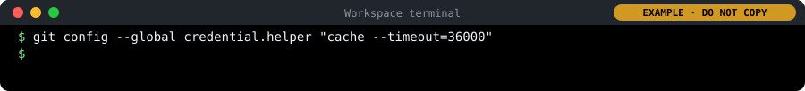
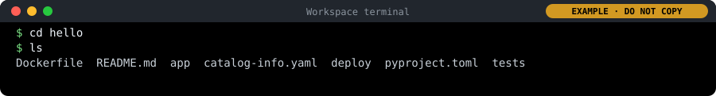
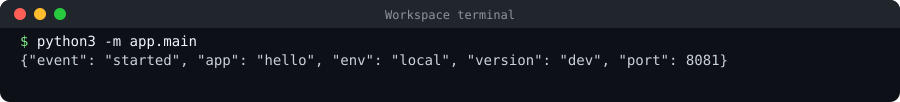
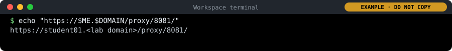

# Day 1: Platform engineering and Linux basics: the steps

Only the steps and the commands, to follow along with your instructor. Every step is explained in full in [README.md](README.md).

Each command comes twice. **Copy and paste:** is the grey box to copy (the copy button is at its top right). Under it, a picture of the terminal marked EXAMPLE shows what it looks like: do not copy from the picture. Where the lab was tested, the picture shows what the command printed (your ids, times, names and team are your own); a picture titled "type this" shows only the command.

## Icebreaker: two truths and a lie

Get to know the people in the room: share two true facts and one false one about your work, and the one tool you wish existed.

### 1. Write two truths and one lie

1. On your note, write three short statements about your work.

2. Make two true and one false. For example: "I have worked at SARB for 12 years", "I have never used Excel", "My first job was in a bank in London".

### 2. Take turns and guess

1. In turn, around the room: say your name and your role in FMD, then read your three statements.

2. The room calls out a guess. Then reveal which one was false.

### 3. One tool you wish existed

1. On a sticky note, write one tool you wish existed at work, for example "a button that gives me a test environment" or "a report that builds itself".

### 4. Read your wish to the room

1. In turn, read your wish out.

2. Stick it on the board, next to any wish like it.

### 5. Which wishes do many people share?

1. The instructor reads out the biggest groups.

2. Note your own wish: you need it in Lab 1 and on Day 2.

## Lab 1: map how a change reaches production today

Map your own road from a request to a live change, mark where it waits, compare it with the other delegates' roads, and see that the shared steps are what a platform builds once.

### 1. List your road, and mark the waits

1. Write one step per yellow sticky note and put them left to right: who asks, who writes it, who tests it, who approves it, who puts it live, who tells the users.

2. Wherever the change waits, add a pink note: how long, and why. For example "Sign-off: 3 days, the approver was away".

3. Add up two numbers and write them in the corner: total days from request to live, and the days someone was actually working on it.

### 2. Walk round and tick what you recognise

1. Leave your sheet on your table, take a pen, and visit at least four other sheets.

2. On each sheet, tick ✓ every step you do too, and star ★ anything you never do but maybe should.

### 3. Same or different?

1. Sort your notes into two groups: ticked by others (the same), and no ticks (only yours).

2. For each "only yours" note, ask: is it really a different job, or the same job done another way?

3. Look at the stars on your sheet: a step someone else has and you do not. Is it a check you are missing?

### 4. One road: the platform

1. Bring your ticked notes to the wall. The same step from different people goes into the same column.

2. Above each column, write how many people had that step.

3. The instructor places a card over each column: what the platform does instead (the table on the slide).

4. Together, count what disappears: set-up done again in every unit, waiting, and checks that only some people remembered.

## Lab 2: Linux warm-up in your workspace

Get comfortable in the Linux terminal of your workspace: files, permissions, processes, services, logs, the web and sudo.

### 1. Make a folder and a file

1. Make a folder called day1 in your home folder. It prints nothing: on Linux, no message means it worked.

   **Copy and paste:**

   ```bash
   mkdir -p ~/day1
   ```

   *In the terminal it looks like this:*

   

2. Go into that folder. It prints nothing either, but look at the end of the prompt: it changes from ~$ to ~/day1$. The prompt always shows where you are.

   **Copy and paste:**

   ```bash
   cd ~/day1
   ```

   *In the terminal it looks like this:*

   

3. Create a file called notes.txt with the word hello in it. Again, nothing is printed.

   **Copy and paste:**

   ```bash
   echo "hello" > notes.txt
   ```

   *In the terminal it looks like this:*

   

4. Now list what is in the folder, with details, to see your file.

   **Copy and paste:**

   ```bash
   ls -la
   ```

   *In the terminal it looks like this:*

   

**Copy and paste:**

```bash
echo "I am $ME, in $TEAM, on $DOMAIN"
```

*In the terminal it looks like this:*


### 2. Read and change permissions

1. Change who may use the file: only you may read and change it, nobody else may even read it. It prints nothing.

   **Copy and paste:**

   ```bash
   chmod 600 notes.txt
   ```

   *In the terminal it looks like this:*

   

2. Look at the file's details again.

   **Copy and paste:**

   ```bash
   ls -la notes.txt
   ```

   *In the terminal it looks like this:*

   

### 3. See what is running

1. Run this: it lists the first few running programs once.

   **Copy and paste:**

   ```bash
   ps aux | head
   ```

   *In the terminal it looks like this (the output depends on your lab):*

   

2. Then run top: it shows the running programs live, busiest first, and keeps updating.

   **Copy and paste:**

   ```bash
   top
   ```

   *In the terminal it looks like this (the output depends on your lab):*

   

3. Look at it for a few seconds, then press q to leave top and get your prompt back.

*In the terminal it looks like this:*


### 4. Check a service and read its log

1. Ask the system how the Docker program is doing.

   **Copy and paste:**

   ```bash
   systemctl status docker --no-pager
   ```

   *In the terminal it looks like this:*

   

2. Read the last ten lines Docker wrote in its log today. sudo means "as the administrator": reading the system's logs needs it. In your workspace it does not ask for a password.

   **Copy and paste:**

   ```bash
   sudo journalctl -u docker --since today | tail
   ```

   *In the terminal it looks like this:*

   

### 5. Call a web service from the terminal

**Copy and paste:**

```bash
curl -I https://gitea.$DOMAIN
```

*In the terminal it looks like this:*


### 6. Run an admin command with sudo

1. Ask "who am I?".

   **Copy and paste:**

   ```bash
   whoami
   ```

   *In the terminal it looks like this:*

   

2. Ask the same question with sudo in front.

   **Copy and paste:**

   ```bash
   sudo whoami
   ```

   *In the terminal it looks like this:*

   

## Lab 3: run hello by hand, and count the steps

Get your service, hello, and run it by hand on your workspace in two settings. Count every manual step: on the next days the platform takes them over.

### 1. Tell Git who you are, then copy your repository

1. Paste this one line on its own and press Enter. It asks "Your full name:": type your name (for example Thandi Nkosi) and press Enter. Git puts this name on every change you save. It then prints the name back so you can check it.

   **Copy and paste:**

   ```bash
   read -p "Your full name: " NAME && git config --global user.name "$NAME" && git config --global user.name
   ```

   *In the terminal it looks like this:*

   

2. Tell Git your e-mail address in the lab. Prints nothing.

   **Copy and paste:**

   ```bash
   git config --global user.email "$ME@$DOMAIN"
   ```

   *In the terminal it looks like this:*

   

3. Let Git remember your password for today, so you type it only once. Prints nothing.

   **Copy and paste:**

   ```bash
   git config --global credential.helper "cache --timeout=36000"
   ```

   *In the terminal it looks like this:*

   

4. Go to your home folder and copy (clone) your code from Gitea. Git asks for a Username: type student01 and press Enter. Then a Password: type your password (from your logins file, cat /etc/pelab/logins.md) and press Enter. Nothing appears while you type a password: that is normal, keep typing.

   **Copy and paste:**

   ```bash
   cd ~
   git clone https://gitea.$DOMAIN/$TEAM/hello
   ```

   *In the terminal it looks like this:*

   

5. Go into the copy and list what is inside.

   **Copy and paste:**

   ```bash
   cd hello
   ls
   ```

   *In the terminal it looks like this:*

   

### 2. Start the service

This starts the program in this terminal. It keeps running, so this terminal stays busy (no prompt) until you stop it. That is normal.

**Copy and paste:**

```bash
python3 -m app.main
```

*In the terminal it looks like this:*



### 3. Call it from a second terminal

1. Open a second terminal: click the + at the top right of the terminal panel. A new terminal opens with its own prompt. The list on the right of the panel shows both terminals; click one to switch to it.

2. In the new terminal, visit the website's front page.

   **Copy and paste:**

   ```bash
   curl -s localhost:8081/
   ```

   *In the terminal it looks like this:*

   

3. Back in the second terminal, ask the website whether it is healthy.

   **Copy and paste:**

   ```bash
   curl -i localhost:8081/healthz
   ```

   *In the terminal it looks like this:*

   

4. Now open the same website in your browser. Your browser runs on your laptop, where localhost means your laptop, not this workspace, so the browser uses your workspace's own address instead, and code-server (your editor) passes anything under /proxy/8081/ on to port 8081 in the workspace. Print your address, then hold Ctrl (Cmd on a Mac) and click it.

   **Copy and paste:**

   ```bash
   echo "https://$ME.$DOMAIN/proxy/8081/"
   ```

   *In the terminal it looks like this:*

   

   

   *hello in the browser, started by hand: the environment's name in big letters (grey for local), the greeting, and version dev.*

### 4. Stop it and start it again as "staging"

1. Click in the first terminal (the one running the service) and press Ctrl+C. The service stops and the prompt comes back.

2. In the same first terminal, paste the box below and press Enter. The service starts again, now as staging, on port 8082.

3. Switch to the second terminal and run:

   **Copy and paste:**

   ```bash
   curl -s localhost:8082/
   ```

   *In the terminal it looks like this:*

   

4. See it in your browser too: print the address for port 8082 and Ctrl+click it (Cmd+click on a Mac). The page now says STAGING.

   **Copy and paste:**

   ```bash
   echo "https://$ME.$DOMAIN/proxy/8082/"
   ```

   *In the terminal it looks like this:*

   

   

   *The same program with three other settings: STAGING in yellow and "Hello from staging".*

**Copy and paste:**

```bash
APP_ENV=staging GREETING="Hello from staging" PORT=8082 python3 -m app.main
```

*In the terminal it looks like this (the output depends on your lab):*


### 5. Look at its logs and its numbers

**Copy and paste:**

```bash
curl -s localhost:8082/metrics
```

*In the terminal it looks like this:*


### 6. Write down every manual step

1. Paste the box: it writes the steps you took today into a file, ~/day1/manual-steps.md, and shows it.

2. Open the file in the editor (Explorer → day1 → manual-steps.md). Add any step you took that is missing, one per line.

3. On the last line, after "this would take:", write your answer in a few words. Save with Ctrl+S (Mac Cmd+S).

4. Keep the file with your Day 1 map: both go into the Day 6 evidence pack.

**Copy and paste:**

```bash
mkdir -p ~/day1
cat > ~/day1/manual-steps.md <<'EOF'
# Day 1: hello by hand, every manual step
1. Told Git my name and e-mail address
2. Copied (cloned) the repository from Gitea, with my password
3. Went into the folder
4. Started the service by hand, in a terminal that stays busy
5. Opened a second terminal and called the service
6. Called its health check
7. Stopped it with Ctrl+C
8. Typed three settings by hand (APP_ENV, GREETING, PORT) and started it again
9. Called it again, on the new port
10. Read its log and its metrics

For 25 people, three environments and a change every day, this would take:
EOF
cat ~/day1/manual-steps.md
```

*In the terminal it looks like this:*


