# Day 1: Platform engineering and Linux basics: the steps

Only the steps and the commands, to follow along with your instructor. Every step is explained in full in [README.md](README.md).

Every command has a picture of the terminal. Where the lab was tested, it shows what the command printed (your ids, times, names and team are your own); "type this" pictures show only what to type.

## Icebreaker: two truths and a lie

Get to know your own team: share two true facts and one false one about your work, and the one tool you wish existed.

### 1. Write two truths and one lie

1. On your note, write three short statements about your work.

2. Make two true and one false. For example: "I have worked at SARB for 12 years", "I have never used Excel", "My first job was in a bank in London".

### 2. Take turns and guess

1. Take turns: say your name and your role in FMD, then read your three statements.

2. The team agrees on a guess. Then reveal which one was false.

### 3. One tool you wish existed

1. Each person names one tool they wish existed at work, for example "a button that gives me a test environment" or "a report that builds itself".

2. One person writes all the wishes on a sheet.

### 4. Choose a team name

1. Agree a team name, inspired by your wishes if you like.

2. Write it on your table card.

### 5. Share with the room

1. One person reads your team name and your favourite wish.

2. The instructor writes the wishes on the board.

## Lab 1: map how a change reaches production today

As a team, map your road from a request to a live change, mark where it waits, compare it with the other teams' roads, and see that the shared steps are what a platform builds once.

### 1. List your road, and mark the waits

1. Write one step per yellow sticky note and put them left to right: who asks, who writes it, who tests it, who approves it, who puts it live, who tells the users.

2. Wherever the change waits, add a pink note: how long, and why. For example "Sign-off: 3 days, the approver was away".

3. Add up two numbers and write them in the corner: total days from request to live, and the days someone was actually working on it.

### 2. Walk round and tick what you recognise

1. Your team chooses one walker. Everyone else stays at your board to explain it to visitors.

2. The walker takes a pen and visits every other team's board in turn.

3. On each board, tick ✓ every step your team does too, and star ★ anything your team never does but maybe should.

### 3. Same or different?

1. The walker tells the team what they saw on the other boards.

2. Sort your notes into two groups: ticked by other teams (the same), and no ticks (only ours).

3. For each "only ours" note, ask: is it really a different job, or the same job done another way?

4. Look at the stars on your board: a step another team has and you do not. Is it a check you are missing?

### 4. One road: the platform

1. Each team brings its ticked notes to the wall. The same step from different teams goes into the same column.

2. Above each column, write how many teams had that step.

3. The instructor places a card over each column: what the platform does instead (the table on the slide).

4. Together, count what disappears: set-up done once per team, waiting, and checks that only some teams remembered.

## Lab 2: Linux warm-up in your workspace

Get comfortable in the Linux terminal of your workspace: files, permissions, processes, services, logs, the web and sudo.

### 1. Make a folder and a file

1. Make a folder called day1 in your home folder. It prints nothing: on Linux, no message means it worked.

   ```bash
   mkdir -p ~/day1
   ```

   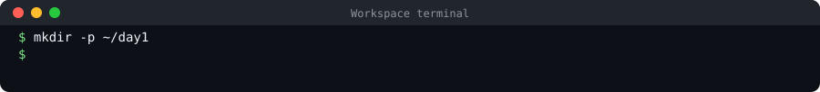

2. Go into that folder. It prints nothing either, but look at the end of the prompt: it changes from ~$ to ~/day1$. The prompt always shows where you are.

   ```bash
   cd ~/day1
   ```

   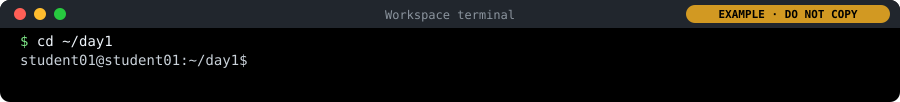

3. Create a file called notes.txt with the word hello in it. Again, nothing is printed.

   ```bash
   echo "hello" > notes.txt
   ```

   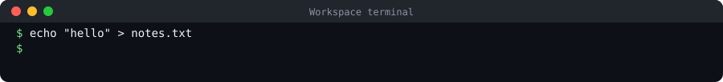

4. Now list what is in the folder, with details, to see your file.

   ```bash
   ls -la
   ```

   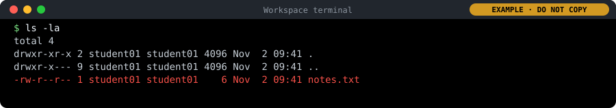

```bash
echo "I am $ME, in $TEAM, on $DOMAIN"
```

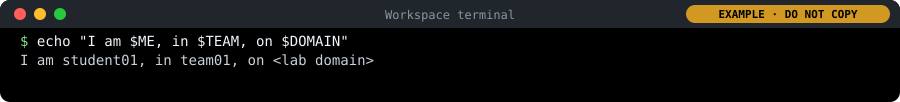

### 2. Read and change permissions

1. Change who may use the file: only you may read and change it, nobody else may even read it. It prints nothing.

   ```bash
   chmod 600 notes.txt
   ```

   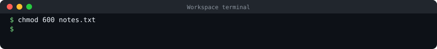

2. Look at the file's details again.

   ```bash
   ls -la notes.txt
   ```

   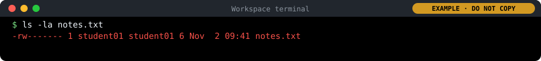

### 3. See what is running

1. Run this: it lists the first few running programs once.

   ```bash
   ps aux | head
   ```

   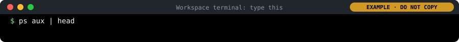

2. Then run top: it shows the running programs live, busiest first, and keeps updating.

   ```bash
   top
   ```

   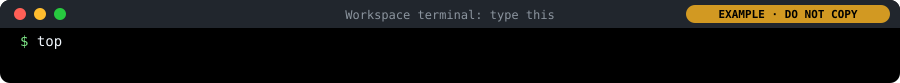

3. Look at it for a few seconds, then press q to leave top and get your prompt back.

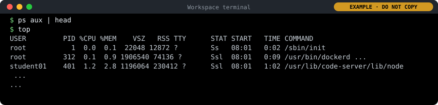

### 4. Check a service and read its log

1. Ask the system how the Docker program is doing.

   ```bash
   systemctl status docker --no-pager
   ```

   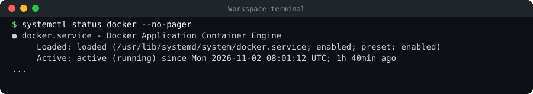

2. Read the last ten lines Docker wrote in its log today. sudo means "as the administrator": reading the system's logs needs it. In your workspace it does not ask for a password.

   ```bash
   sudo journalctl -u docker --since today | tail
   ```

   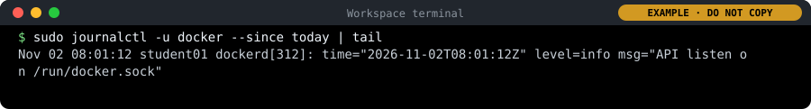

### 5. Call a web service from the terminal

```bash
curl -I https://gitea.$DOMAIN
```

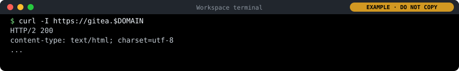

### 6. Run an admin command with sudo

1. Ask "who am I?".

   ```bash
   whoami
   ```

   

2. Ask the same question with sudo in front.

   ```bash
   sudo whoami
   ```

   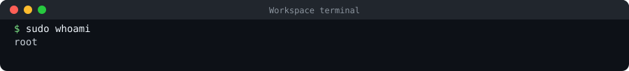

## Lab 3: run hello by hand, and count the steps

Get your team's service, hello, and run it by hand on your workspace in two settings. Count every manual step: on the next days the platform takes them over.

### 1. Tell Git who you are, then copy your team's repository

1. Paste this one line on its own and press Enter. It asks "Your full name:": type your name (for example Thandi Nkosi) and press Enter. Git puts this name on every change you save. It then prints the name back so you can check it.

   ```bash
   read -p "Your full name: " NAME && git config --global user.name "$NAME" && git config --global user.name
   ```

   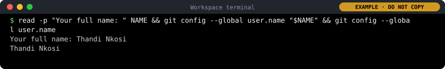

2. Tell Git your e-mail address in the lab. Prints nothing.

   ```bash
   git config --global user.email "$ME@$DOMAIN"
   ```

   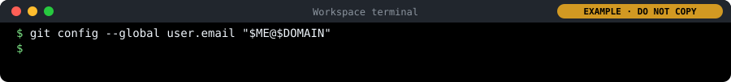

3. Let Git remember your password for today, so you type it only once. Prints nothing.

   ```bash
   git config --global credential.helper "cache --timeout=36000"
   ```

   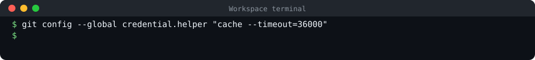

4. Go to your home folder and copy (clone) your team's code from Gitea. Git asks for a Username: type student01 and press Enter. Then a Password: type your password (from your logins file, cat /etc/pelab/logins.md) and press Enter. Nothing appears while you type a password: that is normal, keep typing.

   ```bash
   cd ~
   git clone https://gitea.$DOMAIN/$TEAM/hello
   ```

   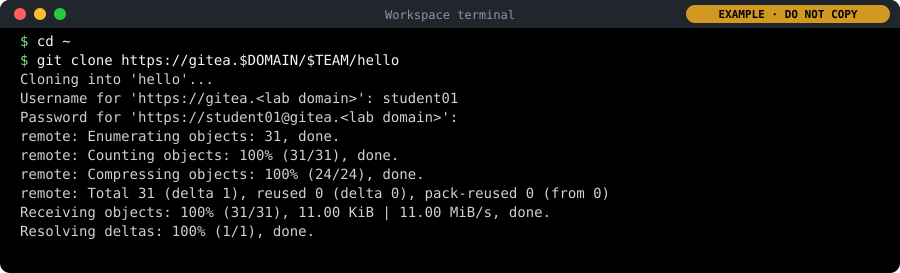

5. Go into the copy and list what is inside.

   ```bash
   cd hello
   ls
   ```

   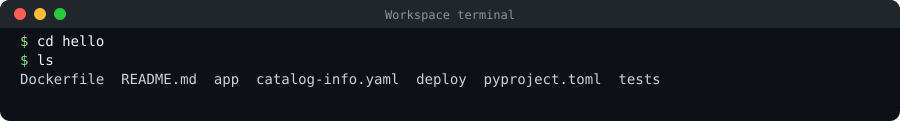

### 2. Start the service

This starts the program in this terminal. It keeps running, so this terminal stays busy (no prompt) until you stop it. That is normal.

```bash
python3 -m app.main
```


### 3. Call it from a second terminal

1. Open a second terminal: click the + at the top right of the terminal panel. A new terminal opens with its own prompt. The list on the right of the panel shows both terminals; click one to switch to it.

2. In the new terminal, visit the website's front page.

   ```bash
   curl -s localhost:8081/
   ```

   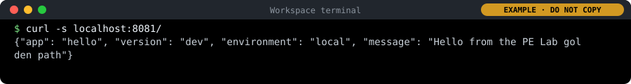

3. Back in the second terminal, ask the website whether it is healthy.

   ```bash
   curl -i localhost:8081/healthz
   ```

   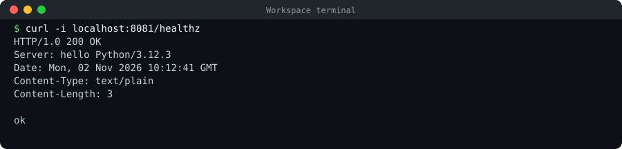

4. Now open the same website in your browser. Your browser runs on your laptop, where localhost means your laptop, not this workspace, so the browser uses your workspace's own address instead, and code-server (your editor) passes anything under /proxy/8081/ on to port 8081 in the workspace. Print your address, then hold Ctrl (Cmd on a Mac) and click it.

   ```bash
   echo "https://$ME.$DOMAIN/proxy/8081/"
   ```

   

   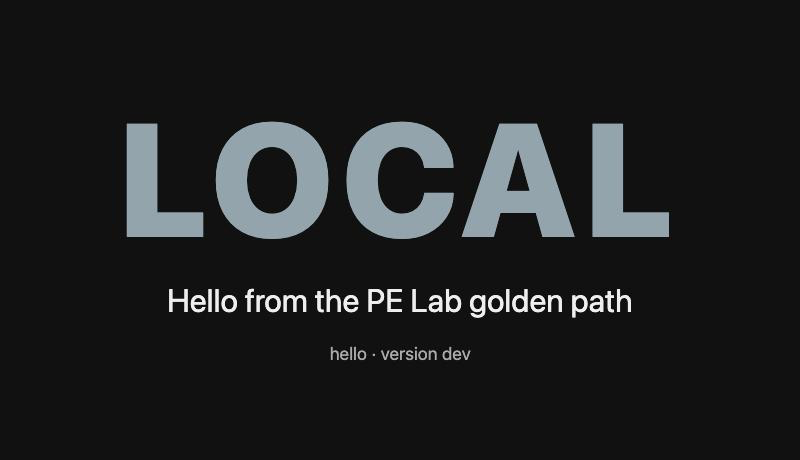

   *hello in the browser, started by hand: the environment's name in big letters (grey for local), the greeting, and version dev.*

### 4. Stop it and start it again as "staging"

1. Click in the first terminal (the one running the service) and press Ctrl+C. The service stops and the prompt comes back.

2. In the same first terminal, paste the box below and press Enter. The service starts again, now as staging, on port 8082.

3. Switch to the second terminal and run:

   ```bash
   curl -s localhost:8082/
   ```

   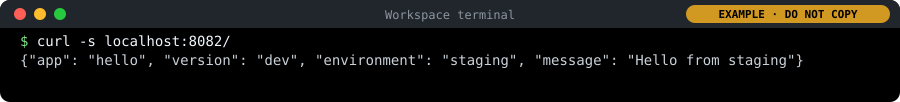

4. See it in your browser too: print the address for port 8082 and Ctrl+click it (Cmd+click on a Mac). The page now says STAGING.

   ```bash
   echo "https://$ME.$DOMAIN/proxy/8082/"
   ```

   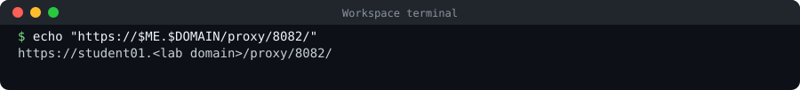

   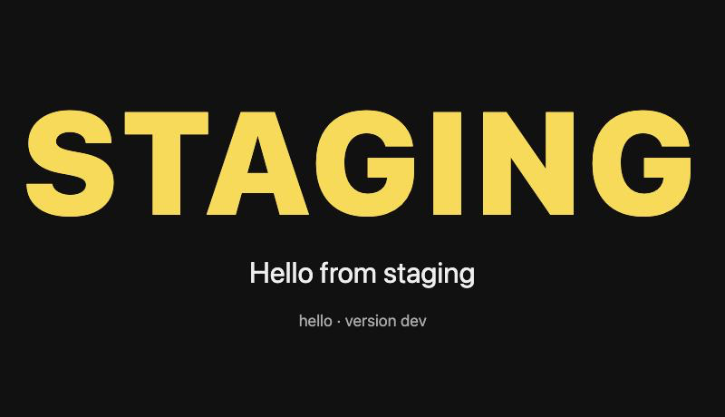

   *The same program with three other settings: STAGING in yellow and "Hello from staging".*

```bash
APP_ENV=staging GREETING="Hello from staging" PORT=8082 python3 -m app.main
```

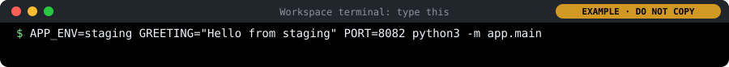

### 5. Look at its logs and its numbers

```bash
curl -s localhost:8082/metrics
```

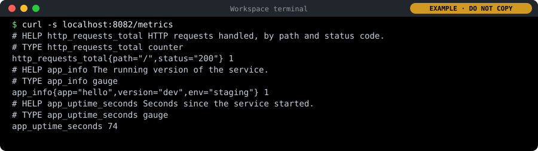

### 6. Write down every manual step

1. Paste the box: it writes the steps you took today into a file, ~/day1/manual-steps.md, and shows it.

2. Open the file in the editor (Explorer → day1 → manual-steps.md). Add any step you took that is missing, one per line.

3. On the last line, after "this would take:", write your answer in a few words. Save with Ctrl+S (Mac Cmd+S).

4. Keep the file with your Day 1 map: both go into the Day 6 evidence pack.

```bash
mkdir -p ~/day1
cat > ~/day1/manual-steps.md <<'EOF'
# Day 1: hello by hand, every manual step
1. Told Git my name and e-mail address
2. Copied (cloned) the repository from Gitea, with my password
3. Went into the folder
4. Started the service by hand, in a terminal that stays busy
5. Opened a second terminal and called the service
6. Called its health check
7. Stopped it with Ctrl+C
8. Typed three settings by hand (APP_ENV, GREETING, PORT) and started it again
9. Called it again, on the new port
10. Read its log and its metrics

For 25 people, three environments and a change every day, this would take:
EOF
cat ~/day1/manual-steps.md
```

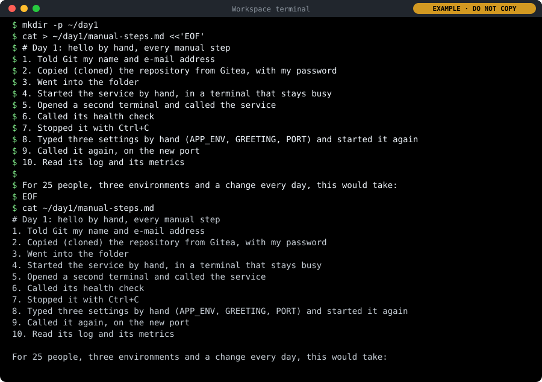
