# Day 2: Git and working together

**Goal:** Every change goes through Git, a pull request and a review, and the approved change goes live in dev by itself.

By the end of the day you can:

- Explain what Git is, where a change lives, and read git status, a diff and the history
- Branch, commit, push and undo safely with Git
- Open a pull request, review it as a second person, approve and merge it
- Explain why main is protected, and what the history proves to an auditor

### Today's plan

Yesterday you ran hello by hand and counted the steps. Today every change goes through Git and a reviewed pull request, and goes live in dev by itself.

| Topic | Labs |
| --- | --- |
| Git basics | [Lab 1: Git basics in a practice repository](#lab-1-git-basics-in-a-practice-repository) |
| Working together | [Lab 2: your first change, on a branch](#lab-2-your-first-change-on-a-branch)<br>[Lab 3: review, approve, merge, and watch it go live](#lab-3-review-approve-merge-and-watch-it-go-live) (on your own)<br>[Lab 4: try to break the rules](#lab-4-try-to-break-the-rules) |
| Merging and conflicts | [Lab 5: resolve a merge conflict](#lab-5-resolve-a-merge-conflict) (on your own) |
| Platform as a product | [Lab 6: write your one-page platform charter](#lab-6-write-your-one-page-platform-charter) (on your own) |

## Git basics

*What Git is, where a change lives, and the commands you will type all day. Then Lab 1: every command, tried in a practice folder where nothing can go wrong.*

### What Git is, and why the platform runs on it

Git is a version-control system: it keeps every version of every file in a folder, with who changed it, when and why. Think of tracked changes in a Word document, but for a whole folder, for ever, with a name on every change.

Git is distributed: when you clone, you get the whole history, not only the latest files. You work on your own copy, and share your work when it is ready by pushing it to a server the team uses. Here that server is Gitea (GitHub and GitLab are others).

On this platform Git holds more than code. The service, its environments (Day 3), its pipeline (Day 5) and its releases (Day 6) are all files in Git, so every change to any of them is recorded and reviewed the same way.

> **In one sentence:** Git keeps the full history of a folder; Gitea keeps the shared copy that the team, and the platform, work from.

**In the lab**

- On Day 1 you cloned team01/hello into ~/hello: your own copy, history included.
- https://gitea.<lab domain>/team01/hello is the shared copy, and the one the platform deploys from.
- git log in ~/hello and the Commits page in Gitea show the same history.
- Lab 1 tries every command in a practice folder first, where nothing can break.

### A repository: a folder with a memory

A repository (repo) is an ordinary folder plus a hidden folder called .git. Your files are the current version; .git holds every earlier version, every branch and every commit message. You never edit .git by hand: Git commands do that.

Git only follows files you tell it about. A new file is untracked until you git add it; from then on Git notices every change to it. A file called .gitignore lists what Git must never record, such as the __pycache__ folders Python leaves behind.

git init turns an empty folder into a repository; git clone copies an existing one from a server, with its whole history. Lab 1 does the first, Day 1 did the second.

> **In one sentence:** A repository is a folder plus its .git history; Git only records the files you add.

**In the lab**

```
$ cd ~/hello && ls -a
.  ..  .dockerignore  .git
.gitea  .gitignore  Dockerfile
README.md  app  catalog-info.yaml
deploy  pyproject.toml  tests
```

- .git is the history. Everything else is the service.
- app/main.py is the code you change today.
- .gitea/workflows/ci.yaml is the pipeline and .gitea/CODEOWNERS names who reviews: they are files too, versioned like the code.

### Where a change lives: four places

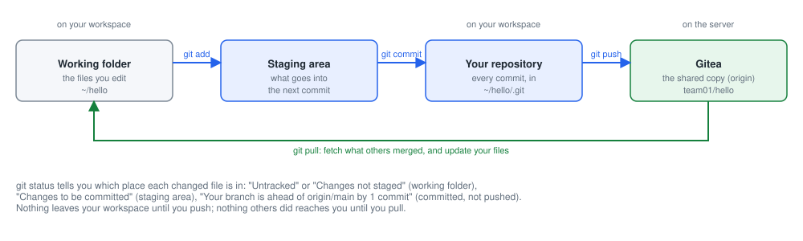

*Each command moves a change one place to the right. git pull brings what others merged back to you.*

- Working folder: the files as they are now. You edit app/main.py here.
- Staging area: the changes you chose for the next commit, with git add. You can commit one file and keep another for later.
- Your repository: git commit saves the staged changes as a commit, in .git. Still only on your workspace.
- Gitea: git push sends your commits there. The platform, the reviewer and the pipeline only see what is in Gitea.

### git status: where is my change?

```
$ git status
On branch greeting-student01
Changes not staged for commit:
  (use "git add <file>..." to update what will be committed)
  (use "git restore <file>..." to discard changes in working directory)
	modified:   app/main.py

$ git add -A
$ git status
On branch greeting-student01
Changes to be committed:
  (use "git restore --staged <file>..." to unstage)
	modified:   app/main.py

$ git commit -m "Change the greeting for team01"
$ git push -u origin greeting-student01
$ git status
On branch greeting-student01
Your branch is up to date with 'origin/greeting-student01'.

nothing to commit, working tree clean
```

- On branch: which branch you are on. Check it before every commit.
- Changes not staged: edited, not yet added. In red on screen.
- Changes to be committed: added, waiting for git commit. In green.
- up to date with origin: Gitea has everything you committed.
- ahead of origin by 1 commit: committed, not pushed yet.
- working tree clean: nothing left to add or commit.
- The lines in brackets tell you the next command. Read them.

### Reading a difference (diff)

```
$ git diff
diff --git a/app/main.py b/app/main.py
index dbb26d3..b376c02 100644
--- a/app/main.py
+++ b/app/main.py
@@ -19,7 +19,7 @@ from http.server import ...
 APP_NAME = os.environ.get("APP_NAME", "hello")
 APP_VERSION = os.environ.get("APP_VERSION", "dev")
 APP_ENV = os.environ.get("APP_ENV", "local")
-GREETING = os.environ.get("GREETING", "Hello from the PE Lab golden path")
+GREETING = os.environ.get("GREETING", "Hello from team01")
 
 STARTED_AT = time.time()
```

- --- a/ is the file before, +++ b/ the file after.
- @@ -19,7 +19,7 @@: the part shown starts at line 19 and is 7 lines long, before and after.
- A line starting with - was removed; with + it was added. A changed line is one of each.
- Lines with a space in front did not change: they are there so you can see where you are.
- Gitea shows the same thing on a pull request, under Files Changed: red for -, green for +.

### A commit, up close

```
$ git commit -m "Change the greeting for team01"
[greeting-student01 8aad367] Change the greeting for team01
 1 file changed, 1 insertion(+), 1 deletion(-)

$ git log
commit 8aad367e1ce02ea035584de2aa8468e66b016d86
Author: Thandi Nkosi <student01@<lab domain>>
Date:   Tue Nov 3 11:23:43 2026 +0000

    Change the greeting for team01

commit 278f9e4951fe0489da5ecac4800088a4c19e7cb7
Author: Thandi Nkosi <student01@<lab domain>>
Date:   Tue Nov 3 11:23:43 2026 +0000

    Initial commit
```

- A commit is a snapshot of every file, plus who, when and why.
- The id (8aad367e...) is a fingerprint of the content and of the commit before it. Change one letter and the id changes: history cannot be altered quietly.
- The first 7 characters are enough to name it: git show 8aad367.
- Author is the name and e-mail you set on Day 1 with git config.
- Each commit points to the one before it: newest at the top.

### A good commit message says why

**Hard to use later**

- "update", "fix", "changes"
- "edit main.py": the diff already shows which file
- "stuff from Tuesday"
- One commit with five unrelated changes: hard to review, impossible to undo one of them

**Useful for years**

- "Change the greeting for team01"
- "Show the team name on the dev page"
- Starts with a verb and finishes the sentence "This change will..."
- One idea per commit: quick to review, easy to revert
- Short (about 60 characters). More detail goes in the pull request description

### Branches: a label on a commit

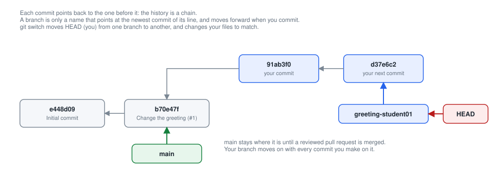

*main points at the last reviewed commit; your branch moves on with each commit you make; HEAD marks the branch you are on.*

- git switch -c greeting-student01 puts a new label on the commit you are on, and moves HEAD to it.
- git commit adds a commit and moves the label HEAD is on. main does not move.
- git switch main moves HEAD back: your files change to main's version. Your branch keeps your work.
- Branches cost nothing: make one for every change, and delete it after the merge.

### Your copy and Gitea's: origin, push and pull

When you clone, Git remembers where from, under the name origin. origin/main is your copy's memory of Gitea's main, as it was the last time you talked to Gitea.

git push sends your branch's new commits to origin. git pull does the opposite: it downloads new commits (git fetch) and adds them to your branch. Neither happens by itself: Git talks to Gitea only when you ask.

git status compares your branch with origin: "up to date", "ahead by 1 commit" (push it), or "behind by 2 commits" (pull first). Gitea refuses a push when it has commits you do not have: pull, then push again.

> **In one sentence:** Nothing moves between your workspace and Gitea until you push or pull.

**In the lab**

```
$ git remote -v
origin  .../team01/hello (fetch)
origin  .../team01/hello (push)
```

- Git asks for your password the first time each day, then remembers it for 10 hours (set on Day 1).
- Start every change with git switch main and git pull: your branch then starts from the newest main.
- Push your branch, never main: main is protected (Lab 4 proves it).

### Undo safely: which command for which mistake

| The situation | The command | What it does |
| --- | --- | --- |
| You changed a file and want it back as it was at the last commit | git restore app/main.py | Throws the change away. It cannot be got back. |
| You added (staged) a file by mistake | git restore --staged app/main.py | Takes it out of the staging area; your change stays in the file. |
| The last commit's message is wrong, and you have not pushed it | git commit --amend -m "Better message" | Replaces the last commit. Only before pushing. |
| A commit is already pushed or merged, and it is wrong | git revert &lt;commit id> | Adds a new commit that undoes it. The history keeps both: the safe undo on a shared branch. |
| Your main has a commit Gitea refused | git reset --hard origin/main | Makes your main exactly like Gitea's, dropping local commits and changes (Lab 4). |
| A merge went wrong half-way | git merge --abort | Puts everything back as it was before the merge (Lab 5). |

### The Git commands you need

| Command | What it does | When |
| --- | --- | --- |
| git clone &lt;url> | Take a full copy of a repository, history included | Once per repository |
| git status | Which branch you are on, and where each change is | Before and after everything |
| git switch main && git pull | Go to main and get the latest merged changes | Start of every change |
| git switch -c &lt;branch> | Create a branch for your change and move onto it | Start of every change |
| git diff | Show your changes, line by line | Before you add |
| git add -A | Stage all changed files for the next commit | Before each commit |
| git commit -m "message" | Save a snapshot with a message that says why | Small, often |
| git push -u origin &lt;branch> | Send your branch to Gitea | When ready for review |
| git log --oneline | Read the history, one line per commit | Any time |
| git show &lt;id> | One commit: who, when, why and its diff | Any time |
| git branch | List your branches; \* marks the one you are on | Any time |

## Lab 1: Git basics

### Lab 1: Git basics in a practice repository

**This lab puts into practice:** [A repository: a folder with a memory](#a-repository-a-folder-with-a-memory) · [Where a change lives: four places](#where-a-change-lives-four-places) · [git status: where is my change?](#git-status-where-is-my-change) · [Reading a difference (diff)](#reading-a-difference-diff) · [A commit, up close](#a-commit-up-close) · [Branches: a label on a commit](#branches-a-label-on-a-commit) · [Undo safely: which command for which mistake](#undo-safely-which-command-for-which-mistake)

#### The idea, in plain words

Before you change the real service, you try every Git command in a folder of your own that nobody else sees. If something goes wrong there, you delete the folder and start again: nothing is lost and nobody is affected.

Think of Git as a camera for a folder. You arrange what goes into the picture (git add), take the picture with a caption (git commit), and later send your album to the shared library, Gitea (git push). Every picture is kept, with who took it, when, and the caption saying why.

At the end you open your real copy of hello and recognise the same things: the history, the branch you are on, and Gitea as the shared copy.

**What you do:** Try every Git command of the day in a practice folder of your own, where nothing can go wrong, and then recognise the same things in your real repository, ~/hello.

**At the end you will have:** A practice repository with four commits, a branch you merged, a change you undid, and the same history seen in ~/hello and in Gitea.

**You will learn:**

- The four places a change lives (working folder, staging area, your repository, Gitea), and the command that moves it between them.
- How to read git status, a diff and the history.
- How to make a branch, merge it, and undo a change safely.

**Words you will meet:**

- **Repository:** A folder whose whole history Git keeps, in a hidden folder called .git.
- **Working folder:** The files as they are now, which you edit.
- **Staging area:** The changes you chose, with git add, to go into the next commit.
- **Commit:** A saved snapshot of the files, with your name, the time and a message that says why.
- **Commit id:** A unique fingerprint of a commit, such as 8dcb232. Yours are different from the ones on this page.
- **Diff:** The difference between two versions, line by line: - for a removed line, + for an added one.
- **Branch:** A name that points at the newest commit of a line of work. It moves forward when you commit.
- **HEAD:** Where you are: the branch (and commit) your files come from.
- **Merge:** Bring the commits of one branch into another.
- **Revert:** A new commit that undoes an earlier one, keeping both in the history.

**Before you start:**

1. Your workspace is open in the browser (https://student01.<lab domain>, signed in with your password).
2. A terminal is open at the bottom of the workspace. If not: menu ☰ (top left) → Terminal → New Terminal. You are ready when you see a prompt that ends in $, for example student01@student01:~$
3. To run a command: copy it from this page (the copy button at the top right of each grey box), click in the terminal, paste with Ctrl+V (on a Mac Cmd+V, or right-click → Paste), and press Enter. You can paste a whole box at once: the lines run one after the other.
4. If Git asks for a Username (the first time each day: it then remembers your password for 10 hours), type student01 and press Enter; for the Password, type your password (from cat /etc/pelab/logins.md) and press Enter. Nothing appears while you type the password: that is normal.
5. This lab works in a new folder, ~/git-practice, which only you have: it is never pushed to Gitea. If you get lost at any point, run cd ~ && rm -rf ~/git-practice and start again at step 2.
6. Run git status whenever you are unsure what happened: it always says which branch you are on and where each change is.

#### Step 1. Check that Git knows who you are

> **In plain words:** Check that Git knows your name and e-mail address, which it writes on every commit.

*Where: Workspace terminal*

**Why:** Git writes your name and e-mail address on every commit. You set them on Day 1; check them before you make your first commit today.

```bash
git --version
git config --global --list
```

**What each line does:**

- `git --version`: show which version of Git is installed.
- `git config --global --list`: list your Git settings for every repository (--global): your name, your e-mail address and the password cache.

**You should see:** The version, then your three settings:

```
git version 2.43.0
user.name=Thandi Nkosi
user.email=student01@<lab domain>
credential.helper=cache --timeout=36000
```

**If you see something else:**

- *No user.name or user.email line*: set them now, with your own name: git config --global user.name "Your Name", then git config --global user.email "$ME@$DOMAIN".

**Check before you go on:** git config --global --list shows user.name and user.email.

#### Step 2. Make a practice repository

> **In plain words:** Make a new, empty repository to practise in.

*Where: Workspace terminal*

**Why:** git init turns an ordinary folder into a repository by adding the .git folder, where Git keeps the history. On Day 1, git clone did this for you and also filled in hello's history.

```bash
mkdir -p ~/git-practice && cd ~/git-practice
git init -b main
ls -a
git status
```

**What each line does:**

- `mkdir -p ~/git-practice && cd ~/git-practice`: make a new folder and go into it.
- `git init -b main`: make it a repository, whose first branch is called main (-b: branch).
- `ls -a`: list everything, hidden files included (-a: all). Names that start with a dot are hidden.
- `git status`: ask Git what is going on.

**You should see:** An empty repository: only the hidden .git folder, and no commits yet:

```
Initialized empty Git repository in /home/student01/git-practice/.git/
.
..
.git
On branch main

No commits yet

nothing to commit (create/copy files and use "git add" to track)
```

**How to read it:**

- . is this folder and .. the one above it: every folder has both.
- .git is the repository's memory. Never edit or delete it by hand: Git commands do that.

**Check before you go on:** git status says "No commits yet", and ls -a shows a .git folder.

#### Step 3. Your first commit: from working folder to repository

> **In plain words:** Create a file, tell Git about it, and save it as your first commit.

*Where: Workspace terminal*

**Why:** A change goes through three places on your workspace: the working folder (you edit), the staging area (git add) and the repository (git commit). git status shows where it is at each moment.

```bash
echo "Hello from $TEAM" > greeting.txt
git status
```

**What each line does:**

- `echo "Hello from $TEAM" > greeting.txt`: create the file greeting.txt with one line in it. $TEAM becomes your team, team01.
- `git status`: Git sees a new file it does not follow yet.

**You should see:** The new file is untracked: Git sees it, but does not record it:

```
On branch main

No commits yet

Untracked files:
  (use "git add <file>..." to include in what will be committed)
	greeting.txt

nothing added to commit but untracked files present (use "git add" to track)
```

Now stage it, check again, and commit it:

```bash
git add greeting.txt
git status
git commit -m "Add the team greeting"
git log
```

**What each line does:**

- `git add greeting.txt`: put the file in the staging area: it goes into the next commit.
- `git status`: the file is now under "Changes to be committed".
- `git commit -m "Add the team greeting"`: save the staged changes as a commit, with a message (-m) that says why.
- `git log`: show the history: every commit, newest first.

**You should see:** Staged, then committed, then your first commit in the history:

```
On branch main

No commits yet

Changes to be committed:
  (use "git rm --cached <file>..." to unstage)
	new file:   greeting.txt

[main (root-commit) 8dcb232] Add the team greeting
 1 file changed, 1 insertion(+)
 create mode 100644 greeting.txt
commit 8dcb2323e356112fde90624d1d774d5230894302 (HEAD -> main)
Author: Thandi Nkosi <student01@<lab domain>>
Date:   Tue Nov 3 11:21:05 2026 +0000

    Add the team greeting
```

**How to read it:**

- root-commit: the first commit of the repository; it has no commit before it.
- 8dcb232 is the start of the commit id. Yours is different: it depends on your name, the time and the content.
- (HEAD -> main): you are on main, and main points at this commit.
- git log opens a viewer when the history is longer than the screen: press q to leave it.

**Check before you go on:** git log shows one commit, "Add the team greeting", with your name.

#### Step 4. Change the file, and read the difference

> **In plain words:** Change the file, see exactly what changed, and save it as a second commit.

*Where: Workspace terminal*

**Why:** Before you commit, look at what you changed. A diff is also what a reviewer reads in a pull request, so reading one here is practice for reviewing in Lab 3.

```bash
sed -i "s/Hello/Good morning/" greeting.txt
echo "Owner: $ME" >> greeting.txt
git diff
```

**What each line does:**

- `sed -i "s/Hello/Good morning/" greeting.txt`: change Hello into Good morning, in the file itself (-i). s/old/new/ means substitute.
- `echo "Owner: $ME" >> greeting.txt`: add a line at the end (>> adds; > would replace the whole file).
- `git diff`: show the changes that are not staged yet, line by line.

**You should see:** One line removed (-) and two added (+):

```
diff --git a/greeting.txt b/greeting.txt
index f42170f..ab65d5d 100644
--- a/greeting.txt
+++ b/greeting.txt
@@ -1 +1,2 @@
-Hello from team01
+Good morning from team01
+Owner: student01
```

**How to read it:**

- --- a/ is the file before your change, +++ b/ the file after.
- @@ -1 +1,2 @@: line 1 before, lines 1 to 2 after.
- A changed line shows as one line removed and one added: Git compares whole lines.

Stage and commit it, and look at the history:

```bash
git add -A
git commit -m "Say good morning and name the owner"
git log --oneline
```

**What each line does:**

- `git add -A`: stage every change (-A: all).
- `git commit -m "..."`: commit it.
- `git log --oneline`: the history, one line per commit: the short id and the message.

**You should see:** Two commits, newest at the top:

```
[main 9267ee9] Say good morning and name the owner
 1 file changed, 2 insertions(+), 1 deletion(-)
9267ee9 (HEAD -> main) Say good morning and name the owner
8dcb232 Add the team greeting
```

**Check before you go on:** git log --oneline shows two commits.

#### Step 5. Look inside a commit

> **In plain words:** Look at everything a commit records.

*Where: Workspace terminal*

**Why:** Every commit keeps who, when, why and exactly what changed. This is the record an auditor reads, and anyone can read it again years later.

```bash
git show HEAD
```

**What each line does:**

- `git show HEAD`: show one commit in full: here HEAD, the newest commit on the branch you are on. git show 8dcb232 would show the first one (with your own id).

**You should see:** The commit's full id, author, date and message, then its diff:

```
commit 9267ee9d97b2ab97c1164331660fd6b6c182680e (HEAD -> main)
Author: Thandi Nkosi <student01@<lab domain>>
Date:   Tue Nov 3 11:21:05 2026 +0000

    Say good morning and name the owner

diff --git a/greeting.txt b/greeting.txt
index f42170f..ab65d5d 100644
--- a/greeting.txt
+++ b/greeting.txt
@@ -1 +1,2 @@
-Hello from team01
+Good morning from team01
+Owner: student01
```

**How to read it:**

- Gitea shows the same page when you click a commit on the Commits page of a repository.

**Check before you go on:** git show printed the author, the date, the message and the change.

#### Step 6. Make a mistake, and undo it

> **In plain words:** Make a change by mistake, and take it back before it is saved.

*Where: Workspace terminal*

**Why:** Before a commit, a change can be undone without leaving a trace. git restore takes a change out of the staging area, or throws it away entirely.

```bash
echo "A mistake" >> greeting.txt
git add greeting.txt
git status --short
git restore --staged greeting.txt
git status --short
git restore greeting.txt
git status --short
cat greeting.txt
```

**What each line does:**

- `echo "A mistake" >> greeting.txt, git add greeting.txt`: make a bad change and stage it.
- `git status --short`: a short status: one line per file. M in the first column: staged. M in the second: changed, not staged.
- `git restore --staged greeting.txt`: take the change out of the staging area. It stays in the file.
- `git restore greeting.txt`: throw the change away: the file goes back to the last commit. This cannot be undone.
- `cat greeting.txt`: show the file.

**You should see:** Staged (M in the first column), then only changed (M in the second), then nothing, and the file as it was committed:

```
M  greeting.txt
 M greeting.txt
Good morning from team01
Owner: student01
```

**How to read it:**

- The third git status --short prints nothing: there is nothing left to commit.
- After a commit has been pushed, you undo it differently: with git revert, in step 8.

**Check before you go on:** The last git status --short prints nothing, and the file has no "A mistake" line.

#### Step 7. Work on a branch

> **In plain words:** Make a branch, save a change on it, and see that main does not have it.

*Where: Workspace terminal*

**Why:** A branch lets you work without touching main. Every change you make this week starts on a branch; main only changes when a reviewed change is merged.

```bash
git switch -c add-farewell
echo "Goodbye from $TEAM" >> greeting.txt
git commit -am "Add a farewell"
git log --oneline --graph --all
```

**What each line does:**

- `git switch -c add-farewell`: create (-c) a branch called add-farewell where you are, and switch to it.
- `git commit -am "Add a farewell"`: stage every changed file (-a) and commit it (-m), in one go. It works for files Git already follows, not for new ones.
- `git log --oneline --graph --all`: the history of every branch (--all), drawn as a line (--graph).

**You should see:** The new commit, on add-farewell; main still points at the commit before:

```
Switched to a new branch 'add-farewell'
[add-farewell 9f22cfd] Add a farewell
 1 file changed, 1 insertion(+)
* 9f22cfd (HEAD -> add-farewell) Add a farewell
* 9267ee9 (main) Say good morning and name the owner
* 8dcb232 Add the team greeting
```

Go back to main and look at the file:

```bash
git switch main
cat greeting.txt
git branch
```

**What each line does:**

- `git switch main`: move to main. Git changes your files to main's version.
- `cat greeting.txt`: show the file: no farewell on main.
- `git branch`: list your branches; \* marks the one you are on.

**You should see:** main's version of the file, and two branches:

```
Switched to branch 'main'
Good morning from team01
Owner: student01
  add-farewell
* main
```

**How to read it:**

- The farewell is not lost: it is on add-farewell. git switch add-farewell would bring it back into the file.

**Check before you go on:** On main, greeting.txt has no "Goodbye" line; git branch lists add-farewell and main.

#### Step 8. Merge the branch, then undo it with a revert

> **In plain words:** Bring the branch into main, then undo that change with a new commit that keeps the record.

*Where: Workspace terminal*

**Why:** Merging brings a branch's work into main; in the team, Gitea does this for you after the review (Lab 3). A revert undoes a commit by adding a new one, so the history keeps both: that is how a change already shared is undone on this platform.

```bash
git merge add-farewell
git log --oneline --graph
git branch -d add-farewell
```

**What each line does:**

- `git merge add-farewell`: bring the commits of add-farewell into the branch you are on, main.
- `git log --oneline --graph`: main's history now.
- `git branch -d add-farewell`: delete the branch (-d): its work is in main now.

**You should see:** A fast-forward: main had not moved, so Git only moved main forward to the branch's commit:

```
Updating 9267ee9..9f22cfd
Fast-forward
 greeting.txt | 1 +
 1 file changed, 1 insertion(+)
* 9f22cfd (HEAD -> main, add-farewell) Add a farewell
* 9267ee9 Say good morning and name the owner
* 8dcb232 Add the team greeting
Deleted branch add-farewell (was 9f22cfd).
```

Now suppose the farewell was a mistake. Undo it, and keep the record:

```bash
git revert --no-edit HEAD
git log --oneline
cat greeting.txt
```

**What each line does:**

- `git revert --no-edit HEAD`: add a new commit that undoes the newest one (HEAD). --no-edit keeps the message Git suggests.
- `git log --oneline, cat greeting.txt`: the history and the file.

**You should see:** Four commits: the farewell and its revert are both in the history, and the file is back as before:

```
[main 8cb387a] Revert "Add a farewell"
 Date: Tue Nov 3 11:21:05 2026 +0000
 1 file changed, 1 deletion(-)
8cb387a (HEAD -> main) Revert "Add a farewell"
9f22cfd Add a farewell
9267ee9 Say good morning and name the owner
8dcb232 Add the team greeting
Good morning from team01
Owner: student01
```

**How to read it:**

- Nothing was deleted: anyone can see that the farewell was added, then taken out, by whom and when. On Day 6 a rollback in prod is exactly this, through a pull request.

**Check before you go on:** git log --oneline shows four commits, the newest "Revert "Add a farewell"".

#### Step 9. The same things in your real repository

> **In plain words:** Look at your real copy of hello the same way, and find the same history in Gitea.

*Where: Workspace terminal, then Gitea*

**Why:** Your copy of hello is a repository like the practice one, with one difference: it was cloned from Gitea, so it knows a remote, origin, to push to and pull from.

```bash
cd ~/hello
git status
git remote -v
git log --oneline
git branch -a
```

**What each line does:**

- `cd ~/hello`: go into your copy of hello, from Day 1.
- `git status`: where you are, and whether your copy is in step with Gitea.
- `git remote -v`: the remote this copy talks to: origin, the address you cloned from.
- `git log --oneline`: hello's history.
- `git branch -a`: every branch (-a: all), yours and the ones Git remembers from Gitea (remotes/origin/...).

**You should see:** main, in step with Gitea; origin is Gitea; one commit so far:

```
On branch main
Your branch is up to date with 'origin/main'.

nothing to commit, working tree clean
origin	https://gitea.<lab domain>/team01/hello (fetch)
origin	https://gitea.<lab domain>/team01/hello (push)
e448d09 (HEAD -> main, origin/main, origin/HEAD) Initial commit
* main
  remotes/origin/HEAD -> origin/main
  remotes/origin/main
```

**How to read it:**

- Initial commit was made by the platform when it created hello from its template. Your id is different.
- origin/main is your copy's memory of Gitea's main. It only changes when you talk to Gitea (git pull or git fetch).
- In Gitea, open team01/hello and click Commits (above the file list): the same commit, with the same id. Click it: the same page as git show.

**If you see something else:**

- *cd: no such file or directory*: you have no copy yet: do step 1 of Day 1 Lab 3 first.
- *Changes not staged, or untracked files*: something changed in ~/hello since Day 1. git restore . puts the files back as they were committed (you lose those changes, which is what you want here).

**Check before you go on:** git status says "up to date with 'origin/main'", and Gitea's Commits page lists the same commit.

**Done when:** Your practice repository has four commits, you have merged and reverted a change, and you have seen the same history in ~/hello and in Gitea.

**If you are stuck**

- Lost in the practice repository? cd ~ && rm -rf ~/git-practice, then start again at step 2: nothing there is shared.
- git log or git show fills the screen and waits: it is a viewer. Press q to leave it.
- Not sure what happened? git status says which branch you are on and where each change is.

## Working together

### The pull-request loop you will use every day

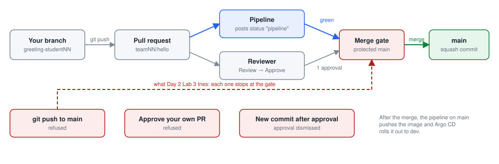

*main only takes a reviewed change with a green pipeline. The three shortcuts of Lab 4 stop at the merge gate.*

1. Branch
2. Change
3. Commit
4. Push
5. Pull request
6. Review and approve
7. Merge
8. Live in dev

Steps 1 to 4 happen in your workspace. Steps 5 to 7 happen in Gitea, with you playing the reviewer in a private window. Step 8 happens by itself: Argo CD sees that main changed and deploys it.

### Why main is protected

Four eyes on every change: the person who writes a change cannot be the one who approves it. In the brief this is segregation of duties.

The history is the audit trail: who changed what, who approved it, when it went live. Evidence by default, not assembled afterwards.

Protection is enforced by the tool, not by a rule in a document. A push to main is refused; a pull request without an approval cannot be merged.

> **In one sentence:** Protected main means every change to production has a second pair of eyes and a permanent record.

**In the lab**

- Pushing straight to main is refused.
- A pull request needs one approval from your team before Merge turns green.
- CODEOWNERS sends every review to your team's developers group.
- The pipeline also runs on every pull request; Day 5 explains what it checks.

## Lab 2: your first change

### Lab 2: your first change, on a branch

#### The idea, in plain words

Git keeps the whole history of a folder of code: every change, who made it, when and why. Think of "track changes" in Word, but for a whole folder, kept for ever, with a way back to any earlier version.

Three ideas from Lab 1 carry the whole lab. A \*\*branch\*\* is your own private copy of the code to work in: whatever you do there disturbs nobody. A \*\*commit\*\* is saving your work in Git with a short note saying what you changed, like signing and dating a page. A \*\*push\*\* is uploading your branch to Gitea, so your team can see it.

Here you change one sentence of the website, the greeting, and take it through all three.

**What you do:** Change the greeting of your team's service on a branch of your own, check it, save it as a commit and send it to Gitea.

**At the end you will have:** Your own branch in Gitea with one saved change: a new greeting, checked on your workspace first.

**You will learn:**

- The everyday Git loop: get the latest version, make a branch, change, check, commit, push.
- Why every change starts on a branch of its own.
- What a commit is, and how to write a useful commit message.

**Words you will meet:**

- **main:** The main line of the code: what gets deployed. Nobody changes it directly.
- **Branch:** Your own copy of the line, where your change cannot disturb anyone until it is reviewed.
- **Commit:** A saved change, with your name, the time and a message that says why. Git keeps every commit for ever.
- **Push:** Send your commits from your workspace to Gitea, so others can see them.
- **Pull:** Fetch the commits others pushed, into your copy.

**Before you start:**

1. Your workspace is open in the browser (https://student01.<lab domain>, signed in with your password).
2. A terminal is open at the bottom of the workspace. If not: menu ☰ (top left) → Terminal → New Terminal. You are ready when you see a prompt that ends in $, for example student01@student01:~$
3. To run a command: copy it from this page (the copy button at the top right of each grey box), click in the terminal, paste with Ctrl+V (on a Mac Cmd+V, or right-click → Paste), and press Enter. You can paste a whole box at once: the lines run one after the other.
4. If Git asks for a Username (the first time each day: it then remembers your password for 10 hours), type student01 and press Enter; for the Password, type your password (from cat /etc/pelab/logins.md) and press Enter. Nothing appears while you type the password: that is normal.
5. The Git in this lab is what you practised in Lab 1: git switch, git status, git diff, git add and git commit, and then git push to send your branch to Gitea for the first time.
6. Your copy of hello from Day 1, in ~/hello. If you do not have it, do step 1 of Day 1 Lab 3 first.
7. The file list on the left of the workspace (the Explorer, the two-pages icon at the top of the left bar) shows your home folder. If it says "You have not yet opened a folder": click Open Folder, type /home/ followed by your user name (for example /home/student01), and click OK.

#### Step 1. Go to main and get the latest version

> **In plain words:** Go into your copy of the code, switch to the main line, and fetch whatever your team added since yesterday.

*Where: Workspace terminal*

**Why:** Always start from the newest main. Changes may have been merged into it since yesterday; starting from an old copy causes conflicts later.

**Do this:**

1. Go into your copy of hello. Prints nothing; the prompt ends in ~/hello$.

   ```bash
   cd ~/hello
   ```

2. Switch to the main line, the one that gets deployed.

   ```bash
   git switch main
   ```

   **You should see:** Git says you are on main:

   ```
   Already on 'main'
   Your branch is up to date with 'origin/main'.
   ```

3. Fetch what others added to main in Gitea.

   ```bash
   git pull
   ```

   **You should see:** "Already up to date.", or a short list of changed files if something was merged since:

   ```
   Already up to date.
   ```

**What each line does:**

- `cd ~/hello`: go into your copy of the service.
- `git switch main`: switch to the main line.
- `git pull`: fetch what others merged into main on Gitea, and add it to your copy.

**If you see something else:**

- *Password prompt*: type your student01 password, from cat /etc/pelab/logins.md (nothing appears while you type).
- *cd: no such file or directory*: you have no copy yet: do step 1 of Day 1 Lab 3, then come back.

**Check before you go on:** Your prompt ends in ~/hello$, and git pull has finished without an error.

#### Step 2. Make your own branch

> **In plain words:** Make your own private copy of the code (a branch) to work in, with your name on it.

*Where: Workspace terminal*

**Why:** A branch is your own copy of the line: you can change anything there without disturbing anyone. Putting your user name in the branch name makes it unique, so it never clashes with anyone else's.

```bash
git switch -c greeting-$ME
```

**What each line does:**

- `git switch -c greeting-$ME`: create (-c) a new branch called greeting- followed by your user name, and switch to it. $ME is filled in for you.

**You should see:** Git confirms the new branch:

```
Switched to a new branch 'greeting-student01'
```

**How to read it:**

- From now on, every commit goes onto your branch, not onto main. git branch lists your branches; the one with \* is the one you are on.

**Try it yourself:** git branch lists your branches, with a \* next to the one you are on now. Paste it:

```bash
git branch
```

**You should see:** Your new branch, with the \*, and main:

```
* greeting-student01
  main
```

**Check before you go on:** Git said "Switched to a new branch 'greeting-student01'" with your own user name.

#### Step 3. Change the greeting

> **In plain words:** Change one sentence in the program: the greeting the website answers with.

*Where: Workspace editor*

**Why:** A small, visible change is the best way to follow a change all the way to dev: you will see your own text answer on the dev address.

**Do this:**

1. In the Explorer on the left, click hello, then app, then main.py. The file opens in the editor.

2. Find line 22, which starts with GREETING. The line numbers are on the left of the editor.

3. Change only the text in the second pair of quotes, for example to Hello from team01. Keep the quotes.

4. Save with Ctrl+S (on a Mac Cmd+S). The dot next to the file name at the top disappears when it is saved.

5. Editor not working for you? Instead of the four instructions above, paste this in the terminal: it makes the same change (a greeting with your team and your name) and shows the new line.

   ```bash
   sed -i "s/^GREETING = .*/GREETING = os.environ.get(\"GREETING\", \"Hello from $TEAM, by $ME\")/" app/main.py
   grep -n "^GREETING" app/main.py
   ```

6. Back in the terminal, run this to see that Git noticed:

   ```bash
   git status
   ```

**What changes in `app/main.py`:** line 22, only the text in the second pair of quotes.

Before:

```
GREETING = os.environ.get("GREETING", "Hello from the PE Lab golden path")
```

After:

```
GREETING = os.environ.get("GREETING", "Hello from team01")
```

**What each line does:**

- `git status`: show which files changed since the last commit.

**You should see:** One modified file, in red:

```
On branch greeting-student01
Changes not staged for commit:
  (use "git add <file>..." to update what will be committed)
  (use "git restore <file>..." to discard changes in working directory)
	modified:   app/main.py
```

**If you see something else:**

- *nothing to commit, working tree clean*: the file was not saved. Click in the editor and press Ctrl+S (Mac Cmd+S), then run git status again.

**Check before you go on:** git status says modified: app/main.py.

#### Step 4. Check it works before you share it

> **In plain words:** Try your change on your own workspace, before anyone else sees it.

*Where: Two workspace terminals*

**Why:** Check your own change before you ask anyone to review it: it saves everyone time, and it is what the pipeline will do again anyway.

**Do this:**

1. In the first terminal, start the service with this command. It keeps running.

   ```bash
   python3 -m app.main
   ```

2. Open a second terminal (the + at the top right of the terminal panel) and run:

   ```bash
   curl -s localhost:8081/
   ```

3. Check that "message" shows your new text.

4. Go back to the first terminal and press Ctrl+C to stop the service.

**What each line does:**

- `python3 -m app.main`: run the service from your changed code, as on Day 1.

**You should see:** In the second terminal, your text in "message":

```
{"app": "hello", "version": "dev", "environment": "local", "message": "Hello from team01"}
```

**If you see something else:**

- *SyntaxError when it starts*: a quote went missing in the GREETING line. Fix the line so it looks like the After box in step 3, save, and start again.
- *Address already in use*: a copy from Day 1 is still running: pkill -f "python3 -m app.main", then start again.

**Check before you go on:** The answer shows your new greeting in "message", and you stopped the website with Ctrl+C.

#### Step 5. Save the change as a commit

> **In plain words:** Save your change in Git, with a short note that says what it does.

*Where: Workspace terminal (the first one, after Ctrl+C)*

**Why:** A commit saves the change in Git, with your name, the time and a message. Anyone can later see who changed what, when and why: that is the record an auditor reads.

**Do this:**

1. Tell Git which changes go into this save: all of them. Prints nothing.

   ```bash
   git add -A
   ```

2. Save it, with a note. The note should finish the sentence "This change will...".

   ```bash
   git commit -m "Change the greeting for $TEAM"
   ```

   **You should see:** Your branch, the save's short id (yours differs) and your note, then what changed:

   ```
   [greeting-student01 6514a43] Change the greeting for team01
    1 file changed, 1 insertion(+), 1 deletion(-)
   ```

**What each line does:**

- `git add -A`: put every changed file (-A: all) into the next commit. Git calls this staging.
- `git commit -m "Change the greeting for $TEAM"`: save the commit, with a message (-m). A good message finishes the sentence "This change will..."

**How to read it:**

- 6514a43 is the start of the commit's id, a unique fingerprint. Yours is different.
- 1 insertion, 1 deletion: Git sees a changed line as one line removed and one added.

**If you see something else:**

- *Author identity unknown*: Git does not know your name yet: run the two git config lines from Day 1 Lab 3, step 1, then commit again.

**Try it yourself:** git log shows the history of saves, newest first. Paste it:

```bash
git log --oneline -3
```

**You should see:** Your save at the top, with your note (your ids differ):

```
6514a43 (HEAD -> greeting-student01) Change the greeting for team01
e448d09 (origin/main, origin/HEAD, main) Initial commit
```

**Check before you go on:** Git printed one line with your branch name and your note, and "1 file changed".

#### Step 6. Send your branch to Gitea

> **In plain words:** Upload your branch to Gitea, so your team can see it and review it.

*Where: Workspace terminal*

**Why:** Until you push, the change exists only in your workspace. Pushing puts your branch in Gitea, where a reviewer can see it and review it.

```bash
git push -u origin greeting-$ME
```

**What each line does:**

- `git push -u origin greeting-$ME`: send your branch to Gitea (origin is Git's name for where you cloned from). -u links your branch to Gitea's, so next time just git push is enough.

**You should see:** Gitea answers with a link to open a pull request:

```
remote:
remote: Create a new pull request for 'greeting-student01':
remote:   https://gitea.<lab domain>/team01/hello/pulls/new/greeting-student01
remote:
To https://gitea.<lab domain>/team01/hello
 * [new branch]      greeting-student01 -> greeting-student01
branch 'greeting-student01' set up to track 'origin/greeting-student01'.
```

**How to read it:**

- Keep this terminal open: in Lab 3 you open that link. Hold Ctrl (on a Mac Cmd) and click the link in the terminal: it opens in a new browser tab.
- Check in Gitea: open team01/hello and click Branches (above the file list). Your branch is in the list.

**If you see something else:**

- *rejected (non-fast-forward)*: someone pushed to a branch with the same name first, which should not happen with $ME in the name. Run git pull --rebase, then git push again.

**Check before you go on:** In Gitea, team01/hello → Branches lists greeting-student01.

**Done when:** Your branch is in Gitea (team01/hello → Branches shows greeting-student01).

**If you are stuck**

- Author identity unknown: run git config --global user.name "Your Name" and git config --global user.email student01@<lab domain>.
- rejected (non-fast-forward): someone pushed first. Run git pull --rebase, then push again.

## Lab 3: review and merge

### Pull requests and reviews: what good looks like

A pull request says: here is a change, please review it. It shows the difference line by line, runs the checks, and collects the approval.

A good change is small and its description says why. A good review reads the difference, asks questions in comments, and either approves or requests changes.

Merging is the decision to put the change on the main line. From then on the platform treats it as the truth and deploys it.

> **In one sentence:** A pull request turns a change into a reviewed, recorded decision.

**In the lab**

- Title: what changed. Description: why, in two lines.
- A second person reviews; you cannot approve your own change. Here you play them, as reviewer.
- Merge needs one approval from your team and a green pipeline. Until the check called pipeline is green, Gitea says "Some checks are pending" (or "failed") and does not merge.
- Squash merge keeps the history tidy: one commit per change.

### Lab 3: review, approve, merge, and watch it go live

*on your own*

#### The idea, in plain words

A pull request is like sending a document for sign-off. You say "here is my change, and here is why". A colleague reads it, may comment, and approves. Then it is filed: merged into main, the line that gets deployed.

Two rules protect main, and Gitea enforces both: someone other than you must approve, and the automatic checks (the pipeline) must pass. After the merge you do nothing: the platform notices main has changed and puts your change live in dev by itself. That is called GitOps.

You play both people: the author, in your normal browser window, and the colleague who reviews, in a private window, signed in as reviewer (its password is in cat /etc/pelab/logins.md).

**What you do:** Turn your change into a reviewed decision: a pull request, a review and approval by a second person, a merge, and the change running in dev by itself.

**At the end you will have:** Your greeting live in dev, put there by the platform, with a record of who approved it.

**You will learn:**

- How to propose a change with a pull request, and how to review one.
- Why main needs an approval and a green pipeline before anything is merged.
- GitOps: how a merge into main deploys to dev without anyone touching a server.

**Words you will meet:**

- **Pull request:** A request to merge your branch into main, with a page where others read the change, comment and approve.
- **Review:** Reading the change and either approving it, or asking for changes.
- **Pipeline:** The automatic checks (lint, tests, scans, build) that run on every change. Its result shows on the pull request.
- **Merge:** Putting the approved change into main. From then on the platform treats it as the truth.
- **Squash:** A way of merging that turns all the commits of a branch into one tidy commit on main.
- **Argo CD:** The tool that watches main and makes the cluster run what main says, in dev by itself.

**Before you start:**

1. Lab 2 done: your branch is pushed.
2. The Git in this lab: after the merge, git switch main and git pull bring Gitea's new main into your copy, and git log shows it (Lab 1, steps 4 and 9).
3. You play two people: the author, in your normal browser window, and the reviewer, in a private window. The reviewer's login is in your logins file (cat /etc/pelab/logins.md).
4. Gitea is open in your browser and you are signed in as yourself: https://gitea.<lab domain> → Sign In, with your student01 and password.

#### Step 1. Open the pull request

> **In plain words:** Ask for your change to be accepted into main, and say why.

*Where: Browser: Gitea*

**Why:** A pull request turns your change into a proposal that others can read, discuss and approve. Nothing reaches main without one.

**Do this:**

1. In the terminal from Lab 2, find the line remote:   https://gitea.<lab domain>/team01/hello/pulls/new/greeting-student01. Hold Ctrl (on a Mac Cmd) and click the link in the terminal: it opens in a new browser tab.

2. Gitea shows your change and a form under it. The title is already your commit message ("Change the greeting for team01"): keep it or make it clearer. It should say what changes.

3. In the box under the title, write two lines on why: for example "Shows our team's name on the dev page, so we can see our own release."

   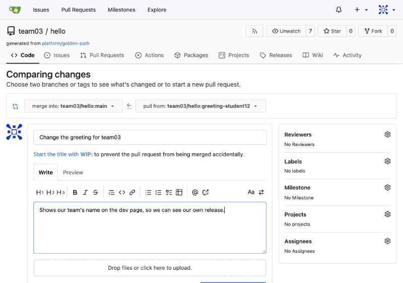

   *The new pull request form: at the top, which branch goes into which (pull from your branch, merge into main); the title, already filled in; and the box where you write why. Your names, team and numbers are your own.*

4. Click Create Pull Request (the blue button under the form).

   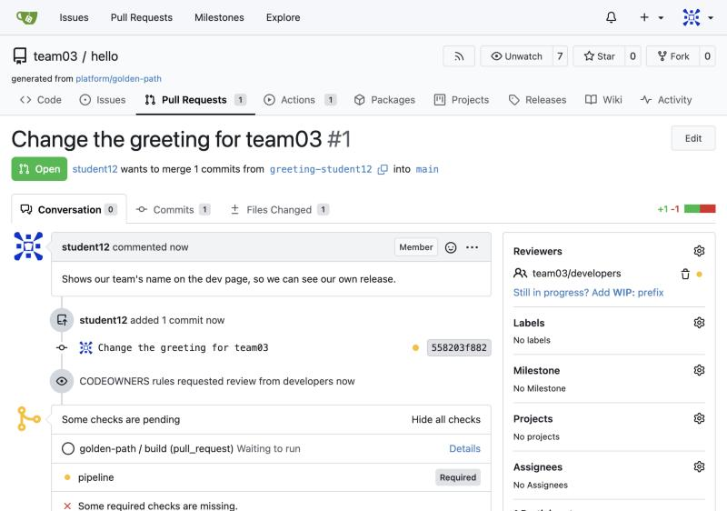

   *Your pull request is created: its number (#1), your description, your commit, and at the bottom the checks starting. The yellow dot means "still running". Your names, team and numbers are your own.*

**You should see:** The pull request page, with your title and description. At the bottom, the checks: a yellow dot while the pipeline checks your change, then a green tick.

**How to read it:**

- Conversation (the tab you are on) holds the description, the comments and the checks. Commits lists your commits. Files Changed shows the change line by line.
- Under the checks Gitea says what still stands between the change and main, for example that it needs an approval.

**If you see something else:**

- *The link does not open*: in Gitea open team01/hello → Pull Requests → New Pull Request; on the right (pull from) choose your branch greeting-student01, then fill in the form as above.
- *"These branches are equal"*: your commit was not pushed. Go back to Lab 2, step 6.

**Check before you go on:** Your pull request page is open, with your title, your two lines of why, and the checks starting at the bottom.

#### Step 2. The reviewer reads the change and comments

> **In plain words:** As the reviewer, in a private window, read your change line by line and leave a comment.

*Where: Browser: Gitea, a private window, as reviewer*

**Why:** A review is a second pair of eyes. Small changes make reviews quick: one line takes a minute to read.

**Do this:**

1. Open a private window (Edge or Chrome: Ctrl+Shift+N, on a Mac Cmd+Shift+N; Firefox: Ctrl+Shift+P, on a Mac Cmd+Shift+P), go to https://gitea.<lab domain>, click Sign In and sign in as reviewer with its password from cat /etc/pelab/logins.md.

2. As the reviewer, open your pull request (team01/hello → Pull Requests → yours) and click the Files Changed tab.

3. The old line is shown in red with -, the new line in green with +.

4. Move the mouse over the green line: a blue + appears at its left. Click it, write a short comment (a question or a suggestion) and click Add single comment.

   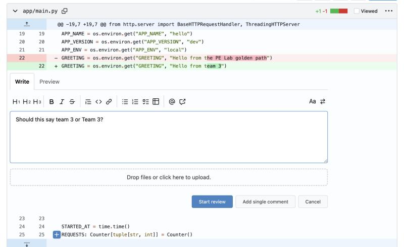

   *Files Changed, seen by the reviewer: the old line 22 in red, the new one in green, and a comment being written under the green line. Add single comment posts it. Your names, team and numbers are your own.*

**You should see:** A comment attached to a line of your change, by reviewer. In your normal window you see it too, in the Conversation tab.

**How to read it:**

- A good comment is about the change, not the person: "Should this say team01 or Team 01?" rather than "This is wrong".
- You, the author, can answer under the comment, and change the code if the comment is right.

**Check before you go on:** A comment is attached to your changed line, and in your normal window you can see it in the Conversation tab.

#### Step 3. The reviewer approves

> **In plain words:** As the reviewer, approve your change; then the automatic checks turn green.

*Where: Browser: Gitea, the private window, as reviewer*

**Why:** main only accepts a change that someone other than its author has approved, and whose pipeline is green. That is segregation of duties, enforced by the tool.

**Do this:**

1. Still in the private window, in Files Changed, click Review (the blue button, top right). A box called Submit review opens.

2. Write a short note ("Looks good"), then click Approve. Then close the private window: you are the author again.

   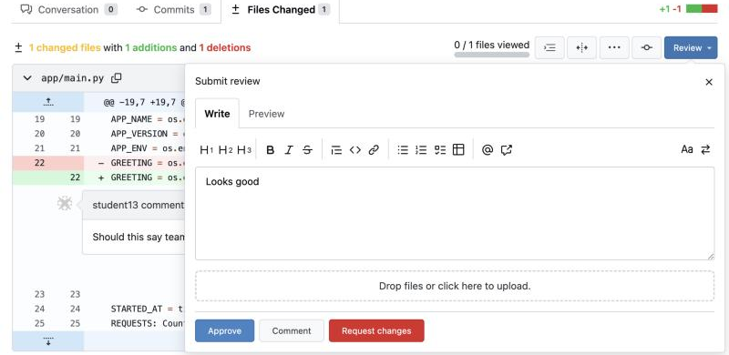

   *The Submit review box: a note ("Looks good"), then Approve. Comment only comments; Request changes asks the author to change something first. Your names, team and numbers are your own.*

3. Now wait for the pipeline: on the Conversation tab, the yellow dot next to the checks turns into a green tick, in a few minutes.

   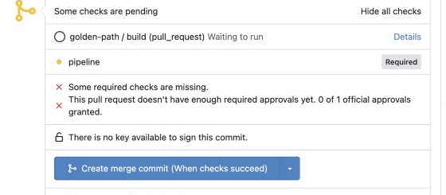

   *Before the approval and the green pipeline, the box above the merge button says exactly what is still missing, and the button only offers to merge "When checks succeed". Your names, team and numbers are your own.*

**You should see:** "All checks were successful", one green approval, and a plain merge button.

**How to read it:**

- Until both are there, the box above the merge button says what is missing: "Some checks are pending" (the pipeline is still running), or "This pull request doesn't have enough required approvals yet. 0 of 1 official approvals granted."
- While something is missing, the merge button reads "... (When checks succeed)": it would only queue the merge, not do it.
- A red pipeline says "Some required checks failed". Then nothing merges until the branch is fixed and pushed again (Day 5 shows how to read the failure).

> **Tip:** The approval counts because reviewer is another account. At work the reviewer is a real colleague; here you play them.

**Check before you go on:** The page shows one approval, "All checks were successful", and a plain merge button.

#### Step 4. Merge it, and update your copy

> **In plain words:** Accept the change into main, then bring your own copy of main up to date.

*Where: Browser: Gitea, then the workspace terminal*

**Why:** Merging is the decision to put the change on the main line. Your own copy of main then needs the new commit too.

**Do this:**

1. On the Conversation tab, click the small arrow to the right of the merge button and choose Create squash commit.

   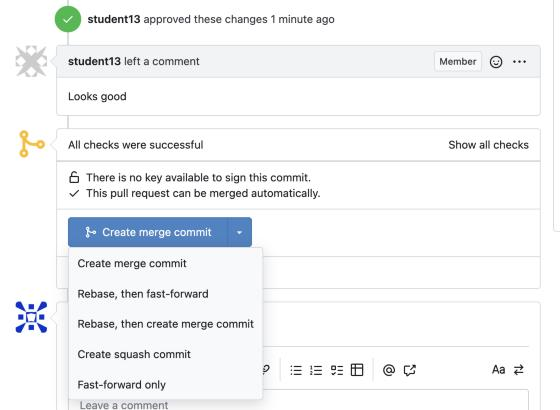

   *Ready to merge: the reviewer's approval, "All checks were successful", and the merge button's menu open. Choose Create squash commit. Your names, team and numbers are your own.*

2. Click the merge button, which now reads Create squash commit. A small form opens: the title of the commit (your pull request's title with its number, for example (#1)) and a message that already says who reviewed it (Reviewed-by: ...).

   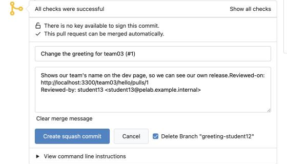

   *The squash commit form: the title with the pull request number (#1), a message that records who reviewed it (Reviewed-by), and Delete Branch ticked. In the lab the address in the message is your lab's Gitea. Your names, team and numbers are your own.*

3. Tick Delete Branch "greeting-student01" (your branch has done its job) and click Create squash commit.

4. In the workspace terminal, go into your copy and switch to main.

   ```bash
   cd ~/hello
   git switch main
   ```

   **You should see:** Git switches back to main:

   ```
   Switched to branch 'main'
   Your branch is up to date with 'origin/main'.
   ```

5. Fetch the merge from Gitea.

   ```bash
   git pull
   ```

   **You should see:** Git fetches main and updates your copy (your ids differ):

   ```
   From https://gitea.<lab domain>/team01/hello
      e448d09..b70e47f  main       -> origin/main
   Updating e448d09..b70e47f
   Fast-forward
    app/main.py | 2 +-
    1 file changed, 1 insertion(+), 1 deletion(-)
   ```

6. Show the last three saves (commits) in the history, one line each.

   ```bash
   git log --oneline -3
   ```

   **You should see:** Your change at the top, as one commit with the pull request number:

   ```
   b70e47f (HEAD -> main, origin/main, origin/HEAD) Change the greeting for team01 (#1)
   e448d09 Initial commit
   ```

**What each line does:**

- `cd ~/hello`: go into your copy of hello (a new terminal starts in your home folder, where git cannot find it).
- `git switch main`: go back to main.
- `git pull`: fetch the merge from Gitea.
- `git log --oneline -3`: show the last three commits, one line each.

**How to read it:**

- The (#1) is the number of your pull request: anyone can open it later to see the review and the approval. The commit message also records who reviewed it (git log -1 shows the Reviewed-by line).

**Check before you go on:** git log shows your change at the top of main, with (#1) or your pull request's number.

#### Step 5. Watch it go live

> **In plain words:** Watch the platform build your change and put it live in dev, without anyone touching a server.

*Where: Browser: Gitea, then Argo CD*

**Why:** This is GitOps: the platform runs what main says. Nobody logs in to a server; the merge is the instruction.

**Do this:**

1. In Gitea, open team01/hello → Actions. The newest run (your merge, on main) builds the image and pushes it to Harbor. Wait for its green tick, a few minutes.

2. Open https://argocd.<lab domain> in a new tab and sign in as delegate, with its password from cat /etc/pelab/logins.md (a read-only login; not your student01 password).

3. In the search box at the top, type team01. Your service has one box per environment: dev, staging and prod. Click the application team01-hello-dev.

   

   *Argo CD's application list, searched for the team: one box per environment of hello (dev, prod, staging), each with its health (Healthy) and sync state (Synced: it runs what Git says). On Day 2 only dev runs; staging and prod come on Day 3 and are released on Day 6. In your lab the repository is https://gitea.<lab domain>/team01/hello.git, and the names, ids and times are your own.*

**You should see:** Within a few minutes of the green pipeline: Synced and Healthy, with your commit id under Last Sync.

**How to read it:**

- Synced: the cluster runs what main says. Healthy: it answers its health check.
- Argo CD checks main every minute, and the pipeline takes a few minutes before that: a short wait is normal.
- The pipeline is not something you wrote: it is the file .gitea/workflows/ci.yaml in team01/hello, copied from the platform team's template, platform/golden-path. Open it in Gitea to see every step. On Day 4 you look inside the template itself.

> **Tip:** If your instructor has switched on the safety net, Argo CD is paused. Look at your merge commit in Gitea instead (Commits → the tick next to it): safety-net/dev says "Deployed to team01-dev" with your commit.

**Check before you go on:** Argo CD shows team01-hello-dev as Synced and Healthy.

#### Step 6. See your change in dev

> **In plain words:** Visit dev and see your own greeting answering there.

**Why:** The proof: your text, answering from dev, put there by the platform.

*Where: Browser*

**Do this:**

1. Open https://hello-team01-dev.<lab domain>/ in a new tab.

**You should see:** DEV in big red letters, your new greeting under it, and the version: the commit id of your merge.

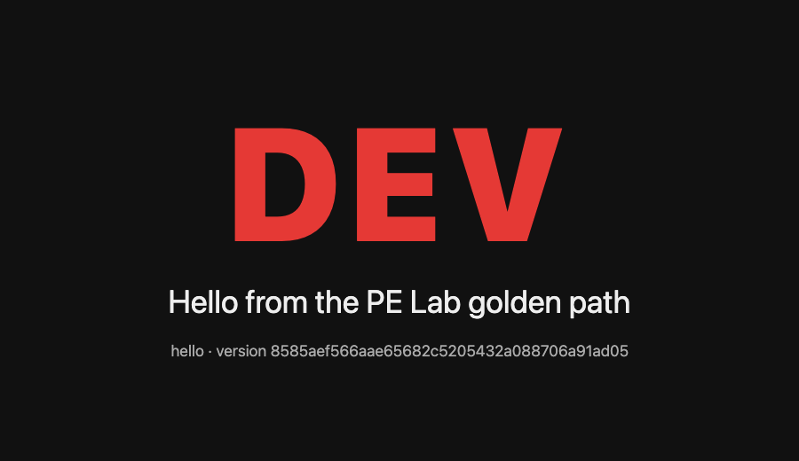

*hello in dev: the environment's name in big letters (red for dev), then the greeting and the version (the commit id the platform built). Your greeting and version are your own.*

<details>
<summary>The same in the terminal (optional)</summary>

*Where: Workspace terminal*

```bash
curl -s https://hello-$TEAM-dev.$DOMAIN/
```

**What each line does:**

- `curl -s https://hello-$TEAM-dev.$DOMAIN/`: call your team's service in dev, at its dev address. A program (like curl) gets the facts as data (JSON); a browser gets the coloured page.

**You should see:** "environment": "dev" and your new greeting:

```
{"app": "hello", "version": "b70e47f...", "environment": "dev", "message": "Hello from team01"}
```

**How to read it:**

- version is now the commit id of your merge: the platform built that exact commit.
- Nobody logged in to a server: the merge did it.

**If you see something else:**

- *The old greeting*: the pipeline or Argo CD has not finished. Check the Actions run (green?) and Argo CD (your commit?), wait a minute, try again.

</details>

**Check before you go on:** The dev page shows DEV in big red letters and your greeting.

**Done when:** Your greeting answers on https://hello-team01-dev.<lab domain>/ and the pull request shows who approved it.

**If you are stuck**

- Argo CD asks for a user name and password: delegate, with its password from cat /etc/pelab/logins.md. Your student01 password does not work there.
- Merge stays grey: it needs one approval from a second person. Your own approval does not count. Approve as reviewer in a private window, with its password from cat /etc/pelab/logins.md.
- "Some checks are pending" or "Some required checks failed" although approved: the required check called pipeline is not green yet. Wait for the run to finish; if it is red, fix it on the branch and push again (Day 5 shows how to read the failure). The "When checks succeed" button only queues the merge: nothing merges while the check is red.
- Argo CD still shows the old commit: the pipeline must finish first (Actions tab). Argo CD checks Git every minute, so it notices within a minute or two.

### GitOps: Git says what should run

The deployment did not happen because someone logged in and ran commands. It happened because main changed.

Argo CD watches the repository and makes the cluster match it. If the two differ, Argo CD changes the cluster, never the other way round.

That is GitOps: Git is the single source of truth for what runs. A rollback is a revert in Git. Nobody needs production access to deploy.

> **In one sentence:** GitOps means the cluster always matches what Git says, so deploying is merging.

**In the lab**

- Argo CD is read-only for delegates; the picture is enough.
- Every merge to main deploys to dev automatically.
- Staging and prod wait for an approved promotion (Day 6).
- If someone changes dev by hand, Argo CD puts it back (Day 6 shows this).

## Lab 4: try to break the rules

### Lab 4: try to break the rules

#### The idea, in plain words

A control at a bank is only real if it stops people, including well-meaning people in a hurry. In this lab you deliberately try three shortcuts: changing main directly, approving your own change, and changing your change after it was approved.

Each time, the platform should say no. Here a "no" is a success: it is proof that the control works. You copy each refusal into a file, as evidence for Day 6.

**What you do:** Try the three shortcuts the platform refuses, and keep the refusal messages as evidence that the controls work.

**At the end you will have:** A file with the three refusal messages you saw yourself, and main unchanged.

**You will learn:**

- Which shortcuts the platform blocks: pushing straight to main, approving your own change, and changing a change after it was approved.
- That a refusal is a success here: it proves the control works.

**Words you will meet:**

- **Protected branch:** A branch, here main, that only takes changes through an approved pull request.
- **Stale approval:** An approval given before the change changed again. It no longer counts.
- **Evidence:** Proof, written down, that a control works. It goes into your Day 6 evidence pack.

**Before you start:**

1. Your workspace is open in the browser (https://student01.<lab domain>, signed in with your password).
2. A terminal is open at the bottom of the workspace. If not: menu ☰ (top left) → Terminal → New Terminal. You are ready when you see a prompt that ends in $, for example student01@student01:~$
3. To run a command: copy it from this page (the copy button at the top right of each grey box), click in the terminal, paste with Ctrl+V (on a Mac Cmd+V, or right-click → Paste), and press Enter. You can paste a whole box at once: the lines run one after the other.
4. If Git asks for a Username (the first time each day: it then remembers your password for 10 hours), type student01 and press Enter; for the Password, type your password (from cat /etc/pelab/logins.md) and press Enter. Nothing appears while you type the password: that is normal.
5. The Git in this lab: git push (refused on main), git reset --hard origin/main to undo a local commit (the "Undo safely" slide), and git commit -am (Lab 1, step 7).
6. Have a notes file or a sheet ready: you will copy three messages.

#### Step 1. Push straight to main

> **In plain words:** Try to change main directly, without a review, and see Gitea refuse it.

*Where: Workspace terminal*

**Why:** This is the shortcut a hurried person takes: change main directly, with no review. The platform must refuse it.

**Do this:**

1. Go to main and make sure it is up to date.

   ```bash
   cd ~/hello
   git switch main && git pull
   ```

   **You should see:** Main, up to date:

   ```
   Already on 'main'
   Your branch is up to date with 'origin/main'.
   Already up to date.
   ```

2. Add a line at the end of README.md. Prints nothing.

   ```bash
   echo "Direct edit" >> README.md
   ```

3. Save it in Git, directly on main.

   ```bash
   git add -A
   git commit -m "Direct edit"
   ```

   **You should see:** Git saves it on your copy of main (this part works, because it is only on your workspace):

   ```
   [main e34ccb5] Direct edit
    1 file changed, 1 insertion(+)
   ```

4. Now try to upload main to Gitea.

   ```bash
   git push
   ```

   **You should see:** Refused. Look for the line with "Not allowed":

   ```
   remote:
   remote: error:
   remote: error: Not allowed to push to protected branch main
   remote: error:
   To https://gitea.<lab domain>/team01/hello
    ! [remote rejected] main -> main (pre-receive hook declined)
   error: failed to push some refs to 'https://gitea.<lab domain>/team01/hello'
   ```

**What each line does:**

- `git switch main && git pull`: go to main and make sure it is up to date.
- `echo "Direct edit" >> README.md`: add a line at the end of README.md (>> adds to the end; > would replace the whole file).
- `git add -A, git commit -m "Direct edit"`: commit the change, on main itself.
- `git push`: try to send main to Gitea.

**Check before you go on:** git push ended with "Not allowed to push to protected branch main" and "failed to push".

#### Step 2. Undo it

> **In plain words:** Throw away the change Gitea refused, so your copy of main matches Gitea again.

*Where: Workspace terminal*

**Why:** Your main now has a commit Gitea will never accept. Put your copy back to exactly what Gitea has.

**Do this:**

1. Make your main exactly like Gitea's, throwing away the refused save.

   ```bash
   git reset --hard origin/main
   ```

   **You should see:** Git names the save it went back to:

   ```
   HEAD is now at b70e47f Change the greeting for team01 (#1)
   ```

2. Check.

   ```bash
   git status
   ```

   **You should see:** Clean, and in step with Gitea:

   ```
   On branch main
   Your branch is up to date with 'origin/main'.

   nothing to commit, working tree clean
   ```

**What each line does:**

- `git reset --hard origin/main`: make your main exactly like Gitea's main (origin/main), throwing away the local commit. --hard also resets the files.
- `git status`: check.

**Check before you go on:** git status says "nothing to commit, working tree clean".

#### Step 3. Approve your own pull request

> **In plain words:** Make a small change on a new branch, open a pull request, and try to approve it yourself.

*Where: Workspace terminal, then Gitea*

**Why:** The author of a change must never be the one who approves it. Here you check that the tool enforces it.

**Do this:**

1. Paste the box: it makes a small change on a new branch and pushes it.

   ```bash
   git switch -c self-approve-$ME
   echo "Self review" >> README.md
   git commit -am "Try to approve my own change"
   git push -u origin self-approve-$ME
   ```

2. Open the pulls/new link it prints and click Create Pull Request.

3. Open Files Changed, click Review, and try to click Approve.

   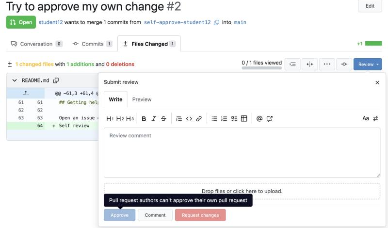

   *Refusal 2, as the author: Approve and Request changes are greyed out, and the mouse over Approve shows "Pull request authors can't approve their own pull request". Your names, team and numbers are your own.*

**What each line does:**

- `git switch -c self-approve-$ME`: a new branch for this test.
- `git commit -am "..."`: commit every changed file in one go (-a: all changed files, -m: the message).
- `git push -u origin self-approve-$ME`: send it to Gitea.

**You should see:** In the terminal, the commit and the pulls/new link (above). Then in Gitea, in the Submit review box, Approve and Request changes are greyed out. Hover over Approve: "Pull request authors can't approve their own pull request". Copy that into your notes.

```
Switched to a new branch 'self-approve-student01'
[self-approve-student01 ba23b3f] Try to approve my own change
 1 file changed, 1 insertion(+)
remote:
remote: Create a new pull request for 'self-approve-student01':
remote:   https://gitea.<lab domain>/team01/hello/pulls/new/self-approve-student01
remote:
To https://gitea.<lab domain>/team01/hello
 * [new branch]      self-approve-student01 -> self-approve-student01
branch 'self-approve-student01' set up to track 'origin/self-approve-student01'.
```

> **Tip:** Signing in as reviewer gets an approval through: the tool checks accounts, not people. That is why at work every account is personal and never shared. In this lab you use a second login only to play the reviewer.

**Check before you go on:** The Approve button is greyed out, and hovering over it shows "Pull request authors can't approve their own pull request".

#### Step 4. Change it after the reviewer approved

> **In plain words:** Approve it as reviewer, then change your change, and watch the approval disappear.

*Where: Gitea, then the workspace terminal*

**Why:** An approval is for what the reviewer read. If the change changes afterwards, the old approval must not count.

**Do this:**

1. Approve your self-approve pull request as reviewer, in a private window, as in Lab 3. The page now shows one approval.

2. Paste the box: it adds one more commit to the same branch.

   ```bash
   echo "One more line" >> README.md
   git commit -am "Change after approval"
   git push
   ```

3. Reload the pull request page.

   

   *Refusal 3: the approval is marked Dismissed, the reason says "New commits pushed, approval review dismissed automatically according to repository settings", and the merge box is back to "0 of 1 official approvals granted". Your names, team and numbers are your own.*

**What each line does:**

- `echo "One more line" >> README.md`: change the file again.
- `git commit -am "...", git push`: commit and push to the same branch: the pull request updates itself. git push now prints "Visit the existing pull request" with its link, instead of a new one.

**You should see:** In the terminal, the push to the existing pull request (above). Then in Gitea, after the reload: "New commits pushed, approval review dismissed automatically according to repository settings", and the merge box says "This pull request doesn't have enough required approvals yet. 0 of 1 official approvals granted." Copy both into your notes.

```
[self-approve-student01 6987239] Change after approval
 1 file changed, 1 insertion(+)
remote:
remote: Visit the existing pull request:
remote:   https://gitea.<lab domain>/team01/hello/pulls/2
remote:
To https://gitea.<lab domain>/team01/hello
   ba23b3f..6987239  self-approve-student01 -> self-approve-student01
```

> **Tip:** Close this pull request without merging when you are done (Close Pull Request at the bottom of the Conversation tab), and delete the branch.

**Check before you go on:** Gitea says the approval was "dismissed automatically", and the merge box asks for an approval again.

#### Step 5. Write down the three messages

> **In plain words:** Save the three refusals you saw in a file, as evidence.

*Where: Workspace terminal*

**Why:** Words on a slide are a claim; a refusal you saw yourself is evidence. These three lines go into the Day 6 evidence pack.

**Do this:**

1. Paste the box: it writes the three refusals you saw into a file, ~/evidence/day2-refusals.md, with your user name and today's date, shows it, and goes back to main.

   ```bash
   mkdir -p ~/evidence
   cat > ~/evidence/day2-refusals.md <<EOF
   # Day 2: three refusals, seen by $ME on $(date +%F)
   1. Push straight to main: "Not allowed to push to protected branch main"
   2. Approve my own pull request: "Pull request authors can't approve their own pull request"
   3. Change after approval: "approval review dismissed automatically according to repository settings"
   EOF
   cat ~/evidence/day2-refusals.md
   cd ~/hello && git switch main
   ```

2. Compare the file with what you saw on the screen. If a message was different, open the file in the editor (Explorer → evidence) and correct it.

**What each line does:**

- `mkdir -p ~/evidence`: a folder for everything you collect for the Day 6 evidence pack.
- `cat > ~/evidence/day2-refusals.md <<EOF ... EOF`: write the lines between the two EOF markers into the file. $ME becomes your user name and $(date +%F) today's date.
- `cat ~/evidence/day2-refusals.md`: show the file.
- `cd ~/hello && git switch main`: go back to main, ready for the next lab.

**You should see:** The file, with your name and today's date, then Git back on main:

```
# Day 2: three refusals, seen by student01 on 2026-10-29
1. Push straight to main: "Not allowed to push to protected branch main"
2. Approve my own pull request: "Pull request authors can't approve their own pull request"
3. Change after approval: "approval review dismissed automatically according to repository settings"
Switched to branch 'main'
Your branch is up to date with 'origin/main'.
```

**How to read it:**

- Three lines of proof that segregation of duties is enforced by the tool, not by trust.

**Check before you go on:** cat shows the three refusals with your user name and today's date, and you are back on main.

**Done when:** Three refusals written down, and main unchanged.

**If you are stuck**

- If any of these pushes or approvals succeeds, tell the instructor straight away: a control is missing.

## Merging and conflicts

### How Git joins two branches: merge, squash and conflicts

Merging brings the commits of one branch into another. If main has not moved since you made your branch, Git only moves main's label forward to your last commit: a fast-forward (you did one in Lab 1).

If both have moved, Git combines them: different files, or different lines of one file, it joins by itself. Gitea's squash merge (Lab 3) also turns all the commits of a branch into one commit on main, so main reads one line per change.

If both changed the same line, Git cannot know which one you want: that is a conflict. Git stops, writes both versions into the file between markers, and waits for a person to choose. Nothing is lost.

> **In one sentence:** Git merges different lines by itself; when two changes touch the same line, a person decides.

**In the lab**

- Lab 5 makes a conflict on purpose: two branches change line 22 of app/main.py.
- Between &lt;&lt;&lt;&lt;&lt;&lt;&lt; HEAD and ======= is your branch's version; between ======= and >>>>>>> main is main's.
- Keep one, delete the other and all three marker lines, then git add and git commit.
- Small changes merged often rarely conflict.

## Lab 5: a merge conflict

### Lab 5: resolve a merge conflict

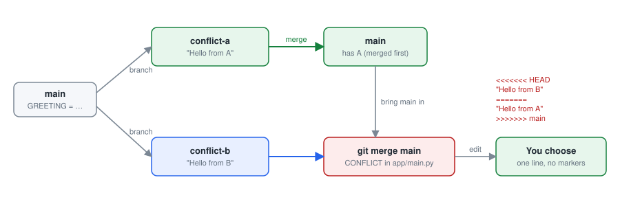

*Two branches changed the same line: Git marks both versions, and you choose.*

*on your own*

#### The idea, in plain words

Imagine two colleagues editing the same sentence of the same document at the same time, each in their own copy. When the copies come together, nobody can say automatically which sentence wins. Git is in the same position: when two branches change the same line, it stops and asks a person to choose. That is a merge conflict.

A conflict is normal and safe: nothing is lost, both versions are kept until you decide. Here you make one on purpose, playing both colleagues with two branches, A and B, so that the first real one does not frighten you.

**What you do:** See what happens when two changes touch the same line, and resolve it calmly.

**At the end you will have:** Both pull requests merged, and one greeting in main that you chose.

**You will learn:**

- Why conflicts happen: two changes to the same line, and Git cannot know which one you want.
- How to read the conflict markers and choose what to keep.
- That a conflict is normal and safe: nothing is lost.

**Words you will meet:**

- **Merge conflict:** Git cannot combine two changes by itself because they touch the same lines. A person decides.
- **Conflict markers:** The lines &lt;&lt;&lt;&lt;&lt;&lt;&lt;, ======= and >>>>>>> that Git writes into the file around the two versions.

**Before you start:**

1. At work, a conflict happens when two colleagues change the same line. Here you play both: you make two branches, A and B, from the same main, and change the same line differently on each.
2. hello is on main and up to date (cd ~/hello && git switch main && git pull).
3. The Git in this lab: git merge (Lab 1, step 8), the conflict markers (the slide "How Git joins two branches"), and git merge --abort if you get lost.
4. The reviewer approves in a private window, as in Lab 3 (logins: cat /etc/pelab/logins.md).

#### Step 1. Change the same line on two branches

> **In plain words:** Change the same line (the greeting) to something different on two branches, A and B, and open a pull request for each.

*Where: Workspace terminal, then Gitea*

**Why:** To make a conflict on purpose, two branches change the same line, differently: as two colleagues would without knowing about each other.

**Do this:**

1. Paste the first box: from main, it makes branch A, changes line 22 (GREETING) to "Hello from branch A", commits and pushes.

   ```bash
   cd ~/hello
   git switch main && git pull
   git switch -c conflict-a-$ME
   sed -i "s/^GREETING = .*/GREETING = os.environ.get(\"GREETING\", \"Hello from branch A\")/" app/main.py
   grep -n "^GREETING" app/main.py
   git commit -am "Greeting from branch A"
   git push -u origin conflict-a-$ME
   ```

2. Paste the second box: from the same main, it makes branch B, changes the same line to "Hello from branch B", commits and pushes.

   ```bash
   git switch main
   git switch -c conflict-b-$ME
   sed -i "s/^GREETING = .*/GREETING = os.environ.get(\"GREETING\", \"Hello from branch B\")/" app/main.py
   grep -n "^GREETING" app/main.py
   git commit -am "Greeting from branch B"
   git push -u origin conflict-b-$ME
   ```

3. Open both pulls/new links the boxes print, and click Create Pull Request on each.

**What each line does:**

- `git switch main && git pull`: start from the newest main.
- `git switch -c conflict-a-$ME`: a new branch, A, with your name in it.
- `sed -i "s/^GREETING = .*/.../" app/main.py`: replace the whole GREETING line with one that says Hello from branch A. sed changes a file without opening it; -i means "in the file itself".
- `grep -n "^GREETING" app/main.py`: show the new line and its number (22).
- `git commit -am "...", git push -u origin conflict-a-$ME`: commit the changed file and send branch A to Gitea.
- `git switch main`: back to main, which does not have A's change: A is only on its branch.
- `git switch -c conflict-b-$ME`: a second branch, B, from the same main.
- `sed ..., grep ..., git commit ..., git push ...`: the same as for A, with Hello from branch B.

**You should see:** main up to date, branch A, its new line 22, the commit and the pulls/new link:

```
Already on 'main'
Your branch is up to date with 'origin/main'.
Already up to date.
Switched to a new branch 'conflict-a-student01'
22:GREETING = os.environ.get("GREETING", "Hello from branch A")
[conflict-a-student01 a348b70] Greeting from branch A
 1 file changed, 1 insertion(+), 1 deletion(-)
remote:
remote: Create a new pull request for 'conflict-a-student01':
remote:   https://gitea.<lab domain>/team01/hello/pulls/new/conflict-a-student01
remote:
To https://gitea.<lab domain>/team01/hello
 * [new branch]      conflict-a-student01 -> conflict-a-student01
branch 'conflict-a-student01' set up to track 'origin/conflict-a-student01'.
```

**Then, after the second box, you should see:** Branch B, its line 22, the commit and its pulls/new link:

```
Switched to branch 'main'
Your branch is up to date with 'origin/main'.
Switched to a new branch 'conflict-b-student01'
22:GREETING = os.environ.get("GREETING", "Hello from branch B")
[conflict-b-student01 b6f652b] Greeting from branch B
 1 file changed, 1 insertion(+), 1 deletion(-)
remote:
remote: Create a new pull request for 'conflict-b-student01':
remote:   https://gitea.<lab domain>/team01/hello/pulls/new/conflict-b-student01
remote:
To https://gitea.<lab domain>/team01/hello
 * [new branch]      conflict-b-student01 -> conflict-b-student01
branch 'conflict-b-student01' set up to track 'origin/conflict-b-student01'.
```

**How to read it:**

- When you have opened both pull requests: team01/hello → Pull Requests shows two, both changing line 22.

**Check before you go on:** team01/hello → Pull Requests shows two pull requests, A's and B's.

#### Step 2. Merge A first

> **In plain words:** Merge A's pull request first. B's pull request then no longer fits.

*Where: Browser: Gitea (the reviewer in a private window, then you)*

**Why:** Once A's change is in main, B no longer fits: B was made from the old main.

**Do this:**

1. In a private window, as reviewer, open A's pull request: Files Changed → Review → Approve. Close the private window.

2. When the checks are green, merge A as yourself (as in Lab 3, step 4).

3. Open B's pull request and read the box above the merge button.

   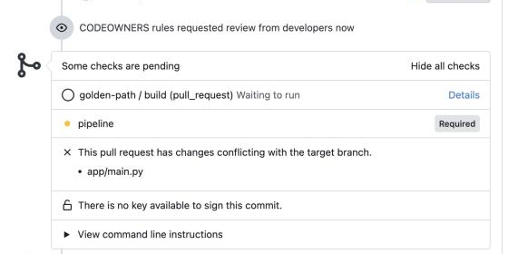

   *B's pull request after A's was merged: "This pull request has changes conflicting with the target branch", the file that conflicts (app/main.py), and no merge button. Steps 3 to 5 fix it. Your names, team and numbers are your own.*

**You should see:** B's pull request now says "This pull request has changes conflicting with the target branch." and cannot be merged.

**Check before you go on:** B's pull request says "This pull request has changes conflicting with the target branch."

#### Step 3. Bring main into branch B

> **In plain words:** Bring the new main into branch B, and Git stops to show the conflict.

*Where: Workspace terminal*

**Why:** You take the new main into branch B, in your workspace, to see the conflict and decide.

```bash
git switch main
git pull
git switch conflict-b-$ME
git merge main
```

**What each line does:**

- `git switch main, git pull`: get the new main, with A's change.
- `git switch conflict-b-$ME`: back to branch B.
- `git merge main`: try to combine main into branch B.

**You should see:** Git stops and names the file:

```
Auto-merging app/main.py
CONFLICT (content): Merge conflict in app/main.py
Automatic merge failed; fix conflicts and then commit the result.
```

**How to read it:**

- Nothing is lost: both versions are in the file, waiting for you to choose. git status shows "both modified: app/main.py".

**Check before you go on:** Git said "CONFLICT (content): Merge conflict in app/main.py".

#### Step 4. Choose the line to keep

> **In plain words:** Look at both versions of the line, keep one, and remove Git's markers.

*Where: Workspace editor*

**Why:** Only a person knows which greeting is right, or whether to write a new one.

**Do this:**

1. Open app/main.py in the editor (Explorer → hello → app → main.py). Around line 22 Git has put both versions between markers (the editor colours them, and offers buttons such as Accept Current Change and Accept Incoming Change above them).

2. Decide which greeting to keep, or write a new one.

3. Delete the other version and all three marker lines, so that one GREETING line is left. Save with Ctrl+S (Mac Cmd+S).

4. Editor not working for you? Instead of the three instructions above, paste this: it keeps main's version (A's greeting), removes B's and the markers, and shows the line that is left.

   ```bash
   sed -i '/^<<<<<<< /,/^=======/d; /^>>>>>>> /d' app/main.py
   grep -n "^GREETING" app/main.py
   ```

5. Check with this command that no marker is left.

   ```bash
   grep -n "<<<<<<<\|=======\|>>>>>>>" app/main.py || echo "no markers left"
   ```

**What changes in `app/main.py`:** keep one GREETING line and delete the rest, markers included.

Before:

```
<<<<<<< HEAD
GREETING = os.environ.get("GREETING", "Hello from branch B")
=======
GREETING = os.environ.get("GREETING", "Hello from branch A")
>>>>>>> main
```

After:

```
GREETING = os.environ.get("GREETING", "Hello from branch A and branch B")
```

**What each line does:**

- `grep -n "<<<<<<<\|=======\|>>>>>>>" app/main.py`: search the file for any of the three markers and show their line numbers (-n). \| means "or".
- `|| echo "no markers left"`: if grep finds nothing, print "no markers left" instead.

**You should see:** "no markers left", and one GREETING line in the file.

**How to read it:**

- Between &lt;&lt;&lt;&lt;&lt;&lt;&lt; HEAD and ======= is the version on the branch you are on (B); between ======= and >>>>>>> main is main's (A, merged in step 2).

**If you see something else:**

- *grep prints a line number*: a marker is still there. Delete that line, save, and check again.

**Check before you go on:** The check prints "no markers left", and line 22 holds one GREETING line.

#### Step 5. Finish the merge and update the pull request

> **In plain words:** Save the decision and upload it; B's pull request can then be merged.

*Where: Workspace terminal, then Gitea*

**Why:** The resolved file becomes a commit on branch B; pushing it updates B's pull request, which can be merged again.

**Do this:**

1. In the workspace terminal, paste the box: it checks no marker is left, saves the merge as a commit and sends it to Gitea.

   ```bash
   if grep -q "^<<<<<<<\|^>>>>>>>" app/main.py; then echo "STOP: conflict markers are still in app/main.py. Go back to step 4."; else
   git add -A
   git commit -m "Resolve conflict with main"
   git push
   fi
   ```

2. In what git push prints, find "Visit the existing pull request:" and the link under it. Hold Ctrl (on a Mac Cmd) and click it: B's pull request opens in Gitea.

3. Reload the page if it was already open: the message above the merge button no longer says "This pull request has changes conflicting with the target branch". The checks start again (yellow dot).

4. Approve as the reviewer: open a private window (Edge or Chrome: Ctrl+Shift+N, on a Mac Cmd+Shift+N; Firefox: Ctrl+Shift+P, on a Mac Cmd+Shift+P), go to https://gitea.<lab domain>, click Sign In and sign in as reviewer. Open B's pull request, click Files Changed, then Review (top right) → Approve. Close the private window.

5. Back in your own window, reload the pull request. When it shows the approval and "All checks were successful", click the small arrow next to the merge button, choose Create squash commit, and confirm.

6. A few minutes later, reload your dev tab (https://hello-team01-dev.<lab domain>/): the greeting you chose in step 4.

**What each line does:**

- `if grep -q ...; then echo "STOP..."; else ... fi`: a safety check first: if a marker is still in the file, stop and say so. Git would otherwise save the markers as if they were code.
- `git add -A`: mark the conflict as resolved (staging the fixed file).
- `git commit -m "Resolve conflict with main"`: finish the merge with a commit.
- `git push`: send it to Gitea: B's pull request updates itself (git push prints "Visit the existing pull request" and its link).

**You should see:** In the terminal, the merge commit and the push to the existing pull request (above). In Gitea, the conflict message is gone from B's pull request. Approve it as reviewer in a private window, merge it as yourself, and a few minutes later dev shows the greeting you kept.

```
[conflict-b-student01 bce9e43] Resolve conflict with main
remote:
remote: Visit the existing pull request:
remote:   https://gitea.<lab domain>/team01/hello/pulls/4
remote:
To https://gitea.<lab domain>/team01/hello
   b6f652b..bce9e43  conflict-b-student01 -> conflict-b-student01
```

**If you see something else:**

- *STOP: conflict markers are still in app/main.py*: nothing was saved. Go back to step 4, remove the marker lines, save, and paste this box again.
- *Lost in the middle of it*: git merge --abort puts everything back as before step 3. Start step 3 again.

**Check before you go on:** B's pull request is merged, and the dev page shows the greeting you kept.

**Done when:** Both pull requests are merged, and app/main.py on main has one greeting and no markers.

**If you are stuck**

- Lost in the conflict? git merge --abort puts everything back; start step 3 again.
- Look for the markers &lt;&lt;&lt;&lt;&lt;&lt;&lt;, ======= and >>>>>>>: delete all three lines, not only the text between them.

## Platform as a product

*A platform has users, an owner, a roadmap and measures of success. This afternoon you write your own one-page charter for the mini platform (Lab 6).*

### What makes a platform a product

The brief: "Capabilities must have identified users, product ownership, funded roadmaps, service levels, telemetry and feedback loops."

- **Users and their jobs:** Who uses the platform (developers, analysts, testers) and the three jobs they most need done: create a service, get an environment, release a change.
- **An owner:** Someone accountable for the platform's roadmap, its service levels and its support. Not a committee.
- **Promises (service levels):** For example: a new service is live in dev within 15 minutes; a pull request is deployed to dev within 5 minutes of merging.
- **Measures:** Lead time for a change, how often teams deploy, how long a new team takes to ship, how satisfied users are. The brief's "flow and productivity" outcome area.
- **Feedback:** A way for users to ask for things and report problems, and a visible backlog of what is coming next.

### Lab 6: write your one-page platform charter

*on your own*

#### The idea, in plain words

A platform is a product, and its customers are the teams who use it. Like any product, it needs to know who its users are, what they need, what it promises them, and how it will know whether it keeps those promises.

A charter writes this on one page. It is the platform team's contract with its users: short enough to read in two minutes, precise enough to check.

**What you do:** Write what a platform for your part of FMD must do and promise: a one-page charter.

**At the end you will have:** A one-page charter in ~/charter/charter.md: users, three jobs, two promises with numbers, two measures, and three next steps.

**You will learn:**

- That a platform is a product: it has users, promises and measures, like any service.
- How to write a promise that can be measured.

**Words you will meet:**

- **Charter:** One page that says who the platform is for, what it promises and how you will know it works.
- **Service level:** A promise with a number and a unit, for example "live in dev within 15 minutes".

**Before you start:**

1. Your workspace, or an A4 sheet if you prefer paper.

2. Your Day 1 delivery map, if you have it: its bottleneck is a good place to start.

3. Paste this in your workspace terminal: it creates the charter with its five headings, ~/charter/charter.md, and shows it. Then open it in the editor (Explorer → charter → charter.md) and fill it in, step by step below.

   ```bash
   mkdir -p ~/charter
   cat > ~/charter/charter.md <<EOF
   # Platform charter: $TEAM

   ## Who uses it
   - 

   ## What they need (three jobs, in their words)
   1. 
   2. 
   3. 

   ## What we promise (two service levels: a number and a unit)
   1. 
   2. 

   ## How we measure (two numbers, and where each comes from)
   1. 
   2. 

   ## What is next (three things, most important first)
   1. 
   2. 
   3. 
   EOF
   cat ~/charter/charter.md
   ```

#### Step 1. Who uses it

> **In plain words:** Write down who would use a platform like this one.

*Where: Your workspace editor*

**Why:** A product without known users gets built for nobody. Naming them keeps every later decision honest.

**Do this:**

1. List the roles in your part of FMD who would use a platform like this one.
2. For each, half a line on what they do: for example "Analysts: build and change the daily reports".

**You should see:** Three to five roles, for example analysts, developers, data engineers, testers, risk and audit.

**Check before you go on:** Three to five roles under "Who uses it", each with half a line.

#### Step 2. What they need

> **In plain words:** Write the three jobs the platform must make easy, as the users would say them.

*Where: Your workspace editor*

**Why:** Users judge a platform by the jobs it makes easy, not by its tools.

**Do this:**

1. Write the three jobs the platform must make easy, in the users' own words.
2. Use your Day 1 bottleneck if it fits.

**You should see:** Three jobs, one line each, for example "Get a new report into production without raising four tickets."

**Check before you go on:** Three jobs, one line each.

#### Step 3. What we promise

> **In plain words:** Write two promises, each with a number and a unit, that you could check.

*Where: Your workspace editor*

**Why:** A promise with a number can be checked. "Fast" cannot.

**Do this:**

1. Write two service levels you could measure this week, each with a number and a unit.
2. Check each one: could you prove on Friday whether you kept it?

**You should see:** Two promises, for example "A merged change is live in dev within 15 minutes" and "A new service is running in dev within 30 minutes of using the template".

**Check before you go on:** Each promise has a number and a unit, for example "within 15 minutes".

#### Step 4. How we measure

> **In plain words:** Write two numbers you would show the platform's owner every month, and where they come from.

*Where: Your workspace editor*

**Why:** Measures tell the platform's owner whether it is getting better, and where to invest next.

**Do this:**

1. Write two numbers you would show the platform's owner every month.
2. Say where each number would come from: Git, the pipeline, the dashboard, a survey.

**You should see:** Two measures, for example "time from template to running service (from Git and Argo CD)" and "share of changes that needed a fix afterwards (from the pull requests)".

**Check before you go on:** Two measures, each with its source (Git, the pipeline, the dashboard, a survey).

#### Step 5. What is next

> **In plain words:** Write the three things you would add to the platform next.

*Where: Your workspace editor*

**Why:** A product has a roadmap. Three next steps show what the platform should learn to do after this course.

**Do this:**

1. Write three things you would add to the platform after this course, most important first.

**You should see:** Three items, for example "a template for scheduled reports", "single sign-on", "a cost report per team".

**Check before you go on:** Three items, most important first.

#### Step 6. Present it in two minutes

> **In plain words:** Read your charter to your neighbour, and listen to theirs.

*Where: With your neighbour*

**Why:** Saying it out loud tests it: if a promise sounds vague, it is.

**Do this:**

1. Read your charter to your neighbour: users, jobs, the two promises, the two measures and the three next steps. Then listen to theirs.
2. Keep the file (or a photo of the sheet): it goes into your Day 6 capstone.

**You should see:** A one-page charter of your own.

**Check before you go on:** Your charter is saved, and you have read it out.

**Done when:** A one-page charter with users, jobs, two promises, two measures and three next steps.

**If you are stuck**

- A promise needs a number and a unit: "within 15 minutes", not "fast".

### Scenario: straight to production

| Scenario | What happens | What the platform does | The rule |
| --- | --- | --- | --- |
| Straight to production | A developer in a hurry tries to push a fix straight to main, skipping the pull request. | Gitea refuses the push. The only way onto main is a pull request with one approval from the team; the approval and the merge are recorded with names and times. | Four eyes on every change. The history is the audit trail. |
| The same fix, the right way | The same developer makes a branch, opens a pull request and asks a colleague to review. | The checks run, the colleague approves in two minutes, the merge deploys to dev by itself. Total time: a few minutes longer than the shortcut, and fully evidenced. | The safe way is also the easy way: that is what a paved road means. |
| The auditor's question | Six months later someone asks who changed the greeting, who approved it and when it reached dev. | The pull request, its approval, the merge commit and the Argo CD history answer all four questions without anyone searching through emails. | Evidence by default: normal work produces the record. |

### Check your understanding

1. Name the four places a change can be, and the command that moves it from one to the next.
2. What is the difference between a commit and a push?
3. Why can you not approve your own pull request, and what does that give the bank?
4. What happened in the platform between "Merge" and the new greeting appearing in dev?
5. A change in dev is wrong. Name two ways to undo it on this platform, and which one leaves a record.
6. What are the five parts of a platform charter?

### What we built today

You can now:

- Explain where a change lives, and read git status, a diff and the history
- Branch, commit, push, open a pull request, and undo safely
- Review, approve and merge a change as a second person
- Explain protected main, four eyes and the audit trail
- Resolve a merge conflict without fear
- Describe the platform as a product with a charter

**Tomorrow:** Infrastructure as Code. You will create and destroy infrastructure with a few lines of OpenTofu, then request your team's staging and prod environments from the environment template, by pull request.

---

[Day 1](../day1/README.md) · [Contents](../README.md) · [Day 3](../day3/README.md)
