# Day 2: Git and working together: the steps

Only the steps and the commands, to follow along with your instructor. Every step is explained in full in [README.md](README.md).

Each command comes twice. **Copy and paste:** is the grey box to copy (the copy button is at its top right). Under it, a picture of the terminal marked EXAMPLE shows what it looks like: do not copy from the picture. Where the lab was tested, the picture shows what the command printed (your ids, times, names and team are your own); a picture titled "type this" shows only the command.

## Git: change hello, see it, send it to Gitea

A first pass through the whole Git loop, together. Lab 2 then does it again, properly, with a pull request.

### 1. Get the latest main

1. Go into your copy of hello and update main.

   **Copy and paste:**

   ```bash
   cd ~/hello
   git switch main
   git pull
   ```

   *In the terminal it looks like this:*

   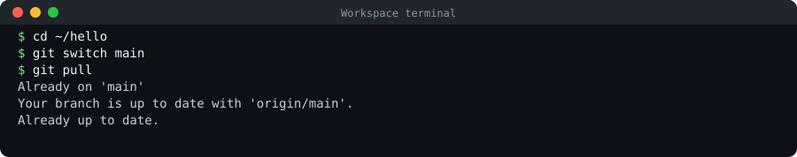

### 2. Make a branch

1. A branch of your own, named after you.

   **Copy and paste:**

   ```bash
   git switch -c warm-up-$ME
   ```

   *In the terminal it looks like this:*

   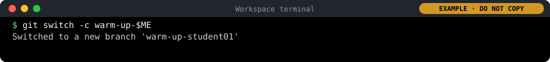

### 3. Change something you can see

1. Change the greeting on line 22 of app/main.py to your own name. In the editor, or with this command:

   **Copy and paste:**

   ```bash
   sed -i "s/Hello from the PE Lab golden path/Hello from $ME/" app/main.py
   ```

   *In the terminal it looks like this:*

   

2. Check the line changed.

   **Copy and paste:**

   ```bash
   grep -n "GREETING =" app/main.py
   ```

   *In the terminal it looks like this:*

   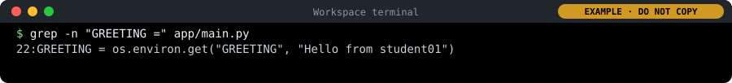

### 4. See it working

1. Start hello. This terminal stays busy.

   **Copy and paste:**

   ```bash
   python3 -m app.main
   ```

   *In the terminal it looks like this:*

   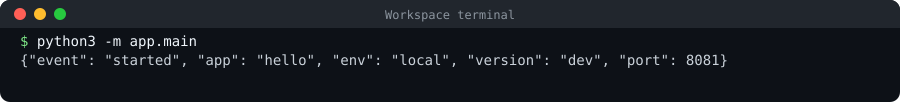

2. In a second terminal (+ at the top right of the terminal panel), call it.

   **Copy and paste:**

   ```bash
   curl -s localhost:8081/
   ```

   *In the terminal it looks like this:*

   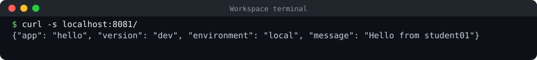

3. Print the browser address, then Ctrl+click it (Cmd+click on a Mac): the page shows your greeting.

   **Copy and paste:**

   ```bash
   echo "https://$ME.$DOMAIN/proxy/8081/"
   ```

   *In the terminal it looks like this:*

   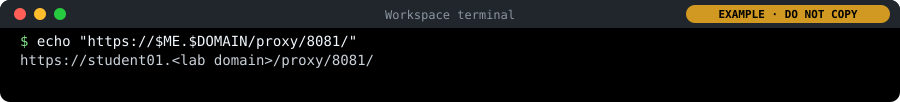

   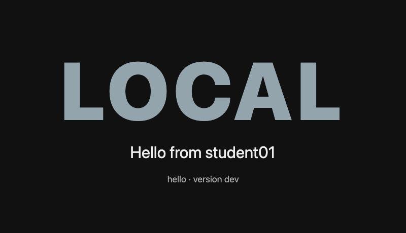

   *Your change, running: LOCAL in grey, and your greeting under it.*

4. Back in the first terminal, stop hello with Ctrl+C.

### 5. Look at what changed

1. Git shows the changed file, then the old and new line.

   **Copy and paste:**

   ```bash
   git status
   git diff
   ```

   *In the terminal it looks like this:*

   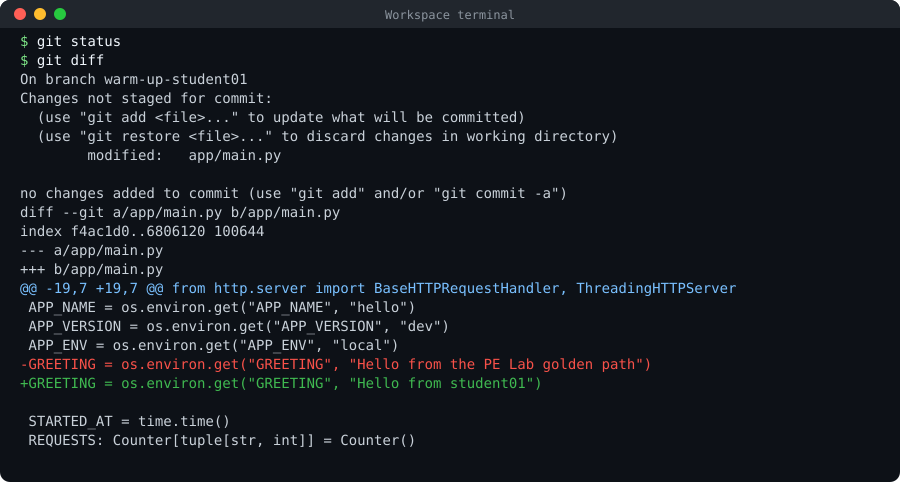

### 6. Commit it

1. Stage the file and save it as a commit.

   **Copy and paste:**

   ```bash
   git add app/main.py
   git commit -m "Say hello from $ME"
   git log --oneline -1
   ```

   *In the terminal it looks like this:*

   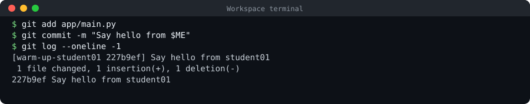

### 7. Push the branch to Gitea

1. Send your branch to Gitea (Username: your user name; Password: from cat /etc/pelab/logins.md).

   **Copy and paste:**

   ```bash
   git push -u origin warm-up-$ME
   ```

   *In the terminal it looks like this:*

   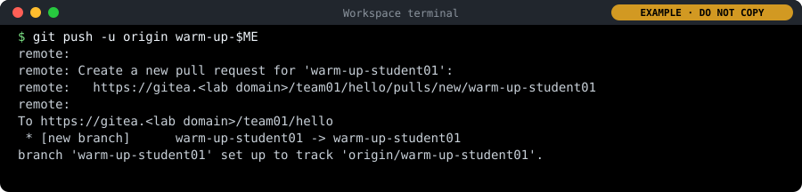

### 8. Find it in Gitea

1. Open your team's hello in Gitea: Ctrl+click the address this prints.

   **Copy and paste:**

   ```bash
   echo "https://gitea.$DOMAIN/$TEAM/hello/src/branch/warm-up-$ME"
   ```

   *In the terminal it looks like this:*

   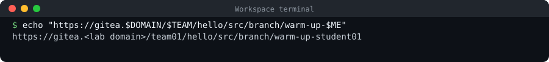

2. Click app/main.py: line 22 has your greeting. Switch the branch menu to main: main still has the old one.

   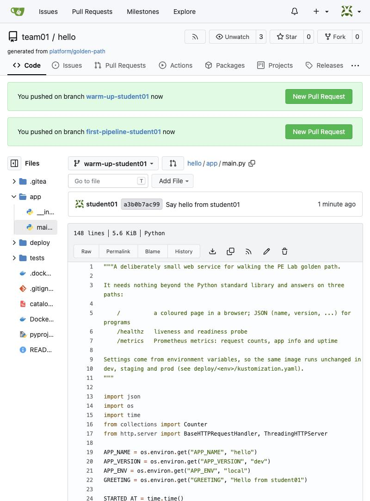

   *Your branch in Gitea: the branch menu says warm-up-studentNN, the last commit is yours ("Say hello from studentNN"), and line 22 has your greeting. The green bar offers a pull request: not today, Lab 2 does that.*

### 9. Back to main

1. Leave the warm-up branch as it is: it is not merged. Lab 2 starts from main.

   **Copy and paste:**

   ```bash
   git switch main
   ```

   *In the terminal it looks like this:*

   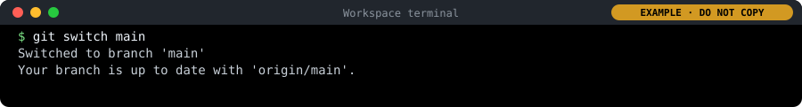

## Pipelines: your first pipeline, from a template

A pipeline is a list of steps that a runner does for you on every change. The platform team keeps ready-made ones in platform/pipeline-templates: copy one into hello with the same Git loop, and watch it run on your pull request.

### 1. Get the templates

1. Copy the templates repository into your workspace and list the templates.

   **Copy and paste:**

   ```bash
   cd ~
   git clone https://gitea.$DOMAIN/platform/pipeline-templates 2>/dev/null || git -C pipeline-templates pull
   ls ~/pipeline-templates/workflows
   ```

   *In the terminal it looks like this:*

   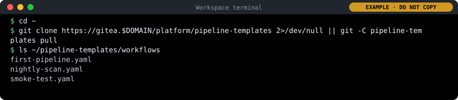

   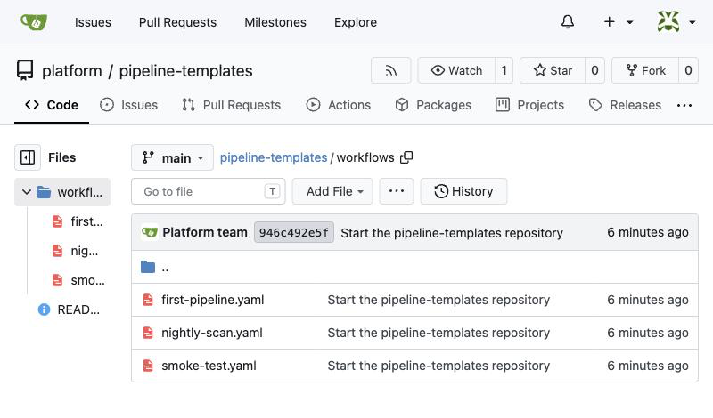

   *The same templates in Gitea: platform/pipeline-templates, folder workflows. One file each, owned by the platform team.*

### 2. Only if first-pipeline.yaml is not in the list: add it in Gitea

1. The instructor does this once for everyone: a student account cannot change the platform repositories.

2. Sign in to Gitea as the Gitea admin, and open platform → pipeline-templates → workflows.

3. Click Add File → New File, and name it first-pipeline.yaml.

4. Paste in the file below. Leave "Commit directly to the main branch" ticked, and click Commit Changes.

5. Back in the terminal, run Get the templates again: the list now has first-pipeline.yaml.

`workflows/first-pipeline.yaml`:

```yaml
# Pipeline template: your first pipeline. Owned by the platform team.
#
# Use it: copy this file, unchanged, into your service's repository as
#   .gitea/workflows/first-pipeline.yaml
# It runs on every pull request, and from the Actions tab (first-pipeline → Run Workflow).
#
# A pipeline is a list of steps that a runner does for you, in order, on every
# change. This one has three: get the code, show what is there, run the tests.
name: first-pipeline

on:
  pull_request:
  workflow_dispatch:

jobs:
  check:
    runs-on: pelab-host
    steps:
      - name: Get the code
        run: |
          git init -q .
          git -c http.extraHeader="Authorization: token ${{ gitea.token }}" \
            fetch -q --depth 1 "${{ gitea.server_url }}/${{ gitea.repository }}.git" "${{ gitea.ref }}"
          git checkout -q FETCH_HEAD
          git log -1 --format='Checking %h: %s (by %an)'

      - name: Show what is here
        run: ls

      - name: Run the tests
        run: pytest -q -p no:cacheprovider
```

### 3. Read the first pipeline

1. Three steps, each a "- name:": get the code, show what is there, run the tests. on: says when it runs.

   **Copy and paste:**

   ```bash
   cat ~/pipeline-templates/workflows/first-pipeline.yaml
   ```

   *In the terminal it looks like this:*

   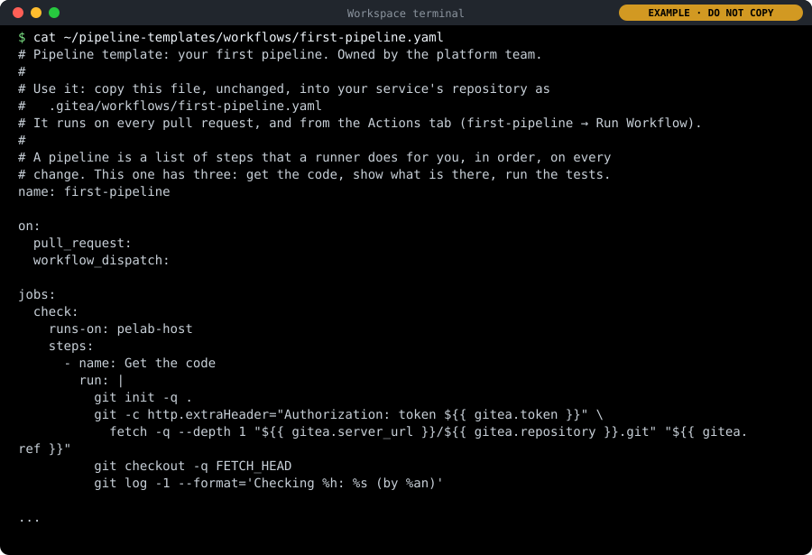

### 4. Make a branch in hello

1. Start from the latest main.

   **Copy and paste:**

   ```bash
   cd ~/hello
   git switch main
   git pull
   git switch -c first-pipeline-$ME
   ```

   *In the terminal it looks like this:*

   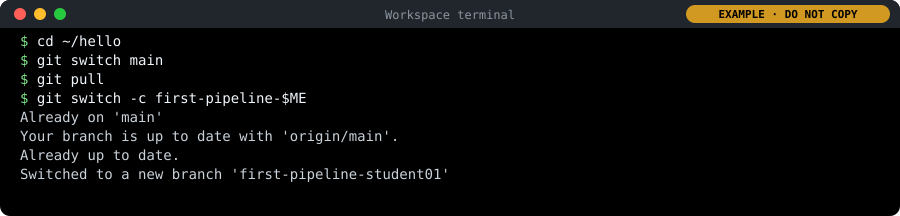

### 5. Copy the template in

1. Pipelines live in .gitea/workflows. hello already has one there: ci.yaml.

   **Copy and paste:**

   ```bash
   cp ~/pipeline-templates/workflows/first-pipeline.yaml .gitea/workflows/
   ls .gitea/workflows
   git status
   ```

   *In the terminal it looks like this:*

   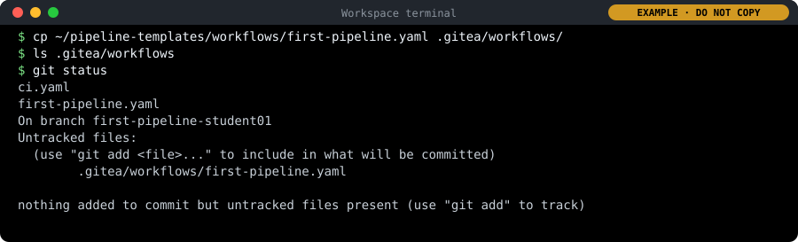

### 6. Commit and push

1. The same loop as the warm-up.

   **Copy and paste:**

   ```bash
   git add .gitea/workflows/first-pipeline.yaml
   git commit -m "Add the first pipeline from the platform template"
   git push -u origin first-pipeline-$ME
   ```

   *In the terminal it looks like this:*

   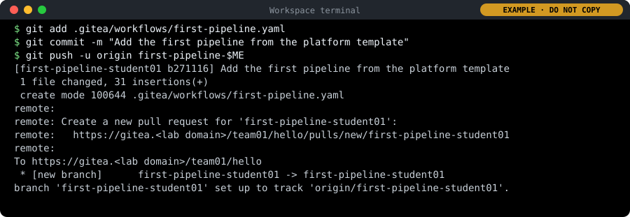

### 7. Open a pull request

1. In what git push printed, Ctrl+click (Cmd+click on a Mac) the address that ends in /pulls/new/first-pipeline-studentNN.

2. Gitea opens the new pull request form: your branch into main. Click Create Pull Request.

   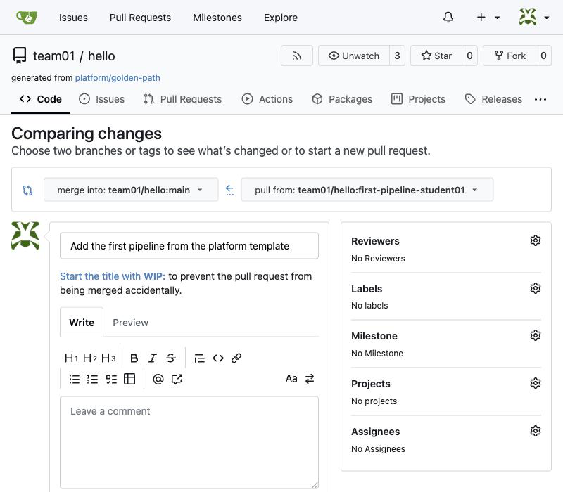

   *The new pull request: merge into main, pull from first-pipeline-studentNN, and the title from your commit. Scroll down for Create Pull Request.*

### 8. Watch it run

1. At the bottom of the pull request, the checks start: golden-path / build (the pipeline hello came with) and first-pipeline / check (yours).

   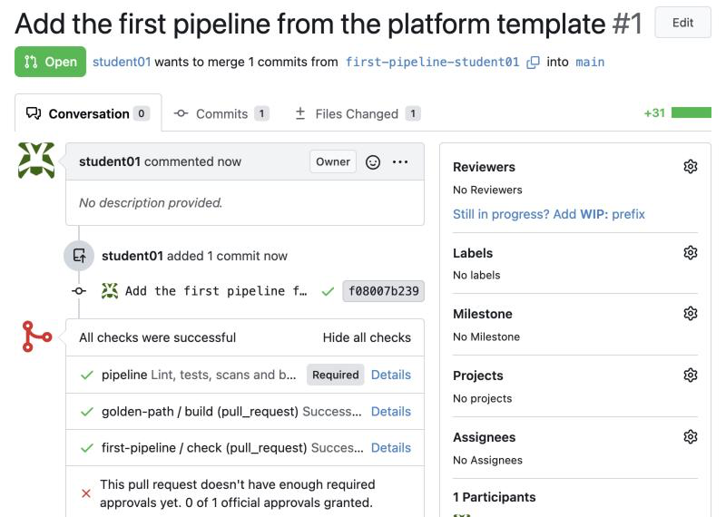

   *A few minutes later, all green: pipeline (the required verdict), golden-path / build, and first-pipeline / check, your new one. Merging would still need a reviewer's approval.*

2. Click Details next to first-pipeline, then open each step: Get the code, Show what is here, Run the tests.

   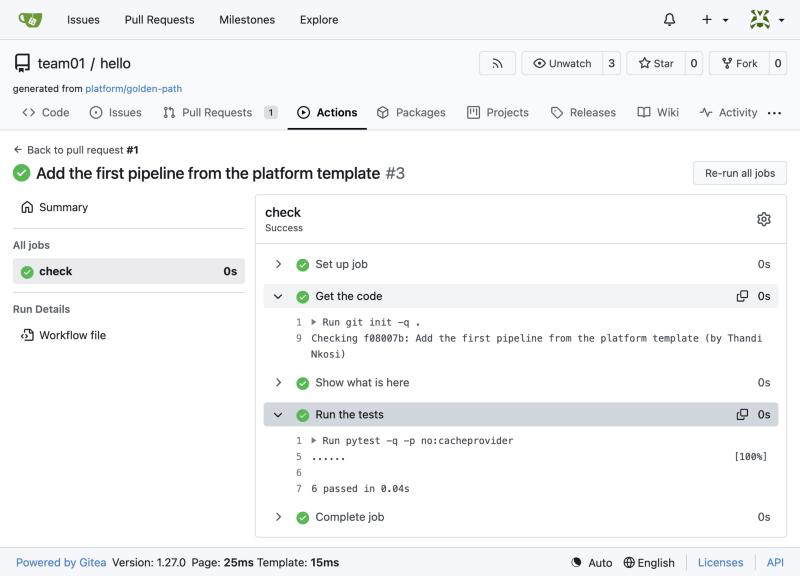

   *The run of first-pipeline: the steps of the template, each green. Get the code says which commit it checked; Run the tests ends in "6 passed".*

### 9. Close it, and go back to main

1. Close the pull request without merging: Close Pull Request, under the comment box at the bottom. The template stays out of main.

   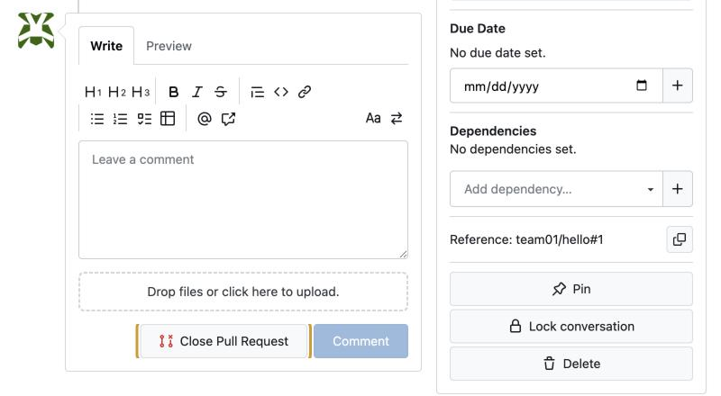

   *Close Pull Request sits under the comment box, at the bottom of the Conversation tab.*

   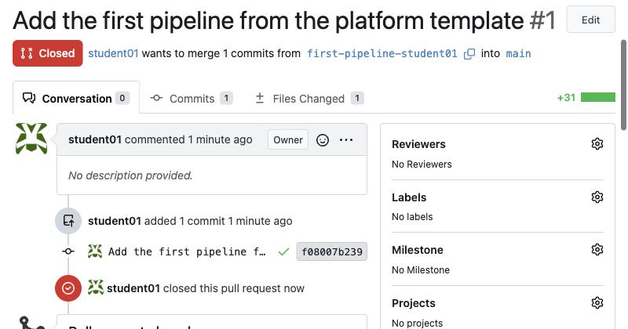

   *Closed: the red label at the top, and "closed this pull request" in the history. Nothing reached main.*

2. In the terminal:

   **Copy and paste:**

   ```bash
   git switch main
   ```

   *In the terminal it looks like this:*

   

## Lab 1: Git basics in a practice repository

Try every Git command of the day in a practice folder of your own, where nothing can go wrong, and then recognise the same things in your real repository, ~/hello.

### 1. Check that Git knows who you are

**Copy and paste:**

```bash
git --version
git config --global --list
```

*In the terminal it looks like this:*

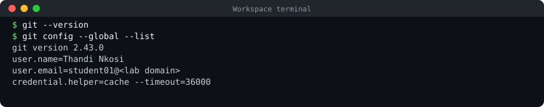

### 2. Make a practice repository

**Copy and paste:**

```bash
mkdir -p ~/git-practice && cd ~/git-practice
git init -b main
ls -a
git status
```

*In the terminal it looks like this:*

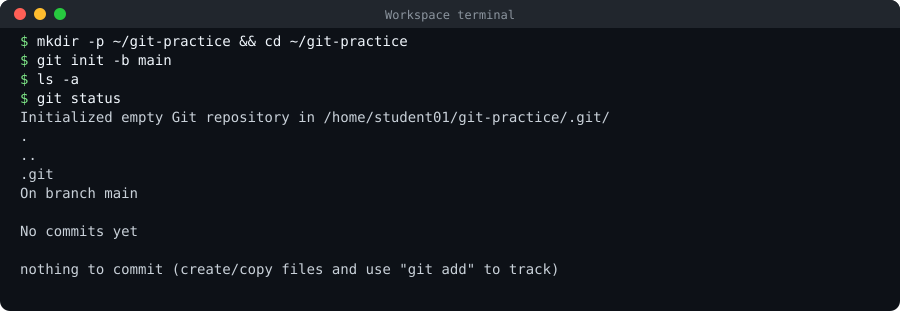

### 3. Your first commit: from working folder to repository

**Copy and paste:**

```bash
echo "Hello from $TEAM" > greeting.txt
git status
```

*In the terminal it looks like this:*

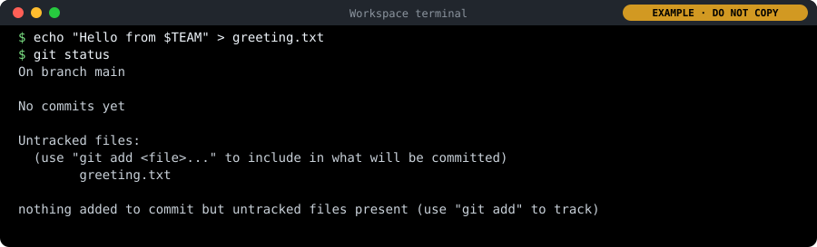

**Copy and paste:**

```bash
git add greeting.txt
git status
git commit -m "Add the team greeting"
git log
```

*In the terminal it looks like this:*

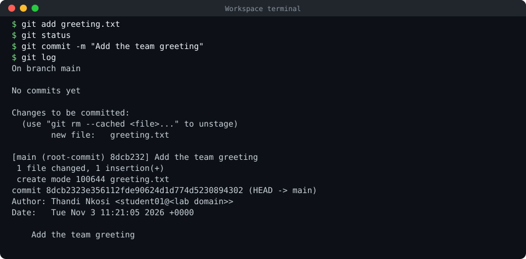

### 4. Change the file, and read the difference

**Copy and paste:**

```bash
sed -i "s/Hello/Good morning/" greeting.txt
echo "Owner: $ME" >> greeting.txt
git diff
```

*In the terminal it looks like this:*

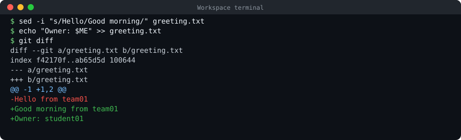

**Copy and paste:**

```bash
git add -A
git commit -m "Say good morning and name the owner"
git log --oneline
```

*In the terminal it looks like this:*

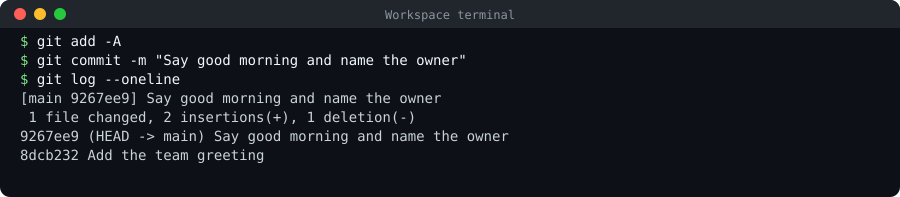

### 5. Look inside a commit

**Copy and paste:**

```bash
git show HEAD
```

*In the terminal it looks like this:*

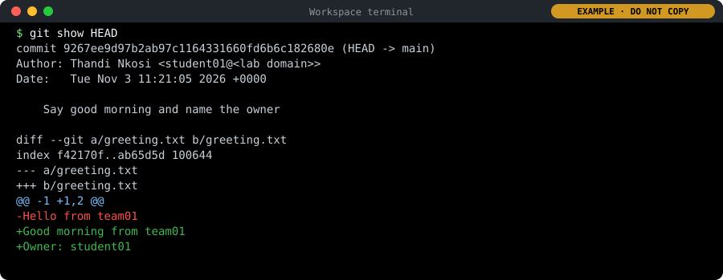

### 6. Make a mistake, and undo it

**Copy and paste:**

```bash
echo "A mistake" >> greeting.txt
git add greeting.txt
git status --short
git restore --staged greeting.txt
git status --short
git restore greeting.txt
git status --short
cat greeting.txt
```

*In the terminal it looks like this:*

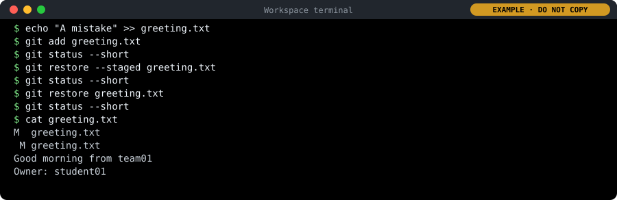

### 7. Work on a branch

**Copy and paste:**

```bash
git switch -c add-farewell
echo "Goodbye from $TEAM" >> greeting.txt
git commit -am "Add a farewell"
git log --oneline --graph --all
```

*In the terminal it looks like this:*

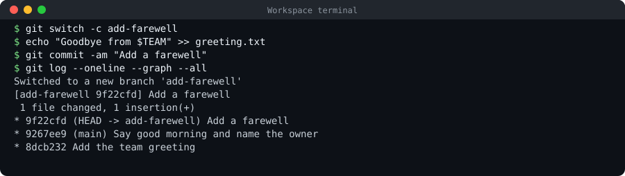

**Copy and paste:**

```bash
git switch main
cat greeting.txt
git branch
```

*In the terminal it looks like this:*

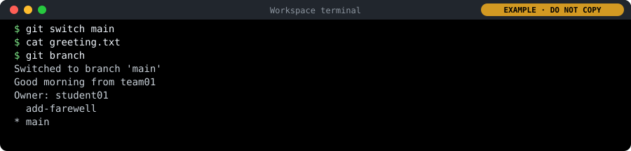

### 8. Merge the branch, then undo it with a revert

**Copy and paste:**

```bash
git merge add-farewell
git log --oneline --graph
git branch -d add-farewell
```

*In the terminal it looks like this:*

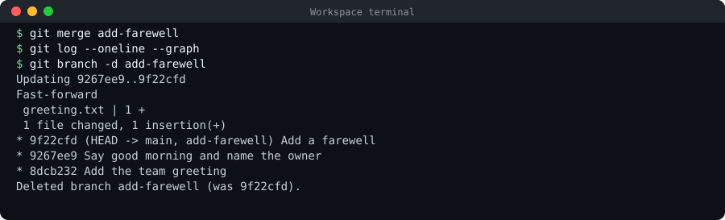

**Copy and paste:**

```bash
git revert --no-edit HEAD
git log --oneline
cat greeting.txt
```

*In the terminal it looks like this:*

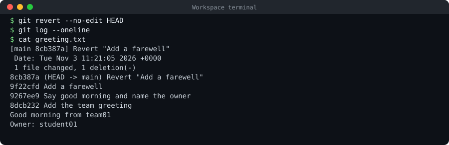

### 9. The same things in your real repository

**Copy and paste:**

```bash
cd ~/hello
git status
git remote -v
git log --oneline
git branch -a
```

*In the terminal it looks like this:*

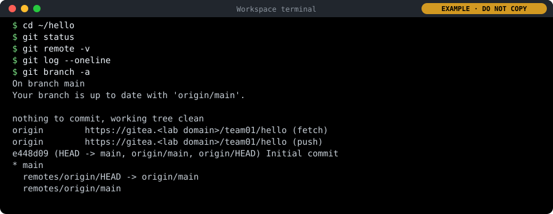

## Lab 2: your first change, on a branch

Change the greeting of your team's service on a branch of your own, check it, save it as a commit and send it to Gitea.

### 1. Go to main and get the latest version

1. Go into your copy of hello. Prints nothing; the prompt ends in ~/hello$.

   **Copy and paste:**

   ```bash
   cd ~/hello
   ```

   *In the terminal it looks like this:*

   

2. Switch to the main line, the one that gets deployed.

   **Copy and paste:**

   ```bash
   git switch main
   ```

   *In the terminal it looks like this:*

   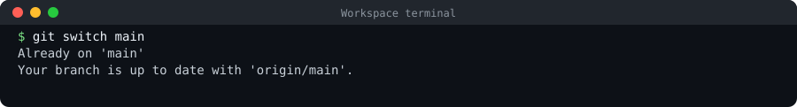

3. Fetch what others added to main in Gitea.

   **Copy and paste:**

   ```bash
   git pull
   ```

   *In the terminal it looks like this:*

   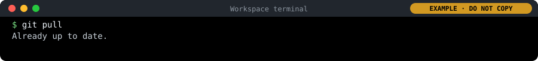

### 2. Make your own branch

**Copy and paste:**

```bash
git switch -c greeting-$ME
```

*In the terminal it looks like this:*

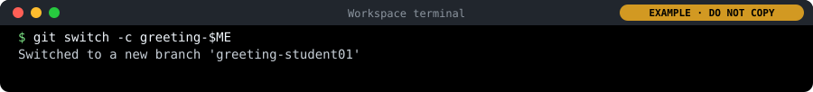

### 3. Change the greeting

1. In the Explorer on the left, click hello, then app, then main.py. The file opens in the editor.

2. Find line 22, which starts with GREETING. The line numbers are on the left of the editor.

3. Change only the text in the second pair of quotes, for example to Hello from team01. Keep the quotes.

4. Save with Ctrl+S (on a Mac Cmd+S). The dot next to the file name at the top disappears when it is saved.

5. Editor not working for you? Instead of the four instructions above, paste this in the terminal: it makes the same change (a greeting with your team and your name) and shows the new line.

   **Copy and paste:**

   ```bash
   sed -i "s/^GREETING = .*/GREETING = os.environ.get(\"GREETING\", \"Hello from $TEAM, by $ME\")/" app/main.py
   grep -n "^GREETING" app/main.py
   ```

   *In the terminal it looks like this:*

   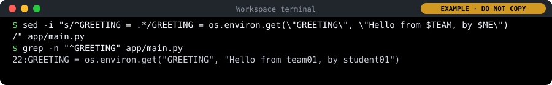

6. Back in the terminal, run this to see that Git noticed:

   **Copy and paste:**

   ```bash
   git status
   ```

   *In the terminal it looks like this:*

   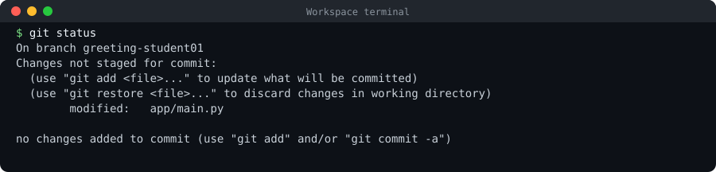

In `app/main.py`, change:

```
GREETING = os.environ.get("GREETING", "Hello from the PE Lab golden path")
```

to:

```
GREETING = os.environ.get("GREETING", "Hello from team01")
```

### 4. Check it works before you share it

1. In the first terminal, start the service with the command below. It keeps running.

2. Open a second terminal (the + at the top right of the terminal panel) and run:

   **Copy and paste:**

   ```bash
   curl -s localhost:8081/
   ```

   *In the terminal it looks like this:*

   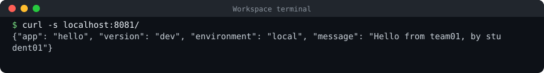

3. Check that "message" shows your new text.

4. Go back to the first terminal and press Ctrl+C to stop the service.

**Copy and paste:**

```bash
python3 -m app.main
```

*In the terminal it looks like this (the output depends on your lab):*

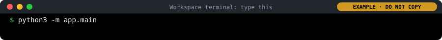

### 5. Save the change as a commit

1. Tell Git which changes go into this save: all of them. Prints nothing.

   **Copy and paste:**

   ```bash
   git add -A
   ```

   *In the terminal it looks like this:*

   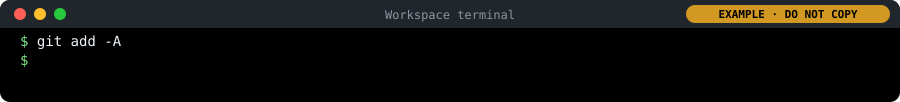

2. Save it, with a note. The note should finish the sentence "This change will...".

   **Copy and paste:**

   ```bash
   git commit -m "Change the greeting for $TEAM"
   ```

   *In the terminal it looks like this:*

   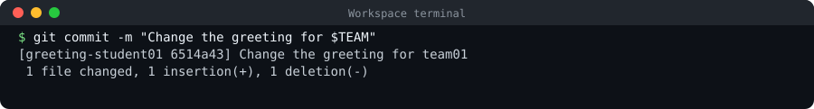

### 6. Send your branch to Gitea

**Copy and paste:**

```bash
git push -u origin greeting-$ME
```

*In the terminal it looks like this:*

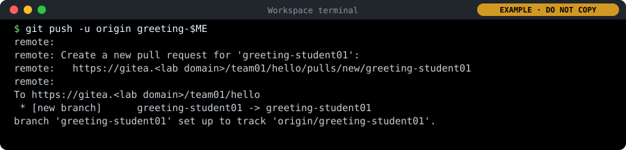

## Lab 3: review, approve, merge, and watch it go live

Turn your change into a reviewed decision: a pull request, a review and approval by a second person, a merge, and the change running in dev by itself.

### 1. Open the pull request

1. In the terminal from Lab 2, find the line remote:   https://gitea.<lab domain>/team01/hello/pulls/new/greeting-student01. Hold Ctrl (on a Mac Cmd) and click the link in the terminal: it opens in a new browser tab.

2. Gitea shows your change and a form under it. The title is already your commit message ("Change the greeting for team01"): keep it or make it clearer. It should say what changes.

3. In the box under the title, write two lines on why: for example "Shows our team's name on the dev page, so we can see our own release."

   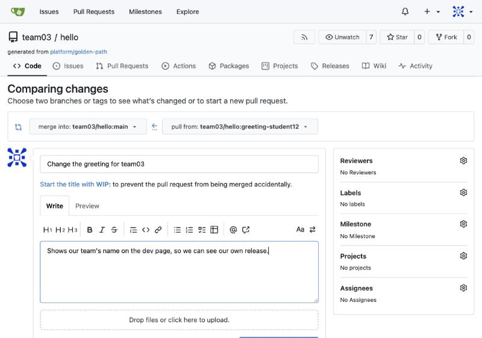

   *The new pull request form: at the top, which branch goes into which (pull from your branch, merge into main); the title, already filled in; and the box where you write why. Your names, team and numbers are your own.*

4. Click Create Pull Request (the blue button under the form).

   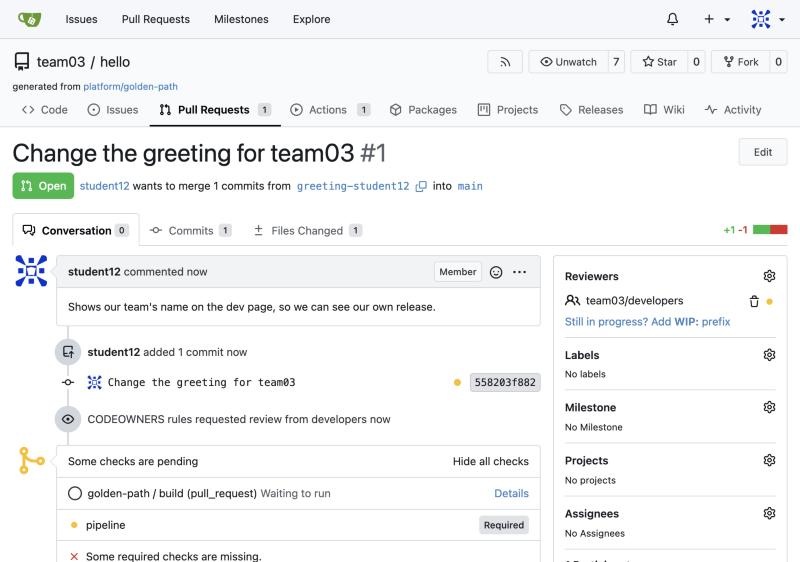

   *Your pull request is created: its number (#1), your description, your commit, and at the bottom the checks starting. The yellow dot means "still running". Your names, team and numbers are your own.*

### 2. The reviewer reads the change and comments

1. Open a private window (Edge or Chrome: Ctrl+Shift+N, on a Mac Cmd+Shift+N; Firefox: Ctrl+Shift+P, on a Mac Cmd+Shift+P), go to https://gitea.<lab domain>, click Sign In and sign in as reviewer with its password from cat /etc/pelab/logins.md.

2. As the reviewer, open your pull request (team01/hello → Pull Requests → yours) and click the Files Changed tab.

3. The old line is shown in red with -, the new line in green with +.

4. Move the mouse over the green line: a blue + appears at its left. Click it, write a short comment (a question or a suggestion) and click Add single comment.

   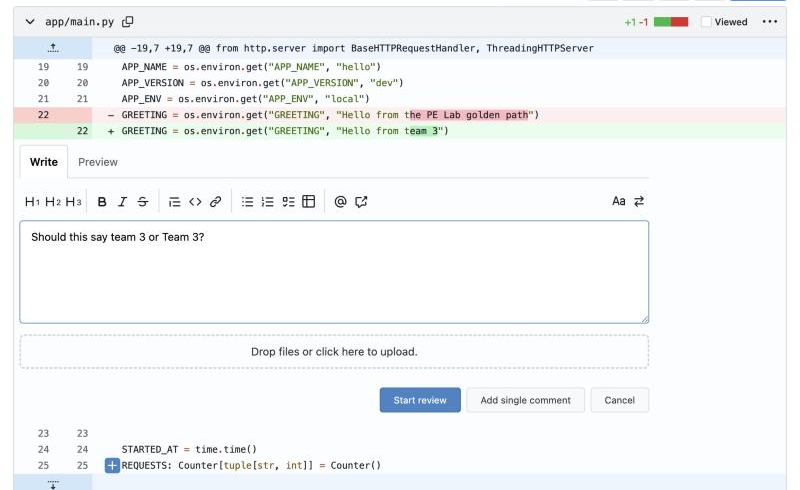

   *Files Changed, seen by the reviewer: the old line 22 in red, the new one in green, and a comment being written under the green line. Add single comment posts it. Your names, team and numbers are your own.*

### 3. The reviewer approves

1. Still in the private window, in Files Changed, click Review (the blue button, top right). A box called Submit review opens.

2. Write a short note ("Looks good"), then click Approve. Then close the private window: you are the author again.

   

   *The Submit review box: a note ("Looks good"), then Approve. Comment only comments; Request changes asks the author to change something first. Your names, team and numbers are your own.*

3. Now wait for the pipeline: on the Conversation tab, the yellow dot next to the checks turns into a green tick, in a few minutes.

   

   *Before the approval and the green pipeline, the box above the merge button says exactly what is still missing, and the button only offers to merge "When checks succeed". Your names, team and numbers are your own.*

### 4. Merge it, and update your copy

1. On the Conversation tab, click the small arrow to the right of the merge button and choose Create squash commit.

   

   *Ready to merge: the reviewer's approval, "All checks were successful", and the merge button's menu open. Choose Create squash commit. Your names, team and numbers are your own.*

2. Click the merge button, which now reads Create squash commit. A small form opens: the title of the commit (your pull request's title with its number, for example (#1)) and a message that already says who reviewed it (Reviewed-by: ...).

   

   *The squash commit form: the title with the pull request number (#1), a message that records who reviewed it (Reviewed-by), and Delete Branch ticked. In the lab the address in the message is your lab's Gitea. Your names, team and numbers are your own.*

3. Tick Delete Branch "greeting-student01" (your branch has done its job) and click Create squash commit.

4. In the workspace terminal, go into your copy and switch to main.

   **Copy and paste:**

   ```bash
   cd ~/hello
   git switch main
   ```

   *In the terminal it looks like this:*

   

5. Fetch the merge from Gitea.

   **Copy and paste:**

   ```bash
   git pull
   ```

   *In the terminal it looks like this:*

   

6. Show the last three saves (commits) in the history, one line each.

   **Copy and paste:**

   ```bash
   git log --oneline -3
   ```

   *In the terminal it looks like this:*

   

### 5. Watch it go live

1. In Gitea, open team01/hello → Actions. The newest run (your merge, on main) builds the image and pushes it to Harbor. Wait for its green tick, a few minutes.

2. Open https://argocd.<lab domain> in a new tab and sign in as delegate, with its password from cat /etc/pelab/logins.md (a read-only login; not your student01 password).

3. In the search box at the top, type team01. Your service has one box per environment: dev, staging and prod. Click the application team01-hello-dev.

   

   *Argo CD's application list, searched for the team: one box per environment of hello (dev, prod, staging), each with its health (Healthy) and sync state (Synced: it runs what Git says). On Day 2 only dev runs; staging and prod come on Day 3 and are released on Day 6. In your lab the repository is https://gitea.<lab domain>/team01/hello.git, and the names, ids and times are your own.*

### 6. See your change in dev

1. Open https://hello-team01-dev.<lab domain>/ in a new tab.

**Copy and paste:**

```bash
curl -s https://hello-$TEAM-dev.$DOMAIN/
```

*In the terminal it looks like this:*


## Lab 4: try to break the rules

Try the three shortcuts the platform refuses, and keep the refusal messages as evidence that the controls work.

### 1. Push straight to main

1. Go to main and make sure it is up to date.

   **Copy and paste:**

   ```bash
   cd ~/hello
   git switch main && git pull
   ```

   *In the terminal it looks like this:*

   

2. Add a line at the end of README.md. Prints nothing.

   **Copy and paste:**

   ```bash
   echo "Direct edit" >> README.md
   ```

   *In the terminal it looks like this:*

   

3. Save it in Git, directly on main.

   **Copy and paste:**

   ```bash
   git add -A
   git commit -m "Direct edit"
   ```

   *In the terminal it looks like this:*

   

4. Now try to upload main to Gitea.

   **Copy and paste:**

   ```bash
   git push
   ```

   *In the terminal it looks like this:*

   

### 2. Undo it

1. Make your main exactly like Gitea's, throwing away the refused save.

   **Copy and paste:**

   ```bash
   git reset --hard origin/main
   ```

   *In the terminal it looks like this:*

   

2. Check.

   **Copy and paste:**

   ```bash
   git status
   ```

   *In the terminal it looks like this:*

   

### 3. Approve your own pull request

1. Paste the box: it makes a small change on a new branch and pushes it.

2. Open the pulls/new link it prints and click Create Pull Request.

3. Open Files Changed, click Review, and try to click Approve.

   

   *Refusal 2, as the author: Approve and Request changes are greyed out, and the mouse over Approve shows "Pull request authors can't approve their own pull request". Your names, team and numbers are your own.*

**Copy and paste:**

```bash
git switch -c self-approve-$ME
echo "Self review" >> README.md
git commit -am "Try to approve my own change"
git push -u origin self-approve-$ME
```

*In the terminal it looks like this:*


### 4. Change it after the reviewer approved

1. Approve your self-approve pull request as reviewer, in a private window, as in Lab 3. The page now shows one approval.

2. Paste the box: it adds one more commit to the same branch.

3. Reload the pull request page.

   

   *Refusal 3: the approval is marked Dismissed, the reason says "New commits pushed, approval review dismissed automatically according to repository settings", and the merge box is back to "0 of 1 official approvals granted". Your names, team and numbers are your own.*

**Copy and paste:**

```bash
echo "One more line" >> README.md
git commit -am "Change after approval"
git push
```

*In the terminal it looks like this:*


### 5. Write down the three messages

1. Paste the box: it writes the three refusals you saw into a file, ~/evidence/day2-refusals.md, with your user name and today's date, shows it, and goes back to main.

2. Compare the file with what you saw on the screen. If a message was different, open the file in the editor (Explorer → evidence) and correct it.

**Copy and paste:**

```bash
mkdir -p ~/evidence
cat > ~/evidence/day2-refusals.md <<EOF
# Day 2: three refusals, seen by $ME on $(date +%F)
1. Push straight to main: "Not allowed to push to protected branch main"
2. Approve my own pull request: "Pull request authors can't approve their own pull request"
3. Change after approval: "approval review dismissed automatically according to repository settings"
EOF
cat ~/evidence/day2-refusals.md
cd ~/hello && git switch main
```

*In the terminal it looks like this:*


## Lab 5: resolve a merge conflict

See what happens when two changes touch the same line, and resolve it calmly.

### 1. Change the same line on two branches

1. Paste the first box: from main, it makes branch A, changes line 22 (GREETING) to "Hello from branch A", commits and pushes.

2. Paste the second box: from the same main, it makes branch B, changes the same line to "Hello from branch B", commits and pushes.

3. Open both pulls/new links the boxes print, and click Create Pull Request on each.

   

   *The two pull requests, A and B, both green, both changing line 22. Your names, team, numbers and times are your own.*

**Copy and paste:**

```bash
cd ~/hello
git switch main && git pull
git switch -c conflict-a-$ME
sed -i "s/^GREETING = .*/GREETING = os.environ.get(\"GREETING\", \"Hello from branch A\")/" app/main.py
grep -n "^GREETING" app/main.py
git commit -am "Greeting from branch A"
git push -u origin conflict-a-$ME
```

*In the terminal it looks like this:*


**Copy and paste:**

```bash
git switch main
git switch -c conflict-b-$ME
sed -i "s/^GREETING = .*/GREETING = os.environ.get(\"GREETING\", \"Hello from branch B\")/" app/main.py
grep -n "^GREETING" app/main.py
git commit -am "Greeting from branch B"
git push -u origin conflict-b-$ME
```

*In the terminal it looks like this:*


### 2. Merge A first

1. In a private window, as reviewer, open A's pull request: Files Changed → Review → Approve. Close the private window.

2. When the checks are green, merge A as yourself (as in Lab 3, step 4).

3. Open B's pull request and read the box above the merge button.

   

   *B's pull request after A's was merged: "This pull request has changes conflicting with the target branch", the file that conflicts (app/main.py), and no merge button. Steps 3 to 5 fix it. Your names, team and numbers are your own.*

### 3. Bring main into branch B

**Copy and paste:**

```bash
git switch main
git pull
git switch conflict-b-$ME
git merge main
```

*In the terminal it looks like this:*


### 4. Choose the line to keep

1. Open app/main.py in the editor (Explorer → hello → app → main.py). Around line 22 Git has put both versions between markers (the editor colours them, and offers buttons such as Accept Current Change and Accept Incoming Change above them).

2. Decide which greeting to keep, or write a new one.

3. Delete the other version and all three marker lines, so that one GREETING line is left. Save with Ctrl+S (Mac Cmd+S).

4. Editor not working for you? Instead of the three instructions above, paste this: it keeps main's version (A's greeting), removes B's and the markers, and shows the line that is left.

   **Copy and paste:**

   ```bash
   sed -i '/^<<<<<<< /,/^=======/d; /^>>>>>>> /d' app/main.py
   grep -n "^GREETING" app/main.py
   ```

   *In the terminal it looks like this (the output depends on your lab):*

   

5. Check with the command below that no marker is left.

In `app/main.py`, change:

```
<<<<<<< HEAD
GREETING = os.environ.get("GREETING", "Hello from branch B")
=======
GREETING = os.environ.get("GREETING", "Hello from branch A")
>>>>>>> main
```

to:

```
GREETING = os.environ.get("GREETING", "Hello from branch A and branch B")
```

**Copy and paste:**

```bash
grep -n "<<<<<<<\|=======\|>>>>>>>" app/main.py || echo "no markers left"
```

*In the terminal it looks like this (the output depends on your lab):*


### 5. Finish the merge and update the pull request

1. In the workspace terminal, paste the box: it checks no marker is left, saves the merge as a commit and sends it to Gitea.

   **Copy and paste:**

   ```bash
   if grep -q "^<<<<<<<\|^>>>>>>>" app/main.py; then echo "STOP: conflict markers are still in app/main.py. Go back to step 4."; else
   git add -A
   git commit -m "Resolve conflict with main"
   git push
   fi
   ```

   *In the terminal it looks like this (the output depends on your lab):*

   

2. In what git push prints, find "Visit the existing pull request:" and the link under it. Hold Ctrl (on a Mac Cmd) and click it: B's pull request opens in Gitea.

3. Reload the page if it was already open: the message above the merge button no longer says "This pull request has changes conflicting with the target branch". The checks start again (yellow dot).

   

   *B after the merge commit: no conflict message any more, and the checks run again (yellow dot). Because the line kept is A's, Gitea notes that the branch adds nothing new. Your names, team, numbers and times are your own.*

4. Approve as the reviewer: open a private window (Edge or Chrome: Ctrl+Shift+N, on a Mac Cmd+Shift+N; Firefox: Ctrl+Shift+P, on a Mac Cmd+Shift+P), go to https://gitea.<lab domain>, click Sign In and sign in as reviewer. Open B's pull request, click Files Changed, then Review (top right) → Approve. Close the private window.

5. Back in your own window, reload the pull request. When it shows the approval and "All checks were successful", click the small arrow next to the merge button, choose Create squash commit, and confirm.

6. A few minutes later, reload your dev tab (https://hello-team01-dev.<lab domain>/): the greeting you chose in step 4.

*In the terminal it looks like this:*


## Lab 6: write your one-page platform charter

Write what a platform for your part of FMD must do and promise: a one-page charter.

### 1. Who uses it

1. List the roles in your part of FMD who would use a platform like this one.

2. For each, half a line on what they do: for example "Analysts: build and change the daily reports".

### 2. What they need

1. Write the three jobs the platform must make easy, in the users' own words.

2. Use your Day 1 bottleneck if it fits.

### 3. What we promise

1. Write two service levels you could measure this week, each with a number and a unit.

2. Check each one: could you prove on Friday whether you kept it?

### 4. How we measure

1. Write two numbers you would show the platform's owner every month.

2. Say where each number would come from: Git, the pipeline, the dashboard, a survey.

### 5. What is next

1. Write three things you would add to the platform after this course, most important first.

### 6. Present it in two minutes

1. Read your charter to your neighbour: users, jobs, the two promises, the two measures and the three next steps. Then listen to theirs.

2. Keep the file (or a photo of the sheet): it goes into your Day 6 capstone.
