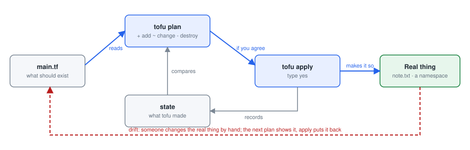
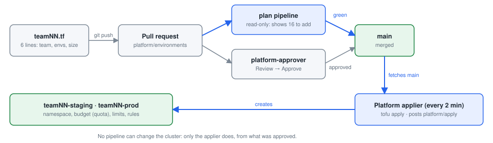

# Day 3: Infrastructure as Code from a template

**Goal:** Describe infrastructure in code, read a plan, and request your team's staging and prod environments from the environment template.

By the end of the day you can:

- Explain Infrastructure as Code: plan, apply, destroy, state and drift
- Run OpenTofu yourself on a small example
- Request staging and prod from the template, by pull request, and see them appear

### Today's plan

Yesterday your change reached dev through a pull request. Today the infrastructure gets the same treatment: your team's staging and prod, requested as code.

| Topic | Labs |
| --- | --- |
| Infrastructure as Code | [Lab 1: plan, apply, change, destroy](#lab-1-plan-apply-change-destroy) |
| Environments | [Lab 2: request staging and prod from the template](#lab-2-request-staging-and-prod-from-the-template) (per team)<br>[Lab 3: drift, and destroy and recreate](#lab-3-drift-and-destroy-and-recreate) |
| Budgets | Concepts and discussion, no lab |

## Infrastructure as Code

### Infrastructure as Code in plain words

Instead of clicking through screens or typing commands, you write down what you want: "a namespace called team01-staging with a budget of 1 CPU". The tool works out the steps.

Plan shows what would change, before anything changes. Apply makes it so. Destroy removes everything the code created. State is the tool's memory of what it built.

Drift is when reality no longer matches the code, because someone changed something by hand. The next plan shows the drift, and apply puts it back.

> **In one sentence:** Infrastructure as Code means you write what you want, the tool makes it so, and the code is the record.

**In the lab**

- The tool is OpenTofu: the open-source version of Terraform, same language, same commands.
- The whole lab was built this way too, with Ansible: one command rebuilds the entire platform.
- Your environments live in the platform/environments repository.
- Every change to them is a pull request with a plan attached, approved by the platform team.

### The Infrastructure as Code loop



*plan compares the code with what exists; apply makes them match; a change by hand (drift) shows up in the next plan.*

1. Write the code
2. tofu init
3. tofu plan
4. Review the plan
5. tofu apply
6. Change the code
7. tofu plan again
8. tofu destroy

The plan is the control point: it is what a reviewer reads in the pull request before approving. Nothing changes until apply.

### Why a bank wants infrastructure as code

Repeatable: the same code gives the same environment every time, in every region, for every team. No more "the test server is slightly different".

Reviewable: an environment change is a pull request with a plan. The reviewer sees exactly what will be created, changed or destroyed.

Auditable and recoverable: the history shows every change and its approval; if an environment is lost, apply rebuilds it.

> **In one sentence:** Code is the only way to make 25 environments identical, reviewed and rebuildable.

**Live demo**

- The instructor shows the playbook that built this lab: ansible-playbook site.yml.
- Roles for the host, the containers, the cluster, each platform service and each team.
- One command, one pinned list of versions, the same result on every run.
- This is the brief's "environment can be safely destroyed and recreated".

## Lab 1: warm-up

### Your first OpenTofu file: five lines that create a file

```
# ~/day3/main.tf
terraform {
  required_providers {
    local = { source = "hashicorp/local" }
  }
}

resource "local_file" "note" {
  filename = "${path.module}/note.txt"
  content  = "Built by code, not by hand."
}
```

- The first block says which plug-in (provider) we need: "local" knows how to manage files on this machine.
- resource "local_file" "note" declares one thing we want to exist: a file, which we will call "note" in the code.
- filename and content are its settings. Change the content and the next plan replaces the file (-/+): a file cannot be edited in place.
- No steps, no commands: only what should exist. OpenTofu works out how.

### Lab 1: plan, apply, change, destroy

**What you do:** Use OpenTofu on something tiny and harmless, a file in your workspace, to learn the four moves of Infrastructure as Code: plan, apply, change and destroy.

**You will learn:**

- What Infrastructure as Code means: a file describes what should exist, and a tool makes it so.
- The four moves: plan (look before you change), apply (make it so), change (edit the code, never the thing) and destroy (remove what the code made).
- What state is (the tool's memory) and what drift is (someone changed it by hand).

**Words you will meet:**

- **OpenTofu:** The tool that reads the code and makes it real. It is the open-source twin of Terraform: same language, same commands, but you type tofu instead of terraform.
- **Provider:** A plug-in that knows how to manage one kind of thing. Here it is local, which manages files in your workspace. This afternoon it is kubernetes.
- **Resource:** One thing the code describes. Here: one file, note.txt.
- **Plan:** OpenTofu compares the code with what exists and lists what it would do. It changes nothing.
- **Apply:** Do what the plan says. OpenTofu asks you to type yes first.
- **State:** The file terraform.tfstate: OpenTofu's memory of what it built, so next time it knows what already exists.
- **Drift:** Reality no longer matches the code, because someone changed it by hand.

**Before you start:**

1. Your workspace is open in the browser (https://student01.<lab domain>, signed in with your password).
2. A terminal is open at the bottom of the workspace. If not: menu ☰ (top left) → Terminal → New Terminal. You are ready when you see a prompt that ends in $, for example student01@student01:~$
3. To run a command: copy it from this page (the copy button at the top right of each grey box), click in the terminal, paste with Ctrl+V (on a Mac Cmd+V, or right-click → Paste), and press Enter. You can paste a whole box at once: the lines run one after the other.
4. If Git asks for a Username (the first time each day: it then remembers your password for 10 hours), type student01 and press Enter; for the Password, type your password (from cat /etc/pelab/logins.md) and press Enter. Nothing appears while you type the password: that is normal.
5. Nothing in this lab touches anything shared. You can make mistakes safely: the worst case is that you start the lab again.

#### Step 1. Write the code

*Where: Workspace terminal*

**Why:** Infrastructure as Code starts with a file that describes what you want. Here the "infrastructure" is one small file, note.txt, so you can watch every move without any risk.

**Do this:**

1. Copy this whole grey box, including the line that says EOF.

   ```bash
   mkdir -p ~/day3 && cd ~/day3
   cat > main.tf <<'EOF'
   terraform {
     required_providers {
       local = { source = "hashicorp/local" }
     }
   }

   resource "local_file" "note" {
     filename = "${path.module}/note.txt"
     content  = "Built by code, not by hand."
   }
   EOF
   ls
   ```

2. Paste it into the terminal and press Enter.

**What each line does:**

- `mkdir -p ~/day3 && cd ~/day3`: make a folder called day3 in your home folder (~ means your home folder), then go into it. -p means "no error if it is already there"; && means "and then, if that worked".
- `cat > main.tf <<'EOF'`: write everything that follows, up to the line EOF, into a new file called main.tf. It is the same as typing the file in an editor and saving it.
- `terraform { required_providers { local = ... } }`: this code needs the provider called local, which manages files. The word is terraform here because OpenTofu and Terraform share the same language.
- `resource "local_file" "note" {`: one resource: a file. local_file is the kind of thing; note is the name we give it inside the code.
- `filename = "${path.module}/note.txt"`: where the file goes: note.txt, in this folder. ${path.module} means "the folder this code is in".
- `content  = "Built by code, not by hand."`: what goes inside the file.
- `ls`: list the files in the folder, to check.

**You should see:** One file in the folder:

```
main.tf
```

**If you see something else:**

- *The prompt changes to > and waits*: the paste stopped before the last EOF line. Press Ctrl+C, then copy and paste the whole box again.
- *ls shows nothing*: the file was not written. Check that you pasted the whole box, then try again.

> **Tip:** To read the file you just made, type cat main.tf and press Enter.

#### Step 2. Prepare the folder: tofu init

*Where: Workspace terminal*

**Why:** Before OpenTofu can use the code, it must fetch the provider the code asks for (local). init does this once in every new folder.

```bash
tofu init
```

**What each line does:**

- `tofu init`: prepare this folder: find and install the providers named in main.tf. Your workspace keeps a copy of them, so this needs no internet.

**You should see:** A few lines about the provider, then, near the end:

```
Initializing provider plugins...
- Finding latest version of hashicorp/local...
- Installing hashicorp/local v2.9.1...
- Installed hashicorp/local v2.9.1 (unauthenticated)
...
OpenTofu has been successfully initialized!
```

**How to read it:**

- You also see "Warning: Incomplete lock file information for providers" and the word unauthenticated. Both are expected here: the lab gives OpenTofu its providers from a local copy instead of the internet. You can ignore them.
- Type ls -a and press Enter: two new entries appeared, .terraform (the installed provider) and .terraform.lock.hcl (which version was chosen). Leave them alone.

**If you see something else:**

- *Error: Failed to query available provider packages*: check that main.tf says hashicorp/local (cat main.tf). Fix it by repeating step 1, then run tofu init again. If it still fails, ask the instructor.
- *tofu: command not found*: you are not in your workspace terminal. Open one in the workspace: ☰ → Terminal → New Terminal.

#### Step 3. See what would happen: tofu plan

*Where: Workspace terminal*

**Why:** plan shows what OpenTofu would do, and does nothing. In a bank, the plan is what a reviewer reads before anything is allowed to change.

```bash
tofu plan
```

**What each line does:**

- `tofu plan`: compare the code (main.tf) with what exists (nothing yet), and list the actions that would make them match.

**You should see:** The file with its settings marked +, and a summary line:

```
  # local_file.note will be created
  + resource "local_file" "note" {
      + content              = "Built by code, not by hand."
      + content_md5          = (known after apply)
      ...
      + filename             = "./note.txt"
      + id                   = (known after apply)
    }

Plan: 1 to add, 0 to change, 0 to destroy.
```

**How to read it:**

- Read the last line first, always. "1 to add, 0 to change, 0 to destroy": one thing will be created, nothing else is touched.
- + in front of a line means "will be created".
- (known after apply) means the value exists only once the file exists, like its checksum.
- The "Note: You didn't use the -out option" at the bottom is advice for automated scripts. Ignore it.
- Type ls: there is still no note.txt. A plan never changes anything.

#### Step 4. Make it so: tofu apply

*Where: Workspace terminal*

**Why:** apply does what the plan says. It shows the plan again and waits until you type yes, so nothing ever happens by accident.

**Do this:**

1. Run this command.

   ```bash
   tofu apply
   ```

2. It prints the same plan as in step 3, then stops at "Enter a value:".

3. Type yes (the whole word, in small letters) and press Enter. Anything else cancels, and nothing happens.

4. Then run the two commands in the second box to look at the result.

   ```bash
   cat note.txt; echo
   ls
   ```

**What each line does:**

- `cat note.txt; echo`: show what is inside the file OpenTofu made. The file does not end with a line break, so echo adds one: your next prompt then starts on its own line.
- `ls`: list the folder again.

**You should see:** Apply completes, the file holds the text from the code, and a new file terraform.tfstate appeared:

```
Do you want to perform these actions?
  OpenTofu will perform the actions described above.
  Only 'yes' will be accepted to approve.

  Enter a value: yes

local_file.note: Creating...
local_file.note: Creation complete after 0s [id=dc2d5adde1d6...]

Apply complete! Resources: 1 added, 0 changed, 0 destroyed.

Built by code, not by hand.
main.tf  note.txt  terraform.tfstate
```

**How to read it:**

- note.txt was made by the code, not by you.
- terraform.tfstate is OpenTofu's memory, the state: it records that it made note.txt, so next time it knows the file already exists. Never edit it by hand. In a team it is kept in a safe, shared place: this afternoon, your environments keep theirs inside the cluster.

**If you see something else:**

- *Apply cancelled.*: you typed something other than yes. Run tofu apply again and type yes.

#### Step 5. Change the code, and plan again

*Where: Workspace terminal*

**Why:** Real infrastructure changes all the time. The rule is: change the code, never the thing itself. The plan then tells you exactly how OpenTofu will make reality match the new code.

**Do this:**

1. Change the text in main.tf. The first command in the box does it for you (you could also edit the file by hand).

   ```bash
   sed -i 's/Built by code, not by hand./Changed by code./' main.tf
   grep content main.tf
   tofu plan
   ```

2. The second command shows the changed line, so you can check it.

3. The third runs a plan: read it before you go on.

4. Then run the second box: apply makes the change (type yes, as in step 4), then shows the file.

   ```bash
   tofu apply
   cat note.txt; echo
   ```

**What changes in `main.tf`:** only the text in content changes.

Before:

```
content  = "Built by code, not by hand."
```

After:

```
content  = "Changed by code."
```

**What each line does:**

- `sed -i 's/old text/new text/' main.tf`: replace the old text with the new text inside main.tf. -i means "change the file itself". It is the same as editing the line by hand and saving.
- `grep content main.tf`: show only the line of main.tf that contains the word content, to check the change.
- `tofu plan`: compare the new code with what exists.

**You should see:** The plan says the file must be replaced, and after the apply the file holds the new text:

```
  # local_file.note must be replaced
-/+ resource "local_file" "note" {
      ~ content              = "Built by code, not by hand." -> "Changed by code." # forces replacement
      ...
    }

Plan: 1 to add, 0 to change, 1 to destroy.
...
Apply complete! Resources: 1 added, 0 changed, 1 destroyed.
Changed by code.
```

**How to read it:**

- -/+ means "destroy, then create a replacement". This provider cannot edit a file's text in place, so OpenTofu deletes the old file and makes a new one.
- ~ marks a value that changes, written old -> new. "# forces replacement" says which change causes the replacement.
- Many things can change in place instead: they show only ~ and "1 to change". The budgets you request this afternoon are like that.
- The lesson: read the symbols, not only the summary line. Replacing a file is harmless; replacing a database would lose its data.

#### Step 6. Break it by hand, let the code repair it, then destroy

*Where: Workspace terminal*

**Why:** Someone "tidies up" by hand and deletes the file: that is drift. The next plan notices that reality no longer matches the code, and apply repairs it. Finally, destroy removes everything the code created, and nothing more.

**Do this:**

1. Run the first box: it deletes the file by hand, then runs a plan.

   ```bash
   rm note.txt
   tofu plan
   ```

2. Run the second box: apply puts the file back (type yes).

   ```bash
   tofu apply
   cat note.txt; echo
   ```

3. Run the third box: destroy removes what the code made (type yes), then ls shows what is left.

   ```bash
   tofu destroy
   ls
   ```

**What each line does:**

- `rm note.txt`: delete the file by hand, the way someone might "tidy up" a server.
- `tofu plan`: compare the code with reality again. The code says note.txt should exist; reality says it does not.
- `tofu destroy`: remove every resource this code created. It asks first, and there is no undo.
- `ls`: see what is left in the folder.

**You should see:** The plan finds the missing file (1 to add), apply brings it back, and destroy removes it again:

```
Plan: 1 to add, 0 to change, 0 to destroy.
...
Apply complete! Resources: 1 added, 0 changed, 0 destroyed.
Changed by code.
...
Do you really want to destroy all resources?
  OpenTofu will destroy all your managed infrastructure, as shown above.
  There is no undo. Only 'yes' will be accepted to confirm.

  Enter a value: yes

local_file.note: Destroying... [id=53aedffc580c...]
local_file.note: Destruction complete after 0s

Destroy complete! Resources: 1 destroyed.
main.tf  terraform.tfstate  terraform.tfstate.backup
```

**How to read it:**

- The plan noticed the missing file without anyone looking for it: drift is found by comparing code with reality.
- destroy listed exactly what it would remove before it asked. It removed only note.txt: your code (main.tf) and the state stay.
- This afternoon the same four moves create, change and remove whole environments.

**Done when:** You have planned, applied, changed, repaired and destroyed a resource using only code.

**If you are stuck**

- tofu init cannot find the provider: check the spelling of hashicorp/local. The workspace has a local copy of it.
- tofu apply waits for an answer: type yes and press Enter.

## Environments

*You have used OpenTofu on a file. Now the same four moves on real infrastructure: request your team's staging and prod from the environment template (Lab 2), then see drift found and an environment rebuilt from code (Lab 3).*

### Environments: dev, staging and prod

An environment is a fenced area where one copy of your application runs: it has its own address, its own settings, a budget of CPU and memory, access rules and network rules.

dev is where every merge lands automatically, for the team to see its work. staging is where a release is checked before production. prod is what users rely on; it changes only through an approved promotion.

The application is identical in all three. Only its settings differ, which is why hello can tell you which environment it is in.

> **In one sentence:** An environment is a fenced area with a budget and rules; the same app runs in all three with different settings.

**In the lab**

- On the cluster, an environment is a namespace: teamNN-dev, teamNN-staging, teamNN-prod.
- Each has a ResourceQuota (the budget), default limits, network policy and access rules.
- dev was created with the lab. Staging and prod you request today.
- The team can change dev and staging; prod is read-only for people. Only the platform deploys there.

### The environment template



*A request is a pull request with a plan; the platform team approves; only the platform applier changes the cluster.*

The platform team wrote one OpenTofu module, team-environment, that knows how to build a correct environment: namespace, labels, budget, limits, network policy, access rules.

A team never writes those details. It writes six lines naming the module, the team, which environments it wants and a size. The module does the rest.

The pull request shows the plan. Only the platform team can approve it; after the merge the platform applies main itself, within two minutes. That is self-service with guardrails.

> **In one sentence:** The environment template turns a correct, approved environment into six lines any team can write.

**In the lab**

```
module "team01" {
  source = "./modules/team-environment"
  team   = "team01"
  environments = ["staging", "prod"]
  size   = "small"
}
```

- size = small gives 1 CPU and 2 GiB per environment; medium gives double.
- Everything else is decided by the module, the same for every team.

## Lab 2: request staging and prod

### Lab 2: request staging and prod from the template

*per team*

**What you do:** Get your team's staging and prod environments the platform way: fill in the environment template, open a pull request, read the plan, and let the platform team approve and apply it.

**You will learn:**

- How a team asks for infrastructure on a platform: a small file in a pull request, not a ticket.
- How to read a plan in a pull request, the way a reviewer does.
- Why only the platform team may approve, and how the platform then applies the change by itself.

**Words you will meet:**

- **Environment:** A fenced area of the cluster for one stage of your service: dev, staging or prod. In Kubernetes it is a namespace, for example team03-staging.
- **Template (module):** Infrastructure code written once by the platform team. You fill in a few values; it builds the same, safe environment for every team.
- **Budget (quota):** How much CPU and memory an environment may use in total.
- **platform/environments:** The repository in Gitea where every team's environment request lives, one file per team.
- **platform/apply:** The status the platform writes on a commit after it has applied it: what it added, changed or destroyed.

**Before you start:**

1. Your workspace is open in the browser (https://student01.<lab domain>, signed in with your password).
2. A terminal is open at the bottom of the workspace. If not: menu ☰ (top left) → Terminal → New Terminal. You are ready when you see a prompt that ends in $, for example student01@student01:~$
3. To run a command: copy it from this page (the copy button at the top right of each grey box), click in the terminal, paste with Ctrl+V (on a Mac Cmd+V, or right-click → Paste), and press Enter. You can paste a whole box at once: the lines run one after the other.
4. If Git asks for a Username (the first time each day: it then remembers your password for 10 hours), type student01 and press Enter; for the Password, type your password (from cat /etc/pelab/logins.md) and press Enter. Nothing appears while you type the password: that is normal.
5. Have your logins at hand (cat /etc/pelab/logins.md): you need your password, and for step 4 the platform-approver login.

#### Step 1. Copy the environments repository and make a branch

*Where: Workspace terminal*

**Why:** Every team asks for environments in the same place: the shared repository platform/environments. You work on a copy, on a branch of your own, exactly as on Day 2.

**Do this:**

1. Paste the box into the terminal and press Enter.

   ```bash
   cd ~
   git clone https://gitea.$DOMAIN/platform/environments
   cd environments
   git switch -c $TEAM-environments
   ls
   ```

2. If Git asks for a Username and Password, type them as in "Before you start".

**What each line does:**

- `cd ~`: go to your home folder.
- `git clone https://gitea.$DOMAIN/platform/environments`: copy the repository from Gitea into a new folder called environments. $DOMAIN is filled in for you with the lab's address.
- `cd environments`: go into that folder.
- `git switch -c $TEAM-environments`: make a new branch and switch to it. $TEAM is filled in with your team, so the branch is called, for example, team03-environments.
- `ls`: list what the repository contains.

**You should see:** Git says it switched to your new branch, then four entries:

```
Switched to a new branch 'team03-environments'
README.md  main.tf  modules  team00.tf.example
```

**How to read it:**

- main.tf: settings shared by every request, for example that OpenTofu keeps its state inside the cluster.
- modules: the environment template, written and owned by the platform team. You use it; you never change it.
- team00.tf.example: an example request, ready to copy.
- Each team's request will be one more file here, teamNN.tf.

**If you see something else:**

- *fatal: destination path 'environments' already exists*: you cloned it before. Run cd ~/environments && git switch main && git pull, then git switch -c $TEAM-environments.
- *Authentication failed*: the user name or password was wrong. Run the git clone line again and type them carefully.

#### Step 2. Fill in the template: six lines

*Where: Workspace terminal*

**Why:** You do not write infrastructure code from scratch. You copy the example under your team's name and put your team in it; the template does the rest, the same way for every team.

**Do this:**

1. Paste the box and press Enter. The first two lines make your file; the last two show it.

   ```bash
   cp team00.tf.example $TEAM.tf
   sed -i "s/team00/$TEAM/g" $TEAM.tf
   cat $TEAM.tf
   git status
   ```

2. Read your file with the team: check that your team name appears twice.

**What changes in `teamNN.tf`:** the copy of the example, with your team in both places.

Before:

```
module "team00" {
  source       = "./modules/team-environment"
  team         = "team00"
  environments = ["staging", "prod"]
  size         = "small"
}
```

After:

```
module "team03" {
  source       = "./modules/team-environment"
  team         = "team03"
  environments = ["staging", "prod"]
  size         = "small"
}
```

**What each line does:**

- `cp team00.tf.example $TEAM.tf`: copy the example to a new file named after your team, for example team03.tf.
- `sed -i "s/team00/$TEAM/g" $TEAM.tf`: in your new file, replace every team00 with your team. g means "every time on the line", not just the first.
- `cat $TEAM.tf`: show the file.
- `git status`: show what is new or changed in your copy of the repository.

**You should see:** Your request, and one new file in git status:

```
# Your team's request: a copy of this file named after your team (team01.tf for
# example), with your team's name in both places below. The plan in the pull
# request shows what will be created before anything changes.

module "team03" {
  source       = "./modules/team-environment"
  team         = "team03"
  environments = ["staging", "prod"]
  size         = "small"
}
On branch team03-environments
Untracked files:
  (use "git add <file>..." to include in what will be committed)
	team03.tf
```

**How to read it:**

- module "team03": one request, named after your team.
- source: which template to use, the environment template in modules.
- team: whose environments these are. It must be your team: the template checks it.
- environments = ["staging", "prod"]: which environments you want. dev already exists.
- size = "small": the budget of each environment, 1 CPU and 2 GB of memory to reserve (medium is double). Choosing the size is where cost control (FinOps) starts, and it is on record.
- git status lists your file under "Untracked files": it is new, and not yet saved in Git.

**If you see something else:**

- *cat still shows team00*: the sed line did not run. Paste it again.
- *No such file or directory*: you are not in the environments folder. Run cd ~/environments, then paste the box again.

#### Step 3. Propose it, and read the plan

*Where: Workspace terminal, then Gitea in the browser*

**Why:** A pull request proposes the change. Its pipeline runs a plan that shows exactly what would be created, before anything exists. The reviewer decides on that plan.

**Do this:**

1. Paste the box and press Enter: it saves your file in a commit and sends your branch to Gitea.

   ```bash
   git add $TEAM.tf
   git commit -m "Request staging and prod for $TEAM"
   git push -u origin $TEAM-environments
   ```

2. In what git push prints, find the line remote:   https://gitea.<lab domain>/platform/environments/pulls/new/teamNN-environments. Hold Ctrl (on a Mac Cmd) and click it: Gitea opens in a new browser tab, signed in as you. (Or in Gitea: platform/environments → Pull Requests → New Pull Request, and choose your branch on the right.)

3. The page shows your change and a form under it. The title is already filled in with your commit message; in the box below it, write one line on why your team needs the environments. Click Create Pull Request.

4. Wait about a minute. Near the bottom of the pull request, a check called plan / plan (pull_request) appears: first a yellow dot (running), then a green tick.

5. Click Details next to it. The run opens. On the left, click the job plan; on the right, click the step called Plan to unfold its output.

6. Scroll to the end of the Plan step and read the summary line. Then scroll up and read the list with your team.

**What each line does:**

- `git add $TEAM.tf`: put your new file into the next commit.
- `git commit -m "..."`: save a commit, with a message that says what it does.
- `git push -u origin $TEAM-environments`: send your branch to Gitea (origin). -u links your branch to Gitea's, so later you can just type git push.

**You should see:** In the Plan step, a list of creations and this summary line:

```
Plan: 16 to add, 0 to change, 0 to destroy.
```

**How to read it:**

- 16 things, 8 for each environment: the namespace (the fenced area), its budget (team-quota), its container defaults (team-defaults), four network rules (who may talk to it) and your team's access.
- Every line starts with +: only creations. Nothing of anyone else is changed or destroyed. That is the first thing a reviewer checks.
- The pipeline only reads: its credentials can look at the cluster but change nothing. Nothing exists yet.
- A second check, pipeline, also turns green: it is the check that main requires before anyone may merge.

**If you see something else:**

- *The Plan step is red with "Invalid value for variable"*: the message says what is wrong: the team name, the environments or the size. Fix teamNN.tf (repeat step 2), then run git commit -am "Fix the request" and git push. The plan runs again by itself.
- *No check appears after three minutes*: reload the page. If still nothing, tell the instructor (the runners).

#### Step 4. The platform team approves, and you merge

*Where: Gitea in the browser*

**Why:** Only the platform team may approve environment changes. That is segregation of duties: the people who ask are not the people who allow. Your own approval, or the reviewer's, does not count here.

**Do this:**

1. Now you play the platform team: open a private window (Ctrl+Shift+N; on a Mac Cmd+Shift+N; in Firefox Ctrl+Shift+P), go to https://gitea.<lab domain>, click Sign In and sign in as platform-approver with its password from cat /etc/pelab/logins.md.
2. In that window, open the pull request (platform/environments → Pull Requests → yours). Click Files Changed: there must be exactly one new file, teamNN.tf, with your team in both places.
3. Check the plan (as in step 3): 16 to add, 0 to change, 0 to destroy.
4. Click Review (top right of Files Changed), then Approve. Close the private window.
5. Back in your own window, signed in as yourself, reload the pull request. When it shows one approval and "All checks were successful", click the merge button (Create merge commit) and confirm.
6. Wait two minutes. Open platform/environments → Commits and click the small tick next to the newest commit, your merge.

**You should see:** Among the checks of your merge commit: platform/apply "Applied: 16 added, 0 changed, 0 destroyed". The platform applied main itself; nobody ran a command on the cluster.

**How to read it:**

- The approval came from the platform team's account; a studentNN approval would leave the merge refused.
- The merge was the instruction, and Git keeps the record: who asked, who approved, what the plan said, what was applied.

**If you see something else:**

- *Merge stays grey after the approval*: look at the box above the merge button. "Does not have enough approvals": the approval came from studentNN or reviewer, not platform-approver. "Some checks are pending": wait for the plan to finish.
- *No platform/apply after five minutes*: tell the instructor (the platform applier on the lab server).

#### Step 5. Look at your new environment

*Where: Workspace terminal*

**Why:** Check with your own eyes that the code made what the plan promised.

```bash
kubectl get namespaces | grep $TEAM
kubectl -n $TEAM-staging get resourcequota,limitrange
kubectl -n $TEAM-staging describe resourcequota team-quota
```

**What each line does:**

- `kubectl get namespaces | grep $TEAM`: list every namespace in the cluster, and keep (grep) only the lines with your team.
- `kubectl -n $TEAM-staging get resourcequota,limitrange`: in your staging namespace (-n), show the budget (resourcequota) and the container defaults (limitrange).
- `kubectl -n $TEAM-staging describe resourcequota team-quota`: show the budget in detail: what is used and what is allowed, line by line.

**You should see:** Three namespaces for your team, then the budget with nothing used yet:

```
team03-dev       Active   2d
team03-prod      Active   2m
team03-staging   Active   2m
...
Name:                   team-quota
Namespace:              team03-staging
Resource                Used  Hard
--------                ----  ----
limits.cpu              0     2
limits.memory           0     4Gi
persistentvolumeclaims  0     5
pods                    0     20
requests.cpu            0     1
requests.memory         0     2Gi
...
```

**How to read it:**

- Hard is the budget, Used is what runs now: nothing yet.
- requests.cpu 1 means one CPU core to reserve for the whole environment; pods 20 means at most twenty running copies.
- The limit range team-defaults gives every container sensible defaults, so nobody has to remember to set them.

**If you see something else:**

- *Only team03-dev is listed*: the apply has not happened yet. Check platform/apply on your merge commit (step 4) and wait a minute.

#### Step 6. See your service find its new homes

*Where: Browser: Argo CD*

**Why:** Argo CD has been trying to put hello into staging and prod since Day 1, and kept retrying because they did not exist. Now that they do, it succeeds by itself. Nobody deploys anything.

**Do this:**

1. Open https://argocd.<lab domain> in a new browser tab.

2. Sign in as delegate, with its password from cat /etc/pelab/logins.md (not your studentNN password).

3. In the search box at the top of the application list, type your team, for example team03.

4. Click teamNN-hello-staging, then go back and click teamNN-hello-prod.

   

   *An application's page in Argo CD: its health (Healthy), its sync state (Synced to the newest commit on main, with its author and message), and the tree of what it runs. This one is already released (Day 6); today yours runs with 0 copies. In your lab the repository is https://gitea.<lab domain>/teamNN/hello.git, and the names, ids and times are your own.*

**You should see:** Both are Synced, and no longer Retrying. hello runs with 0 copies (pods): nothing is released to staging or prod until Day 6.

> **Tip:** If the safety net is on: kubectl -n $TEAM-staging get deployments shows hello with 0/0, and the latest hello commit in Gitea shows safety-net/staging "Deployed to teamNN-staging: not-released-yet, 0 replicas".

**Done when:** Your team has teamNN-staging and teamNN-prod, created by an approved pull request, and the plan is your design record.

**If you are stuck**

- The plan says "Invalid value for variable": the message says what to fix (the team name, the environments or the size).
- The plan pipeline fails before the plan with an access error: tell the instructor (the read-only credentials).
- Merge stays grey: only the platform team can approve this repository, as pelab-admin (the instructor) or platform-approver (its password is in cat /etc/pelab/logins.md). An approval as student01 does not count.
- No platform/apply status after five minutes: tell the instructor (the platform applier on the lab host).

### Who may change the cluster

Plan in the pipeline, apply by the platform. The pipeline in your pull request can only read; the credentials that change the cluster never leave the platform.

- **The plan pipeline reads:** Its credentials can see namespaces, budgets and the OpenTofu state, and change nothing. Anyone can open a pull request; nothing happens until it is approved and merged.
- **The platform team approves:** Only the platform team may approve changes to environments. The person who asks cannot approve: segregation of duties for infrastructure.
- **The platform applies main:** Every two minutes the platform applies the approved state of main with its own credentials, and reports the result on the commit as platform/apply.
- **Drift is put back:** Because it applies every two minutes, a change made by hand is reverted to what the code says. The code is the only way in.

## Lab 3: drift and rebuild

### Lab 3: drift, and destroy and recreate

**What you do:** See the platform notice and repair a change made by hand, and see that a whole environment can be removed and rebuilt identically, from code only.

**You will learn:**

- How drift is found: a plan compares the code with reality.
- How a platform repairs drift by itself, and keeps a record of the repair.
- That an environment built from code can be destroyed and rebuilt identically, with a plan and an approval each time.

**Words you will meet:**

- **Drift:** Reality no longer matches the code, because someone changed it by hand.
- **Re-apply:** The platform applies main again every two minutes, which puts back whatever was changed by hand.
- **Update in place:** A change that edits something without replacing it, shown with ~ in a plan.

**Before you start:**

1. Lab 2 is done: your team has staging (kubectl get namespaces | grep $TEAM shows it).
2. Keep your copy of platform/environments: cd ~/environments.
3. The instructor will tell you when to start steps 1 and 3: they pause and restart the platform's automatic repairs on every VM at once.

#### Step 1. The instructor changes your quota by hand

*Where: Instructor, then your workspace terminal*

**Why:** This is drift on purpose: a well-meaning administrator raises your staging CPU budget directly on the cluster, without changing the code. The instructor has paused the platform's repairs for a few minutes, so you have time to look.

**Do this:**

1. Wait until the instructor says the budgets have been changed.

2. Then paste the box and press Enter.

   ```bash
   kubectl -n $TEAM-staging get resourcequota team-quota -o jsonpath='{.spec.hard.requests\.cpu}{"\n"}'
   ```

**What each line does:**

- `kubectl -n $TEAM-staging get resourcequota team-quota`: read your staging budget.
- `-o jsonpath='{.spec.hard.requests\.cpu}{"\n"}'`: print only one value from it: the CPU you may reserve (requests.cpu). The backslash before the dot is needed because the name itself contains a dot; {"\n"} ends the line.

**You should see:** A single number:

```
5
```

**How to read it:**

- The code (your teamNN.tf with size "small") says 1. Reality says 5. That gap is drift.

**If you see something else:**

- *It still says 1*: the instructor has not changed it yet, or did it before your staging existed. Wait a moment and run it again.

#### Step 2. Detect the drift with a plan

*Where: Gitea in the browser*

**Why:** A plan compares the code with reality. If reality was changed by hand, the plan shows what it would do to put it back.

**Do this:**

1. In Gitea, open platform/environments and click the Actions tab at the top.
2. On the left, under All Workflows, click plan.
3. A blue bar appears above the list of runs: "This workflow has a workflow_dispatch event trigger." Click Run Workflow on its right. In the small box that opens, leave the branch as main and click Run Workflow.
4. After a few seconds a new run appears at the top of the list (reload the page if not). Click it, then click the job plan on the left, then the step Plan on the right to unfold it.
5. Scroll to the end and read the summary line. Then scroll up and find your budget.

**You should see:** One change: your staging budget going back to the code's value:

```
  # module.team03.kubernetes_resource_quota_v1.budget["staging"] will be updated in-place
  ~ resource "kubernetes_resource_quota_v1" "budget" {
      ~ spec {
          ~ hard = {
              ~ "requests.cpu"    = "5" -> "1"
              ...

Plan: 0 to add, 1 to change, 0 to destroy.
```

**How to read it:**

- ~ means "update in place": the budget is not replaced, only set back.
- "5" -> "1": from what someone did by hand, back to what the code says.
- The plan covers the whole repository, and only your budget had drifted. A plan only reads.
- Nobody had to look for the drift: running the same plan as always found it.

**If you see something else:**

- *There is no Run Workflow button*: you are on All Workflows, or inside a run. Go back to the Actions tab and click plan on the left.
- *Plan: 0 to add, 0 to change, 0 to destroy*: the repairs were switched back on before your plan ran, and the platform has already fixed it. Check with the command from step 1: it says 1 again.

#### Step 3. Let the platform repair it

**Why:** The platform applies main every two minutes. Whatever was changed by hand goes back to what the code says, and the repair is written on the commit.

*Where: Gitea in the browser*

**Do this:**

1. Wait until the instructor says the repairs are switched back on, then two more minutes.
2. In Gitea, open platform/environments → Commits and click the small tick next to the newest commit.

**You should see:** platform/apply says what it repaired: "Applied: 0 added, 1 changed, 0 destroyed". The one change is your budget, put back to what the code says.

**If you see something else:**

- *No platform/apply line yet*: wait one more minute and reload: the repairs run every two minutes.

<details>
<summary>The same in the terminal (optional)</summary>

*Where: Workspace terminal*

**Do this:**

1. Wait until the instructor says the repairs are switched back on.

2. Paste the box and press Enter. It waits two minutes (the prompt comes back by itself), then reads your budget again.

   ```bash
   sleep 120
   kubectl -n $TEAM-staging get resourcequota team-quota -o jsonpath='{.spec.hard.requests\.cpu}{"\n"}'
   ```

3. Then in Gitea, open platform/environments → Commits and click the tick next to the newest commit.

**What each line does:**

- `sleep 120`: wait 120 seconds, so the platform has time to re-apply main.
- `kubectl ... jsonpath=...`: read your staging CPU budget again, as in step 1.

**You should see:** 1 again. On the newest commit, platform/apply says what it repaired:

```
1

platform/apply   Applied: 0 added, 1 changed, 0 destroyed
```

**How to read it:**

- The repair needed no ticket and no person: the platform made reality match the code again.
- It is on record: the commit status says when and what was changed back.

**If you see something else:**

- *It still says 5*: wait one more minute and run the kubectl line again. The repairs run every two minutes.

</details>

#### Step 4. Propose removing staging, and read the plan

*Where: Workspace terminal, then Gitea*

**Why:** Removing an environment is a change like any other: in code, by pull request, with a plan. The plan shows exactly what would disappear before it does.

**Do this:**

1. Paste the box and press Enter. It brings your copy up to date, makes a new branch, removes "staging" from your file, shows the difference, commits and pushes.

   ```bash
   cd ~/environments
   git switch main && git pull
   git switch -c $TEAM-remove-staging
   sed -i 's/\["staging", "prod"\]/["prod"]/' $TEAM.tf
   git diff
   git commit -am "Remove staging for $TEAM"
   git push -u origin $TEAM-remove-staging
   ```

2. Read what git diff prints: the old line in red with -, the new line in green with +.

3. Open the pull request as in Lab 2, step 3: Ctrl+click (Mac Cmd+click) the pulls/new link that git push prints, check the title (Remove staging for teamNN) and click Create Pull Request.

4. When the plan check finishes, open it (Details → plan → Plan) and read the summary line.

**What changes in `teamNN.tf`:** staging is taken out of the list.

Before:

```
  environments = ["staging", "prod"]
```

After:

```
  environments = ["prod"]
```

**What each line does:**

- `git switch main && git pull`: go back to main and fetch everything merged since, including your Lab 2 change.
- `git switch -c $TEAM-remove-staging`: make a new branch for this change.
- `sed -i 's/\["staging", "prod"\]/["prod"]/' $TEAM.tf`: replace ["staging", "prod"] with ["prod"] in your file. The backslashes tell sed that [ and ] are ordinary characters here.
- `git diff`: show what you changed, before you commit it.
- `git commit -am "..."`: add every changed file and commit, in one go (-a: all changed files, -m: the message).
- `git push -u origin $TEAM-remove-staging`: send the branch to Gitea.

**You should see:** git diff shows the one changed line, and the plan in the pull request:

```
-  environments = ["staging", "prod"]
+  environments = ["prod"]
...
Plan: 0 to add, 0 to change, 8 to destroy.
```

**How to read it:**

- - in a plan means "will be destroyed": the eight things of your staging. Nothing of prod.
- A reviewer sees exactly what would disappear before it does. At work, a plan that destroys anything is read twice.

**If you see something else:**

- *nothing to commit*: the sed line found nothing to change: check cat $TEAM.tf. If it already says ["prod"], you made this change already: go on to the next step.

#### Step 5. Remove it, then bring it back

*Where: Gitea, then the workspace terminal*

**Why:** An environment built from code can be destroyed and rebuilt identically, from the same code, with a plan and an approval each time. That is what makes environments cheap to throw away and safe to rebuild.

**Do this:**

1. Approve it as the platform team (platform-approver, in a private window, as in Lab 2, step 4); then merge it as yourself.

2. Wait two minutes, then paste the first box: staging is gone.

   ```bash
   kubectl get namespace $TEAM-staging
   ```

3. Paste the second box: it makes a branch that puts staging back. Open its pull request (title: Add staging back for teamNN), read the plan (8 to add), approve it as platform-approver and merge.

   ```bash
   git switch main && git pull
   git switch -c $TEAM-add-staging
   sed -i 's/\["prod"\]/["staging", "prod"]/' $TEAM.tf
   git diff
   git commit -am "Add staging back for $TEAM"
   git push -u origin $TEAM-add-staging
   ```

4. Wait two minutes, then paste the third box: staging is back with the same budget.

   ```bash
   kubectl get namespaces | grep $TEAM
   kubectl -n $TEAM-staging get resourcequota team-quota -o jsonpath='{.spec.hard.requests\.cpu}{"\n"}'
   ```

**What each line does:**

- `kubectl get namespace $TEAM-staging`: ask the cluster for your staging namespace.

**You should see:** First NotFound (staging is gone). After the second pull request: staging is back, with the same budget as before.

```
Error from server (NotFound): namespaces "team03-staging" not found
...
team03-dev       Active   2d
team03-prod      Active   1h
team03-staging   Active   1m
1
```

**How to read it:**

- Nothing was done by hand: two pull requests, two plans, two approvals.
- Staging came back identical: same budget, same rules, same access, because it was built from the same code.
- Argo CD shows teamNN-hello-staging Retrying while staging is gone, and Synced again once it is back.

**If you see something else:**

- *The first box shows staging as Terminating*: the namespace is still being removed. Wait a minute and run it again.
- *The last box says NotFound*: the second merge has not been applied yet. Check platform/apply on its merge commit and wait a minute.

**Then see it in the browser:**

**Do this:**

1. After the first merge and two minutes: open https://argocd.<lab domain> (sign in as delegate) and click teamNN-hello-staging.
2. After the second merge and two minutes: reload it.

**You should see:** While staging is gone, teamNN-hello-staging keeps retrying: it has nowhere to go. Once staging is back, it turns Synced again by itself.

**Done when:** You have seen drift detected and repaired, and staging destroyed and recreated, each with a plan and an approval on record.

**If you are stuck**

- The quota did not come back yet: the platform applies every two minutes. Wait for the next run.
- A destroy plan you did not expect: do not merge it. Ask the instructor to look at the plan with you.

## Budgets

*Your environments exist, built from code. Last topic today: the budget written into the same template, and what a plan tells a reviewer and an auditor.*

### Budgets: FinOps starts in the template

Every environment has a budget: how much CPU and memory it may request in total, and what a container gets if it does not say. On the cluster these are the ResourceQuota and the LimitRange.

Budgets make sharing fair, stop one team from starving the others, and make cost visible per team and per environment.

The size setting in the template is the simplest FinOps control: a team picks small or medium, and the cost of that choice is known before anything runs.

> **In one sentence:** A budget in the template means cost and fairness are decided before the first container runs.

**In the lab**

- small: 1 CPU and 2 GiB requested per environment; medium: double.
- A deployment that asks for more than the budget is refused. You will see this on Day 6.
- Containers without limits get the defaults from the LimitRange.
- The dashboard on Day 6 shows how much of the budget each environment uses.

### What the plan tells a reviewer, and an auditor

- **+ to add:** New things that will exist after apply. For an environment request: namespaces, quotas, policies, role bindings, each with its settings.
- **~ to change:** Existing things whose settings will change, shown old to new. This is how drift and size changes appear.
- **- to destroy:** Things that will be removed. The blast radius of the change, visible before approval.
- **The record:** The plan in the pull request, the approval, the apply log and the Git history together answer: what changed, who asked, who approved, when it happened.

### Check your understanding

1. What is the difference between plan and apply, and which one would you show an auditor?
2. What is drift, and how did you detect and fix it today?
3. Why does the team write six lines instead of the whole environment definition?
4. Why is prod read-only for people, and how does a change still reach it?
5. What does size = "small" decide, and why is that a cost control?

### What we built today

You can now:

- Explain plan, apply, destroy, state and drift
- Run OpenTofu on your own small example
- Request staging and prod from the environment template by pull request
- Read a plan the way a reviewer and an auditor would
- Say what a budget is and why it lives in the template

**Tomorrow:** Containers. You will build the hello image with Docker, run it with different settings, and then create a brand-new service from the packaging template and see it appear in the catalog and in dev.

---

[Day 2](../day2/README.md) · [Contents](../README.md) · [Day 4](../day4/README.md)
