# Day 3: Infrastructure as Code from a template: the steps

Only the steps and the commands, to follow along with your instructor. Every step is explained in full in [README.md](README.md).

Every command has a picture of the terminal. Where the lab was tested, it shows what the command printed (your ids, times, names and team are your own); "type this" pictures show only what to type.

## Infrastructure as Code: the idea in four lines

- You write what you want in files (OpenTofu), not by clicking or typing commands on a server.
- Git keeps the files: every change is a branch, a commit and a pull request, as on Day 2.
- A pipeline checks every pull request: format, then tofu plan, which shows what would change. Lab 2, step 3.
- The platform team approves, you merge, and the platform applies main.

## Lab 1: plan, apply, change, destroy

Use OpenTofu on something tiny and harmless, a file in your workspace, to learn the four moves of Infrastructure as Code: plan, apply, change and destroy.

### 1. Write the code

1. Copy the whole grey box below, including the line that says EOF.

2. Paste it into the terminal and press Enter.

```bash
mkdir -p ~/day3 && cd ~/day3
cat > main.tf <<'EOF'
terraform {
  required_providers {
    local = { source = "hashicorp/local" }
  }
}

resource "local_file" "note" {
  filename = "${path.module}/note.txt"
  content  = "Built by code, not by hand."
}
EOF
ls
```

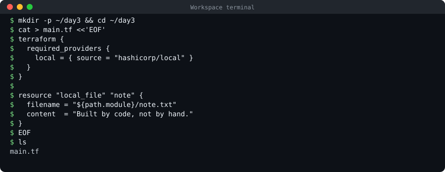

### 2. Prepare the folder: tofu init

```bash
tofu init
```

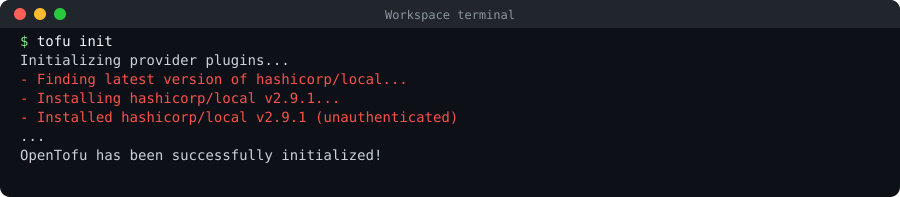

### 3. See what would happen: tofu plan

```bash
tofu plan
```

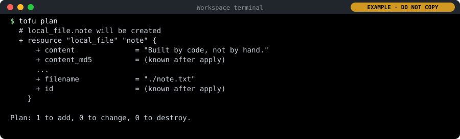

### 4. Make it so: tofu apply

1. Run the command below.

2. It prints the same plan as in step 3, then stops at "Enter a value:".

3. Type yes (the whole word, in small letters) and press Enter. Anything else cancels, and nothing happens.

4. Then run the two commands in the second box to look at the result.

```bash
tofu apply
```

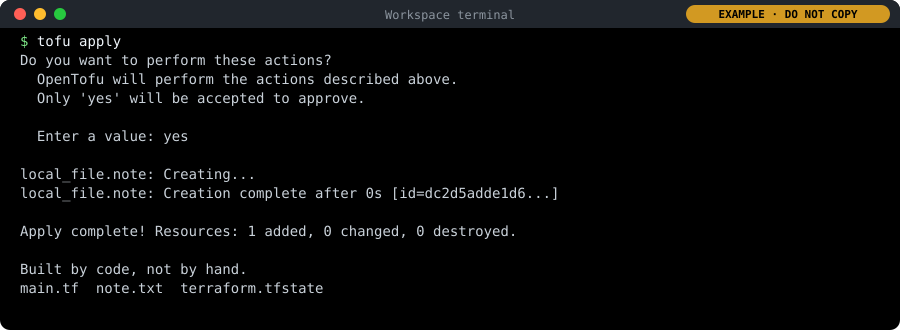

```bash
cat note.txt; echo
ls
```

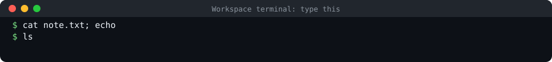

### 5. Change the code, and plan again

1. Change the text in main.tf. The first command in the box does it for you (you could also edit the file by hand).

2. The second command shows the changed line, so you can check it.

3. The third runs a plan: read it before you go on.

4. Then run the second box: apply makes the change (type yes, as in step 4), then shows the file.

In `main.tf`, change:

```
content  = "Built by code, not by hand."
```

to:

```
content  = "Changed by code."
```

```bash
sed -i 's/Built by code, not by hand./Changed by code./' main.tf
grep content main.tf
tofu plan
```

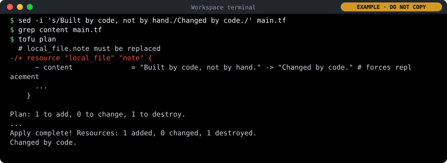

```bash
tofu apply
cat note.txt; echo
```

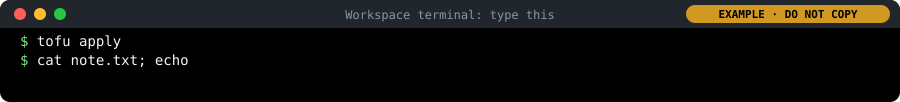

### 6. Break it by hand, let the code repair it, then destroy

1. Run the first box: it deletes the file by hand, then runs a plan.

2. Run the second box: apply puts the file back (type yes).

3. Run the third box: destroy removes what the code made (type yes), then ls shows what is left.

```bash
rm note.txt
tofu plan
```

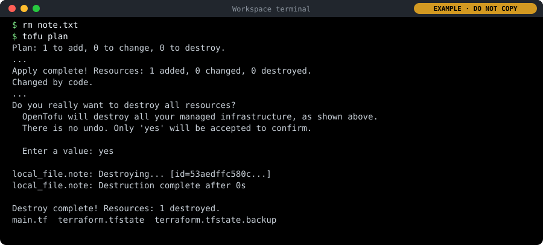

```bash
tofu apply
cat note.txt; echo
```


```bash
tofu destroy
ls
```

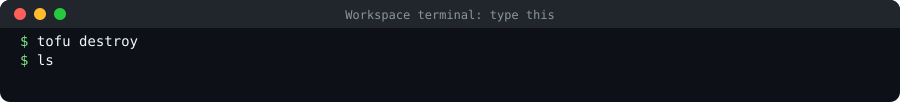

## Lab 2: request staging and prod from the template

Get your team's staging and prod environments the platform way: fill in the environment template, open a pull request, read the plan, and let the platform team approve and apply it.

### 1. Copy the environments repository and make a branch

1. Paste the box into the terminal and press Enter.

2. If Git asks for a Username and Password, type them as in "Before you start".

```bash
cd ~
git clone https://gitea.$DOMAIN/platform/environments
cd environments
git switch -c $TEAM-environments
ls
```

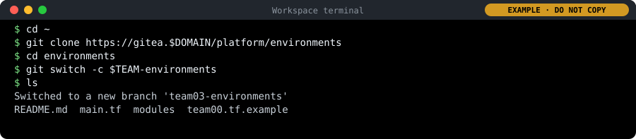

### 2. Fill in the template: six lines

1. Paste the box and press Enter. The first two lines make your file; the last two show it.

2. Read your file with the team: check that your team name appears twice.

In `teamNN.tf`, change:

```
module "team00" {
  source       = "./modules/team-environment"
  team         = "team00"
  environments = ["staging", "prod"]
  size         = "small"
}
```

to:

```
module "team03" {
  source       = "./modules/team-environment"
  team         = "team03"
  environments = ["staging", "prod"]
  size         = "small"
}
```

```bash
cp team00.tf.example $TEAM.tf
sed -i "s/team00/$TEAM/g" $TEAM.tf
cat $TEAM.tf
git status
```

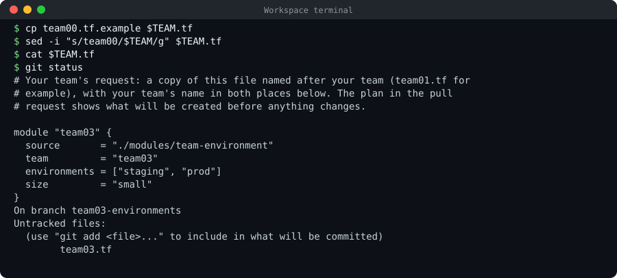

### 3. Propose it, and read the plan

1. Paste the box and press Enter: it saves your file in a commit and sends your branch to Gitea.

2. In what git push prints, find the line remote:   https://gitea.<lab domain>/platform/environments/pulls/new/teamNN-environments. Hold Ctrl (on a Mac Cmd) and click it: Gitea opens in a new browser tab, signed in as you. (Or in Gitea: platform/environments → Pull Requests → New Pull Request, and choose your branch on the right.)

3. The page shows your change and a form under it. The title is already filled in with your commit message; in the box below it, write one line on why your team needs the environments. Click Create Pull Request.

4. Wait about a minute. Near the bottom of the pull request, a check called plan / plan (pull_request) appears: first a yellow dot (running), then a green tick.

5. Click Details next to it. The run opens. On the left, click the job plan; on the right, click the step called Plan to unfold its output.

6. Scroll to the end of the Plan step and read the summary line. Then scroll up and read the list with your team.

```bash
git add $TEAM.tf
git commit -m "Request staging and prod for $TEAM"
git push -u origin $TEAM-environments
```

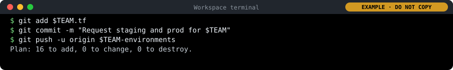

### 4. The platform team approves, and you merge

1. Now you play the platform team: open a private window (Ctrl+Shift+N; on a Mac Cmd+Shift+N; in Firefox Ctrl+Shift+P), go to https://gitea.<lab domain>, click Sign In and sign in as platform-approver with its password from cat /etc/pelab/logins.md.

2. In that window, open the pull request (platform/environments → Pull Requests → yours). Click Files Changed: there must be exactly one new file, teamNN.tf, with your team in both places.

3. Check the plan (as in step 3): 16 to add, 0 to change, 0 to destroy.

4. Click Review (top right of Files Changed), then Approve. Close the private window.

5. Back in your own window, signed in as yourself, reload the pull request. When it shows one approval and "All checks were successful", click the merge button (Create merge commit) and confirm.

6. Wait two minutes. Open platform/environments → Commits and click the small tick next to the newest commit, your merge.

### 5. Look at your new environment

```bash
kubectl get namespaces | grep $TEAM
kubectl -n $TEAM-staging get resourcequota,limitrange
kubectl -n $TEAM-staging describe resourcequota team-quota
```

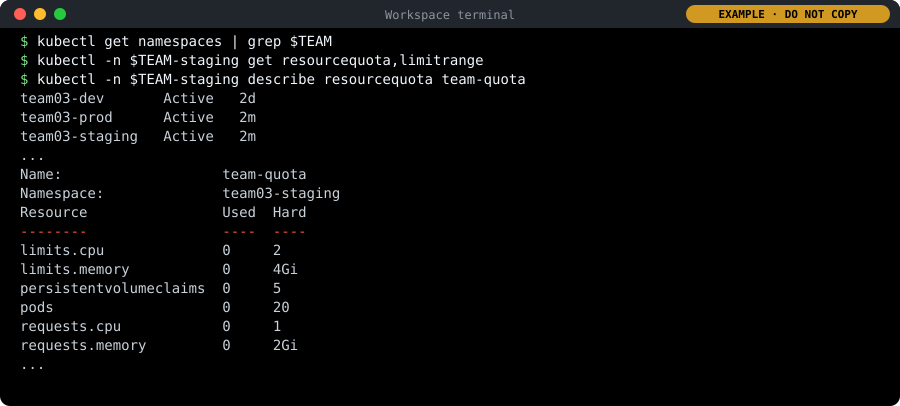

### 6. See your service find its new homes

1. Open https://argocd.<lab domain> in a new browser tab.

2. Sign in as delegate, with its password from cat /etc/pelab/logins.md (not your studentNN password).

3. In the search box at the top of the application list, type your team, for example team03.

4. Click teamNN-hello-staging, then go back and click teamNN-hello-prod.

   

   *An application's page in Argo CD: its health (Healthy), its sync state (Synced to the newest commit on main, with its author and message), and the tree of what it runs. This one is already released (Day 6); today yours runs with 0 copies. In your lab the repository is https://gitea.<lab domain>/teamNN/hello.git, and the names, ids and times are your own.*

## Lab 3: drift, and destroy and recreate

See the platform notice and repair a change made by hand, and see that a whole environment can be removed and rebuilt identically, from code only.

### 1. The instructor changes your quota by hand

1. Wait until the instructor says the budgets have been changed.

2. Then paste the box and press Enter.

```bash
kubectl -n $TEAM-staging get resourcequota team-quota -o jsonpath='{.spec.hard.requests\.cpu}{"\n"}'
```

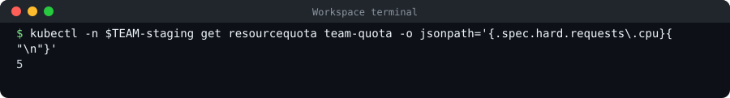

### 2. Detect the drift with a plan

1. In Gitea, open platform/environments and click the Actions tab at the top.

2. On the left, under All Workflows, click plan.

3. A blue bar appears above the list of runs: "This workflow has a workflow_dispatch event trigger." Click Run Workflow on its right. In the small box that opens, leave the branch as main and click Run Workflow.

4. After a few seconds a new run appears at the top of the list (reload the page if not). Click it, then click the job plan on the left, then the step Plan on the right to unfold it.

5. Scroll to the end and read the summary line. Then scroll up and find your budget.

### 3. Let the platform repair it

1. Wait until the instructor says the repairs are switched back on.

2. Paste the box and press Enter. It waits two minutes (the prompt comes back by itself), then reads your budget again.

3. Then in Gitea, open platform/environments → Commits and click the tick next to the newest commit.

```bash
sleep 120
kubectl -n $TEAM-staging get resourcequota team-quota -o jsonpath='{.spec.hard.requests\.cpu}{"\n"}'
```

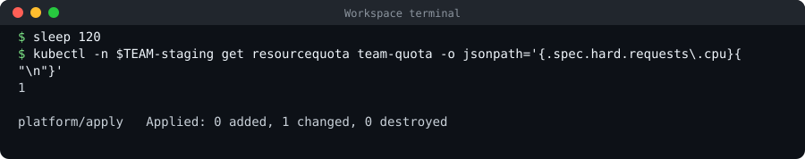

### 4. Propose removing staging, and read the plan

1. Paste the box and press Enter. It brings your copy up to date, makes a new branch, removes "staging" from your file, shows the difference, commits and pushes.

2. Read what git diff prints: the old line in red with -, the new line in green with +.

3. Open the pull request as in Lab 2, step 3: Ctrl+click (Mac Cmd+click) the pulls/new link that git push prints, check the title (Remove staging for teamNN) and click Create Pull Request.

4. When the plan check finishes, open it (Details → plan → Plan) and read the summary line.

In `teamNN.tf`, change:

```
  environments = ["staging", "prod"]
```

to:

```
  environments = ["prod"]
```

```bash
cd ~/environments
git switch main && git pull
git switch -c $TEAM-remove-staging
sed -i 's/\["staging", "prod"\]/["prod"]/' $TEAM.tf
git diff
git commit -am "Remove staging for $TEAM"
git push -u origin $TEAM-remove-staging
```

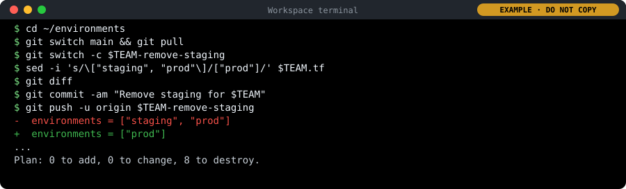

### 5. Remove it, then bring it back

1. Approve it as the platform team (platform-approver, in a private window, as in Lab 2, step 4); then merge it as yourself.

2. Wait two minutes, then paste the first box: staging is gone.

3. Paste the second box: it makes a branch that puts staging back. Open its pull request (title: Add staging back for teamNN), read the plan (8 to add), approve it as platform-approver and merge.

4. Wait two minutes, then paste the third box: staging is back with the same budget.

```bash
kubectl get namespace $TEAM-staging
```

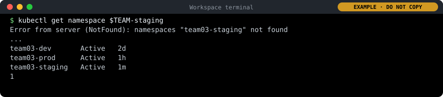

```bash
git switch main && git pull
git switch -c $TEAM-add-staging
sed -i 's/\["prod"\]/["staging", "prod"]/' $TEAM.tf
git diff
git commit -am "Add staging back for $TEAM"
git push -u origin $TEAM-add-staging
```

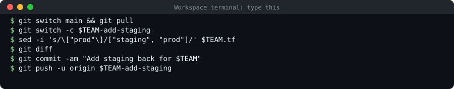

```bash
kubectl get namespaces | grep $TEAM
kubectl -n $TEAM-staging get resourcequota team-quota -o jsonpath='{.spec.hard.requests\.cpu}{"\n"}'
```

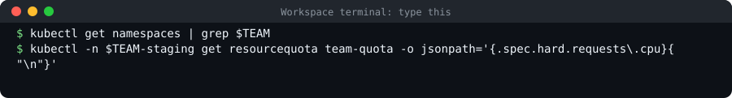

## Pipelines: the one that checked your request

Your request in Lab 2 was checked by a pipeline the environments repository came with. Read it, and run its first check yourself.

### 1. Get the latest environments

1. Your copy from Lab 2.

   ```bash
   cd ~/environments
   git switch main
   git pull
   ```

   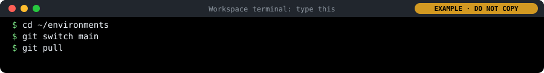

### 2. List its steps

1. Each "- name:" is one step of the pipeline.

   ```bash
   grep -n "name:" .gitea/workflows/plan.yaml
   ```

   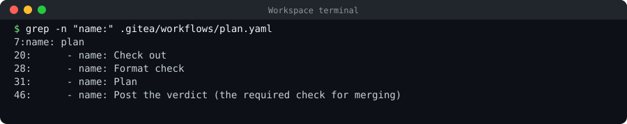

### 3. Run its first check yourself

1. The Format check step. No output means every file is formatted.

   ```bash
   tofu fmt -check -recursive -diff
   ```

   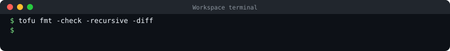

### 4. Find its runs in Gitea

1. Open https://gitea.<lab domain>/platform/environments, then the Actions tab, then plan.

2. Open your run from Lab 2 and read the last lines of the Plan step.
