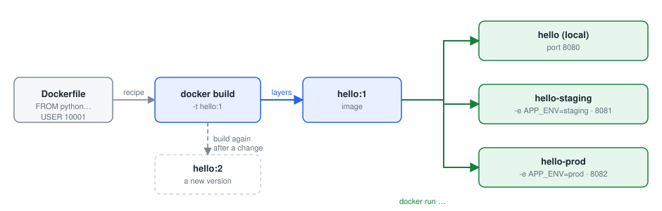
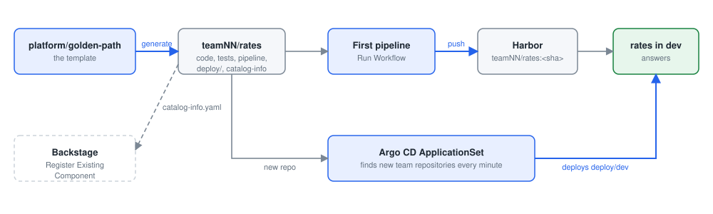
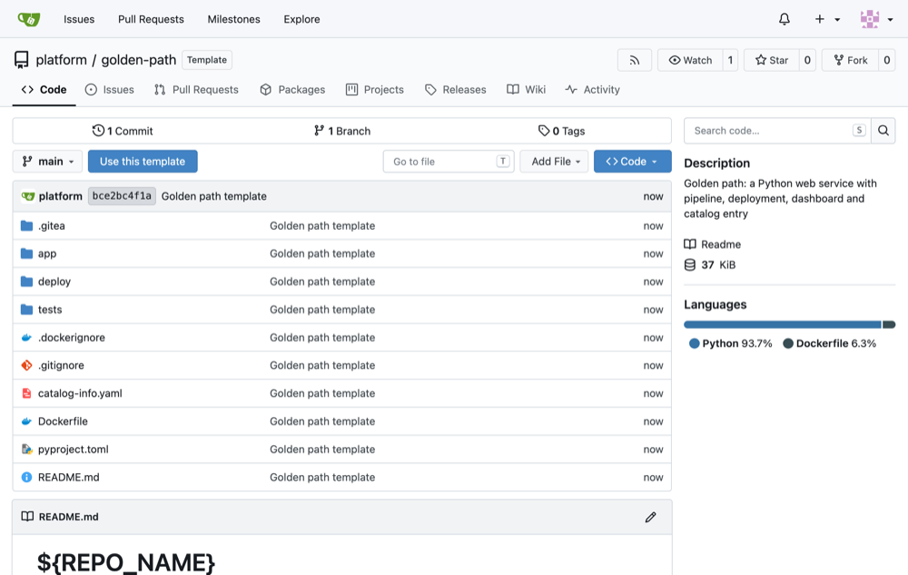
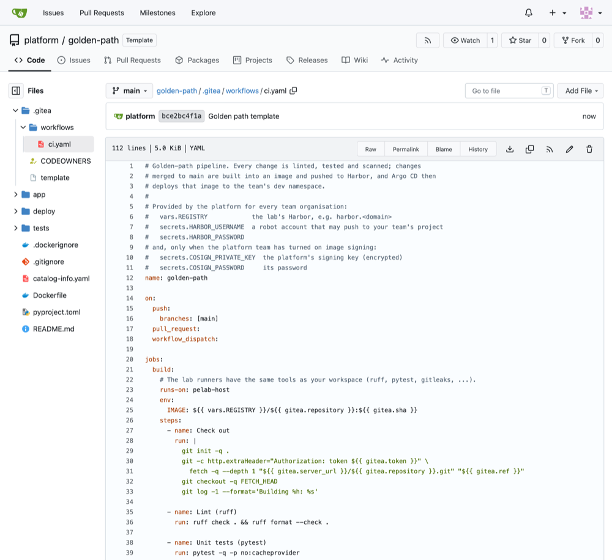
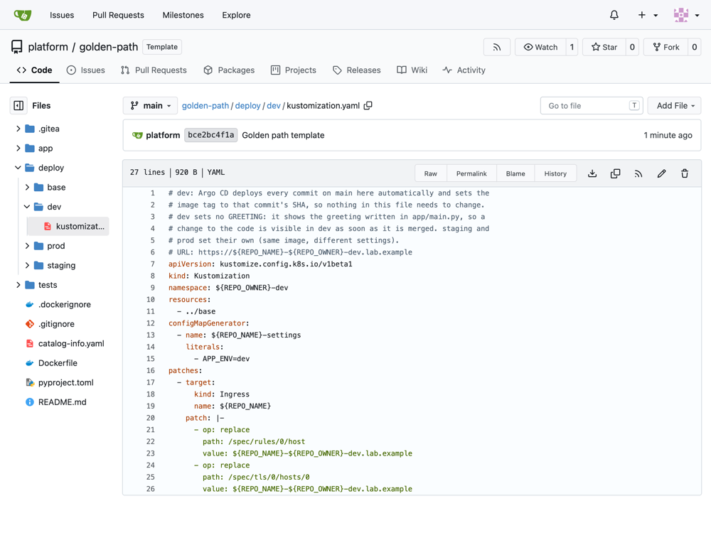
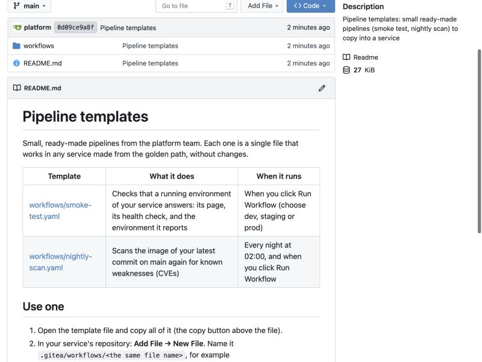
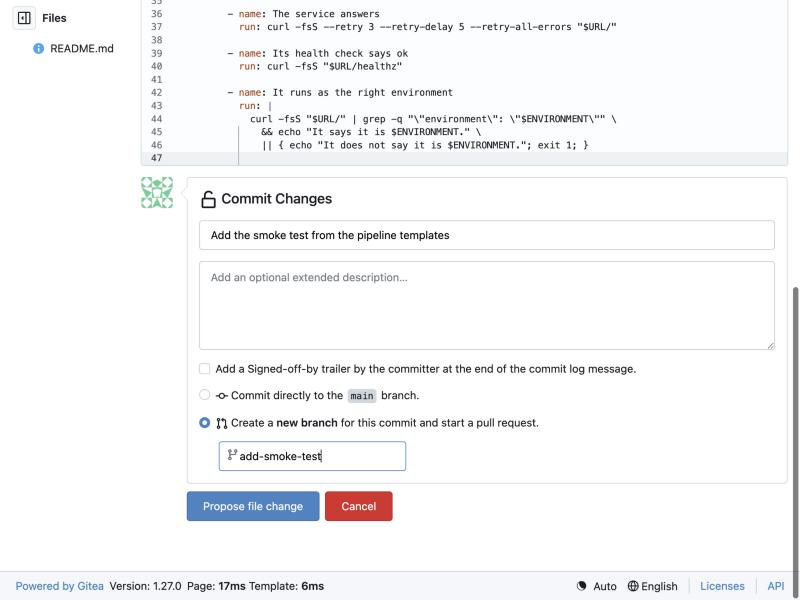
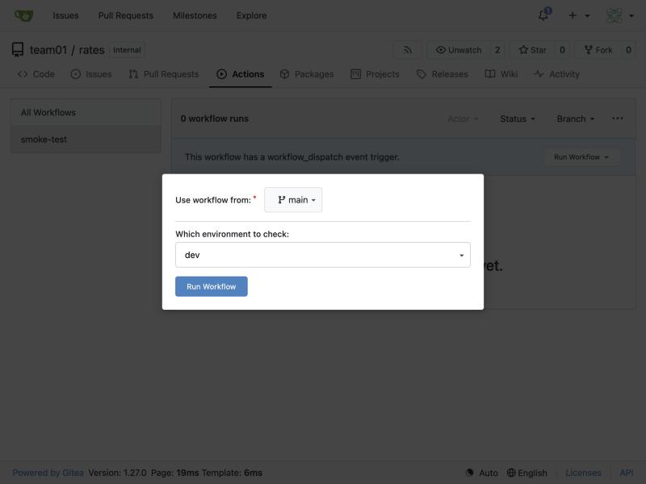
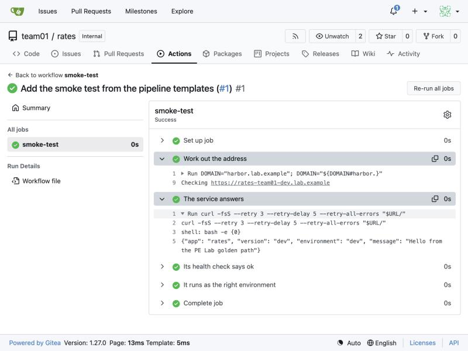

# Day 4: Containers and the packaging template

**Goal:** Build and run a container, and create a new service from the packaging template without a ticket.

By the end of the day you can:

- Explain image, container, Dockerfile, registry and tag in plain words
- Build the hello image, run it with different settings, and see it report its environment
- Create a new service from the golden-path template and find it in the catalog and in dev

### Today's plan

Yesterday your team got staging and prod from a template. Today you package hello in a container by hand, then let the packaging template create a whole new service.

| Topic | Labs |
| --- | --- |
| Containers | [Lab 1: build and run the hello image](#lab-1-build-and-run-the-hello-image)<br>[Lab 2: one image, three environments](#lab-2-one-image-three-environments) |
| The packaging template | [Lab 3: create a new service from the template](#lab-3-create-a-new-service-from-the-template) (per team)<br>[Lab 4: a first change to the new service](#lab-4-a-first-change-to-the-new-service)<br>[Lab 5: add a pipeline from a template](#lab-5-add-a-pipeline-from-a-template) |

## Containers

### Containers in plain words

An image is the application plus everything it needs to run (the language, the libraries, the settings files), frozen into one package. A container is a running copy of an image.

A Dockerfile is the recipe that builds the image, step by step, from a base image. A registry is the shelf where images are kept and scanned. A tag is the version label on an image.

"It works on my machine" stops being a problem: the image that passed the checks is the image that runs in dev, staging and prod.

> **In one sentence:** An image is the app and everything it needs, packaged once; a container is that image running.

**In the lab**

- Docker runs inside your workspace.
- Harbor is the lab's registry; every team has a project in it.
- The pipeline tags each image with the commit it was built from.
- The base image comes through Harbor's cache, not straight from the internet.

### From recipe to running container



*Build once, run as many environments as you need: only the settings change.*

1. Dockerfile
2. docker build
3. Image
4. docker run
5. Container
6. docker push
7. Registry (Harbor)
8. Deployed by Argo CD

This morning you do steps 1 to 5 by hand. From Day 5 the pipeline does steps 1 to 7 on every change, and Argo CD does step 8.

### The hello Dockerfile, line by line

```
ARG BASE_IMAGE=python:3.12-slim
FROM ${BASE_IMAGE}

ARG APP_VERSION=dev
ENV APP_VERSION=${APP_VERSION} \
    PYTHONUNBUFFERED=1

WORKDIR /srv
COPY app/ ./app/

USER 10001
EXPOSE 8080
ENTRYPOINT ["python", "-m", "app.main"]
```

- FROM: start from a small official Python image. The pipeline passes the Harbor-cached copy as BASE_IMAGE.
- ENV: settings baked into the image. APP_VERSION becomes the commit id in the pipeline.
- COPY app/: put the application code into the image. Nothing else: no tests, no secrets.
- USER 10001: run as an ordinary user, never as root. A guardrail on Day 5 checks this.
- ENTRYPOINT: the command the container runs when it starts.

## Lab 1: Docker by hand

### Lab 1: build and run the hello image

**What you do:** Package hello into a container image yourself, run it, look inside it, and remove it.

**You will learn:**

- What a container image is, and how a Dockerfile describes one.
- How to build an image, run it as a container, read its logs and look inside.
- Why the image runs as an ordinary user, not as the administrator.

**Words you will meet:**

- **Image:** A package with everything a program needs to run: the program, Python, the libraries. Built once, it never changes.
- **Container:** A running copy of an image, kept apart from everything else on the machine.
- **Dockerfile:** The recipe for an image: one instruction per line.
- **Tag:** The label after the colon in hello:1: which version of the image.
- **Registry:** Where images are kept and shared. The lab's registry is Harbor; it also keeps copies of public images from Docker Hub.
- **Port mapping:** -p 8080:8080 connects a port of your workspace to a port inside the container.

**Before you start:**

1. Your workspace is open in the browser (https://student01.<lab domain>, signed in with your password).
2. A terminal is open at the bottom of the workspace. If not: menu ☰ (top left) → Terminal → New Terminal. You are ready when you see a prompt that ends in $, for example student01@student01:~$
3. To run a command: copy it from this page (the copy button at the top right of each grey box), click in the terminal, paste with Ctrl+V (on a Mac Cmd+V, or right-click → Paste), and press Enter. You can paste a whole box at once: the lines run one after the other.
4. If Git asks for a Username (the first time each day: it then remembers your password for 10 hours), type student01 and press Enter; for the Password, type your password (from cat /etc/pelab/logins.md) and press Enter. Nothing appears while you type the password: that is normal.
5. Your copy of hello, in ~/hello. Docker is already installed in your workspace; nothing else is needed.

#### Step 1. Build the image

*Where: Workspace terminal*

**Why:** Packaging the service once, as an image, means it runs exactly the same everywhere: in your workspace, in dev, staging and prod.

**Do this:**

1. Paste the box and press Enter. The first build takes a minute: it fetches Python through Harbor.

   ```bash
   cd ~/hello
   git switch main && git pull
   docker build --build-arg BASE_IMAGE=harbor.$DOMAIN/dockerhub/library/python:3.12-slim -t hello:1 .
   ```

2. Read the numbered steps as they appear: one for each instruction in the Dockerfile.

**What each line does:**

- `git switch main && git pull`: build from the latest main, with your team's merged changes.
- `docker build`: build an image by following the Dockerfile in this folder.
- `--build-arg BASE_IMAGE=harbor.$DOMAIN/dockerhub/library/python:3.12-slim`: which image to start from: a small Python 3.12, fetched through the lab's Harbor (dockerhub is Harbor's copy of Docker Hub). The Dockerfile's first line uses this setting.
- `-t hello:1`: name (tag) the result hello, version 1.
- `.`: the folder to build from: this one (the dot). The Dockerfile is here.

**You should see:** Something like this: a list of steps that fills in as it goes, [1/3] to [3/3] for the three instructions of the Dockerfile, ending with the image being named:

```
[+] Building 12.4s (8/8) FINISHED                                     docker:default
 => [internal] load build definition from Dockerfile                             0.0s
 => [internal] load metadata for harbor.<lab domain>/dockerhub/library/python:3.12-slim   1.2s
...
 => [1/3] FROM harbor.<lab domain>/dockerhub/library/python:3.12-slim@sha256:...   9.6s
...
 => [2/3] WORKDIR /srv                                                           0.3s
 => [3/3] COPY app/ app/                                                         0.1s
 => exporting to image                                                           0.2s
 => => exporting layers                                                          0.1s
 => => writing image sha256:51ec07f75cbf...                                      0.0s
 => => naming to docker.io/library/hello:1                                       0.0s
```

**How to read it:**

- Each [n/3] is one instruction of the Dockerfile: start from Python, make a working folder /srv, copy your app folder into it. Open Dockerfile in the editor to see the lines.
- A second build is much faster: Docker reuses the steps that did not change (CACHED).

**If you see something else:**

- *failed to resolve source metadata ... harbor*: the workspace cannot reach Harbor. Check that you pasted the whole line; if it still fails, tell the instructor.
- *Cannot connect to the Docker daemon*: Docker is not running in your workspace: sudo systemctl start docker, then build again.

#### Step 2. Find it in the list of images

*Where: Workspace terminal*

**Why:** An image is now stored in your workspace, ready to run as many times as you like.

```bash
docker images hello
```

**What each line does:**

- `docker images hello`: list the images called hello in your workspace.

**You should see:** hello:1 with its id and its size:

```
IMAGE     ID             DISK USAGE   CONTENT SIZE   EXTRA
hello:1   51ec07f75cbf        145MB             0B
```

**How to read it:**

- Almost all of the 145 MB is Python itself; your code is a few kilobytes.
- The id is the image's fingerprint: the same id is always exactly the same image.

#### Step 3. Run it

*Where: Workspace terminal*

**Why:** An image is only a package; a container is the running copy. One image can run as many containers as you like.

```bash
docker run -d --name hello -p 8080:8080 hello:1
docker ps
```

**What each line does:**

- `docker run`: start a container from an image.
- `-d`: in the background (detached), so your terminal stays free.
- `--name hello`: call the container hello, so later commands can find it by name.
- `-p 8080:8080`: connect port 8080 of your workspace to port 8080 inside the container, where the service listens.
- `hello:1`: the image to run.
- `docker ps`: list the running containers.

**You should see:** A long container id, then hello in the list with STATUS "Up":

```
945cd5ec3bf7cdc2172d...
CONTAINER ID   IMAGE     COMMAND                CREATED         STATUS        PORTS                                         NAMES
945cd5ec3bf7   hello:1   "python -m app.main"   2 seconds ago   Up 1 second   0.0.0.0:8080->8080/tcp, [::]:8080->8080/tcp   hello
```

**If you see something else:**

- *port is already allocated*: something already uses port 8080, perhaps hello from Day 1 still running: stop it (Ctrl+C in its terminal, or pkill -f "python3 -m app.main"), then docker rm hello and run again.
- *The container name "/hello" is already in use*: a container called hello exists from an earlier try: docker rm -f hello, then run again.

#### Step 4. Call it

*Where: Workspace terminal*

**Why:** Check that the service in the container answers exactly like the one you ran by hand on Day 1.

```bash
curl -s localhost:8080/
curl -i localhost:8080/healthz
```

**What each line does:**

- `curl -s localhost:8080/`: call the service; port 8080 of your workspace leads into the container.
- `curl -i localhost:8080/healthz`: the health check, with the status line.

**You should see:** The same answers as on Day 1, now from inside a container:

```
{"app": "hello", "version": "dev", "environment": "local", "message": "Hello from the PE Lab golden path"}
HTTP/1.0 200 OK
Server: hello Python/3.12.15
...
ok
```

**How to read it:**

- The Server line shows the Python inside the image (yours may be a slightly different 3.12), not your workspace's: the container brings its own.

**If you see something else:**

- *curl: (52) Empty reply from server, or nothing at all*: the container is still starting. Wait two seconds and run the box again.

#### Step 5. Read its logs, and check who it runs as

*Where: Workspace terminal*

**Why:** Logs are how you find out what a container did. And a container should never run as the administrator: if someone breaks into it, they must get as little as possible.

```bash
docker logs hello
docker exec hello id
```

**What each line does:**

- `docker logs hello`: show what the program in the container wrote: its log.
- `docker exec hello id`: run one command, id, inside the running container; id shows which user it runs as.

**You should see:** The JSON log lines, then the user:

```
{"event": "started", "app": "hello", "env": "local", "version": "dev", "port": 8080}
{"event": "request", "app": "hello", "env": "local", "method": "GET", "path": "/", "status": 200, "duration_ms": 0.24}
uid=10001 gid=0(root) groups=0(root)
```

**How to read it:**

- One log line for the start, then one per request: the same log as on Day 1.
- uid=10001 is an ordinary user, not root (root would be uid=0). The Dockerfile's USER 10001 line did that. On Day 5 you see the pipeline refuse a Dockerfile without it.

#### Step 6. Stop and remove it

*Where: Workspace terminal*

**Why:** Containers are thrown away and recreated, never repaired by hand. The image stays, ready to run again.

```bash
docker stop hello
docker rm hello
docker ps -a
docker images hello
```

**What each line does:**

- `docker stop hello`: stop the container (it is asked to finish, then stopped).
- `docker rm hello`: remove the stopped container.
- `docker ps -a`: list all containers, stopped ones too (-a): none left.
- `docker images hello`: the image is still there.

**You should see:** No container left, but the image hello:1 is still there:

```
hello
hello
CONTAINER ID   IMAGE     COMMAND   CREATED   STATUS    PORTS     NAMES
IMAGE     ID             DISK USAGE   CONTENT SIZE   EXTRA
hello:1   51ec07f75cbf        145MB             0B
```

**How to read it:**

- docker stop and docker rm each repeat the container's name when they succeed.

**Done when:** You built hello:1, ran it, read its logs, saw it runs as an ordinary user, and removed the container.

**If you are stuck**

- The build cannot pull the base image: the Harbor cache may be cold or offline. Tell the lab assistant.
- port is already allocated: an old container still uses the port. docker rm -f hello, then run again.

### Lab 2: one image, three environments

**What you do:** Run the same image as staging and prod with only its settings changed, and see that a new version is a new image beside the old one.

**You will learn:**

- Build once, run anywhere: the same image runs in every environment; only the settings differ.
- A new version is a new image, beside the old one; rolling back is running the old one again.

**Words you will meet:**

- **Environment variable:** A setting given to the container when it starts, with -e NAME=value.
- **Version:** Here a new tag, hello:2, built from changed code. hello:1 is not touched.

**Before you start:**

1. Lab 1 done: the image hello:1 exists (docker images hello).
2. No container called hello is running (docker ps shows none).

#### Step 1. Run it as staging

*Where: Workspace terminal*

**Why:** The same image becomes "staging" just by being given other settings when it starts.

```bash
cd ~/hello
docker run -d --name hello-staging -p 8081:8080 -e APP_ENV=staging -e GREETING="Hello from staging" hello:1
sleep 2
curl -s localhost:8081/
```

**What each line does:**

- `cd ~/hello`: go into your copy of hello: this lab builds and edits it (a new terminal starts in your home folder, where docker build would not find the Dockerfile).
- `--name hello-staging -p 8081:8080`: a second name and another port of your workspace (8081), leading to the same port 8080 inside.
- `-e APP_ENV=staging -e GREETING="Hello from staging"`: two settings (environment variables) given to the container.
- `sleep 2`: wait two seconds: the service needs a moment to start before it can answer.
- `curl -s localhost:8081/`: call this copy.

**You should see:** The same image, now reporting staging:

```
{"app": "hello", "version": "dev", "environment": "staging", "message": "Hello from staging"}
```

#### Step 2. Run it as prod too

*Where: Workspace terminal*

**Why:** Two environments side by side, from one image: what dev, staging and prod are on the platform.

```bash
docker run -d --name hello-prod -p 8082:8080 -e APP_ENV=prod -e GREETING="Hello from prod" hello:1
sleep 2
curl -s localhost:8082/
docker ps
```

**What each line does:**

- `docker run ... -e APP_ENV=prod ... hello:1`: a third copy, as prod, on port 8082.
- `docker ps`: both are running, from the same image.

**You should see:** prod answers, and docker ps lists two containers, both from hello:1:

```
{"app": "hello", "version": "dev", "environment": "prod", "message": "Hello from prod"}
CONTAINER ID   IMAGE     ...   PORTS                    NAMES
...            hello:1   ...   0.0.0.0:8082->8080/tcp   hello-prod
...            hello:1   ...   0.0.0.0:8081->8080/tcp   hello-staging
```

#### Step 3. Make version 2

*Where: Workspace editor and terminal*

**Why:** A change to the code means a new image. The old one stays exactly as it was: that is what makes rolling back safe.

**Do this:**

1. In the editor, open hello → app → main.py and change the text of the GREETING line (line 22), for example to Hello from version 2. Save with Ctrl+S (Mac Cmd+S).

2. Paste the box: it builds a new image, tagged 2, and gives it the version number 2.

   ```bash
   docker build --build-arg BASE_IMAGE=harbor.$DOMAIN/dockerhub/library/python:3.12-slim --build-arg APP_VERSION=2 -t hello:2 .
   docker images hello
   ```

**What changes in `app/main.py`:** line 22, only the text in the second pair of quotes.

Before:

```
GREETING = os.environ.get("GREETING", "Hello from the PE Lab golden path")
```

After:

```
GREETING = os.environ.get("GREETING", "Hello from version 2")
```

**What each line does:**

- `--build-arg APP_VERSION=2`: a setting baked into the image when it is built: the version it reports.
- `-t hello:2`: tag the new image hello, version 2.

**You should see:** Two images: hello:1 (in use, U) and the new hello:2:

```
IMAGE     ID             DISK USAGE   CONTENT SIZE   EXTRA
hello:1   51ec07f75cbf        145MB             0B   U
hello:2   88e52ddf8ecf        145MB             0B
```

**How to read it:**

- Different ids: two different images. Building version 2 did not change version 1.
- U under EXTRA means "in use": your staging and prod containers run hello:1.

> **Tip:** No editor at hand? sed -i 's/Hello from the PE Lab golden path/Hello from version 2/' app/main.py makes the same change.

#### Step 4. Run the two versions side by side

*Where: Workspace terminal*

**Why:** Old and new can run at the same time. Rolling back is just running the old image again: nothing has to be rebuilt.

```bash
docker run -d --name hello-v1 -p 8080:8080 hello:1
docker run -d --name hello-v2 -p 8083:8080 hello:2
sleep 2
curl -s localhost:8080/
curl -s localhost:8083/
```

**What each line does:**

- `docker run ... hello:1 / hello:2`: one container from each version, on ports 8080 and 8083.
- `curl -s localhost:8080/, curl -s localhost:8083/`: ask both.

**You should see:** Two answers: version dev with the old greeting, version 2 with yours:

```
{"app": "hello", "version": "dev", "environment": "local", "message": "Hello from the PE Lab golden path"}
{"app": "hello", "version": "2", "environment": "local", "message": "Hello from version 2"}
```

#### Step 5. Clean up

*Where: Workspace terminal*

**Why:** Leave the workspace tidy, and undo your greeting change: real changes go through a pull request, not from here.

```bash
docker rm -f hello-staging hello-prod hello-v1 hello-v2
git checkout app/main.py
docker ps
```

**What each line does:**

- `docker rm -f ...`: stop and remove the four containers in one go (-f: force, even while running).
- `git checkout app/main.py`: undo your change to app/main.py: put back what Git has.
- `docker ps`: check that nothing is running.

**You should see:** The four names, Git confirming the undo, and an empty list:

```
hello-staging
hello-prod
hello-v1
hello-v2
Updated 1 path from the index
CONTAINER ID   IMAGE     COMMAND   CREATED   STATUS    PORTS     NAMES
```

**Done when:** You ran one image as three environments and two versions side by side.

**If you are stuck**

- Your change does not show: rebuild with a new tag, and run that tag. A tag never changes its image.

## Containers

### Build once, run anywhere: why settings live outside the image

The image that passed the tests and the scan is the one that runs in production. If you rebuilt it for each environment you would be testing one thing and running another.

So the image holds the code, and the environment holds the settings: the environment name, the greeting, the port, and later secrets. In Kubernetes these arrive as environment variables from a ConfigMap.

Tags are immutable: a tag names one image forever. The pipeline uses the commit id, so every running container can be traced to the exact code it came from.

> **In one sentence:** The image is the code, frozen; the environment supplies the settings; the tag ties a container to a commit.

**In the lab**

- deploy/base holds the definition shared by all environments.
- deploy/dev, deploy/staging and deploy/prod each add only the settings that differ: namespace, APP_ENV, GREETING, address, image tag, replicas.
- Promotion on Day 6 is changing the tag in deploy/staging, nothing else.

## The packaging template

*What a new service gets for free, and how the platform team built it. Then you create a new service from it (Lab 3), make its first change (Lab 4), and add a pipeline from a template (Lab 5).*

### What every new service gets from the template

- **A working service and its tests:** The hello app skeleton, five unit tests, and a project file for lint and tests. It runs on the first day.
- **A Dockerfile that passes the checks:** Small base image, non-root user, only the code inside. The Dockerfile check in the pipeline is already green.
- **The pipeline:** Lint, tests, secret scan, Dockerfile check, build, image scan, push. The same for every service, so every service meets the same standard.
- **Deployment for dev, staging and prod:** The Kubernetes definition with probes, resource limits and security settings, plus one overlay per environment. Dev goes live on the first merge.
- **Catalog entry, dashboard, alert, README:** The portal knows the service and its owner; Grafana shows it; an alert fires if it is down; the README explains the path.

### Architecting a golden path: how the platform team built it

Pick a job many teams do the same way. Here: start a new web service and get it to production.

Build it once, properly, with the controls inside: the Dockerfile, the pipeline checks, the deployment settings, the ownership metadata. Have security review it once, not once per team.

Hand it over as a template, measure how many teams use it and how long they take, and improve it from their feedback. Keep it the easiest route, or teams will go around it.

> **In one sentence:** A golden path is built once with the controls inside, handed over as a template, and kept the easiest route.

**In the lab**

- The template is a Gitea template repository: platform/golden-path.
- Creating a service copies it and fills in the names.
- The platform team changes it in one place; new services get the improvement.
- On Day 6 your capstone says what you would add to it next.

### Your service is also an API, with an owner and a promise

The brief wants governed APIs: an owner, a contract, versioning, monitoring. The template gives the simplest version of each.

- **A contract:** / returns a fixed JSON shape; /healthz tells the platform the service is alive; /metrics gives Prometheus its numbers. Consumers can rely on the shape.
- **An owner:** catalog-info.yaml names the team that owns it. The portal shows it; CODEOWNERS routes reviews to it.
- **A version:** Every response carries the version (the commit id). Every image carries the same. Nothing runs that cannot be traced.
- **Monitoring:** The template includes a ServiceMonitor and an alert rule. The dashboard on Day 6 shows requests, errors and versions per environment.

## Lab 3: create a service from the template

### Lab 3: create a new service from the template



*A new service from the template: its first pipeline, Harbor and Argo CD take it to dev without anyone being asked.*

*per team*

**What you do:** Use the golden path: create a brand-new service called rates from the template, and watch it build, deploy and appear in the portal without asking anyone.

**You will learn:**

- What a golden path gives a team: a new service with code, tests, pipeline, deployment, dashboard and catalog entry, in minutes.
- How the pieces of the platform connect: Gitea, the pipeline, Harbor, Argo CD and the portal.
- Where the template lives (platform/golden-path in Gitea), where its pipeline is (.gitea/workflows/ci.yaml), and how a new service gets both.

**Words you will meet:**

- **Golden path (template):** The platform team's ready-made way to build a service. You fill in a name; everything else is already done the safe way.
- **Harbor:** The lab's registry: it stores your images, scans them for known weaknesses and lists their ingredients (SBOM).
- **Portal (Backstage):** The catalog of every service: who owns it and where it runs.

**Before you start:**

1. Gitea is open and you are signed in as yourself (https://gitea.<lab domain>).
2. Keep your logins at hand (cat /etc/pelab/logins.md): Harbor uses your studentNN login; Argo CD the delegate login.

#### Step 1. Look inside the template first

*Where: Browser: Gitea*

**Why:** The template is an ordinary repository that the platform team owns: platform/golden-path. Everything a new service gets, its pipeline included, is in there. You read it; you never copy it by hand.

**Do this:**

1. Open https://gitea.<lab domain>/platform/golden-path. Next to the name platform / golden-path, a grey label says Template, and a blue button Use this template sits above the files: Gitea offers this repository as a starting point for new ones. Do not click it yet.

   

   *The template repository platform/golden-path in Gitea: the Template label next to its name, and the folders and files every new service gets. In your lab the address starts with https://gitea.<lab domain>.*

2. Read the list of files: .gitea (the pipeline and the review rule), app (the code), deploy (how it runs in dev, staging and prod), tests, Dockerfile (how the image is built), README.md (the user guide) and catalog-info.yaml (its portal entry).

3. Click .gitea, then workflows, then ci.yaml. This is the pipeline: the one file that says what runs on every change.

   

   *The pipeline in the template, .gitea/workflows/ci.yaml. The comment at the top says what the platform provides (the registry and the push login); the on: block says when it runs; each "- name:" under steps is one check.*

4. Read the steps from top to bottom: each line "- name: ..." is one step. Check out, Lint (ruff), Unit tests (pytest), Secret scan (gitleaks), Dockerfile lint (hadolint), Validate the manifests, Build the image, Vulnerability scan (trivy), Push to Harbor, Sign the image, Clean up, Post the verdict.

5. Read the block on: near the top: the pipeline runs on every push to main, on every pull request, and when someone clicks Run Workflow (workflow_dispatch).

6. Go back to platform/golden-path (click golden-path in the path at the top). Click deploy, then dev, then kustomization.yaml.

7. Find ${REPO_NAME} and ${REPO_OWNER} in it. They are blanks: when a repository is created from the template, Gitea writes the new name and team in their place.

   

   *deploy/dev/kustomization.yaml in the template: ${REPO_NAME} and ${REPO_OWNER} are the blanks Gitea fills in with the new repository's name and team.*

8. Go back, click .gitea, then the file template. It lists the files in which Gitea fills in the blanks: README.md, catalog-info.yaml, .gitea/CODEOWNERS and everything under deploy.

**You should see:** The template: one repository with the code, the pipeline (.gitea/workflows/ci.yaml), the deployment for three environments and the catalog entry, with blanks where the service's name and team go.

**How to read it:**

- This is how a platform team shares its knowledge: not as a wiki page or a ticket, but as a working starting point. Every team that uses it gets the same checks in the same order.
- You can read the template but not change it: it belongs to the platform team. To ask for a change, open an issue in platform/golden-path (the Issues tab).

**If you see something else:**

- *Gitea shows "404 Not Found"*: check the address: platform, then golden-path, with a dash. Make sure you are signed in (your picture at the top right).

#### Step 2. Create the repository from the template

*Where: Browser: Gitea*

**Why:** One form creates a complete service. Nobody raises a ticket or copies files by hand.

**Do this:**

1. In Gitea, click + (top right, next to your picture) → New Repository.
2. Owner: open the list and choose your team, teamNN (not your own name).
3. Repository Name: rates (in small letters).
4. Template: click "Select a template.", type golden and choose platform/golden-path. (Clicking Use this template on platform/golden-path opens the same form with this already chosen.)
5. Template Items appears: tick Git Content (Default Branch) and Branch Protection. Leave the others.
6. Click Create Repository at the bottom.

**You should see:** teamNN/rates with the folders app, deploy and tests and the files Dockerfile, README.md and catalog-info.yaml.

**How to read it:**

- Open deploy → dev → kustomization.yaml: where the template had ${REPO_NAME} and ${REPO_OWNER}, it now says rates and teamNN. The template filled them in.
- Open .gitea → workflows → ci.yaml: the same pipeline you read in the template, word for word. You wrote none of it, and it already runs every check.
- Branch Protection copied the template's rule: main takes pull requests only, with an approval and a green pipeline, from the first minute.

**If you see something else:**

- *Your team is not in the Owner list*: you are not signed in as yourself, or not in the team. Check the picture at the top right; if it is right, tell the instructor.
- *The repository has only a README*: Git Content was not ticked. Ask the instructor to delete it, and create it again.

#### Step 3. Run its pipeline for the first time

*Where: Browser: Gitea*

**Why:** The first pipeline builds the first image. From then on it runs by itself on every change.

**Do this:**

1. In teamNN/rates, click the Actions tab.
2. On the left, under All Workflows, click golden-path.
3. A blue bar says "This workflow has a workflow_dispatch event trigger.": click Run Workflow on its right, leave the branch as main, and click Run Workflow in the box that opens.
4. Reload the page after a few seconds: a new run appears at the top. Click it to watch.

**You should see:** The job build with its steps (lint, tests, secret scan, Dockerfile lint, build, scan, push), each turning green, in a few minutes.

**How to read it:**

- Each step is a check of the golden path. You meet every one of them again on Day 5.

**If you see something else:**

- *The run waits for a long time ("Waiting to run")*: the runner is busy with another run (yours, for example on another branch). Wait; if it has not started after five minutes, tell the instructor.

#### Step 4. Find its image in Harbor

*Where: Browser: Harbor*

**Why:** The pipeline's result is an image in Harbor, scanned, with its list of ingredients. That is the evidence of what will run.

**Do this:**

1. Open https://harbor.<lab domain> in a new tab. On the sign-in page, type your studentNN in Username and your own password in Password (the same as Gitea), and click LOG IN.
2. You land on Projects: a table with one line per project. In the Project Name column, click your team, teamNN.
3. The project opens on its Repositories tab: one line per image name. Click teamNN/rates.
4. You now see the artifacts list: one line per image built. Read the line from left to right: Artifacts (the image's fingerprint, sha256:...), Tags (the commit id), Size, Vulnerabilities (a coloured bar; move the mouse over it to see how many weaknesses of each severity) and Push Time.

**You should see:** One artifact, tagged with the commit id (40 letters and digits), with its scan result under Vulnerabilities and its SBOM.

**How to read it:**

- The tag is the commit the image was built from: anyone can trace a running image back to its exact code and review.
- Click the artifact to see the vulnerability report and the SBOM (the ingredients list). Day 5 reads them in detail.

#### Step 5. Watch it deploy

*Where: Browser: Argo CD*

**Why:** Argo CD finds new services by itself and deploys them to dev. Nobody configures anything.

**Do this:**

1. Open https://argocd.<lab domain> and sign in as delegate, with its password from cat /etc/pelab/logins.md.
2. Type your team in the search box at the top.
3. Wait up to a minute: Argo CD looks for new repositories every minute.

**You should see:** teamNN-rates-dev appears, then shows Synced and Healthy.

> **Tip:** If the safety net is on: the latest commit of teamNN/rates in Gitea shows safety-net/dev "Deployed to teamNN-dev" once the first pipeline has passed.

#### Step 6. Open it

**Why:** The new service answers on its own dev address, made for it by the template.

*Where: Browser*

**Do this:**

1. Open https://rates-teamNN-dev.<lab domain>/ in a new tab (your team instead of teamNN).

**You should see:** The same kind of page as hello: DEV in big red letters, the greeting "Hello from the PE Lab golden path", and under it "rates · version" with the commit id. Same template, so the same page, with the new service's name.

**If you see something else:**

- *A 404 page, or the browser cannot find the address*: Argo CD has not deployed it yet (step 5). Wait a minute and reload.

<details>
<summary>The same in the terminal (optional)</summary>

*Where: Workspace terminal*

```bash
curl -s https://rates-$TEAM-dev.$DOMAIN/
```

**What each line does:**

- `curl -s https://rates-$TEAM-dev.$DOMAIN/`: call the new service in dev, as a program would: the answer is data (JSON).

**You should see:** It answers as rates, in dev:

```
{"app": "rates", "version": "4f2c1e9...", "environment": "dev", "message": "Hello from the PE Lab golden path"}
```

**If you see something else:**

- *curl: (6) Could not resolve host, or a 404 page*: Argo CD has not deployed it yet (step 5). Wait a minute and try again.

</details>

#### Step 7. Add it to the portal

*Where: Browser: the portal (Backstage)*

**Why:** The catalog is where everyone finds every service, its owner and its links. Registering takes one address.

**Do this:**

1. Open https://backstage.<lab domain> in a new tab. A page asks how to sign in: on the Guest card, click Enter. No password is needed.
2. In the menu on the left (Home, Catalog, APIs, Docs, Create...), click Create.... The page lists templates.
3. At the top right of that page, click Register Existing Component.
4. A form with one box, Select URL (the repository URL), opens. Paste this address in it, with your team: https://gitea.<lab domain>/teamNN/rates/src/branch/main/catalog-info.yaml
5. Click Analyze. Backstage reads the file and shows what it will add: one component, rates.
6. Click Import, wait a few seconds, then click View Component.
7. Read the component's page: the About card (owner teamNN, the description) and the links to its environments, pipeline, Argo CD, Harbor and Grafana. Click Catalog on the left: rates is now listed next to hello.

**You should see:** rates in the catalog, owned by teamNN, with links to its environments, pipeline, Argo CD, Harbor and Grafana.

**How to read it:**

- catalog-info.yaml in the repository is where the portal reads all this from: the template wrote it for you.

**If you see something else:**

- *Analyze reports an error*: check the address: your team, rates, and catalog-info.yaml at the end. Open it in a new tab first: it should show the file.

#### Step 8. Two services, one pipeline

*Where: Browser: Gitea*

**Why:** hello was made from the same template before the course began. Two services, the same checks: that is what a template buys a platform team.

**Do this:**

1. In Gitea, open teamNN/hello, then .gitea → workflows → ci.yaml.
2. In a second tab, open teamNN/rates, then .gitea → workflows → ci.yaml.
3. Compare the two: the same steps, in the same order, with the same comments.
4. Now open platform/golden-path and click Issues: this is where teams ask the platform team for changes to the template.

**You should see:** The same pipeline in hello and rates, copied from platform/golden-path.

**How to read it:**

- A new repository gets a copy of the template as it is that day. When the platform team improves the pipeline (a new scan, say), every service created afterwards gets it at once.
- Services that already exist keep their copy. The platform team brings them up to date with a pull request to each team, which the team reviews and merges like any other change. That is why the whole pipeline is one file: one file is easy to compare and to update.

**Done when:** teamNN/rates exists, its pipeline is green, it answers in dev, and it is in the portal. Count how many people you had to ask: none.

**If you are stuck**

- The template is not offered: you must be signed in, and pick platform/golden-path in the Template field.
- Use a short lowercase name with dashes only: it becomes part of the service address.
- Nothing in Argo CD after a few minutes: the pipeline must finish first (Actions tab).
- Analyze fails in the portal: check the address ends in /src/branch/main/catalog-info.yaml.

### Lab 4: a first change to the new service

**What you do:** Make your first change to rates through the same loop as on Day 2, and read the README the golden path gave it.

**You will learn:**

- That a service made from the template works with the same loop as every other: branch, change, test, pull request, review, merge.
- How to run the service's tests yourself before you push.

**Words you will meet:**

- **Test:** A small program that checks the service does what it should. pytest runs them all.

**Before you start:**

1. Your workspace is open in the browser (https://student01.<lab domain>, signed in with your password).
2. A terminal is open at the bottom of the workspace. If not: menu ☰ (top left) → Terminal → New Terminal. You are ready when you see a prompt that ends in $, for example student01@student01:~$
3. To run a command: copy it from this page (the copy button at the top right of each grey box), click in the terminal, paste with Ctrl+V (on a Mac Cmd+V, or right-click → Paste), and press Enter. You can paste a whole box at once: the lines run one after the other.
4. If Git asks for a Username (the first time each day: it then remembers your password for 10 hours), type student01 and press Enter; for the Password, type your password (from cat /etc/pelab/logins.md) and press Enter. Nothing appears while you type the password: that is normal.
5. Lab 3 done: teamNN/rates exists and answers in dev.

#### Step 1. Copy the new repository and make a branch

*Where: Workspace terminal*

**Why:** Same loop as on Day 2: your own copy, your own branch.

```bash
cd ~
git clone https://gitea.$DOMAIN/$TEAM/rates
cd rates
git switch -c first-change-$ME
```

**What each line does:**

- `git clone https://gitea.$DOMAIN/$TEAM/rates`: copy the new repository into ~/rates.
- `git switch -c first-change-$ME`: a new branch with your name.

**You should see:** Git copies it (the numbers may differ a little) and switches to your branch:

```
Cloning into 'rates'...
remote: Enumerating objects: 31, done.
remote: Counting objects: 100% (31/31), done.
remote: Compressing objects: 100% (24/24), done.
remote: Total 31 (delta 1), reused 0 (delta 0), pack-reused 0 (from 0)
Receiving objects: 100% (31/31), 11.00 KiB | 11.00 MiB/s, done.
Resolving deltas: 100% (1/1), done.
Switched to a new branch 'first-change-student07'
```

#### Step 2. Change the greeting and run the tests

*Where: Workspace editor and terminal*

**Why:** Run the same tests the pipeline will run, before you push: you find a mistake in seconds instead of minutes.

**Do this:**

1. In the editor, open rates → app → main.py and change the text of the GREETING line (line 22). Save with Ctrl+S (Mac Cmd+S).

2. Paste the box to run the tests.

   ```bash
   pytest -q
   ```

**What changes in `app/main.py`:** line 22, only the text in the second pair of quotes.

Before:

```
GREETING = os.environ.get("GREETING", "Hello from the PE Lab golden path")
```

After:

```
GREETING = os.environ.get("GREETING", "Rates service of team 3")
```

**What each line does:**

- `pytest -q`: run every test in the tests folder, quietly (-q): one dot per passing test.

**You should see:** Five dots and "5 passed":

```
.....                                                                    [100%]
5 passed in 0.58s
```

**How to read it:**

- Each dot is one test that passed; a failing test would show F and a red explanation (Day 5).

**If you see something else:**

- *pytest: command not found*: you are not in your workspace terminal. Open one in the workspace (☰ → Terminal → New Terminal).
- *SyntaxError or a failed test*: a quote went missing in your GREETING line. Compare it with the After box, fix and save, then run pytest -q again.

#### Step 3. Commit, push, review, merge

*Where: Workspace terminal, then Gitea*

**Why:** The new service follows exactly the Day 2 rules: a second person (the reviewer) approves, the pipeline must be green, then you merge.

**Do this:**

1. Paste the box to commit and push.

   ```bash
   git commit -am "First change to rates"
   git push -u origin first-change-$ME
   ```

2. Open the pulls/new link it prints (Hold Ctrl (on a Mac Cmd) and click the link in the terminal) and click Create Pull Request.

3. Approve as reviewer: Open a private window (Edge or Chrome: Ctrl+Shift+N, on a Mac Cmd+Shift+N; Firefox: Ctrl+Shift+P, on a Mac Cmd+Shift+P), go to https://gitea.<lab domain>, click Sign In, and sign in with the other person's login: reviewer or platform-approver, with its password from cat /etc/pelab/logins.md in your workspace. Then Files Changed → Review → Approve, and close the private window.

4. When "All checks were successful", merge (Create squash commit, as on Day 2).

**What each line does:**

- `git commit -am "First change to rates"`: commit every changed file, with a message.
- `git push -u origin first-change-$ME`: send the branch to Gitea.

**You should see:** The pipeline runs on the pull request, and again on main after the merge.

#### Step 4. See it live in dev

**Why:** The proof that the new service ships exactly like hello: merge, and it is live in dev.

*Where: Browser*

**Do this:**

1. Wait a few minutes after the merge: the pipeline builds the image first (Actions tab, green tick), then Argo CD deploys it within a minute.
2. Reload your rates dev tab (https://rates-teamNN-dev.<lab domain>/).

**You should see:** DEV in red, and your new greeting under it. The version is now the commit id of your merge.

**If you see something else:**

- *The old greeting*: the pipeline or Argo CD has not finished. Check the Actions run of your merge (green?) and teamNN-rates-dev in Argo CD, wait a minute, and reload.

<details>
<summary>The same in the terminal (optional)</summary>

*Where: Workspace terminal*

```bash
curl -s https://rates-$TEAM-dev.$DOMAIN/
```

**What each line does:**

- `curl -s https://rates-$TEAM-dev.$DOMAIN/`: call rates in dev.

**You should see:** Your new greeting, a few minutes after the merge (the pipeline builds the image first, then Argo CD deploys it within a minute):

```
{"app": "rates", "version": "a81d3c0...", "environment": "dev", "message": "Rates service of team 3"}
```

</details>

> **Tip:** If the safety net is on, check the merge commit's safety-net/dev status instead of Argo CD.

#### Step 5. Read the README

*Where: Browser: Gitea*

**Why:** The README is the golden path's user guide: everything a new team member needs to change, release and watch the service.

**Do this:**

1. Open teamNN/rates in Gitea: the README is shown under the file list.
2. Read the sections on changing, releasing and watching the service.

**You should see:** You recognise every step from the last four days: branch and pull request (Day 2), environments (Day 3), the image (Day 4), and the release to staging and prod still to come (Day 6).

**Done when:** Your change to rates is live in dev, through a reviewed pull request.

**If you are stuck**

- The same as Day 2: one approval from the reviewer, then merge once the pipeline is green.

## Lab 5: a pipeline from a template

### Lab 5: add a pipeline from a template

**What you do:** Give rates a second pipeline, a smoke test, by copying a template the platform team wrote. Time it: from finding the template to a green run.

**You will learn:**

- Where the platform team keeps its pipeline templates (platform/pipeline-templates in Gitea) and how a team uses one.
- Where the main pipeline you have used all week came from, and why the platform team wrote it once instead of each team writing its own.

**Words you will meet:**

- **Pipeline template:** A pipeline the platform team wrote once, as one file, for every team to copy. It works without changes.
- **Smoke test:** A quick check that a running service answers at all: its page, its health check, the right environment. Not a full test, just "is there smoke?".
- **workflow_dispatch:** The line in a pipeline that adds the Run Workflow button: the pipeline runs when someone clicks it.

**Before you start:**

1. Lab 3 done: teamNN/rates exists and answers in dev.
2. Gitea is open and you are signed in as yourself.
3. Look at the clock and write down the time: you stop the clock at the end of step 5.

#### Step 1. Find the pipeline templates

*Where: Browser: Gitea*

**Why:** Templates are only useful if teams can find them. The platform team keeps them next to the golden path, with a README that says what each one does.

**Do this:**

1. Open https://gitea.<lab domain>/platform/pipeline-templates.

2. Read the README under the file list: a table with one line per template (what it does, when it runs), then "Use one" in four steps.

   

   *platform/pipeline-templates: the folder workflows holds the templates, and the README lists them: smoke-test.yaml and nightly-scan.yaml, what each does and when it runs. In your lab the address starts with https://gitea.<lab domain>.*

3. You can also find it in the portal: open https://backstage.<lab domain>, click Catalog, and look for Pipeline templates. Its links lead back here.

**You should see:** Two templates: smoke-test.yaml (is the service answering?) and nightly-scan.yaml (scan the image again every night).

**If you see something else:**

- *Gitea shows "404 Not Found"*: check the address: platform, then pipeline-templates. Make sure you are signed in (your picture at the top right).

#### Step 2. Read the smoke test, and copy it

*Where: Browser: Gitea*

**Why:** Read before you use: a template is code that will run in your repository. This one is about thirty lines and needs no changes.

**Do this:**

1. Click workflows, then smoke-test.yaml.
2. Read the comment at the top: copy it unchanged, as .gitea/workflows/smoke-test.yaml.
3. Read the block on: workflow_dispatch adds a Run Workflow button, and inputs adds a list in it: which environment to check (dev, staging or prod).
4. Read the four steps (each "- name:"): Work out the address, The service answers, Its health check says ok, It runs as the right environment.
5. Above the file, on the right, click the Copy content button (two small squares, next to the download arrow). The whole file is now copied.

**You should see:** The template, and the four checks it makes.

**How to read it:**

- Work out the address builds your service's address from the repository's name and team, for example https://rates-teamNN-dev.<lab domain>. That is why nobody has to fill anything in: the same file works for hello, rates and any service made from the golden path.

#### Step 3. Add it to rates, on a new branch

*Where: Browser: Gitea*

**Why:** A new pipeline is a change like any other: it goes through a pull request, a review and the main pipeline before it can run.

**Do this:**

1. Open your team's rates repository: https://gitea.<lab domain>/teamNN/rates.

2. Above the file list, click Add File, then New File.

3. In the box "Name your file…" at the top, type .gitea/workflows/smoke-test.yaml (each / makes a folder as you type).

4. Click in the big empty editor below and paste with Ctrl+V (Mac Cmd+V). The template appears, about 45 lines.

5. Scroll down to Commit Changes. In the first box, type the message Add the smoke test from the pipeline templates.

6. Choose "Create a new branch for this commit and start a pull request." and type the branch name add-smoke-test in the box that appears. Click Propose file change.

   

   *The bottom of the New File page: the end of the pasted template, the commit message, "Create a new branch for this commit and start a pull request." chosen with the branch add-smoke-test, and the Propose file change button.*

**You should see:** The page "Comparing changes": one commit, one file added, .gitea/workflows/smoke-test.yaml with the template's lines in green.

**If you see something else:**

- *The pasted text is empty, or its lines are shifted to the right*: click in the editor, press Ctrl+A (Mac Cmd+A) and Delete, go back to the template, click Copy content again, and paste once more.
- *"Commit directly to the main branch" is the only choice*: you are in platform/pipeline-templates, not in teamNN/rates. Go back to your rates repository and start again from Add File.

#### Step 4. Open the pull request, review, merge

*Where: Browser: Gitea*

**Why:** Same rules as every change on Day 2: a reviewer approves and the main pipeline must be green. The platform's template does not skip the team's own rules.

**Do this:**

1. On "Comparing changes", click New Pull Request, then Create Pull Request at the bottom of the form.
2. Wait for the main pipeline (golden-path) to run on the pull request: a few minutes, until "All checks were successful".
3. Approve as reviewer: Open a private window (Edge or Chrome: Ctrl+Shift+N, on a Mac Cmd+Shift+N; Firefox: Ctrl+Shift+P, on a Mac Cmd+Shift+P), go to https://gitea.<lab domain>, click Sign In, and sign in with the other person's login: reviewer or platform-approver, with its password from cat /etc/pelab/logins.md in your workspace. Then Files Changed → Review → Approve, and close the private window.
4. Back in your own window, reload the pull request and merge it (Create squash commit, as on Day 2).

**You should see:** The pull request merged. main of teamNN/rates now has .gitea/workflows/smoke-test.yaml.

#### Step 5. Run the smoke test

*Where: Browser: Gitea*

**Why:** The new pipeline is live the moment it is on main. Nobody installed anything or asked for access.

**Do this:**

1. In teamNN/rates, click the Actions tab. On the left, under All Workflows, there are now two: golden-path (the main pipeline) and smoke-test (yours). Click smoke-test.

2. In the blue bar "This workflow has a workflow_dispatch event trigger.", click Run Workflow on the right. A box opens: leave main, leave "Which environment to check" on dev, and click Run Workflow.

   

   *The Run Workflow box of smoke-test: "Use workflow from: main", and the list "Which environment to check" (dev, staging, prod) that the template's inputs block made.*

3. Reload the page after a few seconds: the run appears at the top. Click it, then click smoke-test on the left to see its steps.

4. Click each step to open it. Look at the clock: how many minutes since you wrote down the time at the start?

   

   *A green smoke test: Work out the address prints "Checking https://rates-team01-dev..." and The service answers shows the service's JSON. The two last steps are green too. In your lab the address ends in your lab domain.*

**You should see:** Every step green, in seconds. Work out the address prints "Checking https://rates-teamNN-dev.<lab domain>", The service answers shows rates' JSON, the health check prints ok, and the last step says "It says it is dev."

**How to read it:**

- Write down the minutes it took. Most of it was the review and the main pipeline, not the smoke test.

**If you see something else:**

- *There is no smoke-test under All Workflows*: the file is not on main yet, or not in .gitea/workflows. Check that the pull request is merged and that the file is at .gitea/workflows/smoke-test.yaml (Code tab).
- *The run waits for a long time ("Waiting to run")*: the runner is busy, for example with the main pipeline of your merge. Wait a minute or two.

#### Step 6. Make it go red

*Where: Browser: Gitea*

**Why:** A check is only worth having if it can fail. rates has no staging yet, so the smoke test for staging must say so.

**Do this:**

1. Click Run Workflow again. This time, in "Which environment to check", choose staging. Click Run Workflow.
2. Reload, open the new run and click smoke-test on the left.

**You should see:** A red cross. The service answers failed: curl reports an error (for example "The requested URL returned error: 404"), because nothing runs at https://rates-teamNN-staging.<lab domain> yet. The later steps did not run.

**How to read it:**

- Red is the smoke test doing its job: it tells you, in seconds, that an environment does not answer. On Day 6, run it against hello in staging and prod after each release.

#### Step 7. Where the main pipeline came from

*Where: Browser: Gitea*

**Why:** The main pipeline you have used all week was built the same way, by the platform team, from the steps you did by hand.

**Do this:**

1. Open teamNN/hello, then .gitea → workflows → ci.yaml.
2. Above the file, click History. One commit: the platform created hello from the golden-path template before the course, and the pipeline came with it.
3. Open https://gitea.<lab domain>/platform/golden-path/src/branch/main/.gitea/workflows/ci.yaml: the original, in the template. Every service made from the template has a copy.
4. Read the list below: each line is something you did by hand this week, then (→) the step of the pipeline that now does it.
5. By hand, Day 4 Lab 4: you ran pytest -q yourself → Lint (ruff) and Unit tests (pytest), on every change.
6. By hand, Day 4 Lab 1: docker build, with a tag you chose → Build the image, tagged with the commit id: no tag to remember.
7. By hand, Day 4 Lab 1: the image stayed in your workspace → Push to Harbor, where Argo CD fetches it.
8. By hand: nobody checked for secrets, Dockerfile mistakes or known weaknesses → Secret scan (gitleaks), Dockerfile lint (hadolint), Vulnerability scan (trivy), and Harbor scans again.
9. By hand, Day 1 Lab 3 and Day 4 Lab 2: settings typed into the run command → no pipeline step: the template's deploy folder holds the settings, and Argo CD runs them.

**You should see:** Every manual step from Day 1 and this morning, done by the pipeline on every change, the same way for every team.

**How to read it:**

- This is the platform engineering bargain. The platform team did the work once: they wrote the steps down as a pipeline, had security check it once, and put it in a template. Every team gets it in seconds, and nobody has to remember it.
- The second template took you minutes, not days, for the same reason. Teams that need a new kind of pipeline ask in platform/pipeline-templates (Issues). When one team's idea is good, it becomes a template for everyone.

> **Tip:** Want another? Add nightly-scan.yaml the same way (steps 2 to 4). It scans rates' image again every night at 02:00, because new weaknesses are found in images that have not changed. Its Run Workflow button scans it now.

**Done when:** rates has a second pipeline, copied from a template in minutes, reviewed and green. You know where the templates are, and where the main pipeline came from.

**If you are stuck**

- Copy the template with its Copy content button, not by selecting the text: the spaces at the start of each line matter.
- The file must be at .gitea/workflows/smoke-test.yaml in your rates repository, on main, before smoke-test appears under All Workflows.
- Red for staging is expected: rates has no staging yet.

### This morning by hand versus this afternoon from the template

**By hand (Labs 1 and 2)**

- Write or copy a Dockerfile and hope it is safe
- Build and tag the image yourself, and remember the tag
- Run containers with the right settings for each environment
- No tests, no scans, no dashboard, no owner recorded
- Repeat for every service, slightly differently each time
- Write every new pipeline yourself, from nothing

**From the templates (Labs 3 to 5)**

- A reviewed Dockerfile with a non-root user
- The pipeline builds, scans and tags with the commit id
- One overlay per environment, already written
- Tests, scans, dashboard, alert and owner included
- Every service identical in shape; only the code differs
- A new pipeline in minutes: copy a pipeline template, review, merge

### Check your understanding

1. What is the difference between an image and a container?
2. Why does the platform build the image once and run it in every environment, instead of building per environment?
3. Why must a tag never be reused, and what does the pipeline use as the tag?
4. List four things a new service gets from the packaging template that it would not get by hand.
5. What are the five steps to architect a golden path?
6. Where are the pipeline templates kept, and how does a team add one to its service?

### What we built today

You can now:

- Explain image, container, Dockerfile, registry and tag
- Build and run the hello image, with different settings per environment
- Create a new service from the template and find it in the catalog and in dev
- Say how the platform team architects a golden path
- Explain why your service is already a governed API in miniature

**Tomorrow:** CI/CD, testing and security. You will read the pipeline that has been running all week, break it on purpose, fix it, and see the guardrails refuse a bad deployment.

---

[Day 3](../day3/README.md) · [Contents](../README.md) · [Day 5](../day5/README.md)
