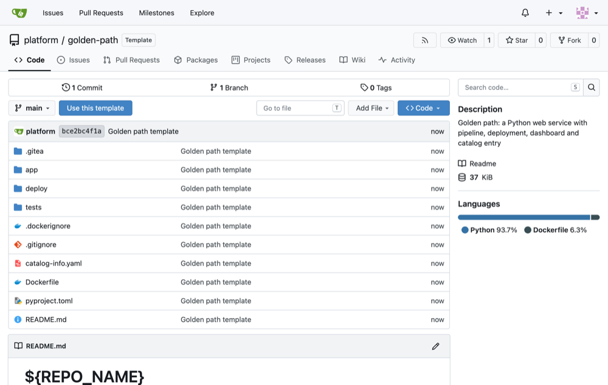
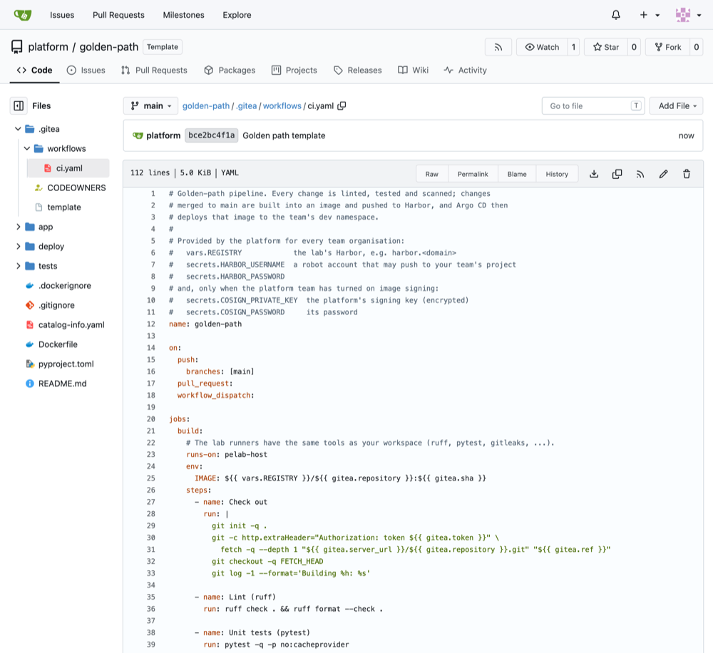
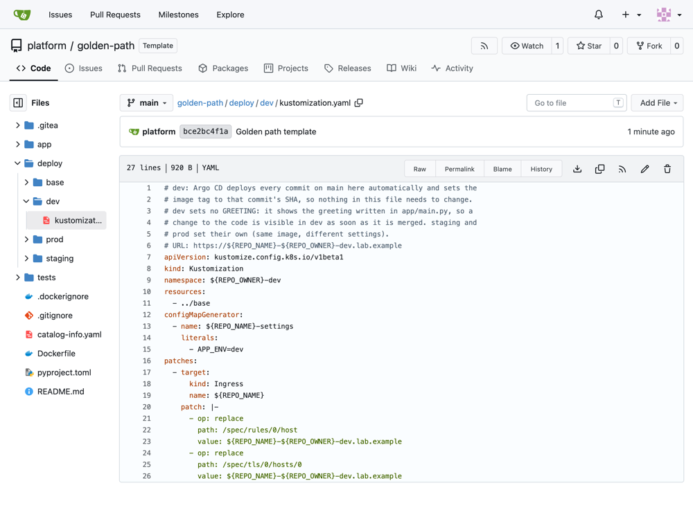
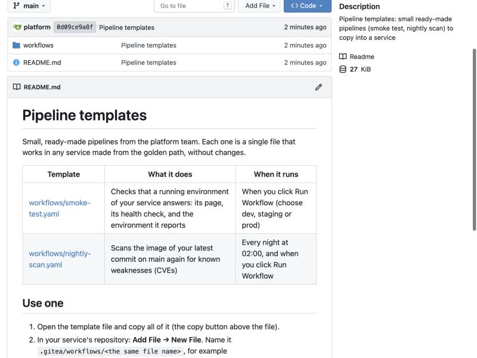
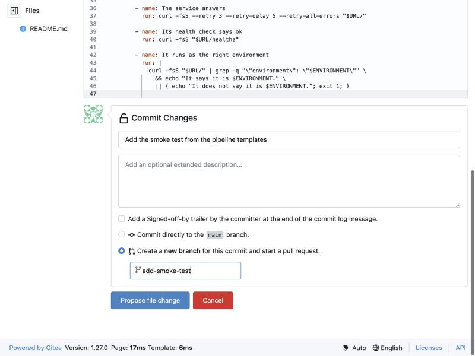
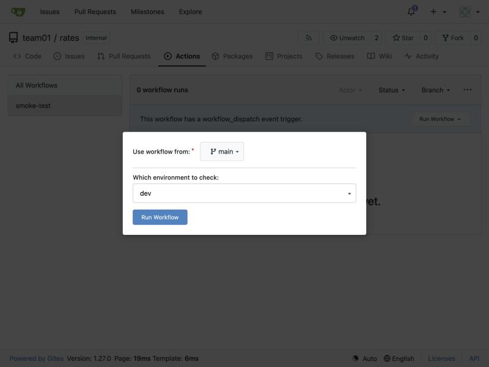
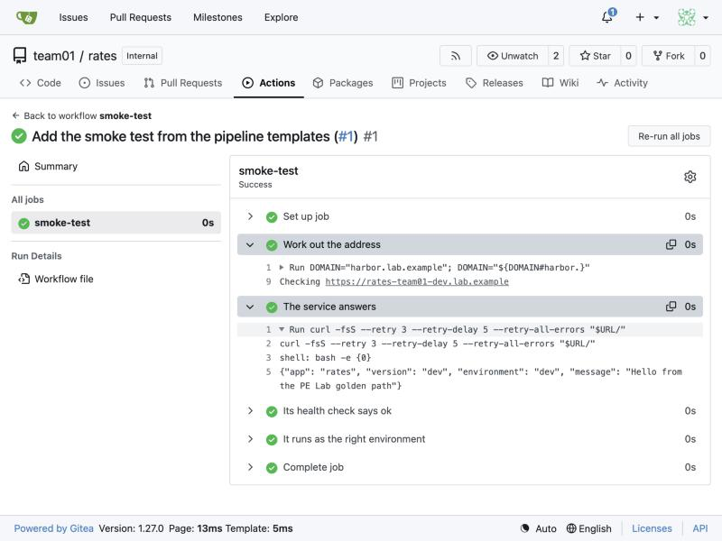

# Day 4: Containers and the packaging template: the steps

Only the steps and the commands, to follow along with your instructor. Every step is explained in full in [README.md](README.md).

## Pipelines: two ways to get one from a template

- Create a service from the golden-path template: it comes with its whole pipeline, .gitea/workflows/ci.yaml. Lab 3.
- Copy a small pipeline from platform/pipeline-templates into a service you have. Lab 5 (the smoke test).

## Lab 1: build and run the hello image

Package hello into a container image yourself, run it, look inside it, and remove it.

### 1. Build the image

1. Paste the box and press Enter. The first build takes a minute: it fetches Python through Harbor.

2. Read the numbered steps as they appear: one for each instruction in the Dockerfile.

```bash
cd ~/hello
git switch main && git pull
docker build --build-arg BASE_IMAGE=harbor.$DOMAIN/dockerhub/library/python:3.12-slim -t hello:1 .
```

### 2. Find it in the list of images

```bash
docker images hello
```

### 3. Run it

```bash
docker run -d --name hello -p 8081:8081 hello:1
docker ps
```

### 4. Call it

```bash
curl -s localhost:8081/
curl -i localhost:8081/healthz
```

### 5. Read its logs, and check who it runs as

```bash
docker logs hello
docker exec hello id
```

### 6. Stop and remove it

```bash
docker stop hello
docker rm hello
docker ps -a
docker images hello
```

## Lab 2: one image, three environments

Run the same image as staging and prod with only its settings changed, and see that a new version is a new image beside the old one.

### 1. Run it as staging

```bash
cd ~/hello
docker run -d --name hello-staging -p 8082:8081 -e APP_ENV=staging -e GREETING="Hello from staging" hello:1
sleep 2
curl -s localhost:8082/
```

### 2. Run it as prod too

```bash
docker run -d --name hello-prod -p 8083:8081 -e APP_ENV=prod -e GREETING="Hello from prod" hello:1
sleep 2
curl -s localhost:8083/
docker ps
```

### 3. Make version 2

1. In the editor, open hello → app → main.py and change the text of the GREETING line (line 22), for example to Hello from version 2. Save with Ctrl+S (Mac Cmd+S).

2. Paste the box: it builds a new image, tagged 2, and gives it the version number 2.

In `app/main.py`, change:

```
GREETING = os.environ.get("GREETING", "Hello from the PE Lab golden path")
```

to:

```
GREETING = os.environ.get("GREETING", "Hello from version 2")
```

```bash
docker build --build-arg BASE_IMAGE=harbor.$DOMAIN/dockerhub/library/python:3.12-slim --build-arg APP_VERSION=2 -t hello:2 .
docker images hello
```

### 4. Run the two versions side by side

```bash
docker run -d --name hello-v1 -p 8081:8081 hello:1
docker run -d --name hello-v2 -p 8084:8081 hello:2
sleep 2
curl -s localhost:8081/
curl -s localhost:8084/
```

### 5. Clean up

```bash
docker rm -f hello-staging hello-prod hello-v1 hello-v2
git checkout app/main.py
docker ps
```

## Lab 3: create a new service from the template

Use the golden path: create a brand-new service called rates from the template, and watch it build, deploy and appear in the portal without asking anyone.

### 1. Look inside the template first

1. Open https://gitea.<lab domain>/platform/golden-path. Next to the name platform / golden-path, a grey label says Template, and a blue button Use this template sits above the files: Gitea offers this repository as a starting point for new ones. Do not click it yet.

   

   *The template repository platform/golden-path in Gitea: the Template label next to its name, and the folders and files every new service gets. In your lab the address starts with https://gitea.<lab domain>.*

2. Read the list of files: .gitea (the pipeline and the review rule), app (the code), deploy (how it runs in dev, staging and prod), tests, Dockerfile (how the image is built), README.md (the user guide) and catalog-info.yaml (its portal entry).

3. Click .gitea, then workflows, then ci.yaml. This is the pipeline: the one file that says what runs on every change.

   

   *The pipeline in the template, .gitea/workflows/ci.yaml. The comment at the top says what the platform provides (the registry and the push login); the on: block says when it runs; each "- name:" under steps is one check.*

4. Read the steps from top to bottom: each line "- name: ..." is one step. Check out, Lint (ruff), Unit tests (pytest), Secret scan (gitleaks), Dockerfile lint (hadolint), Validate the manifests, Build the image, Vulnerability scan (trivy), Push to Harbor, Sign the image, Clean up, Post the verdict.

5. Read the block on: near the top: the pipeline runs on every push to main, on every pull request, and when someone clicks Run Workflow (workflow_dispatch).

6. Go back to platform/golden-path (click golden-path in the path at the top). Click deploy, then dev, then kustomization.yaml.

7. Find ${REPO_NAME} and ${REPO_OWNER} in it. They are blanks: when a repository is created from the template, Gitea writes the new name and team in their place.

   

   *deploy/dev/kustomization.yaml in the template: ${REPO_NAME} and ${REPO_OWNER} are the blanks Gitea fills in with the new repository's name and team.*

8. Go back, click .gitea, then the file template. It lists the files in which Gitea fills in the blanks: README.md, catalog-info.yaml, .gitea/CODEOWNERS and everything under deploy.

### 2. Create the repository from the template

1. In Gitea, click + (top right, next to your picture) → New Repository.

2. Owner: open the list and choose your team, teamNN (not your own name).

3. Repository Name: rates (in small letters).

4. Template: click "Select a template.", type golden and choose platform/golden-path. (Clicking Use this template on platform/golden-path opens the same form with this already chosen.)

5. Template Items appears: tick Git Content (Default Branch) and Branch Protection. Leave the others.

6. Click Create Repository at the bottom.

### 3. Run its pipeline for the first time

1. In teamNN/rates, click the Actions tab.

2. On the left, under All Workflows, click golden-path.

3. A blue bar says "This workflow has a workflow_dispatch event trigger.": click Run Workflow on its right, leave the branch as main, and click Run Workflow in the box that opens.

4. Reload the page after a few seconds: a new run appears at the top. Click it to watch.

### 4. Find its image in Harbor

1. Open https://harbor.<lab domain> in a new tab. On the sign-in page, type your studentNN in Username and your own password in Password (the same as Gitea), and click LOG IN.

2. You land on Projects: a table with one line per project. In the Project Name column, click your team, teamNN.

3. The project opens on its Repositories tab: one line per image name. Click teamNN/rates.

4. You now see the artifacts list: one line per image built. Read the line from left to right: Artifacts (the image's fingerprint, sha256:...), Tags (the commit id), Size, Vulnerabilities (a coloured bar; move the mouse over it to see how many weaknesses of each severity) and Push Time.

### 5. Watch it deploy

1. Open https://argocd.<lab domain> and sign in as delegate, with its password from cat /etc/pelab/logins.md.

2. Type your team in the search box at the top.

3. Wait up to a minute: Argo CD looks for new repositories every minute.

### 6. Open it

1. Open https://rates-teamNN-dev.<lab domain>/ in a new tab (your team instead of teamNN).

```bash
curl -s https://rates-$TEAM-dev.$DOMAIN/
```

### 7. Add it to the portal

1. Open https://backstage.<lab domain> in a new tab. A page asks how to sign in: on the Guest card, click Enter. No password is needed.

2. In the menu on the left (Home, Catalog, APIs, Docs, Create...), click Create.... The page lists templates.

3. At the top right of that page, click Register Existing Component.

4. A form with one box, Select URL (the repository URL), opens. Paste this address in it, with your team: https://gitea.<lab domain>/teamNN/rates/src/branch/main/catalog-info.yaml

5. Click Analyze. Backstage reads the file and shows what it will add: one component, rates.

6. Click Import, wait a few seconds, then click View Component.

7. Read the component's page: the About card (owner teamNN, the description) and the links to its environments, pipeline, Argo CD, Harbor and Grafana. Click Catalog on the left: rates is now listed next to hello.

### 8. Two services, one pipeline

1. In Gitea, open teamNN/hello, then .gitea → workflows → ci.yaml.

2. In a second tab, open teamNN/rates, then .gitea → workflows → ci.yaml.

3. Compare the two: the same steps, in the same order, with the same comments.

4. Now open platform/golden-path and click Issues: this is where teams ask the platform team for changes to the template.

## Lab 4: a first change to the new service

Make your first change to rates through the same loop as on Day 2, and read the README the golden path gave it.

### 1. Copy the new repository and make a branch

```bash
cd ~
git clone https://gitea.$DOMAIN/$TEAM/rates
cd rates
git switch -c first-change-$ME
```

### 2. Change the greeting and run the tests

1. In the editor, open rates → app → main.py and change the text of the GREETING line (line 22). Save with Ctrl+S (Mac Cmd+S).

2. Paste the box to run the tests.

In `app/main.py`, change:

```
GREETING = os.environ.get("GREETING", "Hello from the PE Lab golden path")
```

to:

```
GREETING = os.environ.get("GREETING", "Rates service of team 3")
```

```bash
pytest -q
```

### 3. Commit, push, review, merge

1. Paste the box to commit and push.

2. Open the pulls/new link it prints (Hold Ctrl (on a Mac Cmd) and click the link in the terminal) and click Create Pull Request.

3. Approve as reviewer: Open a private window (Edge or Chrome: Ctrl+Shift+N, on a Mac Cmd+Shift+N; Firefox: Ctrl+Shift+P, on a Mac Cmd+Shift+P), go to https://gitea.<lab domain>, click Sign In, and sign in with the other person's login: reviewer or platform-approver, with its password from cat /etc/pelab/logins.md in your workspace. Then Files Changed → Review → Approve, and close the private window.

4. When "All checks were successful", merge (Create squash commit, as on Day 2).

```bash
git commit -am "First change to rates"
git push -u origin first-change-$ME
```

### 4. See it live in dev

1. Wait a few minutes after the merge: the pipeline builds the image first (Actions tab, green tick), then Argo CD deploys it within a minute.

2. Reload your rates dev tab (https://rates-teamNN-dev.<lab domain>/).

```bash
curl -s https://rates-$TEAM-dev.$DOMAIN/
```

### 5. Read the README

1. Open teamNN/rates in Gitea: the README is shown under the file list.

2. Read the sections on changing, releasing and watching the service.

## Lab 5: add a pipeline from a template

Give rates a second pipeline, a smoke test, by copying a template the platform team wrote. Time it: from finding the template to a green run.

### 1. Find the pipeline templates

1. Open https://gitea.<lab domain>/platform/pipeline-templates.

2. Read the README under the file list: a table with one line per template (what it does, when it runs), then "Use one" in four steps.

   

   *platform/pipeline-templates: the folder workflows holds the templates, and the README lists them: smoke-test.yaml and nightly-scan.yaml, what each does and when it runs. In your lab the address starts with https://gitea.<lab domain>.*

3. You can also find it in the portal: open https://backstage.<lab domain>, click Catalog, and look for Pipeline templates. Its links lead back here.

### 2. Read the smoke test, and copy it

1. Click workflows, then smoke-test.yaml.

2. Read the comment at the top: copy it unchanged, as .gitea/workflows/smoke-test.yaml.

3. Read the block on: workflow_dispatch adds a Run Workflow button, and inputs adds a list in it: which environment to check (dev, staging or prod).

4. Read the four steps (each "- name:"): Work out the address, The service answers, Its health check says ok, It runs as the right environment.

5. Above the file, on the right, click the Copy content button (two small squares, next to the download arrow). The whole file is now copied.

### 3. Add it to rates, on a new branch

1. Open your team's rates repository: https://gitea.<lab domain>/teamNN/rates.

2. Above the file list, click Add File, then New File.

3. In the box "Name your file…" at the top, type .gitea/workflows/smoke-test.yaml (each / makes a folder as you type).

4. Click in the big empty editor below and paste with Ctrl+V (Mac Cmd+V). The template appears, about 45 lines.

5. Scroll down to Commit Changes. In the first box, type the message Add the smoke test from the pipeline templates.

6. Choose "Create a new branch for this commit and start a pull request." and type the branch name add-smoke-test in the box that appears. Click Propose file change.

   

   *The bottom of the New File page: the end of the pasted template, the commit message, "Create a new branch for this commit and start a pull request." chosen with the branch add-smoke-test, and the Propose file change button.*

### 4. Open the pull request, review, merge

1. On "Comparing changes", click New Pull Request, then Create Pull Request at the bottom of the form.

2. Wait for the main pipeline (golden-path) to run on the pull request: a few minutes, until "All checks were successful".

3. Approve as reviewer: Open a private window (Edge or Chrome: Ctrl+Shift+N, on a Mac Cmd+Shift+N; Firefox: Ctrl+Shift+P, on a Mac Cmd+Shift+P), go to https://gitea.<lab domain>, click Sign In, and sign in with the other person's login: reviewer or platform-approver, with its password from cat /etc/pelab/logins.md in your workspace. Then Files Changed → Review → Approve, and close the private window.

4. Back in your own window, reload the pull request and merge it (Create squash commit, as on Day 2).

### 5. Run the smoke test

1. In teamNN/rates, click the Actions tab. On the left, under All Workflows, there are now two: golden-path (the main pipeline) and smoke-test (yours). Click smoke-test.

2. In the blue bar "This workflow has a workflow_dispatch event trigger.", click Run Workflow on the right. A box opens: leave main, leave "Which environment to check" on dev, and click Run Workflow.

   

   *The Run Workflow box of smoke-test: "Use workflow from: main", and the list "Which environment to check" (dev, staging, prod) that the template's inputs block made.*

3. Reload the page after a few seconds: the run appears at the top. Click it, then click smoke-test on the left to see its steps.

4. Click each step to open it. Look at the clock: how many minutes since you wrote down the time at the start?

   

   *A green smoke test: Work out the address prints "Checking https://rates-team01-dev..." and The service answers shows the service's JSON. The two last steps are green too. In your lab the address ends in your lab domain.*

### 6. Make it go red

1. Click Run Workflow again. This time, in "Which environment to check", choose staging. Click Run Workflow.

2. Reload, open the new run and click smoke-test on the left.

### 7. Where the main pipeline came from

1. Open teamNN/hello, then .gitea → workflows → ci.yaml.

2. Above the file, click History. One commit: the platform created hello from the golden-path template before the course, and the pipeline came with it.

3. Open https://gitea.<lab domain>/platform/golden-path/src/branch/main/.gitea/workflows/ci.yaml: the original, in the template. Every service made from the template has a copy.

4. Read the list below: each line is something you did by hand this week, then (→) the step of the pipeline that now does it.

5. By hand, Day 4 Lab 4: you ran pytest -q yourself → Lint (ruff) and Unit tests (pytest), on every change.

6. By hand, Day 4 Lab 1: docker build, with a tag you chose → Build the image, tagged with the commit id: no tag to remember.

7. By hand, Day 4 Lab 1: the image stayed in your workspace → Push to Harbor, where Argo CD fetches it.

8. By hand: nobody checked for secrets, Dockerfile mistakes or known weaknesses → Secret scan (gitleaks), Dockerfile lint (hadolint), Vulnerability scan (trivy), and Harbor scans again.

9. By hand, Day 1 Lab 3 and Day 4 Lab 2: settings typed into the run command → no pipeline step: the template's deploy folder holds the settings, and Argo CD runs them.
