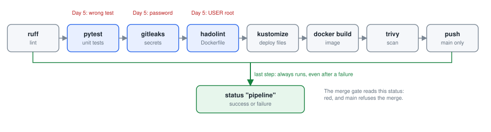
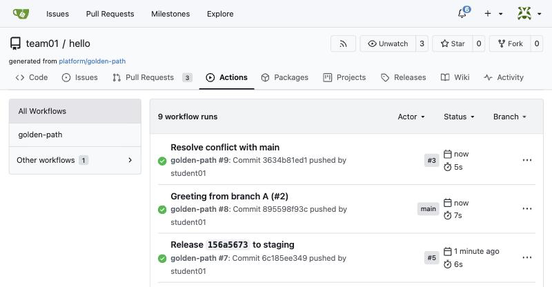
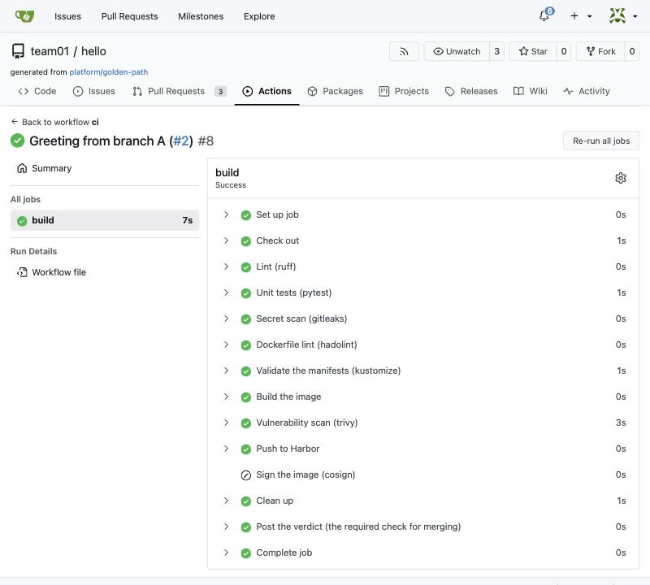
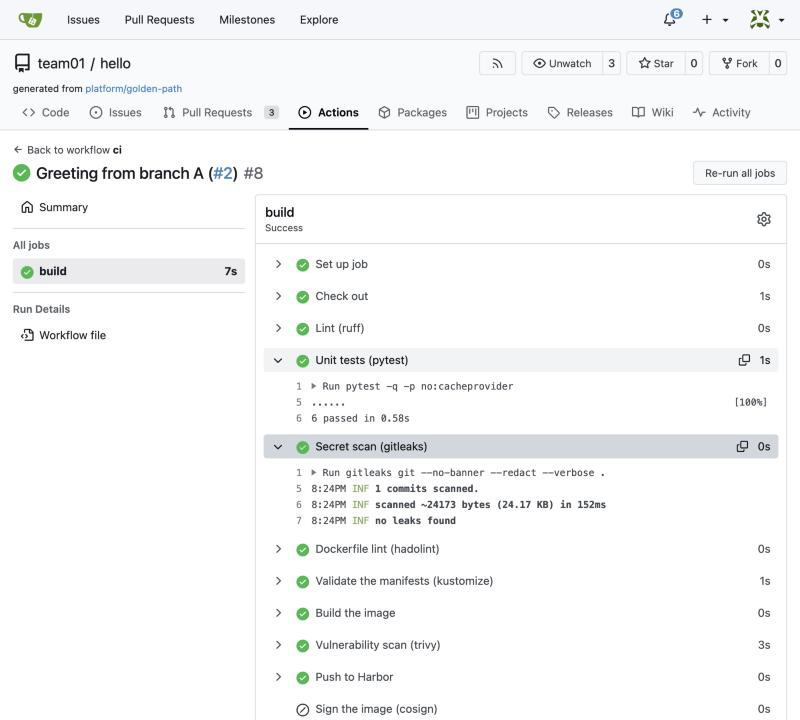
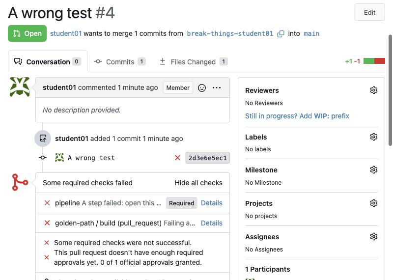
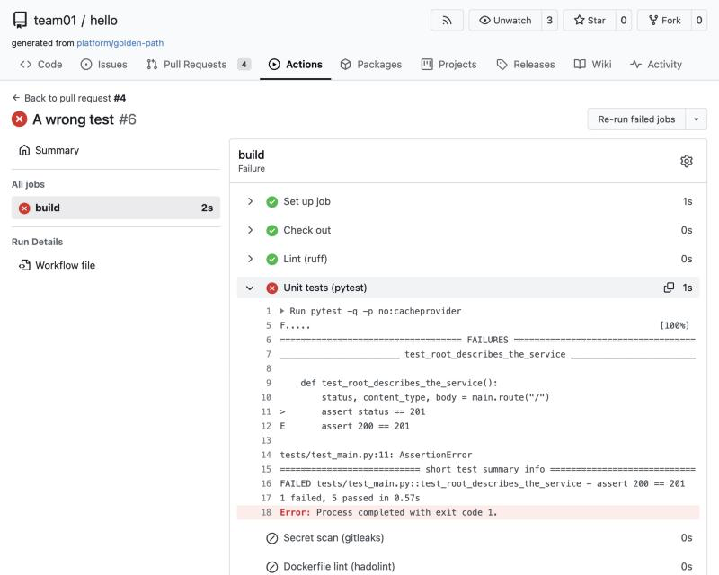
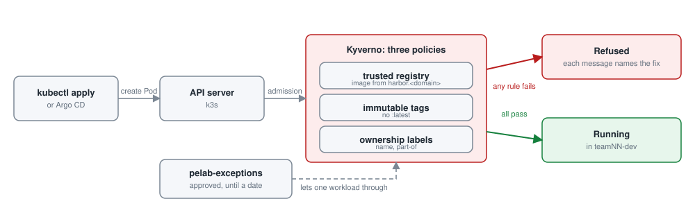
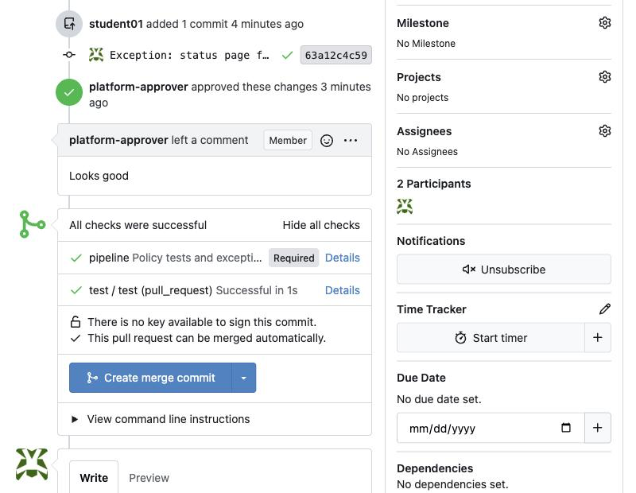

# Day 5: CI/CD, testing and security

**Goal:** Read a pipeline and its results, fix a failing check, and explain how guardrails and evidence protect production.

By the end of the day you can:

- Explain CI/CD, DevSecOps and the software supply chain in plain words
- Read the pipeline, make it fail three different ways, and fix it
- See the guardrails reject a bad deployment, read a policy, and test one yourself

### Today's plan

Yesterday the template built and deployed your new service without anyone being asked. Today you open up the pipeline that did it, break it on purpose, and meet the guardrails and exceptions.

| Topic | Labs |
| --- | --- |
| CI/CD and DevSecOps | [Lab 1: read the pipeline and its evidence](#lab-1-read-the-pipeline-and-its-evidence)<br>[Lab 2: break the pipeline three ways, and fix it](#lab-2-break-the-pipeline-three-ways-and-fix-it) |
| Policy-as-code | [Lab 3: watch the guardrails refuse a bad deployment](#lab-3-watch-the-guardrails-refuse-a-bad-deployment)<br>[Lab 4: test a policy like code, with the Kyverno CLI](#lab-4-test-a-policy-like-code-with-the-kyverno-cli) |
| Scenarios and exceptions | [Lab 5: ask for an exception, and watch it expire](#lab-5-ask-for-an-exception-and-watch-it-expire) (per team) |

## CI/CD and DevSecOps

### CI/CD in plain words

A pipeline is a checklist that runs itself on every change. Continuous integration: every change is merged often and checked at once. Continuous delivery: every checked change is packaged so it can be deployed at any time.

The checklist is code too (ci.yaml, in the repository), so it is reviewed, versioned and the same for everyone. Runners are the machines that execute it.

On a pull request the pipeline checks; on main it also builds and pushes the image. Nothing reaches the registry without passing every check.

> **In one sentence:** A pipeline is a checklist that runs itself on every change, written as code, the same for every team.

**In the lab**

- The pipeline is Gitea Actions; the file is .gitea/workflows/ci.yaml.
- Five runners on the lab server execute the jobs for all teams.
- The steps: lint, unit tests, secret scan, Dockerfile check, deployment check, build, image scan, push.
- Push happens only on main, never from a pull request.

### What the pipeline does on every change



*Each step can stop the pipeline; its last step always posts the verdict that the merge gate reads.*

1. Checkout
2. Lint
3. Unit tests
4. Secret scan
5. Dockerfile check
6. Build image
7. Image scan + SBOM
8. Push (main only)

A pull request runs steps 1 to 7 and stops. A merge to main runs all eight; the pushed image is what Argo CD deploys.

### DevSecOps and the software supply chain

DevSecOps means the security checks run inside the pipeline on every change, instead of a security review at the end. Problems are found in minutes, by the person who can fix them.

The supply chain is everything that goes into your image: the base image, the packages, your code, the build itself. Most vulnerabilities come from ingredients you did not write.

An SBOM (software bill of materials) is the ingredients list. A vulnerability scan compares the list against known problems. Together they answer "what is inside, and is any of it known to be bad?"

> **In one sentence:** DevSecOps puts the security checks in the pipeline; the SBOM and scan tell you what is in your image and whether it is safe.

**In the lab**

- gitleaks looks for secrets in the code and its history.
- hadolint checks the Dockerfile against good practice.
- Trivy scans the built image; Harbor scans it again on push and generates the SBOM.
- Signing (optional) proves the pipeline, not a person, produced the image.

### The pipeline file, shortened

```
# .gitea/workflows/ci.yaml  (the shape of it)
on: push to main, pull_request, workflow_dispatch
runs-on: pelab-host
env:
  IMAGE: <registry>/<team>/<repo>:<commit id>
steps:
  - Checkout
  - Lint:             ruff check . && ruff format --check .
  - Unit tests:       pytest -q
  - Secret scan:      gitleaks git --redact --verbose .
  - Dockerfile check: hadolint Dockerfile
  - Deploy check:     kubectl kustomize deploy/<env>
  - Build:            docker build -t $IMAGE .
  - Image scan:       trivy image $IMAGE
  - Push:             docker push $IMAGE    (main only)
```

- on: when it runs. workflow_dispatch means you can also run it by hand.
- IMAGE: the registry, your repository name and the commit id. That is the tag.
- Each step is one tool with one job. If any step fails, the run is red and the push never happens.
- The real file is about 60 lines; this is the shape of it.

## Lab 1: read and run the pipeline

### Lab 1: read the pipeline and its evidence

**What you do:** Read what the pipeline did to your last change, and find the evidence it left: test results, a secret scan, an image, a vulnerability report and an SBOM.

**You will learn:**

- What the pipeline checks on every change, step by step.
- Where the evidence of each check is kept, so you can show it to a reviewer or an auditor.

**Words you will meet:**

- **Pipeline run:** One execution of the pipeline for one commit, with the log of every step.
- **Secret scan:** A check (gitleaks) that no password or key was written into the code.
- **Vulnerability scan:** A check (trivy in the pipeline, and Harbor again) of the image against lists of known weaknesses (CVEs).
- **SBOM:** Software Bill of Materials: the list of every package inside an image, with its version. The ingredients list.

**Before you start:**

1. Sign in to Gitea (https://gitea.<lab domain>) and to Harbor (https://harbor.<lab domain>) as yourself: studentNN and your password, the same for both.
2. Have a notes page ready: you copy three things at the end.

#### Step 1. Open the latest run on main

*Where: Browser: Gitea*

**Why:** The runs on main are the ones that build what gets deployed: their logs are the evidence for what is running.

**Do this:**

1. Open teamNN/hello and click the Actions tab.

2. In the list of runs, find the newest one whose label (on the right) is main, and click its title.

   

   *hello's Actions tab: each run with its commit, and on the right where it came from: main, or a pull request number. Your names, team, numbers and times are your own.*

3. On the left you see the job build; on the right, its steps. Each line is one check.

   

   *A run on main: the job build and its steps, in the order of ci.yaml. Sign the image is skipped (grey) unless the platform turned signing on.*

**You should see:** A list of steps, each with a green tick and how long it took: Check out, Lint (ruff), Unit tests (pytest), Secret scan (gitleaks), Dockerfile lint (hadolint), Validate the manifests (kustomize), Build the image, Vulnerability scan (trivy), Push to Harbor, Clean up, and Post the verdict.

**How to read it:**

- Sign the image (cosign) is grey, skipped: image signing is an option the platform team has not switched on.
- Set up job and Complete job, at the top and bottom, are Gitea's own steps.

#### Step 2. Read the tests and the secret scan

*Where: Browser: Gitea*

**Why:** These two steps answer "does it work?" and "did anyone leak a password?" for every single change.

**Do this:**

1. Click the step Unit tests (pytest): its log unfolds under it.

2. Then click Secret scan (gitleaks).

   

   *The two steps opened: Unit tests says "6 passed"; Secret scan says how much it read and "no leaks found".*

**You should see:** In the tests, "6 passed"; in the secret scan, "no leaks found":

```
......                                                                   [100%]
6 passed in 0.57s
...
INF scanned ~20739 bytes (20.74 KB) in 138ms
INF no leaks found
```

#### Step 3. Find the image tag

*Where: Browser: Gitea*

**Why:** The image is tagged with the commit id: from any running image you can find the exact code, the pull request and the review behind it.

**Do this:**

1. Click the step Push to Harbor and read its last lines.

**You should see:** The address of the image, ending with a 40-character commit id:

```
Pushed harbor.<lab domain>/team03/hello:b70e47f7a1c2.... Argo CD deploys it to dev within a minute or two.
```

**How to read it:**

- The same commit id appears at the top of the run, next to the commit's message. Write it down for step 4.

#### Step 4. Open the image in Harbor

*Where: Browser: Harbor*

**Why:** Harbor keeps every image the pipeline pushed, scans it again on arrival, and records its ingredients list.

**Do this:**

1. Open https://harbor.<lab domain> in a new tab. On the sign-in page, type your studentNN in Username and your own password in Password (the same as Gitea), and click LOG IN.
2. On the Projects page, click your team, teamNN, in the Project Name column.
3. On the Repositories tab, click teamNN/hello.
4. In the artifacts list, find the line whose Tags column shows the commit id from step 3. The newest is usually at the top (look at Push Time). If the tag is cut short, move the mouse over it to see it whole.
5. On that line, move the mouse over the coloured bar in the Vulnerabilities column: a box shows the counts by severity.

**You should see:** The image with its tag, its size, a vulnerability summary (a count by severity: critical, high, medium, low) and its SBOM.

**How to read it:**

- A vulnerability is a known weakness in one of the packages inside, usually in the base image (Python and Debian), not in your code.
- The pipeline's trivy step reports them but does not stop the build: deciding what is acceptable is a policy decision (Day 5 afternoon).

#### Step 5. Read the ingredients list (SBOM)

*Where: Browser: Harbor*

**Why:** When a new weakness is announced, the SBOM answers in seconds: "are we affected, and where?"

**Do this:**

1. On the same line of the artifacts list, find the SBOM column and click its link: the ingredients list opens. (If your Harbor shows no SBOM column, click the digest, sha256:..., to open the image, and open its SBOM tab.)
2. The SBOM is a table, one line per package: its name and its version.
3. Search the page for python (Ctrl+F, on a Mac Cmd+F).
4. To see the weaknesses themselves, go back, click the digest (sha256:...) and open the Vulnerabilities tab: one line per weakness, with its ID (CVE-...), its severity, the package it is in, and the version that fixes it (if there is one).

**You should see:** The exact Python version and every package inside your image, each with its version. Most of the image is not your code.

#### Step 6. Write down the evidence

*Where: Your team notes*

**Why:** An evidence pack shows, for one change, every check it passed. You assemble it for the Day 6 capstone.

**Do this:**

1. Copy three things into your notes: the link to the pipeline run (from the browser's address bar), the image tag (the commit id), and the vulnerability counts.

**You should see:** Three lines for the Day 6 evidence pack.

**Done when:** You can show, for one change, its tests, secret scan, image, scan report and SBOM.

**If you are stuck**

- Harbor shows a sign-in page: sign in as student01 with your lab password.
- No SBOM yet: Harbor makes it shortly after the image is pushed. Refresh after a minute.

## Lab 2: break it on purpose

### Lab 2: break the pipeline three ways, and fix it

**What you do:** Make three common mistakes on purpose (a wrong test, a password in the code, running as root) and watch the pipeline catch each one before it reaches main.

**You will learn:**

- How to read a red pipeline: which step failed, and what its log says.
- Three things the pipeline catches before anything is merged: broken code, leaked secrets, unsafe containers.
- That fixing means a new commit: push again, and the pipeline runs again.

**Words you will meet:**

- **Red / green:** A failed / passed pipeline run.
- **Assert:** The line in a test that states what must be true, for example assert status == 200.
- **Root:** The administrator account. A container should never run as root.

**Before you start:**

1. Your workspace is open in the browser (https://student01.<lab domain>, signed in with your password).
2. A terminal is open at the bottom of the workspace. If not: menu ☰ (top left) → Terminal → New Terminal. You are ready when you see a prompt that ends in $, for example student01@student01:~$
3. To run a command: copy it from this page (the copy button at the top right of each grey box), click in the terminal, paste with Ctrl+V (on a Mac Cmd+V, or right-click → Paste), and press Enter. You can paste a whole box at once: the lines run one after the other.
4. If Git asks for a Username (the first time each day: it then remembers your password for 10 hours), type student01 and press Enter; for the Password, type your password (from cat /etc/pelab/logins.md) and press Enter. Nothing appears while you type the password: that is normal.
5. Your copy of hello in ~/hello.
6. After step 1 you open a pull request; keep its page open in the browser. Every push in this lab shows a new pipeline result there, at the bottom of the Conversation tab.

#### Step 1. A wrong test

*Where: Workspace terminal, then Gitea*

**Why:** A test that expects the wrong answer is like a bug in the code: the pipeline must stop it.

**Do this:**

1. Paste the box. It makes a branch, changes one expected value in the tests from 200 to 201, shows the change, commits and pushes.

   ```bash
   cd ~/hello
   git switch main && git pull
   git switch -c break-things-$ME
   sed -i '0,/assert status == 200/s//assert status == 201/' tests/test_main.py
   git diff
   git commit -am "A wrong test"
   git push -u origin break-things-$ME
   ```

2. Open the pulls/new link that git push prints and click Create Pull Request. Hold Ctrl (on a Mac Cmd) and click the link in the terminal: it opens in a new browser tab.

3. Wait for the check to turn red (a red cross), click Details, and open the step Unit tests (pytest).

   

   *The pull request goes red: both checks failed, and merging is blocked. Your names, team, numbers and times are your own.*

   

   *Details → Unit tests (pytest): the test that failed, the line (assert status == 201) and why (assert 200 == 201), then "1 failed, 5 passed".*

**What each line does:**

- `git switch -c break-things-$ME`: a branch of your own for this lab.
- `sed -i '0,/assert status == 200/s//assert status == 201/' tests/test_main.py`: in the tests, change the first "assert status == 200" into "assert status == 201": the test now expects the wrong answer. (0,/.../ means "only the first time".)
- `git diff`: show the change: one line red, one green.

**You should see:** The pipeline is red at Unit tests (pytest). The log names the test and shows the actual and the expected value:

```
FAILED tests/test_main.py::test_root_describes_the_service - assert 200 == 201
1 failed, 5 passed in 0.58s
```

**How to read it:**

- assert 200 == 201: the service answered 200 (OK), the test expected 201. Here the test is wrong; often it is the code.
- The steps after the failure did not run: nothing was built from broken code.
- The pull request says "Some required checks failed": it cannot be merged.

#### Step 2. Fix the test

*Where: Workspace terminal*

**Why:** A fix is a new commit on the same branch. Pushing it runs the pipeline again on the pull request.

```bash
sed -i 's/assert status == 201/assert status == 200/' tests/test_main.py
git commit -am "Fix the test"
git push
```

**What each line does:**

- `sed -i 's/assert status == 201/assert status == 200/' tests/test_main.py`: put the expected value back to 200.
- `git commit -am "Fix the test", git push`: commit and push: the pull request updates itself and a new run starts.

**You should see:** The new run on the pull request turns green.

#### Step 3. A password in the code

*Where: Workspace terminal*

**Why:** People write passwords into code "just to get it working". Once pushed, a password is in the history for ever; the secret scan stops it before it reaches main.

```bash
echo 'DB_PASSWORD = "hunter2-very-secret-123"' >> app/main.py
git commit -am "Add a database password"
git push
```

**What each line does:**

- `echo 'DB_PASSWORD = "..."' >> app/main.py`: add a line with a made-up password at the end of the code (>> adds to the end of the file).

**You should see:** Red at Secret scan (gitleaks), with the rule, the file and the line. The value itself is shown as REDACTED:

```
Finding:     DB_PASSWORD = "REDACTED"
RuleID:      generic-api-key
File:        app/main.py
Line:        110
...
WRN leaks found: 1
```

**How to read it:**

- Lint and the tests were still green: the code works. Only the secret scan knows a password must not be there.
- The scan hides the value (REDACTED), so the log itself does not leak it.

#### Step 4. Remove the password

*Where: Workspace terminal*

**Why:** Take the password out, and push again.

```bash
sed -i '/DB_PASSWORD/d' app/main.py
git commit -am "Remove the password"
git push
```

**What each line does:**

- `sed -i '/DB_PASSWORD/d' app/main.py`: delete (d) every line of the file that contains DB_PASSWORD.

**You should see:** Green again: "no leaks found".

> **Tip:** The password is still in this branch's history: the pipeline only scans the newest commit, but anyone can read the old one. A real password would now have to be changed, because Git never forgets. That is why the scan runs before anything is merged.

#### Step 5. Run as root

*Where: Workspace terminal*

**Why:** A container running as root gives an attacker the keys if it is broken into. The Dockerfile check refuses it.

```bash
sed -i 's/^USER 10001/USER root/' Dockerfile
git commit -am "Run as root"
git push
```

**What each line does:**

- `sed -i 's/^USER 10001/USER root/' Dockerfile`: change the Dockerfile line USER 10001 (an ordinary user) into USER root (the administrator).

**You should see:** Red at Dockerfile lint (hadolint):

```
Dockerfile:16 DL3002 warning: Last USER should not be root
Dockerfile:16 DL3066 info: Non-numeric user-id may not be resolvable by host system
```

**How to read it:**

- DL3002 is the rule's number: search for it to learn more. The pipeline treats every hadolint finding as a failure.

#### Step 6. Put it right, add a test, and merge

*Where: Workspace terminal, then Gitea*

**Why:** Finish with a clean change that also adds a test, so the pipeline now checks one more thing on every future change.

**Do this:**

1. Paste the box. It puts USER 10001 back, adds a new test for the health check, runs the tests (7 now), commits and pushes.

   ```bash
   sed -i 's/^USER root/USER 10001/' Dockerfile
   cat >> tests/test_main.py <<'EOF'


   def test_health_check_says_ok():
       status, _, body = main.route("/healthz")
       assert status == 200
       assert body == "ok\n"
   EOF
   pytest -q
   git commit -am "Run as an ordinary user again, and test the health check"
   git push
   ```

2. In the pull request, wait for green. Approve it as reviewer in a private window, then merge as yourself with Create squash commit.

**What each line does:**

- `sed -i 's/^USER root/USER 10001/' Dockerfile`: put the ordinary user back.
- `cat >> tests/test_main.py <<'EOF' ... EOF`: add a new test at the end of the tests file: it calls /healthz and checks the answer is 200 with the body ok. (The two empty lines before def are the Python style the lint step expects.)
- `pytest -q`: run the tests yourself before you push.

**You should see:** 7 passed, then a green pipeline; after the merge, the run on main pushes a new image to Harbor:

```
.......                                                                  [100%]
7 passed in 0.56s
```

**If you see something else:**

- *Lint (ruff) is red after this push*: the new test was pasted with different spacing. Run ruff format . then git commit -am "Format" and git push.

> **Tip:** Approving as reviewer: Open a private window (Edge or Chrome: Ctrl+Shift+N, on a Mac Cmd+Shift+N; Firefox: Ctrl+Shift+P, on a Mac Cmd+Shift+P), go to https://gitea.<lab domain>, click Sign In, and sign in with the other person's login: reviewer or platform-approver, with its password from cat /etc/pelab/logins.md in your workspace.

**Done when:** You saw three red runs with clear messages, fixed each one, and merged a green change with one more test.

**If you are stuck**

- Green again after removing the password, but it is still in the branch's history in Gitea: a real password would have to be changed. Delete the branch after the lab.
- Your test change did not break anything: check you changed an expected value (for example 200 to 201), not the code under test.

### Testing basics, for people who are not developers

A unit test is a small automatic check with a known answer: call /healthz, expect 200 and "ok". pytest runs every test and reports green or red.

Tests are the safety net that lets anyone change code: if the change breaks something, a test says so in seconds, before a reviewer spends time.

One test per behaviour, named for what it checks. The template ships with five; every new behaviour deserves one more.

> **In one sentence:** A test is a check with a known answer that runs itself; green means the behaviour still holds.

**In the lab**

```
def test_healthz_is_ok(client):
    code, body = client.get("/healthz")
    assert code == 200
    assert body == "ok"
```

- Run them locally: python3 -m pytest -q
- The pipeline runs the same command on every change.

## Policy-as-code

*The rules a bank would put in a policy document, written as files, kept in Git, tested, and enforced by the platform. You watch them refuse a bad deployment (Lab 3), then test them like code (Lab 4).*

### Policy-as-code in plain words



*Kyverno checks every Pod at the API server, whoever applies it; an approved exception lets one workload through until its date.*

A policy document says "only approved images may run in production". A policy as code says the same thing in a file the cluster reads, and refuses anything that breaks it, every time, with a message that says how to fix it.

Because the rule is a file in Git, it is reviewed like any change, tested like code (a good example must pass, a bad one must fail), and versioned. The decision is explainable: the message names the rule.

The rule says no, not a person. That removes arguments, late-night exceptions and inconsistency.

> **In one sentence:** Policy-as-code turns a rule in a document into a file the platform enforces, explains and keeps in Git.

**In the lab**

- Kyverno checks every deployment before the cluster accepts it.
- Three rules guard the team environments: images must come from Harbor; tags must be fixed (never "latest"); every service must carry its name and owner labels.
- Each refusal message says which rule and how to fix it.
- A rule change is a pull request to the platform team.

### What a policy looks like: the trusted-registry rule

```
# platform/policies: policies/pelab-trusted-registry.yaml
# In plain words: for every Pod in a team environment, every
# image must come from harbor.<lab domain>. If not, refuse it.

apiVersion: kyverno.io/v1
kind: ClusterPolicy
metadata:
  name: pelab-trusted-registry
spec:
  rules:
    - name: harbor-only
      match:
        any:
          - resources:
              kinds: [Pod]
              namespaceSelector:
                matchLabels: { pelab.io/tier: team }
      validate:
        failureAction: Enforce
        message: Images must come from harbor.<lab domain>.
          Build and push them with the golden-path pipeline.
        pattern:
          spec:
            containers:
              - image: "harbor.<lab domain>/*"
```

- match: where the rule applies: Pods in namespaces labelled as team environments.
- validate: what must be true: every container image starts with the Harbor address.
- failureAction Enforce: refuse, not just warn.
- message: what the person sees. Usable remediation guidance, as the brief puts it.
- The other two policies have the same shape: a tag that is not "latest"; labels for name and owner.
- Kyverno also checks Deployments with an automatic copy of each Pod rule, named autogen-harbor-only.

## Lab 3: the guardrails

### Lab 3: watch the guardrails refuse a bad deployment

**What you do:** Try to put a careless deployment straight into your dev environment, read the three refusals, and fix them one by one.

**You will learn:**

- What a guardrail (policy) is: a rule the cluster checks for every deployment, for every team.
- How to read a refusal and fix exactly what it names.

**Words you will meet:**

- **Guardrail (policy):** A rule, written as code, that the platform checks automatically. Here enforced by Kyverno.
- **Kyverno:** The tool in the cluster that checks every new or changed resource against the policies, and refuses what breaks them.
- **Deployment:** The Kubernetes description of a service to run: which image, how many copies.
- **kubectl apply:** Ask the cluster to create or update what a file describes.

**Before you start:**

1. Your workspace is open in the browser (https://student01.<lab domain>, signed in with your password).
2. A terminal is open at the bottom of the workspace. If not: menu ☰ (top left) → Terminal → New Terminal. You are ready when you see a prompt that ends in $, for example student01@student01:~$
3. To run a command: copy it from this page (the copy button at the top right of each grey box), click in the terminal, paste with Ctrl+V (on a Mac Cmd+V, or right-click → Paste), and press Enter. You can paste a whole box at once: the lines run one after the other.
4. If Git asks for a Username (the first time each day: it then remembers your password for 10 hours), type student01 and press Enter; for the Password, type your password (from cat /etc/pelab/logins.md) and press Enter. Nothing appears while you type the password: that is normal.
5. kubectl already points at your team's dev namespace (try kubectl get pods).

#### Step 1. Get the guardrails repository and a copy of the bad example

*Where: Workspace terminal*

**Why:** platform/policies holds the guardrails and their examples. You work on a copy of the bad example, with your team in it, so the repository stays as it is.

```bash
cd ~
git clone https://gitea.$DOMAIN/platform/policies
cd policies
sed "s/team01/$TEAM/g" examples/bad.yaml > ~/shortcut.yaml
cat ~/shortcut.yaml
```

**What each line does:**

- `git clone https://gitea.$DOMAIN/platform/policies`: copy the guardrails repository into ~/policies.
- `sed "s/team01/$TEAM/g" examples/bad.yaml > ~/shortcut.yaml`: copy the bad example to ~/shortcut.yaml in your home folder, with your team instead of team01.
- `cat ~/shortcut.yaml`: show it.

**You should see:** A Deployment called shortcut in your dev namespace, with image nginx:latest and no name or owner labels.

**How to read it:**

- Three things are wrong with it, as its comment says: the image is not from the lab's Harbor, it uses the tag latest (which can change under you), and nobody can tell who owns it (no labels).

#### Step 2. Try to deploy it

*Where: Workspace terminal*

**Why:** Try the shortcut: deploy straight to the cluster, skipping the golden path.

```bash
kubectl apply -f ~/shortcut.yaml
```

**What each line does:**

- `kubectl apply -f ~/shortcut.yaml`: ask the cluster to create what the file (-f) describes.

**You should see:** Refused by three rules, each saying how to fix it:

```
Error from server: ... denied the request:

resource Deployment/teamNN-dev/shortcut was blocked due to the following policies

pelab-immutable-tags:
  autogen-no-latest: 'validation error: The "latest" tag is not allowed; use the commit SHA the pipeline tagged the image with. ...'
pelab-ownership-labels:
  required-labels: 'validation error: Add the labels app.kubernetes.io/name and app.kubernetes.io/part-of (your team). ...'
pelab-trusted-registry:
  autogen-harbor-only: 'validation error: Images must come from harbor.<lab domain>. Build and push them with the golden-path pipeline. ...'
```

**How to read it:**

- Each block is one policy (pelab-...) and its rule, with a message written for you: what is wrong and what to do.
- Lines starting with "Warning: would violate PodSecurity" may come first: those are Kubernetes' own advice for a stricter level (warnings only, here). This lab is about the three refusals.

#### Step 3. Fix the image

*Where: Workspace terminal*

**Why:** An image from the lab's Harbor, with a fixed tag, answers two of the three rules at once.

```bash
sed -i "s#image: nginx:latest#image: harbor.$DOMAIN/dockerhub/library/python:3.12-slim#" ~/shortcut.yaml
kubectl apply -f ~/shortcut.yaml
```

**What each line does:**

- `sed -i "s#image: nginx:latest#image: harbor.$DOMAIN/...:3.12-slim#" ~/shortcut.yaml`: replace the image line with an image from the lab's Harbor, with a fixed tag. (# separates the parts here, because the image address contains /.)

**You should see:** One refusal left: pelab-ownership-labels, the labels.

#### Step 4. Add the labels

*Where: Workspace editor*

**Why:** Labels say what a workload is and who owns it, so anyone can find the owner of anything running in the cluster.

**Do this:**

1. In the Explorer on the left, click shortcut.yaml (it is in your home folder) to open it.

2. Find the first metadata block at the top: the lines name: shortcut and namespace: teamNN-dev.

3. Under the namespace line, add the three lines labels:, app.kubernetes.io/name: shortcut and app.kubernetes.io/part-of: teamNN (your team), with exactly the spaces shown below: 2 spaces before labels, 4 before the two labels. Save with Ctrl+S (Mac Cmd+S).

4. Apply again (the box).

   ```bash
   kubectl apply -f ~/shortcut.yaml
   ```

**What changes in `~/shortcut.yaml`:** three new lines under namespace, with your team. Spaces, not tabs.

Before:

```
metadata:
  name: shortcut
  namespace: teamNN-dev
```

After:

```
metadata:
  name: shortcut
  namespace: teamNN-dev
  labels:
    app.kubernetes.io/name: shortcut
    app.kubernetes.io/part-of: teamNN
```

**You should see:** Accepted:

```
deployment.apps/shortcut created
```

**How to read it:**

- All three rules are now satisfied. The pod itself may not start properly (it is a bare Python image with nothing to run): that does not matter here, the guardrails' job was to decide what may be deployed.

**If you see something else:**

- *error converting YAML to JSON*: the spaces are not right. Compare your lines with the After box: 2 spaces before labels, 4 before each label, no tabs.
- *Still refused by pelab-ownership-labels*: check that part-of says your own team, and that you saved the file.

> **Tip:** Rather not use the editor? This command adds the same three lines: sed -i "0,/^  namespace: $TEAM-dev\$/s//  namespace: $TEAM-dev\n  labels:\n    app.kubernetes.io\/name: shortcut\n    app.kubernetes.io\/part-of: $TEAM/" ~/shortcut.yaml

#### Step 5. Clean up, and keep the evidence

*Where: Workspace terminal, then your notes*

**Why:** Remove the test deployment, and keep the refusals: they prove the guardrails work.

```bash
kubectl -n $TEAM-dev delete deployment shortcut
rm ~/shortcut.yaml
```

**What each line does:**

- `kubectl -n $TEAM-dev delete deployment shortcut`: remove the test deployment from your dev namespace.
- `rm ~/shortcut.yaml`: delete your copy of the file.

**You should see:** deployment.apps "shortcut" deleted. Copy the three refusal messages from step 2 into your team notes for the evidence pack.

**Done when:** You saw three refusals, fixed them, and removed the test deployment.

**If you are stuck**

- Error from server (Forbidden) without a policy name: check the namespace is your team's dev namespace (team01-dev).
- Accepted too early? Check you changed team01 to your team: the rules only apply in team namespaces.

### Lab 4: test a policy like code, with the Kyverno CLI

**What you do:** Check the guardrails without a cluster, the way the policies repository's pipeline does, and see that the tests catch a policy that stops working.

**You will learn:**

- That policies are code: they can be run and tested on your own machine, before they reach the cluster.
- How a test suite protects a guardrail from being weakened by accident.

**Words you will meet:**

- **Kyverno CLI:** The kyverno command: runs the policies against files, without a cluster.
- **Policy test:** A list of examples and the result each must get (pass or fail). If a policy changes its behaviour, a test fails.

**Before you start:**

1. Your copy of platform/policies (~/policies) from Lab 3, unchanged: cd ~/policies && git status shows "nothing to commit".

#### Step 1. Check a good deployment

*Where: Workspace terminal*

**Why:** Run the guardrails against a file on your machine: the fastest way to know if a deployment will be accepted.

```bash
cd ~/policies
kyverno apply policies/ --resource examples/good.yaml --values-file tests/values.yaml
```

**What each line does:**

- `kyverno apply policies/`: run every policy in the policies folder...
- `--resource examples/good.yaml`: ...against this file...
- `--values-file tests/values.yaml`: ...and treat team01-dev as a team namespace, as on the cluster (the policies only apply to team namespaces).

**You should see:** No failures:

```
Applying 10 policy rule(s) to 1 resource(s)...

pass: 4, fail: 0, warn: 0, error: 0, skip: 0
```

**How to read it:**

- Ignore the lines "Warning: ... ClusterPolicy is deprecated": a newer policy format exists; these policies work as they are.

#### Step 2. Check the bad one

*Where: Workspace terminal*

**Why:** The same three refusals as on the cluster in Lab 3, found before anything is deployed.

```bash
kyverno apply policies/ --resource examples/bad.yaml --values-file tests/values.yaml
```

**You should see:** Three rules fail, with the same messages as on the cluster:

```
policy pelab-immutable-tags -> resource team01-dev/Deployment/shortcut failed:
1 - autogen-no-latest validation error: The "latest" tag is not allowed; ...
policy pelab-ownership-labels -> resource team01-dev/Deployment/shortcut failed:
1 - required-labels validation error: Add the labels app.kubernetes.io/name and app.kubernetes.io/part-of (your team). ...
policy pelab-trusted-registry -> resource team01-dev/Deployment/shortcut failed:
1 - autogen-harbor-only validation error: Images must come from harbor.<lab domain>. ...

pass: 1, fail: 3, warn: 0, error: 0, skip: 0
```

#### Step 3. Run the policy tests

*Where: Workspace terminal*

**Why:** tests/kyverno-test.yaml lists, for every example, the result each rule must give. This is exactly what the policies repository's pipeline runs on every change to the guardrails.

```bash
kyverno test tests/
```

**What each line does:**

- `kyverno test tests/`: run the test suite in the tests folder.

**You should see:** A table of results, ending with:

```
Test Summary: 11 tests passed and 0 tests failed
```

#### Step 4. Break a test on purpose

*Where: Workspace terminal*

**Why:** Pretend someone weakened the labels rule, so it no longer refuses the shortcut. The tests must notice.

```bash
sed -i '/required-labels.*shortcut/s/result: fail/result: pass/' tests/kyverno-test.yaml
kyverno test tests/
git checkout tests/kyverno-test.yaml
```

**What each line does:**

- `sed -i '/required-labels.*shortcut/s/result: fail/result: pass/' tests/kyverno-test.yaml`: on the test line for the labels rule and the shortcut, change the expected result from fail to pass.
- `kyverno test tests/`: run the tests again.
- `git checkout tests/kyverno-test.yaml`: undo the change.

**You should see:** One test fails, then Git puts the file back:

```
Test Summary: 10 tests passed and 1 tests failed

Error: 1 tests failed
Updated 1 path from the index
```

**How to read it:**

- The tests notice when a guardrail does not do what it promises: nobody can quietly weaken one.

#### Step 5. Think of one more rule

*Where: Your team*

**Why:** Guardrails turn a written rule into one that is checked every time. Which of FMD's rules would you automate first?

**Do this:**

1. Choose one more rule you would turn into a policy, and say in one sentence what it would refuse. Compare with your neighbour.
2. Ideas: cost (every workload has a budget), naming, data (no production data in dev), resilience (prod runs at least two copies).

**You should see:** One rule per team on the board.

**Done when:** You ran the policies and their tests on your machine and saw a broken test caught.

**If you are stuck**

- Everything shows as skipped: you left out --values-file tests/values.yaml, so the command line does not know team01-dev is a team namespace.

## Scenarios and exceptions

*The pipeline and the guardrails both say no. Next: the everyday mistakes they catch, and how the platform says yes safely, with a time-limited exception (Lab 5).*

### Scenarios: everyday mistakes the pipeline catches

| Scenario | What happens | What the platform does | The rule |
| --- | --- | --- | --- |
| The password in the code | A developer pastes a database password into main.py to get something working, and opens a pull request. | The secret scan fails the pipeline and names the file and line. The reviewer sees a red pull request and does not approve it, so the password never reaches main. | No secrets in source code. |
| What is inside the image | A reviewer asks whether the service is affected by a newly announced vulnerability in a common library. | Harbor's SBOM lists every package and version in the image; the scan shows whether the vulnerability applies and how severe it is. Answer in a minute, not a week. | Know what is inside every image. |
| Running as root | A Dockerfile is changed to run as root because "permissions were annoying". | The Dockerfile check warns in the pipeline. If it were deployed anyway, the environment refuses to start a container as root. | Least privilege for containers. |

### Scenarios: what the guardrails do

| Scenario | What happens | What the platform does | The rule |
| --- | --- | --- | --- |
| The unknown image | Someone deploys nginx:latest from the internet into dev, "just to test something". | The guardrail refuses it three times: not from Harbor, tag "latest", no owner label. Each message says how to fix it. Nothing ran. | Only trusted, versioned, owned images run. |
| Asking for an exception | A team needs an image that is not in Harbor, for a good reason and for two weeks. | They open a pull request to the platform team with the reason and an end date. Once approved, the exception applies to that image only, and expires on its own. | Exceptions are written down, approved and temporary. |
| The unsigned image (optional) | Someone pushes an image to Harbor by hand, skipping the pipeline. | With signing switched on, the pipeline signs every image it builds. The signed-images policy reports an image nobody signed. | Only the pipeline produces production images. |

### Saying yes safely: exceptions

A guardrail that can never be lifted gets worked around. A guardrail that can be lifted by anyone is not a guardrail. The answer is an exception that is written down, approved by the right person, limited in scope, and temporary.

As code, an exception is one more file in Git: which rule, for which workload, why, who approved, and when it expires. The platform applies it and removes it on the date.

The brief asks for exactly this: every exception must record scope, rationale, affected assets, residual risk, compensating controls, owner, approver, expiry and remediation plan.

> **In one sentence:** An exception is a recorded, approved, temporary yes; without an end date it is a policy change.

**In the lab**

- Request: a pull request adding exceptions/&lt;team>-&lt;what>.yaml to platform/policies.
- Contents: who, why, which rule, which workload, until when (at most 30 days).
- Checks: the pipeline refuses a request without those, or for a platform namespace.
- Approval: only the platform team; the platform applies it within two minutes.
- Expiry: after the date it is removed. Running pods keep running; new ones are refused.

## Lab 5: ask for an exception

### Lab 5: ask for an exception, and watch it expire

*per team*

**What you do:** Ask, the proper way, to break one rule for a short time: a written, reviewed, time-limited exception. Then see what happens when it expires.

**You will learn:**

- How a platform says yes safely: an exception that is written down, reviewed, limited in time and visible to all.
- What happens when an exception ends.

**Words you will meet:**

- **Exception:** Written permission to break one rule, for one workload, until a date. It lives in Git, in platform/policies/exceptions.
- **ReplicaSet:** The part of a Deployment that starts its pods. When an exception has ended, new ReplicaSets cannot start pods.

**Before you start:**

1. Your workspace is open in the browser (https://student01.<lab domain>, signed in with your password).
2. A terminal is open at the bottom of the workspace. If not: menu ☰ (top left) → Terminal → New Terminal. You are ready when you see a prompt that ends in $, for example student01@student01:~$
3. To run a command: copy it from this page (the copy button at the top right of each grey box), click in the terminal, paste with Ctrl+V (on a Mac Cmd+V, or right-click → Paste), and press Enter. You can paste a whole box at once: the lines run one after the other.
4. If Git asks for a Username (the first time each day: it then remembers your password for 10 hours), type student01 and press Enter; for the Password, type your password (from cat /etc/pelab/logins.md) and press Enter. Nothing appears while you type the password: that is normal.
5. Your copy of platform/policies (~/policies).

#### Step 1. Try the status page

*Where: Workspace terminal*

**Why:** examples/status-page.yaml is a ready-made web page straight from Docker Hub. Your team "needs it for a demo": see what the guardrails say.

```bash
cd ~/policies
git switch main && git pull
sed "s/team01/$TEAM/g" examples/status-page.yaml > ~/status-page.yaml
kubectl apply -f ~/status-page.yaml
```

**What each line does:**

- `sed "s/team01/$TEAM/g" examples/status-page.yaml > ~/status-page.yaml`: copy the example to your home folder, with your team in it.
- `kubectl apply -f ~/status-page.yaml`: try to deploy it to your dev namespace.

**You should see:** Refused by one rule only, pelab-trusted-registry: the image comes from Docker Hub. Its tag and labels are fine.

#### Step 2. Write the exception request

*Where: Workspace terminal, then the editor*

**Why:** An exception is a request in writing: who asks, why, and until when. It is a file in Git, so it is reviewed like any change.

**Do this:**

1. Paste the box. It makes a branch, copies the template under your team's name, fills in your team and your user name, sets the end date to one week from today, and shows the file.

   ```bash
   git switch -c $TEAM-status-page
   cp examples/exception-template.yaml exceptions/$TEAM-status-page.yaml
   sed -i "s/team01/$TEAM/g; s/student01/$ME/" exceptions/$TEAM-status-page.yaml
   sed -i "s/pelab.io\/expires: .*/pelab.io\/expires: \"$(date -d '+7 days' +%F)\"/" exceptions/$TEAM-status-page.yaml
   cat exceptions/$TEAM-status-page.yaml
   ```

2. Open the file in the editor (Explorer → policies → exceptions → teamNN-status-page.yaml) and rewrite the reason, under pelab.io/reason, in your own words: why the golden path cannot be used, in one or two sentences. Keep the same indentation. Save.

**What each line does:**

- `git switch -c $TEAM-status-page`: a branch for the request.
- `cp examples/exception-template.yaml exceptions/$TEAM-status-page.yaml`: copy the template into the exceptions folder, named after your team.
- `sed -i "s/team01/$TEAM/g; s/student01/$ME/" ...`: put your team and your user name in it.
- `sed -i "s/pelab.io\/expires: .*/pelab.io\/expires: \"$(date -d '+7 days' +%F)\"/" ...`: set the end date (pelab.io/expires) to one week from today. $(date -d '+7 days' +%F) is replaced by that date, for example 2026-11-09.
- `cat exceptions/$TEAM-status-page.yaml`: show the request.

**You should see:** Your request: your team in its name and namespace, your user name, a reason and an end date a week ahead:

```
metadata:
  name: team03-status-page            # CHANGE: <team>-<what>, lowercase
  namespace: pelab-exceptions       # exceptions only count in this namespace
  annotations:
    pelab.io/requested-by: student12  # CHANGE: your user name
    pelab.io/reason: >-               # CHANGE: why the golden path cannot be used, in one or two sentences
      We need a status page for the demo this week and there is no
      golden-path image for it yet.
    pelab.io/expires: "2026-11-09"
...
          namespaces: [team03-dev]    # CHANGE: your team's namespace
          names: [status-page*]       # CHANGE: the workload's name (pods add a suffix)
```

**How to read it:**

- The # CHANGE comments mark what a request must fill in; the commands filled in all of them except the reason, which is yours to write.
- namespaces and names limit the exception to exactly this workload in your dev namespace: nothing else gets the permission.

#### Step 3. Check it the way the pipeline will

*Where: Workspace terminal*

**Why:** The policies pipeline checks every request: an owner, a reason, and an end date at most 30 days ahead. Check yours first.

**Do this:**

1. Run the check (the box).

   ```bash
   python3 tests/check-exceptions.py
   ```

2. Then paste the second box: it sets a date 60 days ahead and checks (refused), then puts the one-week date back and checks again (ok).

   ```bash
   sed -i "s/pelab.io\/expires: .*/pelab.io\/expires: \"$(date -d '+60 days' +%F)\"/" exceptions/$TEAM-status-page.yaml
   python3 tests/check-exceptions.py
   sed -i "s/pelab.io\/expires: .*/pelab.io\/expires: \"$(date -d '+7 days' +%F)\"/" exceptions/$TEAM-status-page.yaml
   python3 tests/check-exceptions.py
   ```

**What each line does:**

- `python3 tests/check-exceptions.py`: run the same check the pipeline runs on every exception file.

**You should see:** ok with your date; FAIL for a date too far ahead; ok again once it is put back:

```
ok   exceptions/team03-status-page.yaml (team03-status-page), until 2026-11-09
FAIL exceptions/team03-status-page.yaml (team03-status-page):
  - expires 2026-12-31: at most 30 days ahead (2026-12-02)
ok   exceptions/team03-status-page.yaml (team03-status-page), until 2026-11-09
```

#### Step 4. Propose it; the platform team approves

*Where: Workspace terminal, then Gitea*

**Why:** Only the platform team may approve an exception: the team that asks is not the team that allows.

**Do this:**

1. Paste the box: it commits only your exception file and pushes.

   ```bash
   git add exceptions/$TEAM-status-page.yaml
   git commit -m "Exception: status page for $TEAM"
   git push -u origin $TEAM-status-page
   ```

2. Open the pulls/new link it prints and click Create Pull Request (title: Exception: status page for teamNN).

3. Now play the platform team: Open a private window (Edge or Chrome: Ctrl+Shift+N, on a Mac Cmd+Shift+N; Firefox: Ctrl+Shift+P, on a Mac Cmd+Shift+P), go to https://gitea.<lab domain>, click Sign In, and sign in with platform-approver, with its password from cat /etc/pelab/logins.md in your workspace. In Files Changed, read who asks, why and until when, as a reviewer would, then Review → Approve.

4. When the test pipeline is green and the approval is there, merge in your own window.

   

   *The exception's pull request in platform/policies: approved by platform-approver, and the test pipeline (policy tests and exception checks) green. Your names, team, numbers and times are your own.*

5. Two minutes later, open platform/policies → Commits and click the tick next to your merge commit.

**What each line does:**

- `git add exceptions/$TEAM-status-page.yaml`: put only your exception file into the commit.

**You should see:** The test pipeline is green. After the merge, platform/apply on the merge commit says "3 policies, 1 exceptions in force".

#### Step 5. Try the status page again

*Where: Workspace terminal*

**Why:** With the exception in force, the same file that was refused is now allowed, and anyone can read why in Git.

```bash
kubectl apply -f ~/status-page.yaml
kubectl -n $TEAM-dev get pods
```

**What each line does:**

- `kubectl -n $TEAM-dev get pods`: list the pods in your dev namespace.

**You should see:** deployment.apps/status-page created, and its pod running (your pod names end differently):

```
deployment.apps/status-page created
NAME                           READY   STATUS    RESTARTS   AGE
hello-6d9f8b7c5d-x2k8p         1/1     Running   0          2d
status-page-7c9d6b5f8-q4m2n    1/1     Running   0          10s
```

#### Step 6. End the exception, and watch what happens

*Where: Workspace terminal, Gitea, then the terminal again*

**Why:** Exceptions end. Ending one early is the proper way to stop it: a change in Git, reviewed, on record.

**Do this:**

1. Paste the first box: it makes a branch that sets the end date to yesterday, checks it (it reports "ended"), commits and pushes.

   ```bash
   cd ~/policies
   git switch main && git pull
   git switch -c $TEAM-status-page-end
   sed -i "s/pelab.io\/expires: .*/pelab.io\/expires: \"$(date -d yesterday +%F)\"/" exceptions/$TEAM-status-page.yaml
   python3 tests/check-exceptions.py
   git commit -am "End the status page exception for $TEAM"
   git push -u origin $TEAM-status-page-end
   ```

2. Open its pull request (Ctrl+click the pulls/new link that git push prints, then Create Pull Request). Get the platform team's approval as in step 4: in a private window, sign in as platform-approver, open the pull request, Files Changed → Review → Approve, and close the window. Then merge it in your own window.

3. Two minutes after the merge, platform/apply on the commit says "expired, not applied: teamNN-status-page". Then paste the second box.

   ```bash
   kubectl -n $TEAM-dev rollout restart deployment status-page
   sleep 20
   kubectl -n $TEAM-dev get replicasets,pods
   kubectl -n $TEAM-dev get events | grep "Error creating" | tail -1
   ```

**What each line does:**

- `sed -i "s/pelab.io\/expires: .*/pelab.io\/expires: \"$(date -d yesterday +%F)\"/" ...`: set the end date to yesterday.
- `python3 tests/check-exceptions.py`: the check accepts a past date and reports the exception as ended.
- `kubectl -n $TEAM-dev rollout restart deployment status-page`: ask Kubernetes to replace the status page's pods with new ones, as any change would.
- `sleep 20`: give it twenty seconds.
- `kubectl -n $TEAM-dev get replicasets,pods`: show the ReplicaSets (old and new) and the pods.
- `kubectl -n $TEAM-dev get events | grep "Error creating" | tail -1`: list what happened in your namespace lately (its events) and keep the last line about a pod that could not be created: the reason the new ReplicaSet has no pods.

**You should see:** The check says ended; later, the old pod keeps running, but the new ReplicaSet has 0 pods:

```
ended exceptions/team03-status-page.yaml (team03-status-page), on 2026-11-02: the platform no longer applies it
...
NAME                                     DESIRED   CURRENT   READY   AGE
replicaset.apps/status-page-6b87f7cbc7   1         0         0       20s
replicaset.apps/status-page-77ffdd9665   1         1         1       3m
...
15s   Warning   FailedCreate   replicaset/status-page-6b87f7cbc7   Error creating: admission webhook "validate.kyverno.svc-fail" denied the request: ...
```

**How to read it:**

- An expired exception does not switch anything off: what runs keeps running. It stops anything new starting, until the real cause (an image from Docker Hub) is fixed.

> **Tip:** Clean up: kubectl -n $TEAM-dev delete deployment status-page, then rm ~/status-page.yaml.

**Done when:** You have seen an exception requested, checked, approved, used and expired, all on record in Git.

**If you are stuck**

- check-exceptions.py says the date is too far ahead: at most 30 days from today.
- Still refused after the merge: wait for the platform/apply status (two minutes), and check the namespace and name in your exception match the deployment.

### Check your understanding

1. What is the difference between continuous integration and continuous delivery?
2. Name three checks the pipeline runs and what mistake each one catches.
3. What is an SBOM, and what question does it answer in a hurry?
4. What makes a policy "as code" rather than a rule in a document?
5. What must an exception always have, and why?

### What we built today

You can now:

- Explain CI/CD, DevSecOps and the supply chain in plain words
- Read a pipeline run and find the image tag, the scan and the SBOM
- Make the pipeline fail with a bad test, a secret and a root user, and fix each
- Watch the guardrails refuse a bad deployment, and test a policy with the CLI
- Ask for a time-limited exception, get it approved, and see it expire

**Tomorrow:** Deploy, observe and the capstone. You will promote hello to staging and then prod by pull request, read the dashboard, load-test staging, break and recover a service, and present your team's service with its evidence pack.

---

[Day 4](../day4/README.md) · [Contents](../README.md) · [Day 6](../day6/README.md)
