# Day 5: CI/CD, testing and security: the steps

Only the steps and the commands, to follow along with your instructor. Every step is explained in full in [README.md](README.md).

Each command comes twice. **Copy and paste:** is the grey box to copy (the copy button is at its top right). Under it, a picture of the terminal marked EXAMPLE shows what it looks like: do not copy from the picture. Where the lab was tested, the picture shows what the command printed (your ids, times, names and team are your own); a picture titled "type this" shows only the command.

## CI/CD and guardrails: where the pipelines are today

- hello and rates: ci.yaml runs on every pull request and on main: lint, tests, secret scan, build, scan, push. Labs 1 and 2.
- platform/policies: its own pipeline (test.yaml) tests the guardrails and every exception request. Labs 4 and 5.
- The guardrails themselves run in the cluster (Kyverno): they refuse a bad deployment even when every pipeline was green. Lab 3.

## Lab 1: read the pipeline and its evidence

Read what the pipeline did to your last change, and find the evidence it left: test results, a secret scan, an image, a vulnerability report and an SBOM.

### 1. Open the latest run on main

1. Open teamNN/hello and click the Actions tab.

2. In the list of runs, find the newest one whose label (on the right) is main, and click its title.

   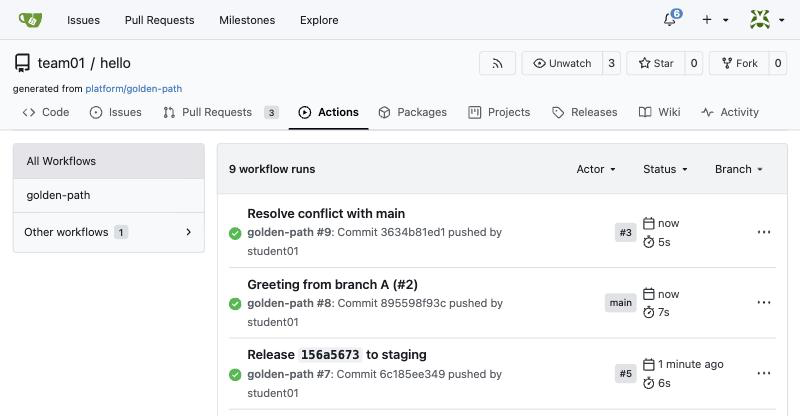

   *hello's Actions tab: each run with its commit, and on the right where it came from: main, or a pull request number. Your names, team, numbers and times are your own.*

3. On the left you see the job build; on the right, its steps. Each line is one check.

   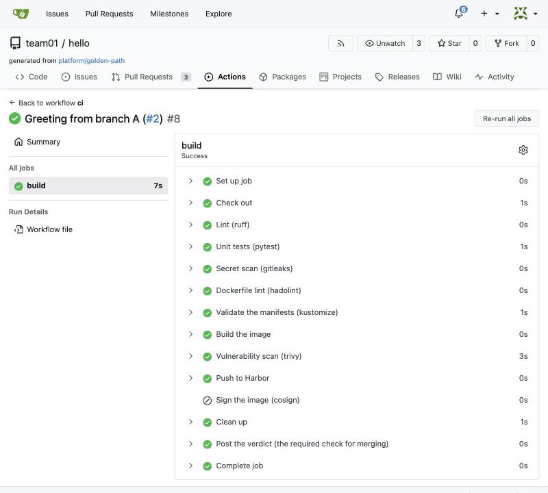

   *A run on main: the job build and its steps, in the order of ci.yaml. Sign the image is skipped (grey) unless the platform turned signing on.*

### 2. Read the tests and the secret scan

1. Click the step Unit tests (pytest): its log unfolds under it.

2. Then click Secret scan (gitleaks).

   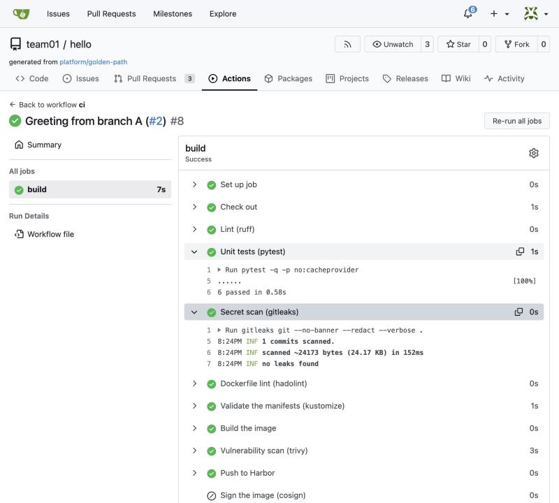

   *The two steps opened: Unit tests says "6 passed"; Secret scan says how much it read and "no leaks found".*

### 3. Find the image tag

1. Click the step Push to Harbor and read its last lines.

### 4. Open the image in Harbor

1. Open https://harbor.<lab domain> in a new tab. On the sign-in page, type your studentNN in Username and your own password in Password (the same as Gitea), and click LOG IN.

2. On the Projects page, click your team, teamNN, in the Project Name column.

3. On the Repositories tab, click teamNN/hello.

4. In the artifacts list, find the line whose Tags column shows the commit id from step 3. The newest is usually at the top (look at Push Time). If the tag is cut short, move the mouse over it to see it whole.

5. On that line, move the mouse over the coloured bar in the Vulnerabilities column: a box shows the counts by severity.

### 5. Read the ingredients list (SBOM)

1. On the same line of the artifacts list, find the SBOM column and click its link: the ingredients list opens. (If your Harbor shows no SBOM column, click the digest, sha256:..., to open the image, and open its SBOM tab.)

2. The SBOM is a table, one line per package: its name and its version.

3. Search the page for python (Ctrl+F, on a Mac Cmd+F).

4. To see the weaknesses themselves, go back, click the digest (sha256:...) and open the Vulnerabilities tab: one line per weakness, with its ID (CVE-...), its severity, the package it is in, and the version that fixes it (if there is one).

### 6. Write down the evidence

1. Copy three things into your notes: the link to the pipeline run (from the browser's address bar), the image tag (the commit id), and the vulnerability counts.

## Lab 2: break the pipeline three ways, and fix it

Make three common mistakes on purpose (a wrong test, a password in the code, running as root) and watch the pipeline catch each one before it reaches main.

### 1. A wrong test

1. Paste the box. It makes a branch, changes one expected value in the tests from 200 to 201, shows the change, commits and pushes.

2. Open the pulls/new link that git push prints and click Create Pull Request. Hold Ctrl (on a Mac Cmd) and click the link in the terminal: it opens in a new browser tab.

3. Wait for the check to turn red (a red cross), click Details, and open the step Unit tests (pytest).

   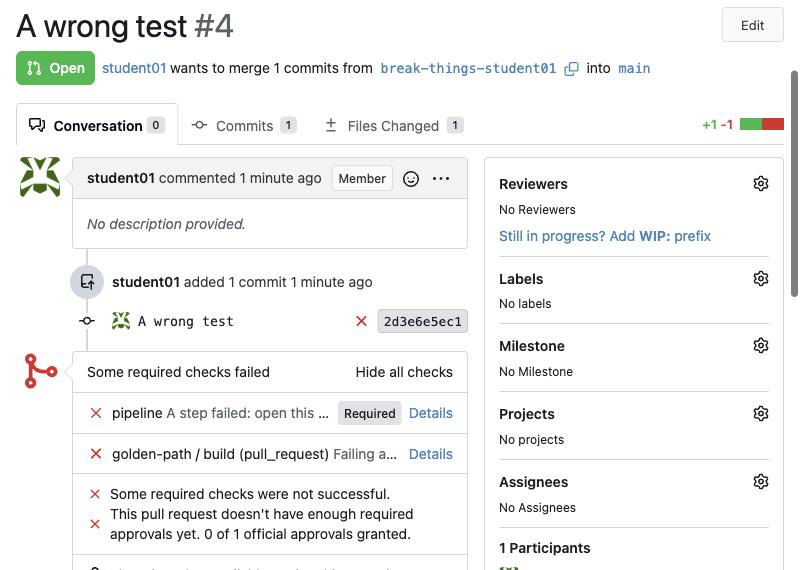

   *The pull request goes red: both checks failed, and merging is blocked. Your names, team, numbers and times are your own.*

   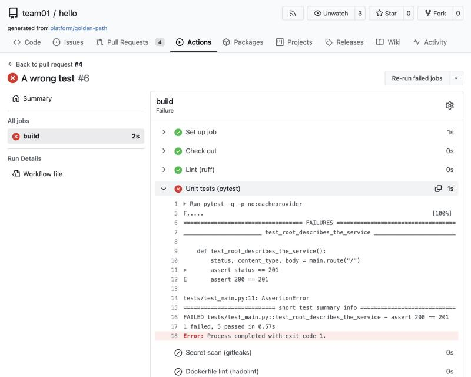

   *Details → Unit tests (pytest): the test that failed, the line (assert status == 201) and why (assert 200 == 201), then "1 failed, 5 passed".*

**Copy and paste:**

```bash
cd ~/hello
git switch main && git pull
git switch -c break-things-$ME
sed -i '0,/assert status == 200/s//assert status == 201/' tests/test_main.py
git diff
git commit -am "A wrong test"
git push -u origin break-things-$ME
```

*In the terminal it looks like this:*

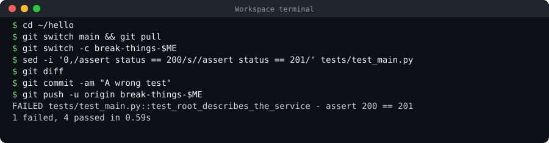

### 2. Fix the test

**Copy and paste:**

```bash
sed -i 's/assert status == 201/assert status == 200/' tests/test_main.py
git commit -am "Fix the test"
git push
```

*In the terminal it looks like this (the output depends on your lab):*

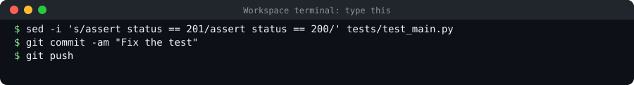

### 3. A password in the code

**Copy and paste:**

```bash
echo 'DB_PASSWORD = "hunter2-very-secret-123"' >> app/main.py
git commit -am "Add a database password"
git push
```

*In the terminal it looks like this:*

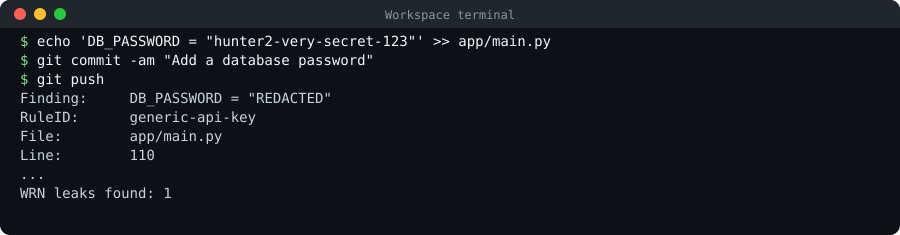

### 4. Remove the password

**Copy and paste:**

```bash
sed -i '/DB_PASSWORD/d' app/main.py
git commit -am "Remove the password"
git push
```

*In the terminal it looks like this (the output depends on your lab):*

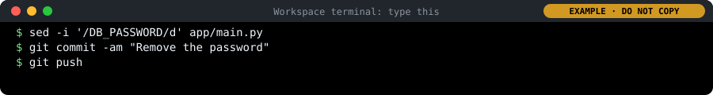

### 5. Run as root

**Copy and paste:**

```bash
sed -i 's/^USER 10001/USER root/' Dockerfile
git commit -am "Run as root"
git push
```

*In the terminal it looks like this:*

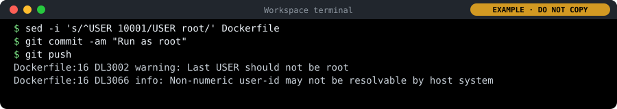

### 6. Put it right, add a test, and merge

1. Paste the box. It puts USER 10001 back, adds a new test for the health check, runs the tests (6 now), commits and pushes.

2. In the pull request, wait for green. Approve it as reviewer in a private window, then merge as yourself with Create squash commit.

**Copy and paste:**

```bash
sed -i 's/^USER root/USER 10001/' Dockerfile
cat >> tests/test_main.py <<'EOF'

def test_health_check_says_ok():
    status, _, body = main.route("/healthz")
    assert status == 200
    assert body == "ok\n"
EOF
pytest -q
git commit -am "Run as an ordinary user again, and test the health check"
git push
```

*In the terminal it looks like this:*

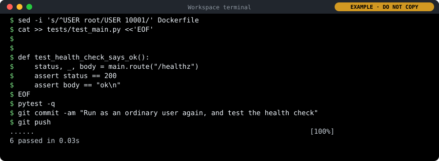

## Lab 3: watch the guardrails refuse a bad deployment

Try to put a careless deployment straight into your dev environment, read the three refusals, and fix them one by one.

### 1. Get the guardrails repository and a copy of the bad example

**Copy and paste:**

```bash
cd ~
git clone https://gitea.$DOMAIN/platform/policies
cd policies
sed "s/team01/$TEAM/g" examples/bad.yaml > ~/shortcut.yaml
cat ~/shortcut.yaml
```

*In the terminal it looks like this (the output depends on your lab):*

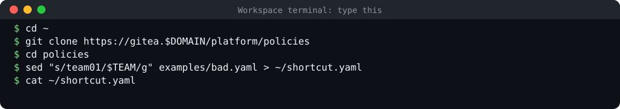

### 2. Try to deploy it

**Copy and paste:**

```bash
kubectl apply -f ~/shortcut.yaml
```

*In the terminal it looks like this:*

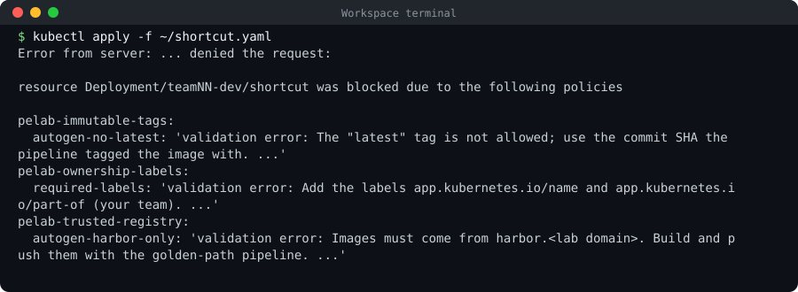

### 3. Fix the image

**Copy and paste:**

```bash
sed -i "s#image: nginx:latest#image: harbor.$DOMAIN/dockerhub/library/python:3.12-slim#" ~/shortcut.yaml
kubectl apply -f ~/shortcut.yaml
```

*In the terminal it looks like this (the output depends on your lab):*

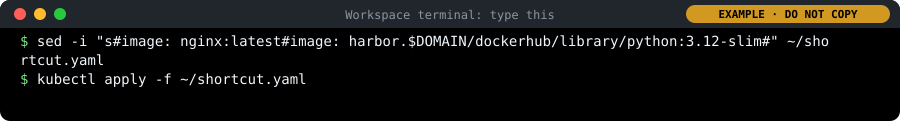

### 4. Add the labels

1. In the Explorer on the left, click shortcut.yaml (it is in your home folder) to open it.

2. Find the first metadata block at the top: the lines name: shortcut and namespace: teamNN-dev.

3. Under the namespace line, add the three lines labels:, app.kubernetes.io/name: shortcut and app.kubernetes.io/part-of: teamNN (your team), with exactly the spaces shown below: 2 spaces before labels, 4 before the two labels. Save with Ctrl+S (Mac Cmd+S).

4. Apply again (the box).

In `~/shortcut.yaml`, change:

```
metadata:
  name: shortcut
  namespace: teamNN-dev
```

to:

```
metadata:
  name: shortcut
  namespace: teamNN-dev
  labels:
    app.kubernetes.io/name: shortcut
    app.kubernetes.io/part-of: teamNN
```

**Copy and paste:**

```bash
kubectl apply -f ~/shortcut.yaml
```

*In the terminal it looks like this:*

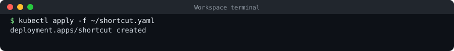

### 5. Clean up, and keep the evidence

**Copy and paste:**

```bash
kubectl -n $TEAM-dev delete deployment shortcut
rm ~/shortcut.yaml
```

*In the terminal it looks like this (the output depends on your lab):*

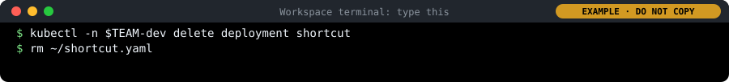

## Lab 4: test a policy like code, with the Kyverno CLI

Check the guardrails without a cluster, the way the policies repository's pipeline does, and see that the tests catch a policy that stops working.

### 1. Check a good deployment

**Copy and paste:**

```bash
cd ~/policies
kyverno apply policies/ --resource examples/good.yaml --values-file tests/values.yaml
```

*In the terminal it looks like this:*

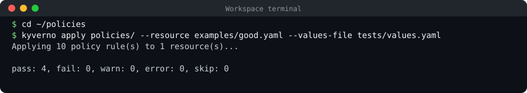

### 2. Check the bad one

**Copy and paste:**

```bash
kyverno apply policies/ --resource examples/bad.yaml --values-file tests/values.yaml
```

*In the terminal it looks like this:*

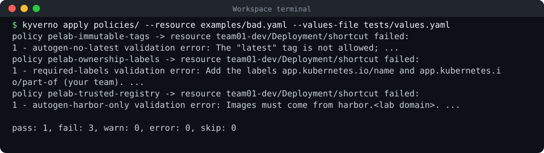

### 3. Run the policy tests

**Copy and paste:**

```bash
kyverno test tests/
```

*In the terminal it looks like this:*

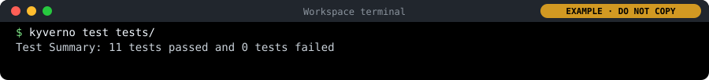

### 4. Break a test on purpose

**Copy and paste:**

```bash
sed -i '/required-labels.*shortcut/s/result: fail/result: pass/' tests/kyverno-test.yaml
kyverno test tests/
git checkout tests/kyverno-test.yaml
```

*In the terminal it looks like this:*

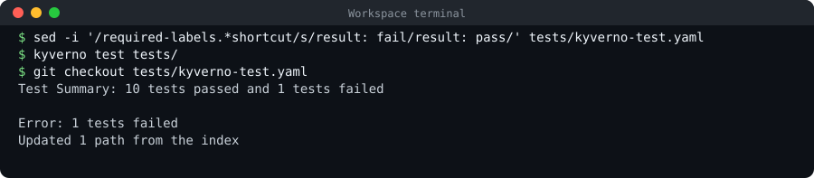

### 5. Think of one more rule

1. Choose one more rule you would turn into a policy, and say in one sentence what it would refuse. Compare with your neighbour.

2. Ideas: cost (every workload has a budget), naming, data (no production data in dev), resilience (prod runs at least two copies).

## Lab 5: ask for an exception, and watch it expire

Ask, the proper way, to break one rule for a short time: a written, reviewed, time-limited exception. Then see what happens when it expires.

### 1. Try the status page

**Copy and paste:**

```bash
cd ~/policies
git switch main && git pull
sed "s/team01/$TEAM/g" examples/status-page.yaml > ~/status-page.yaml
kubectl apply -f ~/status-page.yaml
```

*In the terminal it looks like this (the output depends on your lab):*

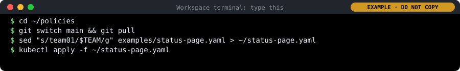

### 2. Write the exception request

1. Paste the box. It makes a branch, copies the template under your team's name, fills in your team and your user name, sets the end date to one week from today, and shows the file.

2. Open the file in the editor (Explorer → policies → exceptions → teamNN-status-page.yaml) and rewrite the reason, under pelab.io/reason, in your own words: why the golden path cannot be used, in one or two sentences. Keep the same indentation. Save.

**Copy and paste:**

```bash
git switch -c $TEAM-status-page
cp examples/exception-template.yaml exceptions/$TEAM-status-page.yaml
sed -i "s/team01/$TEAM/g; s/student01/$ME/" exceptions/$TEAM-status-page.yaml
sed -i "s/pelab.io\/expires: .*/pelab.io\/expires: \"$(date -d '+7 days' +%F)\"/" exceptions/$TEAM-status-page.yaml
cat exceptions/$TEAM-status-page.yaml
```

*In the terminal it looks like this:*

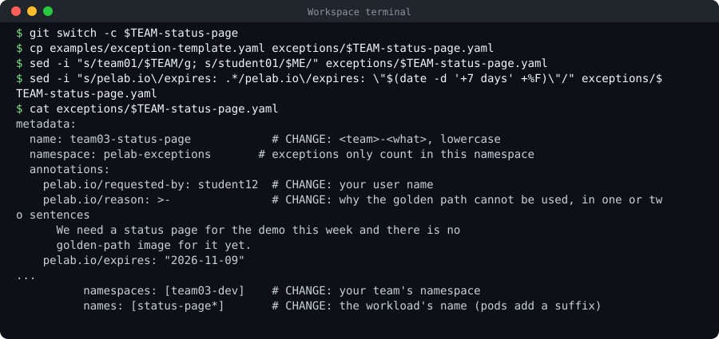

### 3. Check it the way the pipeline will

1. Run the check (the box).

2. Then paste the second box: it sets a date 60 days ahead and checks (refused), then puts the one-week date back and checks again (ok).

**Copy and paste:**

```bash
python3 tests/check-exceptions.py
```

*In the terminal it looks like this:*

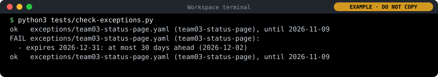

**Copy and paste:**

```bash
sed -i "s/pelab.io\/expires: .*/pelab.io\/expires: \"$(date -d '+60 days' +%F)\"/" exceptions/$TEAM-status-page.yaml
python3 tests/check-exceptions.py
sed -i "s/pelab.io\/expires: .*/pelab.io\/expires: \"$(date -d '+7 days' +%F)\"/" exceptions/$TEAM-status-page.yaml
python3 tests/check-exceptions.py
```

*In the terminal it looks like this (the output depends on your lab):*

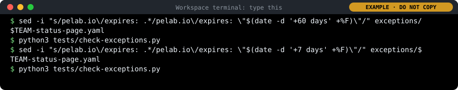

### 4. Propose it; the platform team approves

1. Paste the box: it commits only your exception file and pushes.

2. Open the pulls/new link it prints and click Create Pull Request (title: Exception: status page for teamNN).

3. Now play the platform team: Open a private window (Edge or Chrome: Ctrl+Shift+N, on a Mac Cmd+Shift+N; Firefox: Ctrl+Shift+P, on a Mac Cmd+Shift+P), go to https://gitea.<lab domain>, click Sign In, and sign in with the other person's login: reviewer or platform-approver, with its password from cat /etc/pelab/logins.md in your workspace. Sign in as platform-approver. In Files Changed, read who asks, why and until when, as a reviewer would, then Review → Approve.

4. When the test pipeline is green and the approval is there, merge in your own window.

   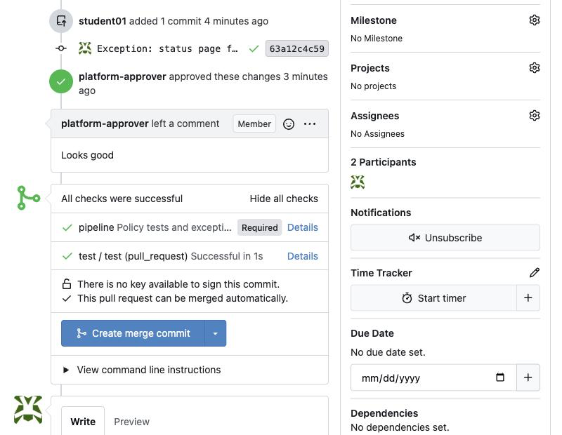

   *The exception's pull request in platform/policies: approved by platform-approver, and the test pipeline (policy tests and exception checks) green. Your names, team, numbers and times are your own.*

5. Two minutes later, open platform/policies → Commits and click the tick next to your merge commit.

**Copy and paste:**

```bash
git add exceptions/$TEAM-status-page.yaml
git commit -m "Exception: status page for $TEAM"
git push -u origin $TEAM-status-page
```

*In the terminal it looks like this (the output depends on your lab):*

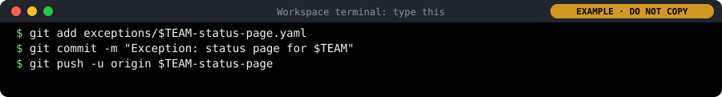

### 5. Try the status page again

**Copy and paste:**

```bash
kubectl apply -f ~/status-page.yaml
kubectl -n $TEAM-dev get pods
```

*In the terminal it looks like this:*

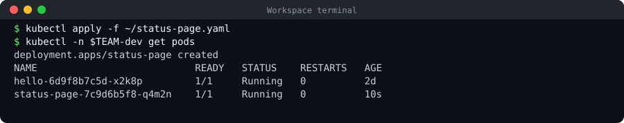

### 6. End the exception, and watch what happens

1. Paste the first box: it makes a branch that sets the end date to yesterday, checks it (it reports "ended"), commits and pushes.

2. Open its pull request (Ctrl+click the pulls/new link that git push prints, then Create Pull Request). Get the platform team's approval as in step 4: in a private window, sign in as platform-approver, open the pull request, Files Changed → Review → Approve, and close the window. Then merge it in your own window.

3. Two minutes after the merge, platform/apply on the commit says "expired, not applied: teamNN-status-page". Then paste the second box.

**Copy and paste:**

```bash
cd ~/policies
git switch main && git pull
git switch -c $TEAM-status-page-end
sed -i "s/pelab.io\/expires: .*/pelab.io\/expires: \"$(date -d yesterday +%F)\"/" exceptions/$TEAM-status-page.yaml
python3 tests/check-exceptions.py
git commit -am "End the status page exception for $TEAM"
git push -u origin $TEAM-status-page-end
```

*In the terminal it looks like this:*

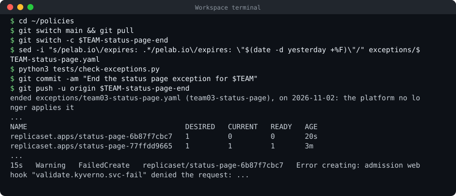

**Copy and paste:**

```bash
kubectl -n $TEAM-dev rollout restart deployment status-page
sleep 20
kubectl -n $TEAM-dev get replicasets,pods
kubectl -n $TEAM-dev get events | grep "Error creating" | tail -1
```

*In the terminal it looks like this (the output depends on your lab):*

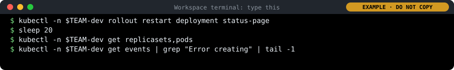

## Pipelines: add the nightly scan to rates, from a template

The same copy-a-template loop as the smoke test on Day 4, this time with Git in the terminal. The nightly scan scans the image of main again every night: new weaknesses are found every day.

### 1. Get the templates

1. Copy them, or update your copy from Day 2.

   **Copy and paste:**

   ```bash
   cd ~
   git clone https://gitea.$DOMAIN/platform/pipeline-templates 2>/dev/null || git -C pipeline-templates pull
   ls ~/pipeline-templates/workflows
   ```

   *In the terminal it looks like this (the output depends on your lab):*

   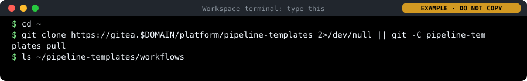

### 2. Make a branch in rates

1. Your copy of rates from Day 4.

   **Copy and paste:**

   ```bash
   cd ~/rates
   git switch main
   git pull
   git switch -c nightly-scan-$ME
   ```

   *In the terminal it looks like this (the output depends on your lab):*

   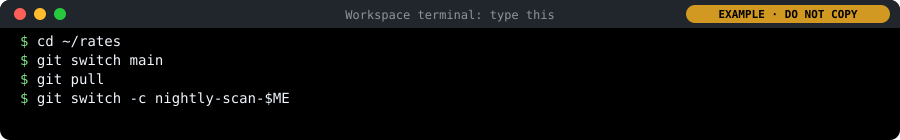

### 3. Copy the template in, commit, push

1. One file, unchanged.

   **Copy and paste:**

   ```bash
   cp ~/pipeline-templates/workflows/nightly-scan.yaml .gitea/workflows/
   git add .gitea/workflows/nightly-scan.yaml
   git commit -m "Add the nightly scan from the platform template"
   git push -u origin nightly-scan-$ME
   ```

   *In the terminal it looks like this (the output depends on your lab):*

   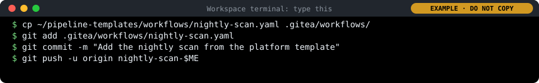

### 4. Pull request, review, merge

1. Ctrl+click the /pulls/new/ address git push printed, then Create Pull Request.

2. When golden-path is green, the reviewer approves (private window, as on Day 2) and you merge.

   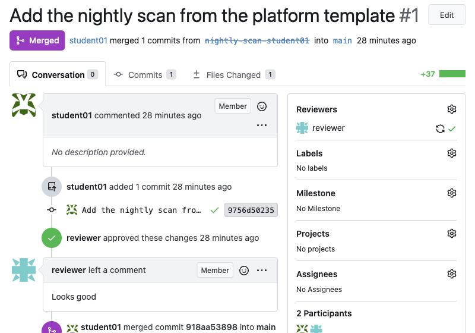

   *Merged: the reviewer approved, and the nightly scan is now on main. Your names and numbers are your own.*

### 5. Run it now

1. In your team's rates, click Actions, then nightly-scan, then Run Workflow, and Run Workflow again in the box.

   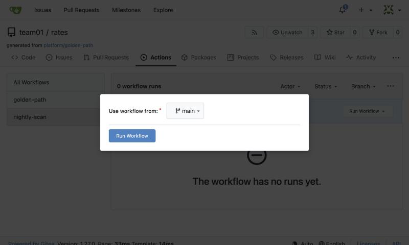

   *nightly-scan in the list on the left, and the Run Workflow box: use the workflow from main.*

2. Open the run, then the Scan it (trivy) step. Green: no fixable HIGH or CRITICAL weaknesses. Red: the step lists them.

   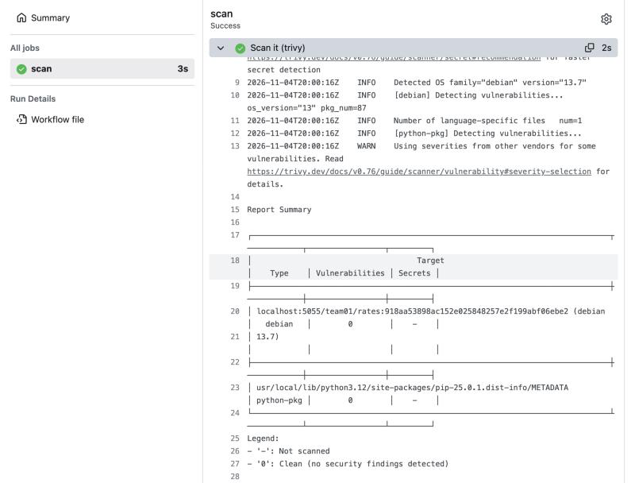

   *A green nightly scan: trivy's report summary, 0 vulnerabilities in the operating system (debian) and in the Python packages. In the lab the image name starts with harbor.<lab domain>.*
