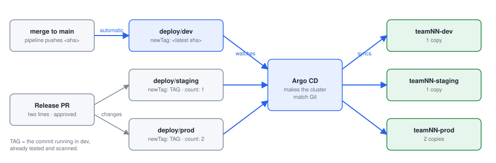
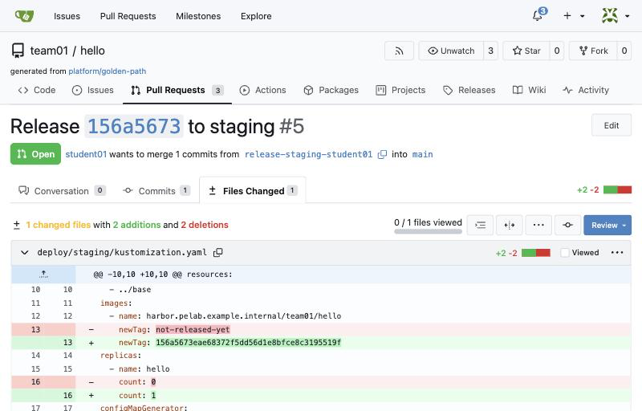
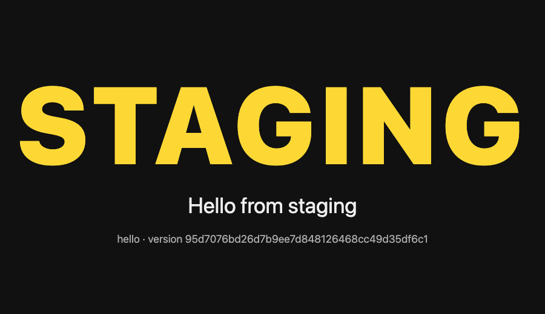
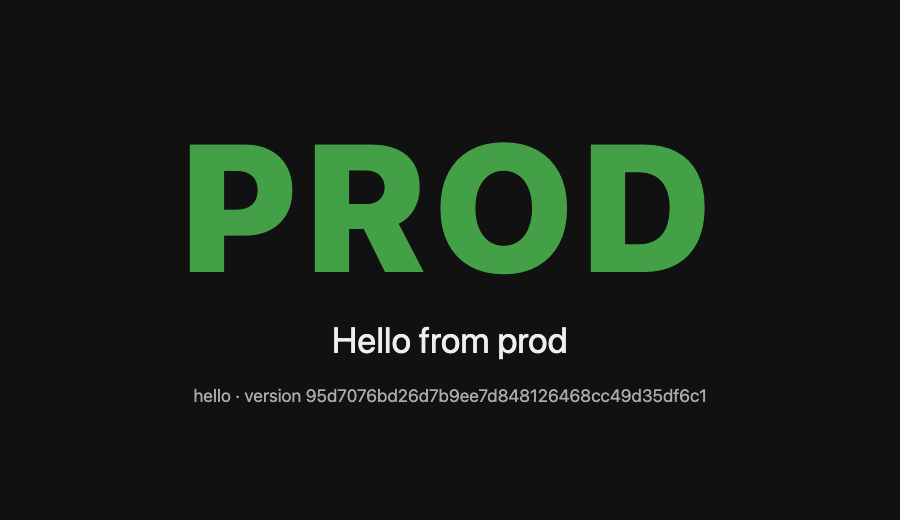
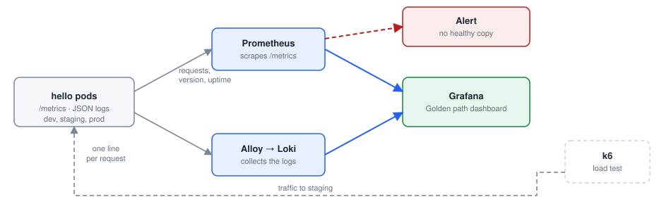
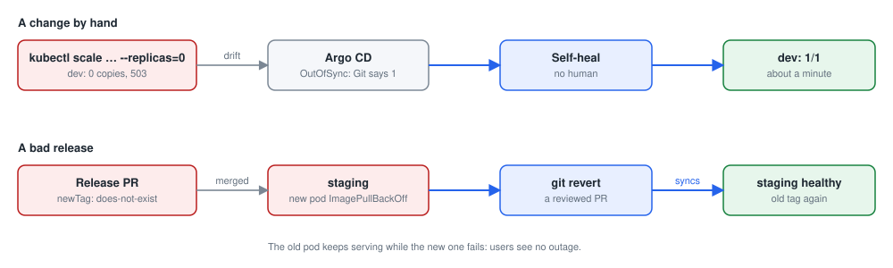
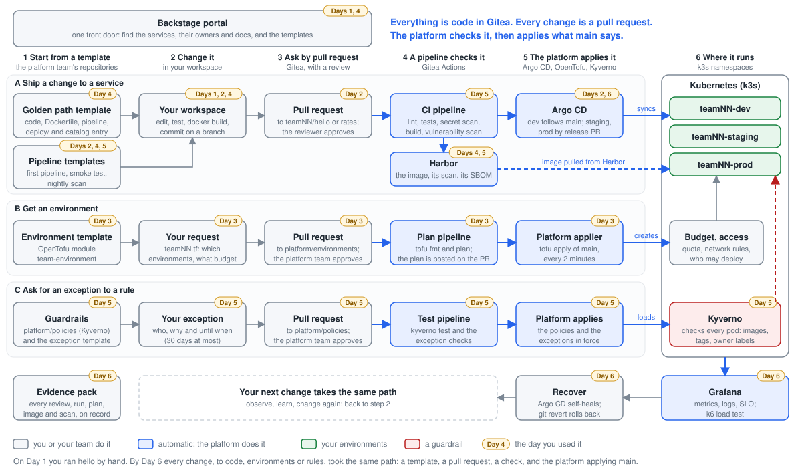
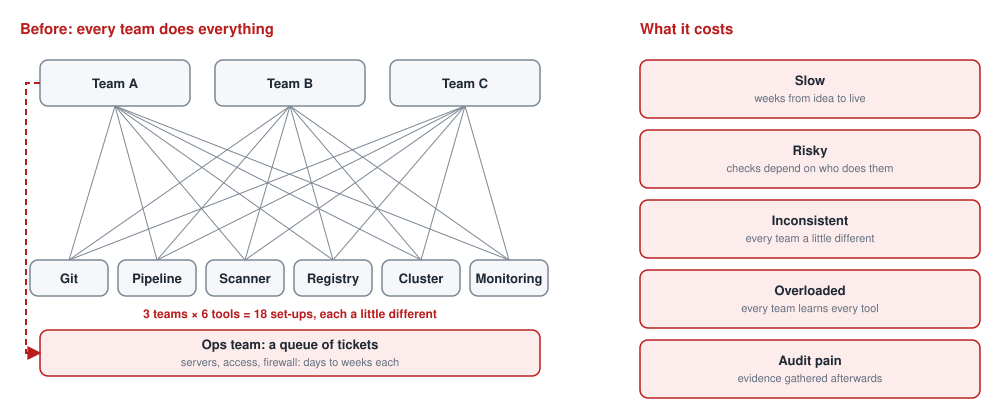
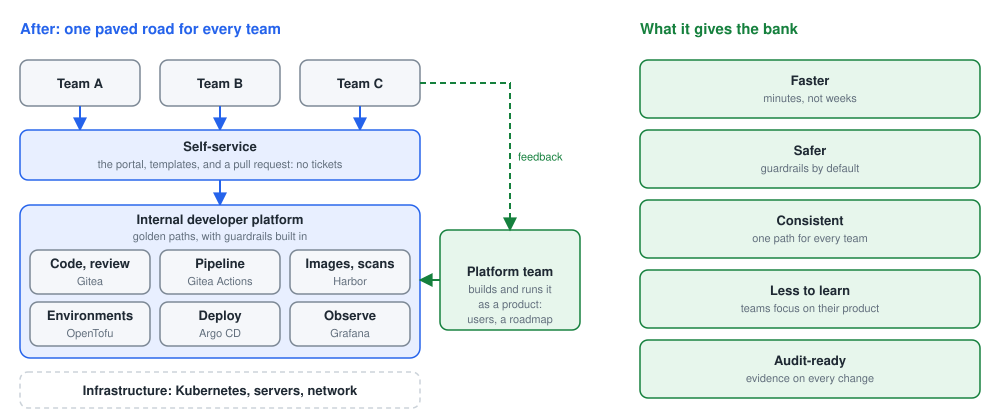
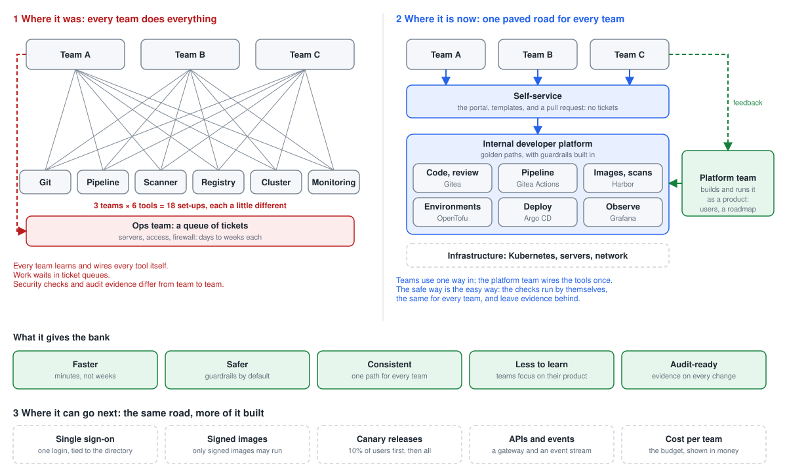

# Day 6: Deploy, observe and the capstone

**Goal:** Release to staging and prod through Git, read the dashboard, recover from a bad change, and present your service with its evidence.

By the end of the day you can:

- Promote a release to staging and then prod by pull request, and see each environment report its name
- Read the dashboard, run a load test, and explain end-to-end performance engineering
- Break and recover a service, and assemble the evidence pack for the capstone

### Today's plan

Yesterday you saw what the pipeline and the guardrails refuse. Today you release to staging and prod, watch the service, break it, and present your capstone.

| Topic | Labs |
| --- | --- |
| Kubernetes and GitOps | [Lab 1: promote hello to staging, then prod](#lab-1-promote-hello-to-staging-then-prod) (on your own) |
| Observability | [Lab 2: read the dashboard](#lab-2-read-the-dashboard) |
| Performance engineering | [Lab 3: load-test staging and watch the dashboard](#lab-3-load-test-staging-and-watch-the-dashboard) |
| Resilience | [Lab 4: break it, and watch the platform recover](#lab-4-break-it-and-watch-the-platform-recover) |
| Capstone | [Capstone: your service to prod, with evidence](#capstone-your-service-to-prod-with-evidence) (on your own) |
| Final lab | [Final lab: your name in dev, staging and prod](#final-lab-your-name-in-dev-staging-and-prod) (on your own) |
| Looking back, and ahead | Concepts and discussion, no lab |

## Kubernetes and GitOps

### Kubernetes in one slide: the five words you need

You will see these in Argo CD and on the dashboard. You will not type them; the templates already wrote them.

- **Cluster:** The machines that run containers, managed as one. In the lab: one server running k3s.
- **Namespace:** A fenced area inside the cluster with its own budget, access and network rules. One per environment: teamNN-dev, teamNN-staging, teamNN-prod.
- **Pod and Deployment:** A Pod is a running container. A Deployment says "keep N copies of this image running, and replace them carefully when the image changes". Replicas is N.
- **Service and Ingress:** A Service is the stable internal address for the pods. An Ingress is the public address: https://hello-teamNN-dev.&lt;domain>.
- **ConfigMap:** The settings for an environment (APP_ENV, GREETING), supplied to the container as environment variables. Same image, different ConfigMap.

### GitOps and promotion: how a release reaches prod



*dev follows main automatically; staging and prod change only through an approved two-line release pull request.*

The repository holds one folder per environment: deploy/dev, deploy/staging, deploy/prod. Each says which image tag runs there and how many copies. Argo CD makes each namespace match its folder.

dev follows main: every merge runs the newest image. staging and prod run only the tag written in their folder, so they change only when someone changes that file, by pull request, with an approval.

Promotion is therefore a two-line change: the tag (the commit id of a build that passed every check) and the replica count. Rollback is a revert of that change. Deterministic, recorded, no production access needed.

> **In one sentence:** Promotion is a reviewed change to the tag in an environment's folder; Argo CD does the rest.

**In the lab**

- Find the tag in Harbor or in the pipeline log.
- Edit deploy/staging/kustomization.yaml: newTag and replicas.
- Pull request, approval, merge. Argo CD syncs within a few minutes.
- The same for deploy/prod, with two replicas.

### The promotion change: two lines

```
# deploy/staging/kustomization.yaml   (before -> after)

images:
  - name: harbor.<lab domain>/teamNN/hello
-   newTag: not-released-yet
+   newTag: 3f9c2a7e1b0d4c5e6f7a8b9c0d1e2f3a4b5c6d7e
    # the new tag is the commit id, copied from Harbor

replicas:
  - name: hello
-   count: 0
+   count: 1

# deploy/prod/kustomization.yaml: the same, with count: 2
```

- newTag: the exact image that passed the pipeline. Copy it from Harbor; never type "latest".
- count: how many copies run. Staging gets one; prod gets two, so one can restart without downtime.
- Nothing else changes between environments except the settings in the ConfigMap.
- The pull request shows exactly these lines. The reviewer can check the tag against the scan in Harbor.

## Lab 1: promote to staging and prod

### Lab 1: promote hello to staging, then prod

*on your own*

**What you do:** Release the image running in dev to staging and then prod, by changing two lines in a reviewed pull request.

**You will learn:**

- How a release works on the platform: a pull request that changes which image runs, and how many copies.
- That staging and prod run the very image dev tested, never a rebuild.

**Words you will meet:**

- **Release (promotion):** Moving a tested image to the next environment: dev → staging → prod.
- **newTag:** The line in deploy/&lt;env>/kustomization.yaml that says which image (which commit) runs there.
- **count:** The line that says how many copies (replicas) run there. 0 means off.

**Before you start:**

1. Your workspace is open in the browser (https://student01.<lab domain>, signed in with your password).
2. A terminal is open at the bottom of the workspace. If not: menu ☰ (top left) → Terminal → New Terminal. You are ready when you see a prompt that ends in $, for example student01@student01:~$
3. To run a command: copy it from this page (the copy button at the top right of each grey box), click in the terminal, paste with Ctrl+V (on a Mac Cmd+V, or right-click → Paste), and press Enter. You can paste a whole box at once: the lines run one after the other.
4. If Git asks for a Username (the first time each day: it then remembers your password for 10 hours), type student01 and press Enter; for the Password, type your password (from cat /etc/pelab/logins.md) and press Enter. Nothing appears while you type the password: that is normal.
5. You have staging and prod (Day 3). You make each release; the reviewer approves it in a private window.
6. Use one terminal for the whole lab: step 1 stores the release tag in $TAG, which a new terminal would not know.

#### Step 1. Find the tag to release

*Where: Workspace terminal, then Harbor*

**Why:** You release the image built from the newest commit on main: the one running in dev. Its tag is that commit's id.

**Do this:**

1. Paste the box. The last line prints the tag.

   ```bash
   cd ~/hello
   git switch main && git pull
   TAG=$(git rev-parse HEAD)
   echo $TAG
   ```

2. Open Harbor (https://harbor.<lab domain>, sign in as studentNN). Click Projects → teamNN (Project Name column) → teamNN/hello (Repositories tab).

3. In the artifacts list, find the line whose Tags column shows this tag (move the mouse over a cut-short tag to see it whole), and check that its Vulnerabilities column shows a coloured bar: it has been scanned. If there is no such line, the pipeline on main is still running: wait for it and reload.

**What each line does:**

- `git switch main && git pull`: the newest main.
- `TAG=$(git rev-parse HEAD)`: store the id of the newest commit in a variable called TAG. $( ) runs the command inside and uses its answer.
- `echo $TAG`: print it.

**You should see:** A 40-character tag, the same as the newest image in Harbor:

```
283803288206439f84db4279b5d39fd644cb5f24
```

#### Step 2. Change two lines for staging

*Where: Workspace terminal*

**Why:** A release is a tiny change in Git: which image, how many copies. Everything else about staging stays as the template made it.

**What changes in `deploy/staging/kustomization.yaml`:** two lines: which image, how many copies.

Before:

```
images:
  - name: harbor.<lab domain>/teamNN/hello
    newTag: not-released-yet
replicas:
  - name: hello
    count: 0
```

After:

```
images:
  - name: harbor.<lab domain>/teamNN/hello
    newTag: 283803288206439f84db4279b5d39fd644cb5f24
replicas:
  - name: hello
    count: 1
```

```bash
git switch -c release-staging-$ME
sed -i "s/newTag: .*/newTag: $TAG/; s/count: 0/count: 1/" deploy/staging/kustomization.yaml
git diff
```

**What each line does:**

- `git switch -c release-staging-$ME`: a branch for the release.
- `sed -i "s/newTag: .*/newTag: $TAG/; s/count: 0/count: 1/" ...`: two replacements in the staging file: newTag becomes your tag, and count goes from 0 to 1 copy.
- `git diff`: show exactly what changed.

**You should see:** Exactly two changed lines in git diff: newTag and count.

```
-    newTag: not-released-yet
+    newTag: 283803288206439f84db4279b5d39fd644cb5f24
 replicas:
   - name: hello
-    count: 0
+    count: 1
```

**If you see something else:**

- *newTag: with nothing after it*: $TAG was empty: you are in a new terminal. Run step 1 again, then git checkout deploy/staging/kustomization.yaml and this step again.

#### Step 3. Propose the release; the reviewer approves

*Where: Workspace terminal, then Gitea*

**Why:** A release is reviewed like any change: someone else agrees that this image may go to staging.

**Do this:**

1. Paste the box to commit and push.

   ```bash
   git commit -am "Release ${TAG:0:8} to staging"
   git push -u origin release-staging-$ME
   ```

2. Open the pulls/new link it prints (Hold Ctrl (on a Mac Cmd) and click the link in the terminal) and click Create Pull Request.

   

   *Files Changed of the release: in deploy/staging/kustomization.yaml, newTag becomes the commit id and count goes from 0 to 1. Nothing else. Your names, team, numbers and times are your own.*

3. Approve as reviewer: Open a private window (Edge or Chrome: Ctrl+Shift+N, on a Mac Cmd+Shift+N; Firefox: Ctrl+Shift+P, on a Mac Cmd+Shift+P), go to https://gitea.<lab domain>, click Sign In, and sign in with the other person's login: reviewer or platform-approver, with its password from cat /etc/pelab/logins.md in your workspace. Read Files Changed (two lines), then Review → Approve, and close the private window.

4. When "All checks were successful", merge with Create squash commit.

**What each line does:**

- `git commit -am "Release ${TAG:0:8} to staging"`: commit, with the first 8 characters of the tag in the message (${TAG:0:8}).

**You should see:** A green pipeline (it checks the deploy folders still build), an approval, and the merge.

#### Step 4. Watch staging update

*Where: Browser: Argo CD*

**Why:** Argo CD sees the change on main and makes staging match it: the release itself needs no command.

**Do this:**

1. Open https://argocd.<lab domain> (sign in as delegate if it asks) and click teamNN-hello-staging.

2. Within a minute of the merge it starts syncing.

   

   *teamNN-hello-staging after the release: Healthy, Synced to main, the comment of your release commit, and the tree: settings (cm), service (svc), the hello deployment (deploy) with its copies. In your lab the repository is https://gitea.<lab domain>/teamNN/hello.git, and the names, ids and times are your own.*

**You should see:** Syncing, then Synced and Healthy, with one pod.

> **Tip:** If the safety net is on: the merge commit's safety-net/staging says "Deployed to teamNN-staging: &lt;tag>, 1 replica", and kubectl -n $TEAM-staging get pods shows the pod.

#### Step 5. Check staging answers with the right version

**Why:** The proof: staging runs your tag, and reports its own name and settings.

*Where: Browser*

**Do this:**

1. Open https://hello-teamNN-staging.<lab domain>/ in a new tab (your team instead of teamNN).

**You should see:** STAGING in big yellow letters, staging's own greeting ("Hello from staging"), and the version: your tag.



*hello in staging: the same image as dev, with staging's settings: STAGING in yellow. The greeting and version in your lab are your own (staging says "Hello from staging").*

**How to read it:**

- Keep the dev tab open next to it: same service, different environment, different colour.

<details>
<summary>The same in the terminal (optional)</summary>

*Where: Workspace terminal*

```bash
curl -s https://hello-$TEAM-staging.$DOMAIN/
```

**What each line does:**

- `curl -s https://hello-$TEAM-staging.$DOMAIN/`: call hello in staging.

**You should see:** "environment": "staging", "version" with your tag, and staging's own greeting:

```
{"app": "hello", "version": "283803288206439f84db4279b5d39fd644cb5f24", "environment": "staging", "message": "Hello from staging"}
```

**How to read it:**

- The greeting comes from staging's settings (deploy/staging/kustomization.yaml), not from the code: same image, different settings, exactly as on Day 4.

</details>

#### Step 6. Do the same for prod, with two copies

*Where: Workspace terminal, then Gitea*

**Why:** Prod gets the same image as staging, with two copies so that one can fail without an outage.

**Do this:**

1. Paste the box: from the updated main, the same two lines in deploy/prod, with count 2.

   ```bash
   git switch main && git pull
   git switch -c release-prod-$ME
   sed -i "s/newTag: .*/newTag: $TAG/; s/count: 0/count: 2/" deploy/prod/kustomization.yaml
   git diff
   git commit -am "Release ${TAG:0:8} to prod"
   git push -u origin release-prod-$ME
   ```

2. Pull request, approval, merge, as in step 3.

3. After the merge, call prod (the second box).

   ```bash
   curl -s https://hello-$TEAM-prod.$DOMAIN/
   kubectl -n $TEAM-prod get pods
   ```

**You should see:** prod answers with "environment": "prod" and your tag, and runs two pods. Three environments, three answers, one image.

**How to read it:**

- kubectl in prod works, but only for reading: your team may look at prod, not change it by hand. Changes go through Git.

**Then see it in the browser:**

**Do this:**

1. In Argo CD, click teamNN-hello-prod: Synced and Healthy, with two pods.
2. Open https://hello-teamNN-prod.<lab domain>/ in a new tab.
3. Put the three tabs side by side: dev, staging, prod.

**You should see:** PROD in big green letters, with your tag. Three environments, three colours, one image.



*hello in prod: PROD in green, the colour of what customers use. Your greeting and version are your own (prod says "Hello from prod").*

**Done when:** dev, staging and prod each report their own environment, and staging and prod run the tag you released.

**If you are stuck**

- Copy the whole tag: all 40 characters of the commit id.
- Argo CD shows the image cannot be pulled: the tag is wrong. Fix it in a new pull request.

## Observability

*Is the service keeping its promise? Metrics, logs, dashboards and a simple service level objective. Then you read your own service's dashboard (Lab 2).*

### Observability and SLOs in plain words



*What the dashboard reads: metrics and logs from every copy of the service, in every environment.*

Metrics are numbers over time: requests per second, errors, response time, CPU. Logs are the events, one line each. A dashboard puts the numbers on screen; an alert says when a number crosses a line.

A service level indicator (SLI) is a number that measures the promise, such as the share of requests that succeed. A service level objective (SLO) is the target: 99% of requests succeed. The error budget is the 1% you may spend on changes and incidents.

Observability is what lets a team say "it works" with evidence, and lets an incident be found in minutes rather than reported by a user.

> **In one sentence:** Observability turns "it works" into numbers and logs you can see; an SLO is the promise those numbers must keep.

**In the lab**

- hello exposes /metrics; Prometheus collects it every 30 seconds.
- Alloy ships the JSON logs to Loki.
- the Golden path services dashboard in Grafana shows versions, traffic, errors and logs per team and environment.
- The template includes one alert: the service is down for five minutes.

### Lab 2: read the dashboard

**What you do:** Read your service's health on the Golden path services dashboard: versions, traffic, errors and logs. Then write a short service-level report.

**You will learn:**

- How to see, on one page, what runs where, whether it is healthy, how busy it is and what goes wrong.
- How to turn what you see into a service-level report.

**Words you will meet:**

- **Dashboard:** A page of live panels in Grafana, fed by the service's metrics and logs.
- **Service level (SLO):** A promise with a number, for example "99% of requests succeed".
- **4xx / 5xx:** Error answers: 4xx means the request was wrong (404: not found), 5xx means the service failed.

**Before you start:**

1. Lab 1 done: staging runs one copy.
2. Put the browser and the workspace side by side if you can: you make traffic in the terminal and watch it in Grafana.

#### Step 1. Open the dashboard

*Where: Browser: Grafana*

**Why:** One page shows the whole service across its environments: the first place to look in any incident.

**Do this:**

1. Open https://grafana.<lab domain> in a new tab. On the sign-in page, type delegate in Email or username, its password from cat /etc/pelab/logins.md in Password (the same read-only login as Argo CD), and click Log in.
2. Open the menu on the left (if it is closed, click the ☰ icon at the top left) and click Dashboards.
3. The list shows folders. Click the folder PE Lab to open it, then click Golden path services.
4. At the top left of the dashboard there are two lists. Team: choose your team, teamNN. Service: choose hello.
5. At the top right, leave the time range (Last 1 hour) and the refresh (30s) as they are: the dashboard updates itself every 30 seconds. The round arrow button refreshes it now.

**You should see:** Five panels: What runs where (version = commit SHA), Healthy pods, Requests per second, Failed requests (share of 4xx and 5xx), and Logs. What runs where lists dev, staging and prod, each with its tag.

#### Step 2. Make some traffic

*Where: Workspace terminal*

**Why:** An idle service shows flat lines. A minute of steady traffic makes the panels speak.

```bash
for i in $(seq 1 300); do curl -s -o /dev/null https://hello-$TEAM-staging.$DOMAIN/; sleep 0.2; done
```

**What each line does:**

- `for i in $(seq 1 300); do ...; done`: repeat what is between do and done 300 times.
- `curl -s -o /dev/null https://hello-$TEAM-staging.$DOMAIN/`: call staging and throw the answer away (-o /dev/null): only the traffic matters.
- `sleep 0.2`: wait a fifth of a second: five calls a second, about a minute in all.

**You should see:** The prompt comes back after about a minute. Meanwhile Requests per second rises for staging, to about 5.

#### Step 3. Make some errors

*Where: Workspace terminal*

**Why:** See what an error looks like on the dashboard, before a real one happens.

```bash
for i in $(seq 1 50); do curl -s -o /dev/null https://hello-$TEAM-staging.$DOMAIN/missing; done
```

**What each line does:**

- `.../missing`: an address the service does not have: it answers 404.

**You should see:** Failed requests (share of 4xx and 5xx) shows a small percentage for staging, within a minute.

#### Step 4. Find them in the logs

*Where: Browser: Grafana*

**Why:** The panel says something is wrong; the logs say what, request by request.

**Do this:**

1. Scroll down to the Logs panel, at the bottom of the dashboard. The newest lines are at the top.
2. Press Ctrl+F (on a Mac Cmd+F) and type missing: the browser highlights the failed requests.

**You should see:** One JSON line per failed request:

```
{"event": "request", "app": "hello", "env": "staging", "method": "GET", "path": "/missing", "status": 404, "duration_ms": 0.21}
```

#### Step 5. Write a service-level report

*Where: Your team notes*

**Why:** A report turns what you saw into something a service owner can act on.

**Do this:**

1. Write three lines: the promise (99% of requests succeed), today's measured success rate (100% minus the failed share on the dashboard), and the one alert that exists (it fires when hello has no healthy copy).

**You should see:** A three-line report for the evidence pack, for example "Promise 99%. Measured today 85% in staging, all of the failures our own 404 test. Alert: no healthy pod for 2 minutes."

**Done when:** You can read versions, traffic, errors and logs for your service, and have a three-line service-level report.

**If you are stuck**

- Grafana asks for a login: delegate, with its password from cat /etc/pelab/logins.md (the same as Argo CD). It is read-only: you can look at everything and change nothing.
- Empty panels: pick your team and app at the top of the dashboard, and look at the last 15 minutes.

## Performance engineering

*You can see the service's health on the dashboard. Next: put real load on staging and turn the numbers into a decision (Lab 3).*

### End-to-end performance engineering

Performance has two halves, and a platform measures both from the same place. Delivery performance: how fast and safely changes flow, measured as lead time for a change, deployment frequency, change failure rate and time to restore. Runtime performance: how the service behaves under load, measured as response time, error rate and saturation of its budget.

End to end means tracing one change from the pull request to its effect in production: when it was merged, when it was live, what it did to response time and errors, and how fast a bad one was undone.

The platform makes these numbers a by-product: Git gives lead time, Argo CD gives deployment time, the dashboard gives runtime, and the incident lab gives time to restore.

> **In one sentence:** Performance engineering end to end measures both the flow of changes and the service under load, from one platform.

**In the lab**

- Lead time: from first commit to live in dev, read from Git and Argo CD.
- Deployment frequency: count your team's deployments this week.
- Runtime: a two-minute k6 load test against staging, watched on the dashboard.
- Time to restore: measured in the next lab.

### A load test in ten lines: k6

```
// ~/day6/load.js
import http from 'k6/http';
import { check, sleep } from 'k6';

export const options = { vus: 20, duration: '2m' };

export default function () {
  const r = http.get('https://hello-teamNN-staging.<lab domain>/');
  check(r, { 'status is 200': (res) => res.status === 200 });
  sleep(0.5);
}

// run it:   k6 run load.js
```

- vus: 20 virtual users, each calling the service in a loop for two minutes.
- check: counts how many answers were good. That is your SLI under load.
- k6 prints requests per second, response time (average and p95) and the check pass rate.
- Run it against staging, never prod, unless the platform team agrees.

### Lab 3: load-test staging and watch the dashboard

**What you do:** Put real load on staging with k6, watch what it does on the dashboard, and turn the numbers into a decision.

**You will learn:**

- How to measure a service under load: throughput, response time (p95) and success rate.
- How to turn the numbers into a decision about copies, budget or code.

**Words you will meet:**

- **k6:** A load-testing tool: it plays many users at once and measures every answer.
- **VU (virtual user):** One simulated user, calling the service in a loop.
- **p95:** The 95th percentile: 95% of requests were answered at least this fast. A better guide than the average.

**Before you start:**

1. Your workspace is open in the browser (https://student01.<lab domain>, signed in with your password).
2. A terminal is open at the bottom of the workspace. If not: menu ☰ (top left) → Terminal → New Terminal. You are ready when you see a prompt that ends in $, for example student01@student01:~$
3. To run a command: copy it from this page (the copy button at the top right of each grey box), click in the terminal, paste with Ctrl+V (on a Mac Cmd+V, or right-click → Paste), and press Enter. You can paste a whole box at once: the lines run one after the other.
4. If Git asks for a Username (the first time each day: it then remembers your password for 10 hours), type student01 and press Enter; for the Password, type your password (from cat /etc/pelab/logins.md) and press Enter. Nothing appears while you type the password: that is normal.
5. Lab 1 done: staging runs. Put the dashboard and the terminal side by side.

#### Step 1. Write the load test

*Where: Workspace terminal*

**Why:** A load test is code too: ten lines that say how many users, for how long, and what counts as success.

```bash
mkdir -p ~/day6 && cd ~/day6
cat > load.js <<EOF
import http from 'k6/http';
import { check, sleep } from 'k6';

export const options = { vus: 20, duration: '2m' };

export default function () {
  const r = http.get('https://hello-$TEAM-staging.$DOMAIN/');
  check(r, { 'status is 200': (res) => res.status === 200 });
  sleep(0.5);
}
EOF
cat load.js
```

**What each line does:**

- `cat > load.js <<EOF ... EOF`: write the lines into load.js. Because EOF has no quotes here, $TEAM and $DOMAIN are filled in with your team and the lab domain.
- `options = { vus: 20, duration: '2m' }`: 20 virtual users, for two minutes.
- `http.get(...)`: each user calls staging...
- `check(r, { 'status is 200': ... })`: ...checks the answer is 200...
- `sleep(0.5)`: ...and waits half a second: so about 40 calls a second in all.

**You should see:** The script, with your team and the lab domain in the address:

```
  const r = http.get('https://hello-team03-staging.<lab domain>/');
```

#### Step 2. Run it

*Where: Workspace terminal*

**Why:** Two minutes of steady load give numbers you can compare.

```bash
k6 run load.js
```

**What each line does:**

- `k6 run load.js`: run the test. A progress bar runs for two minutes; then the summary.

**You should see:** A summary. Find four lines: checks_succeeded, http_req_duration (its p(95)), http_req_failed and http_reqs:

```
  █ TOTAL RESULTS

    checks_total.......: 4731    39.4/s
    checks_succeeded...: 100.00% 4731 out of 4731
    checks_failed......: 0.00%   0 out of 4731

    ✓ status is 200

    HTTP
    http_req_duration..............: avg=4.67ms   min=255.36µs med=2.31ms   max=212.56ms p(90)=5.08ms   p(95)=6.15ms
    http_req_failed................: 0.00%  0 out of 4731
    http_reqs......................: 4731   39.4/s
```

**How to read it:**

- checks_succeeded: the share of answers that were 200, your success rate.
- http_req_duration p(95): 95% of requests were answered at least this fast.
- http_reqs: how many requests, and how many per second.

#### Step 3. Watch the dashboard while it runs

*Where: Browser: Grafana*

**Why:** The dashboard shows the same load from the service's side.

**Do this:**

1. Go to the Golden path services dashboard (Team: teamNN, Service: hello), and click the round arrow button at the top right to refresh it; it also refreshes itself every 30 seconds.
2. In Requests per second, each line is one environment: move the mouse over the lines to see which is staging.
3. In Failed requests (share of 4xx and 5xx), check the staging line stays at the bottom, at 0%.

**You should see:** Requests per second for staging rises to about 40; Failed requests stays at 0%.

#### Step 4. Run it again with 100 users

*Where: Workspace terminal, and the dashboard*

**Why:** Five times the users: does one copy still keep the promise?

**Do this:**

1. Run the first box; it takes two minutes.

   ```bash
   k6 run --vus 100 load.js
   ```

2. While it runs, open a second terminal (+) and run the second box a few times: it shows how much CPU and memory the staging pod uses right now.

   ```bash
   kubectl -n $TEAM-staging top pods
   ```

**What each line does:**

- `k6 run --vus 100 load.js`: the same test, but with 100 users: --vus overrides the number in the script.
- `kubectl -n $TEAM-staging top pods`: show the CPU (in millicores: 1000m is one core) and memory each staging pod uses now. hello may use at most 200m CPU (a fifth of a core) and 128Mi of memory: the limits in its deployment (deploy/base/deployment.yaml).

**You should see:** More requests per second; p95 rises; the pod's CPU climbs towards its 200m limit, for example:

```
NAME                     CPU(cores)   MEMORY(bytes)
hello-5c7d9b8f6c-8v2kq   187m         31Mi
```

#### Step 5. Turn the numbers into a decision

*Where: Your team notes*

**Why:** Numbers are only useful if they lead to a decision.

**Do this:**

1. Write down p95 and the success rate at 20 and at 100 users.
2. Decide: does one copy keep the promise at 100 users? If not, what would you change: more copies, a bigger budget, or the code?

**You should see:** A short performance note with a recommendation, for example "At 100 users p95 rose from 6 ms to 180 ms; prod needs two copies".

**Done when:** You have p95 and success rate at two loads, and a recommendation based on them.

**If you are stuck**

- Use your team's staging address, never prod.
- Many failed checks: your staging may have 0 replicas. Check Lab 1 was merged and synced.

## Resilience

*You know how the service behaves under load. Next: break it on purpose, twice, and time how the platform recovers (Lab 4).*

### Lab 4: break it, and watch the platform recover



*Two incidents, two ways back: Argo CD self-heals a change made by hand; Git reverts a bad release.*

**What you do:** Cause two incidents on purpose, a manual change and a bad release, and measure how the platform recovers from each. Note the clock time at every step.

**You will learn:**

- Self-healing: the platform undoes a change made by hand, because Git says otherwise.
- Recovery through Git: a bad release is undone with a revert, reviewed and recorded like any change.
- How to measure time to restore.

**Words you will meet:**

- **Incident:** Something that stops a service working as promised.
- **Self-heal:** Argo CD puts the cluster back to what Git says, by itself.
- **Revert:** A new commit that undoes an earlier one. History is kept; nothing is erased.
- **Time to restore:** How long from the start of an incident until the service works again.

**Before you start:**

1. Your workspace is open in the browser (https://student01.<lab domain>, signed in with your password).
2. A terminal is open at the bottom of the workspace. If not: menu ☰ (top left) → Terminal → New Terminal. You are ready when you see a prompt that ends in $, for example student01@student01:~$
3. To run a command: copy it from this page (the copy button at the top right of each grey box), click in the terminal, paste with Ctrl+V (on a Mac Cmd+V, or right-click → Paste), and press Enter. You can paste a whole box at once: the lines run one after the other.
4. If Git asks for a Username (the first time each day: it then remembers your password for 10 hours), type student01 and press Enter; for the Password, type your password (from cat /etc/pelab/logins.md) and press Enter. Nothing appears while you type the password: that is normal.
5. Labs 1 and 2 done. Keep the Golden path services dashboard open, and a notes page for the clock times.

#### Step 1. Switch dev off by hand

*Where: Workspace terminal*

**Why:** Incident one: someone changes the cluster by hand and switches dev off. Note the time.

```bash
date +%T
kubectl -n $TEAM-dev scale deployment hello --replicas=0
curl -s -o /dev/null -w "%{http_code}\n" https://hello-$TEAM-dev.$DOMAIN/
```

**What each line does:**

- `date +%T`: print the time now (hours:minutes:seconds). Write it down.
- `kubectl -n $TEAM-dev scale deployment hello --replicas=0`: set hello in dev to 0 copies, by hand.
- `curl ... -w "%{http_code}\n"`: call dev and print only the status code.

**You should see:** The time, the scale confirmation, then 503 (no copy running) instead of 200. The Healthy pods panel drops to 0 for dev.

```
14:02:11
deployment.apps/hello scaled
503
```

**Then see it in the browser:**

**Do this:**

1. Reload your dev tab (https://hello-teamNN-dev.<lab domain>/).

**You should see:** An error page instead of the red DEV page: dev has no copy running.

#### Step 2. Do nothing, and watch

**Why:** Git still says dev runs one copy. Watch the platform put it back without anyone doing anything.

*Where: Browser: Argo CD, and your dev tab*

**Do this:**

1. In Argo CD, open teamNN-hello-dev. It may already have put dev back: Argo CD notices the change and syncs it back within seconds, so OutOfSync often lasts too short to see.
2. Wait until its health turns from Progressing (the copy is starting) to Healthy, then reload your dev tab: the red DEV page is back. Note the time.

**You should see:** Within seconds to a minute, with nobody doing anything: Sync OK "a few seconds ago", Progressing, then Healthy, and DEV answering. The time between your two notes is the time to restore.


*teamNN-hello-dev seconds after dev was switched off by hand: Argo CD has already synced it back (Sync OK, a few seconds ago) and the new copy is starting (Progressing). In your lab the repository is https://gitea.<lab domain>/teamNN/hello.git, and the names, ids and times are your own.*

<details>
<summary>The same in the terminal (optional)</summary>

*Where: Workspace terminal*

**Do this:**

1. Run this command: it keeps watching hello in dev and prints a line at every change.

   ```bash
   kubectl -n $TEAM-dev get deployment hello -w
   ```

2. When READY is 1/1 again, press Ctrl+C to stop watching, and note the time:

   ```bash
   date +%T
   ```

   ```
   20:31:50
   ```

**What each line does:**

- `kubectl ... get deployment hello -w`: show hello in dev, and keep watching (-w) for changes.

</details>

> **Tip:** If the safety net is on, the platform puts the copy back within two minutes instead.

#### Step 3. Release something broken to staging

*Where: Workspace terminal, then Gitea*

**Why:** Incident two: a release that cannot work, through the normal path. Even approved changes can be wrong.

**Do this:**

1. Paste the box: it releases a tag that does not exist, on a branch.

   ```bash
   cd ~/hello
   git switch main && git pull
   git switch -c bad-release-$ME
   sed -i "s/newTag: .*/newTag: does-not-exist/" deploy/staging/kustomization.yaml
   git commit -am "Release a tag that does not exist"
   git push -u origin bad-release-$ME
   ```

2. Open the pull request, approve it as reviewer in a private window, merge. Note the time.

3. A minute after the merge, run:

   ```bash
   kubectl -n $TEAM-staging get pods
   ```

**What each line does:**

- `sed -i "s/newTag: .*/newTag: does-not-exist/" ...`: point staging at an image tag that does not exist.

**You should see:** The new pod cannot start (ErrImagePull, then ImagePullBackOff), but the old pod keeps serving: staging still answers.

```
NAME                     READY   STATUS             RESTARTS   AGE
hello-5c7d9b8f6c-8v2kq   1/1     Running            0          1h
hello-7f6b4c9d5e-m3x7p   0/1     ImagePullBackOff   0          1m
```

**How to read it:**

- Kubernetes only removes the old pod once the new one is healthy: a bad release does not take staging down. That is the rolling update the platform uses.

**Then see it in the browser:**

**Do this:**

1. In Argo CD, open teamNN-hello-staging.
2. Reload your staging tab (https://hello-teamNN-staging.<lab domain>/).

**You should see:** Argo CD: Synced (the cluster has what Git says), but its health is Progressing, not Healthy: the new pod cannot pull its image (after ten minutes it turns Degraded). The staging tab still shows the yellow STAGING page: the old copy keeps serving.


*teamNN-hello-staging after the bad release: Synced to the commit "Release a tag that does not exist", but Progressing. On the right, two copies of the deployment: the new one spinning (it cannot start), the old one Healthy (it keeps serving). In your lab the repository is https://gitea.<lab domain>/teamNN/hello.git, and the names, ids and times are your own.*

#### Step 4. Recover through Git

*Where: Workspace terminal, then Gitea*

**Why:** Undo the bad release with a revert: a new commit that reverses it, through the same reviewed path. Nothing is erased; the history shows the mistake and the fix.

**Do this:**

1. Paste the box: it makes a branch, reverts the last change to the staging file, shows what the revert changed and pushes.

   ```bash
   git switch main && git pull
   git switch -c revert-bad-release-$ME
   git revert --no-edit $(git log -1 --format=%H -- deploy/staging/kustomization.yaml)
   git diff HEAD~1 --stat
   git push -u origin revert-bad-release-$ME
   ```

2. Pull request, approval, merge. Note the time.

3. A minute later, run this again: it shows one healthy pod.

   ```bash
   kubectl -n $TEAM-staging get pods
   ```

**What each line does:**

- `git log -1 --format=%H -- deploy/staging/kustomization.yaml`: find the id of the last commit that changed the staging file: the bad release.
- `git revert --no-edit <that id>`: make a new commit that undoes it, with the standard message (--no-edit).
- `git diff HEAD~1 --stat`: show which file the revert changed.

**You should see:** The revert commit, changing one line in the staging file:

```
[revert-bad-release-student12 4e111b4] Revert "Release a tag that does not exist (#4)"
 1 file changed, 1 insertion(+), 1 deletion(-)
 deploy/staging/kustomization.yaml | 2 +-
 1 file changed, 1 insertion(+), 1 deletion(-)
```

**How to read it:**

- After the merge, staging syncs back to the good tag and the broken pod is replaced. The time from the bad merge to this one is your time to restore through Git, with a full record of who did what.

**Then see it in the browser:**

**Do this:**

1. A minute after the merge, look at teamNN-hello-staging in Argo CD, then reload your staging tab.

**You should see:** Argo CD: Synced and Healthy again, with the good tag. The staging tab shows STAGING with the good version.

#### Step 5. Read the incident timeline

*Where: Browser: Argo CD*

**Why:** The platform wrote the timeline for you: every sync, with its commit and time.

**Do this:**

1. Open teamNN-hello-staging in Argo CD and click History and Rollback (at the top).

   

   *History and Rollback: every sync, newest first, with when it was deployed, the commit, its author and its message. Here the revert, and under it the bad release. In your lab the repository is https://gitea.<lab domain>/teamNN/hello.git, and the names, ids and times are your own.*

**You should see:** Every sync with its commit and time: the good release, the bad one, and the revert. The incident timeline, written by the platform.

> **Tip:** If the safety net is on: in Gitea, open deploy/staging/kustomization.yaml → History. Each commit shows its safety-net/staging result.

**Done when:** You have two recovery times: one with no human (self-heal) and one through Git (revert).

**If you are stuck**

- Note the clock time at every step: the times are the evidence.

### Scenarios: budgets and recovery

| Scenario | What happens | What the platform does | The rule |
| --- | --- | --- | --- |
| Over budget | A pull request raises the service's CPU request to 10 cores "to be safe". | The deployment is refused: the environment's budget is 1 CPU. The message names the quota. The team asks for a bigger size through the environment template if it really needs it. | Budgets and fair sharing. Capacity is a reviewed decision, not a side effect. |
| The hand edit | An administrator "fixes" dev by hand at 2 a.m. and forgets to tell anyone. | Argo CD notices that the cluster no longer matches Git and puts it back within minutes. The real fix has to go through a pull request, where it is reviewed and recorded. | Git is the source of truth; the cluster is made to match it. |
| The bad release | A release to prod passes every check but misbehaves under real traffic. | Rollback is a revert of the two-line promotion change: pull request, approval, merge. Argo CD returns prod to the previous tag. The history shows both the release and the rollback. | Deterministic rollback, with evidence. |

## Capstone

*Take your own service to production through the whole path, collect the evidence, and present it to the panel.*

### Capstone: your service to prod, with evidence

*on your own*

**What you do:** Take your Day 4 service (rates) from a real improvement to production, with the evidence a reviewer would ask for, and present it.

**You will learn:**

- How the whole platform fits together, end to end, for one service of your own.
- How to show a reviewer that a change is safe: the evidence pack.

**Words you will meet:**

- **Evidence pack:** The links and screenshots that prove each control worked for your change: review, pipeline, scan, approval, release, monitoring, recovery.
- **Panel:** Two or three reviewers who score your work with the rubric: operability, security, architecture, evidence and user value.

**Before you start:**

1. Everything from the week: your notes, the Day 1 map, the Day 2 charter, the refusal messages, the reports.
2. You do all three jobs yourself: the change and the releases, the evidence, and a short presentation. Keep the evidence as you go: it saves time at the end.

#### Step 1. Make one real improvement

*Where: Workspace, then Gitea*

**Why:** A real change, however small, through every control of the platform.

**Do this:**

1. Agree on one improvement to rates, for example a new field in the answer, or a new test.

2. Get the latest rates and make a branch of your own:

   ```bash
   cd ~/rates
   git switch main && git pull
   git switch -c improvement-$ME
   ```

3. Make the change in the editor and save it. Then run the tests:

   ```bash
   pytest -q
   ```

   ```
   ......                                                                   [100%]
   6 passed in 0.04s
   ```

4. Commit and push:

   ```bash
   git add -A
   git commit -m "Improve rates"
   git push -u origin improvement-$ME
   ```

5. Pull request, review, approval, merge, as on Day 2 and in Day 4 Lab 4.

#### Step 2. Release it to staging, then prod

*Where: Workspace, then Gitea*

**Why:** Promote the tested image, exactly as in Lab 1.

**Do this:**

1. In ~/rates, follow Lab 1 steps 1 to 6, with rates instead of hello in the addresses: deploy/staging with one copy, check it, then deploy/prod with two copies.

**You should see:** Three addresses (rates-teamNN-dev, -staging and -prod) each reporting its environment and your version.

#### Step 3. Measure it

*Where: Workspace and Grafana*

**Why:** Show that it keeps a promise under load, with numbers.

**Do this:**

1. Make a copy of the load test for rates:

   ```bash
   cd ~/day6
   cp load.js rates.js
   sed -i "s/hello-/rates-/" rates.js
   ```

2. Run it. While it runs, open the Golden path services dashboard in Grafana, choose Service: rates at the top left, and read Requests per second and Failed requests for staging:

   ```bash
   k6 run rates.js
   ```

**You should see:** p95 and success rate written down, with a recommendation.

#### Step 4. Assemble the evidence pack

*Where: A folder or a shared page*

**Why:** The panel asks "how do you know?". The pack answers with proof, not claims.

**Do this:**

1. Collect, as links or screenshots: the pull requests with their approvals; the pipeline runs; the image with its scan and SBOM; the environment request and its plan (Day 3); the guardrail refusals (Day 2 and Day 5); the release pull requests; the dashboard; the load-test numbers; your recovery times (Lab 4).
2. Tick each item off on the list as you add it.

**You should see:** Every item linked or captured.

#### Step 5. Prepare five minutes

*Where: Your workspace*

**Why:** Five minutes is short: decide what the panel must hear.

**Do this:**

1. Plan five parts, one minute each: what you built; the path it took from commit to prod; the evidence; your charter from Day 2 against what you delivered; what you would add to the platform next.

**You should see:** Five short slides or one page of notes.

#### Step 6. Present to the panel

*Where: In front of the panel*

**Why:** Explaining it is the final proof that you understand it.

**Do this:**

1. Present at your time slot, then answer the panel's questions.

**You should see:** The panel scores against the rubric: operability, security, architecture, evidence and user value.

**Done when:** Your service runs in prod, your evidence pack is complete, and you have presented.

**If you are stuck**

- Collect evidence as you go: a link or a screenshot after every step, not at the end.

### The evidence pack: where each item comes from

Evidence by default: every item below was produced by normal work this week. Nobody writes it afterwards.

- **Change control:** The pull request with its review and approval; the three refusal messages from Day 2 (push to main, self-approval, stale approval).
- **Pipeline and supply chain:** The green run on main; the image tag; the Harbor vulnerability report and SBOM; the Day 5 failures for a bad test, a secret and a root user.
- **Policy:** The three guardrail refusals and the fixed deployment; the Kyverno CLI pass and fail output.
- **Environments and promotion:** The environment pull request with its plan; the staging and prod promotion pull requests; Argo CD's history for each environment.
- **Operations:** The dashboard with versions per environment; the SLO note; the load-test numbers and recommendation; the two recovery times from Lab 4.

## Final lab

### Final lab: your name in dev, staging and prod

*on your own*

**What you do:** One last change through the whole platform: put your name on hello's page, see it in dev, then release it to staging and prod, with an approval each time.

**You will learn:**

- The whole path in one go: commit, push, pull request, approval, pipeline, dev, then two approved releases.
- That staging and prod get the very image dev ran: only a tag in Git changes.

**Words you will meet:**

- **Graduates file:** app/graduates/studentNN.txt: a small file with your name in it. The page shows the name it finds there.

**Before you start:**

1. Your workspace is open in the browser (https://student01.<lab domain>, signed in with your password).
2. A terminal is open at the bottom of the workspace. If not: menu ☰ (top left) → Terminal → New Terminal. You are ready when you see a prompt that ends in $, for example student01@student01:~$
3. To run a command: copy it from this page (the copy button at the top right of each grey box), click in the terminal, paste with Ctrl+V (on a Mac Cmd+V, or right-click → Paste), and press Enter. You can paste a whole box at once: the lines run one after the other.
4. If Git asks for a Username (the first time each day: it then remembers your password for 10 hours), type student01 and press Enter; for the Password, type your password (from cat /etc/pelab/logins.md) and press Enter. Nothing appears while you type the password: that is normal.
5. Lab 1 done: you have staging and prod, and know how a release works.
6. You do every step yourself, and approve as the reviewer in a private window, as all week.
7. Use one terminal for steps 1 to 3: step 1 keeps your name in $NAME, which a new terminal would not know.

#### Step 1. Type your name

*Where: Workspace terminal*

**Why:** Your name goes on the page in every environment, so type it the way you want it shown.

**Do this:**

1. Paste the box on its own. It asks for your name: type it as you want it on the page, for example Thandi Mokoena, and press Enter.

   ```bash
   read -p "Your name: " NAME
   ```

**What each line does:**

- `read -p "Your name: " NAME`: ask a question and keep the answer in a variable called NAME, for the next steps.

**You should see:** Your name: with your answer after it, and the prompt back.

#### Step 2. Put your name on the page

*Where: Workspace terminal*

**Why:** A small change to the code, made on a branch, tested before it is pushed: the same as every change this week.

**Do this:**

1. Paste the box. It makes a branch, writes your name in a file of its own, adds the party to the page and runs the tests.

   ```bash
   cd ~/hello
   git switch main && git pull
   git switch -c congrats-$ME
   mkdir -p app/graduates
   echo "$NAME" > app/graduates/$ME.txt
   python3 - <<'EOF'
   from pathlib import Path

   main = Path("app/main.py")
   code = main.read_text()
   if "def congrats()" in code:
       print("The party is already on the page (you ran this before). Only your name is updated.")
   else:
       block = r'''
   # The end of the course: the names in app/graduates/ (one file each), and what they did.
   WEEK = [
       ("🐧", "Linux and Git: every change by pull request, with a review"),
       ("🏗️", "Infrastructure as code: environments asked for in OpenTofu"),
       ("📦", "Containers, and a new service from the golden path template"),
       ("🛡️", "A pipeline that tests and scans, and guardrails in the cluster"),
       ("🚀", "Releases to dev, staging and prod with GitOps, watched in Grafana"),
   ]
   PARTY = """<style>
     .env { animation: party-glow 2.4s ease-in-out infinite; }
     .env, .message, .facts, .party { position: relative; z-index: 1; }
     .party { display: flex; flex-direction: column; align-items: center; gap: 1rem; }
     .party-trophy { font-size: 4.5rem; animation: party-bounce 1.6s ease-in-out infinite; }
     .party-title {
       font-size: clamp(2rem, 9vw, 6.5rem); font-weight: 900; letter-spacing: 0.02em;
       background: linear-gradient(90deg, #ff4d6d, #ffd166, #06d6a0, #4cc9f0, #b388ff, #ff4d6d);
       background-size: 200% auto; -webkit-background-clip: text; background-clip: text;
       color: transparent; animation: party-pop 0.9s ease-out both, party-shine 3s linear infinite;
     }
     .party-names { display: flex; flex-wrap: wrap; justify-content: center; gap: 0.7rem; }
     .party-name {
       padding: 0.5rem 1.2rem; border-radius: 999px; font-weight: 800;
       font-size: clamp(1.2rem, 3.2vw, 2rem); color: #1a1a2e;
       background: linear-gradient(135deg, #ffd166, #ff8fab);
       box-shadow: 0 0 28px rgba(255, 209, 102, 0.55);
       animation: party-pop 0.7s ease-out both, party-float 3s ease-in-out infinite;
     }
     .party-done { font-size: clamp(1.3rem, 3.6vw, 2.3rem); font-weight: 600; }
     .party-week {
       list-style: none; padding: 0; margin: 0.5rem 0 0; display: flex; flex-wrap: wrap;
       justify-content: center; gap: 0.7rem; width: min(64rem, 92vw);
     }
     .party-week li {
       flex: 0 1 19rem; display: flex; align-items: center; gap: 0.8rem; padding: 0.9rem 1.1rem;
       box-sizing: border-box; text-align: left; color: #e8e8f0; border-radius: 16px;
       background: rgba(255, 255, 255, 0.07); border: 1px solid rgba(255, 255, 255, 0.16);
       backdrop-filter: blur(6px); animation: party-rise 0.7s ease-out both;
     }
     .party-week b { font-size: 1.8rem; }
     .party-confetti { position: fixed; inset: 0; overflow: hidden; pointer-events: none; }
     .party-confetti i {
       position: absolute; top: -6vh; width: 10px; height: 16px; opacity: 0.9;
       animation: party-fall linear infinite;
     }
     @keyframes party-fall { to { transform: translateY(112vh) rotate(760deg); } }
     @keyframes party-pop { 0% { scale: 0; opacity: 0; } 70% { scale: 1.15; } 100% { scale: 1; } }
     @keyframes party-shine { to { background-position: 200% center; } }
     @keyframes party-float { 50% { translate: 0 -8px; } }
     @keyframes party-rise { from { translate: 0 24px; opacity: 0; } }
     @keyframes party-bounce { 50% { transform: translateY(-16px) rotate(-8deg); } }
     @keyframes party-glow { 50% { text-shadow: 0 0 48px currentColor; } }
     @media (prefers-reduced-motion: reduce) {
       .party-confetti { display: none; }
       .env, .party, .party * { animation: none !important; }
     }
   </style>"""


   def congrats() -> str:
       """Return a party for everyone in app/graduates/ (one file per person), or nothing."""
       from html import escape
       from pathlib import Path

       folder = Path(__file__).parent / "graduates"
       people = sorted(n for p in folder.glob("*.txt") if (n := p.read_text().strip()))
       if not people:
           return ""
       colours = ["#ff4d6d", "#ffd166", "#06d6a0", "#4cc9f0", "#b388ff", "#ff8fab"]
       shapes = ["50%", "2px", "0"]
       confetti = "".join(
           f'<i style="left: {i * 37 % 100}%; background: {colours[i % 6]}; '
           f"border-radius: {shapes[i % 3]}; animation-duration: {3 + i % 5 * 0.7:.1f}s; "
           f'animation-delay: -{i * 0.23 % 4:.2f}s"></i>'
           for i in range(70)
       )
       names = "".join(
           f'<span class="party-name" style="animation-delay: {0.5 + i * 0.3:.1f}s, {i * 0.4:.1f}s">'
           f"{escape(name)}</span>"
           for i, name in enumerate(people)
       )
       week = "".join(
           f'<li style="animation-delay: {1.2 + i * 0.2:.1f}s"><b>{icon}</b>{escape(text)}</li>'
           for i, (icon, text) in enumerate(WEEK)
       )
       return (
           f'{PARTY}\n  <div class="party-confetti" aria-hidden="true">{confetti}</div>\n'
           '  <div class="party">\n'
           '    <div class="party-trophy" aria-hidden="true">🏆</div>\n'
           '    <div class="party-title">Congratulations</div>\n'
           f'    <div class="party-names">{names}</div>\n'
           '    <div class="party-done">you are done with Platform Engineering!</div>\n'
           f'    <ul class="party-week">{week}</ul>\n'
           "  </div>"
       )

   '''
       env = '  <div class="env">{text["environment"]}</div>\n'
       code = code.replace("\ndef render_page(", block + "\ndef render_page(", 1)
       code = code.replace(env, env + "  {congrats()}\n", 1)
       main.write_text(code)
       print("Added the party to the page.")
   EOF
   pytest -q
   git status --short
   ```

**What each line does:**

- `git switch -c congrats-$ME`: a branch of your own for this change.
- `echo "$NAME" > app/graduates/$ME.txt`: your name, in a file named after you.
- `python3 - <<'EOF' ... EOF`: add a party to app/main.py, under the environment's name: falling confetti, a trophy, a rainbow Congratulations, your name as a glowing badge, and five things you did this week. If the party is already there (you ran this before), only your name is updated.
- `pytest -q`: run the tests before you push.
- `git status --short`: what changed: app/main.py (M) and the new folder app/graduates/ (??).

**You should see:** "Added the party to the page.", the tests passing, and the two changes:

```
Already on 'main'
Your branch is up to date with 'origin/main'.
Already up to date.
Switched to a new branch 'congrats-student01'
Added the party to the page.
......                                                                   [100%]
6 passed in 0.57s
 M app/main.py
?? app/graduates/
```

**If you see something else:**

- *The party is already on the page (you ran this before)*: nothing is wrong: only your name file is updated. Carry on with step 3.
- *Your name does not show in dev later*: the name file was empty: $NAME was lost (a new terminal). Run step 1 again, then echo "$NAME" > app/graduates/$ME.txt, commit and push.

#### Step 3. Commit, push, and open the pull request

*Where: Workspace terminal, then Gitea*

**Why:** Nothing reaches an environment without a pull request.

**Do this:**

1. Paste the box to commit and push.

   ```bash
   git add -A
   git commit -m "Congratulations $NAME"
   git push -u origin congrats-$ME
   ```

2. Open the pulls/new link it prints (Hold Ctrl (on a Mac Cmd) and click the link in the terminal) and click Create Pull Request.

**What each line does:**

- `git add -A`: put both changes, the page and your name file, into the commit.

**You should see:** A pull request with two files changed, and the pipeline running on it.

#### Step 4. The reviewer approves; you merge

*Where: Gitea*

**Why:** Someone else agrees before anything is merged.

**Do this:**

1. Approve as reviewer: Open a private window (Edge or Chrome: Ctrl+Shift+N, on a Mac Cmd+Shift+N; Firefox: Ctrl+Shift+P, on a Mac Cmd+Shift+P), go to https://gitea.<lab domain>, click Sign In, and sign in with reviewer, with its password from cat /etc/pelab/logins.md in your workspace. Then Files Changed → Review → Approve, and close the private window.
2. When "All checks were successful", merge with Create squash commit.

**You should see:** Merged: the pipeline was green and the reviewer approved.

#### Step 5. See your name in dev

*Where: Browser*

**Why:** dev follows main: a merged change appears there by itself.

**Do this:**

1. Wait a few minutes: the pipeline on main builds the new image (Actions tab, green tick), then Argo CD puts it in dev.
2. Open https://hello-teamNN-dev.<lab domain>/ in a new tab (your team instead of teamNN).

**You should see:** DEV glowing red, falling confetti, a bouncing trophy, a rainbow Congratulations, your name on a glowing badge, "you are done with Platform Engineering!" and five cards with what you did this week.

#### Step 6. Release it to staging

*Where: Workspace terminal, then Gitea*

**Why:** staging gets the very image that dev runs, through an approved two-line change, as in Lab 1.

**Do this:**

1. When your name shows in dev, paste the box.

   ```bash
   cd ~/hello
   git switch main && git pull
   TAG=$(git rev-parse HEAD)
   git switch -c congrats-staging-$ME
   sed -i "s/newTag: .*/newTag: $TAG/; s/count: 0/count: 1/" deploy/staging/kustomization.yaml
   git commit -am "Release the congratulations to staging"
   git push -u origin congrats-staging-$ME
   ```

2. Open the pulls/new link it prints and click Create Pull Request. The reviewer approves (private window, as in step 4); then merge.

3. A minute after the merge, open https://hello-teamNN-staging.<lab domain>/ in a new tab.

**What each line does:**

- `TAG=$(git rev-parse HEAD)`: the newest commit on main: its image is the one dev runs.
- `sed -i "s/newTag: .*/newTag: $TAG/; s/count: 0/count: 1/" ...`: staging runs that image, with one copy (if it was still off).

**You should see:** STAGING in yellow, with your name.

#### Step 7. Release it to prod

*Where: Workspace terminal, then Gitea*

**Why:** prod gets exactly what staging runs, after one more approval.

**Do this:**

1. Paste the box. It takes the tag that staging runs, so prod gets the same image.

   ```bash
   cd ~/hello
   git switch main && git pull
   TAG=$(awk '/newTag:/ {print $2}' deploy/staging/kustomization.yaml)
   git switch -c congrats-prod-$ME
   sed -i "s/newTag: .*/newTag: $TAG/; s/count: 0/count: 2/" deploy/prod/kustomization.yaml
   git commit -am "Release the congratulations to prod"
   git push -u origin congrats-prod-$ME
   ```

2. Open the pulls/new link, Create Pull Request, the reviewer approves, merge.

3. A minute after the merge, open https://hello-teamNN-prod.<lab domain>/ in a new tab.

**What each line does:**

- `TAG=$(awk '/newTag:/ {print $2}' deploy/staging/kustomization.yaml)`: read the tag staging runs, from Git.
- `sed -i "s/newTag: .*/newTag: $TAG/; s/count: 0/count: 2/" ...`: prod runs that same image, with two copies (if it was still off).

**You should see:** PROD in green, with your name.

#### Step 8. Three environments, one image

*Where: Browser*

**Why:** The whole week on three tabs: one change, reviewed, tested, built once and released twice.

**Do this:**

1. Put the three tabs side by side: dev (red), staging (yellow), prod (green).
2. Take a screenshot of the three for your evidence pack.

**You should see:** The same page and your name in all three, each in its own colour. Congratulations: you are done.

**Done when:** Your name is on hello's page in dev, staging and prod: one change, from commit to prod, with an approval at every step.

## Looking back, and ahead

### The week on one page: how the pieces come together



- A, a service change: golden path, workspace, pull request, CI pipeline and Harbor, then Argo CD.
- B, an environment: the same moves, with OpenTofu and the platform applier.
- C, an exception to a rule: the same moves again, with Kyverno.
- Grey is what people do; blue is what the platform does by itself.
- Underneath: watch it in Grafana, recover from Git, keep the evidence.

### What we built this week: the whole platform, used end to end

| Piece | Tool | What it does |
| --- | --- | --- |
| Workspace | Linux, Docker, Git | Days 1 and 4 |
| Portal | Backstage | Days 1 and 4 |
| Template | Golden path | Days 3, 4 and 5 |
| Repository | Gitea | Day 2 |
| Pipeline | Gitea Actions | Day 5 |
| Registry | Harbor | Day 5 |
| GitOps | Argo CD | Days 2 and 6 |
| Environments | k3s + Kyverno | Days 3, 5 and 6 |
| Observe | Grafana, Loki | Day 6 |

Monday: the app ran by hand. Friday: it runs in prod through every piece of this path, with evidence at each step. Nothing was deployed by a person.

### Before platform engineering



- Every team sets up every tool itself: 3 teams × 6 tools = 18 set-ups, each a little different.
- What a team cannot do itself waits in the ops team's ticket queue: days to weeks.
- What it costs: slow, risky, inconsistent, overloaded teams, and evidence gathered afterwards.

### After platform engineering



- Teams use one way in: the portal, templates and a pull request. No tickets.
- A platform team wires the tools once, with guardrails built in, and runs it as a product, with feedback from the teams.
- Each cost becomes a gain: faster, safer, consistent, less to learn, audit-ready.

### Platform engineering: where it was, is, and can go



- Where it was: every team wires every tool itself, and waits on tickets for the rest.
- Where it is now: one way in, built once by a platform team, with the checks built in.
- What it gives the bank: faster, safer, consistent, less to learn, audit-ready.
- Where it can go next: single sign-on, signed images, canary releases, APIs and events, cost per team.

### What you would add next: the platform roadmap

Every capstone presentation ends with this. Some options the lab already contains, switched off.

- **Single sign-on:** Keycloak: one login for every tool, tied to the bank's directory. The brief's "enterprise identity, MFA".
- **Signed images and provenance:** cosign signing in the pipeline and a policy that only runs signed images. Lab 5 in full.
- **Canary releases:** Argo Rollouts: send 10% of traffic to a new version, watch the dashboard, then promote or roll back automatically.
- **An API gateway and events:** APISIX and Redpanda: governed APIs with rate limits, and an event stream. The brief's data and integration platform.
- **Cost per team:** OpenCost: the budget turned into money, per team and per environment, for showback.

### Final check: the whole path

1. Describe, in order, what happens between a merge to main and the new version answering in dev.
2. How does a release reach prod, who approves it, and how is it rolled back?
3. What is an SLO, and what did your service measure against it today?
4. Name the four delivery measures and the three runtime measures of end-to-end performance engineering.
5. Explain to a colleague, in two sentences, what an Internal Developer Platform is and why FMD would want one.

---

[Day 5](../day5/README.md) · [Contents](../README.md)
