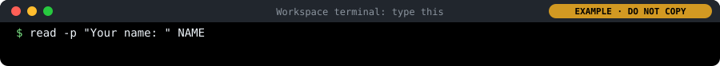
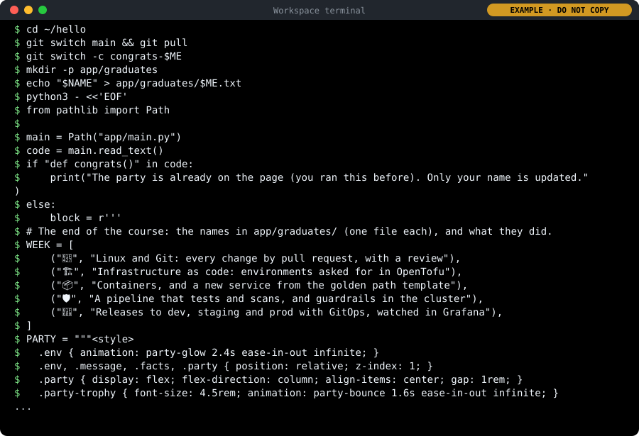
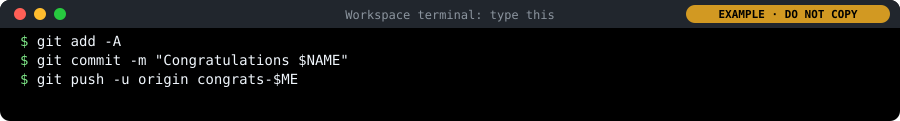
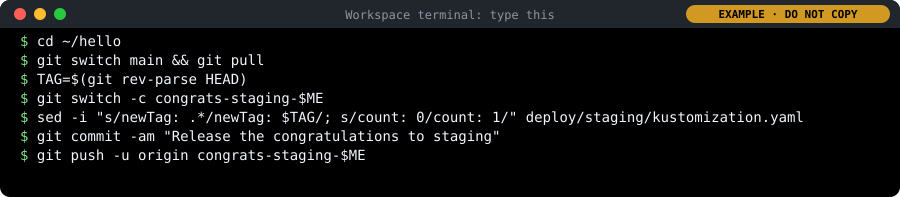
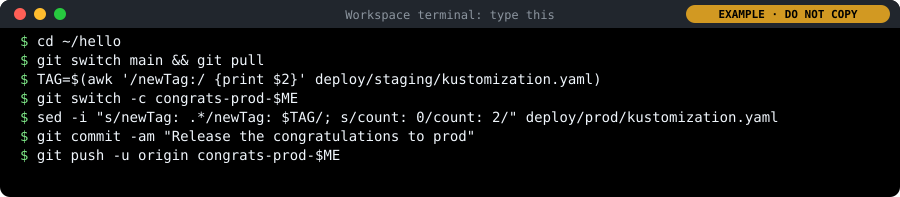
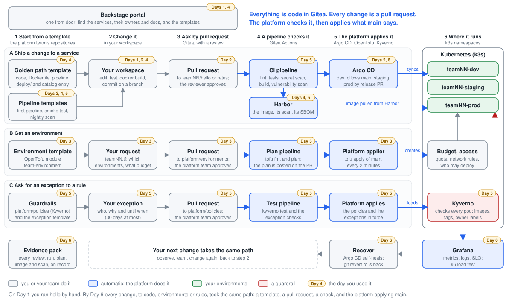
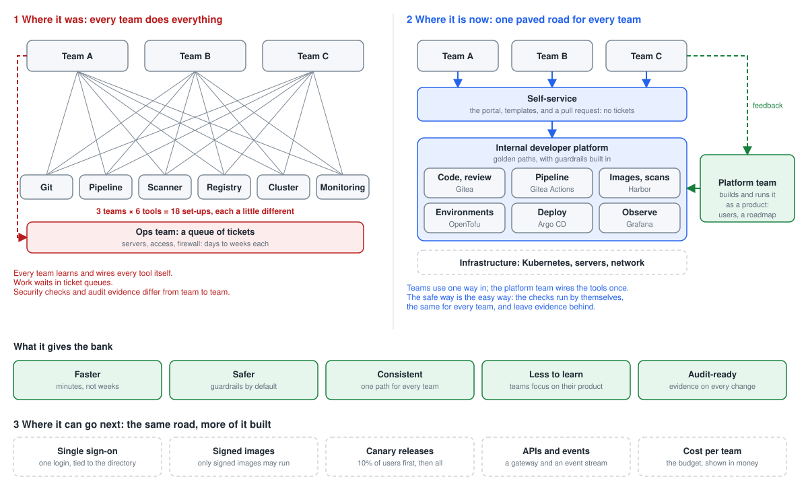

# Day 6: Deploy, observe and the capstone: the steps

Only the steps and the commands, to follow along with your instructor. Every step is explained in full in [README.md](README.md).

How to read this page:

- 📋 **Copy and paste this into the terminal:** A grey box. Click the copy button at its top right, click in the workspace terminal, paste (Ctrl+V, on a Mac Cmd+V) and press Enter. Copy only from these boxes.
- 👀 **Example only, do not copy.** What it looks like: a picture of the terminal, marked EXAMPLE · DO NOT COPY. It shows what you should see; your ids, times, names and team are your own.
- ✏️ **Do this in the editor, not in the terminal.** A line to change by hand in a file, in the editor. Do not paste it into the terminal.
- Everything else (open, click, read) you do yourself, in the browser or the editor: nothing to copy.

## Lab 1: promote hello to staging, then prod

Release the image running in dev to staging and then prod, by changing two lines in a reviewed pull request.

### 1. Find the tag to release

**Where:** Workspace terminal, then Harbor

1. Paste the box. The last line prints the tag.

   📋 **Copy and paste this into the terminal:**

   ```bash
   cd ~/hello
   git switch main && git pull
   TAG=$(git rev-parse HEAD)
   echo $TAG
   ```

   👀 **Example only, do not copy.** What it looks like:

   

2. Open Harbor (https://harbor.<lab domain>, sign in as studentNN). Click Projects → teamNN (Project Name column) → teamNN/hello (Repositories tab).

3. In the artifacts list, find the line whose Tags column shows this tag (move the mouse over a cut-short tag to see it whole), and check that its Vulnerabilities column shows a coloured bar: it has been scanned. If there is no such line, the pipeline on main is still running: wait for it and reload.

### 2. Change two lines for staging

**Where:** Workspace terminal

✏️ **Do this in the editor, not in the terminal.** In `deploy/staging/kustomization.yaml`, change:

```
images:
  - name: harbor.<lab domain>/teamNN/hello
    newTag: not-released-yet
replicas:
  - name: hello
    count: 0
```

to:

```
images:
  - name: harbor.<lab domain>/teamNN/hello
    newTag: 283803288206439f84db4279b5d39fd644cb5f24
replicas:
  - name: hello
    count: 1
```

📋 **Copy and paste this into the terminal:**

```bash
git switch -c release-staging-$ME
sed -i "s/newTag: .*/newTag: $TAG/; s/count: 0/count: 1/" deploy/staging/kustomization.yaml
git diff
```

👀 **Example only, do not copy.** What it looks like:


### 3. Propose the release; the reviewer approves

**Where:** Workspace terminal, then Gitea

1. Paste the box to commit and push.

   📋 **Copy and paste this into the terminal:**

   ```bash
   git commit -am "Release ${TAG:0:8} to staging"
   git push -u origin release-staging-$ME
   ```

   👀 **Example only, do not copy.** What it looks like (what it prints depends on your lab):

   

2. Open the pulls/new link it prints (Hold Ctrl (on a Mac Cmd) and click the link in the terminal) and click Create Pull Request.

   

   *Files Changed of the release: in deploy/staging/kustomization.yaml, newTag becomes the commit id and count goes from 0 to 1. Nothing else. Your names, team, numbers and times are your own.*

3. Approve as reviewer: Open a private window (Edge or Chrome: Ctrl+Shift+N, on a Mac Cmd+Shift+N; Firefox: Ctrl+Shift+P, on a Mac Cmd+Shift+P), go to https://gitea.<lab domain>, click Sign In, and sign in with the other person's login: reviewer or platform-approver, with its password from cat /etc/pelab/logins.md in your workspace. Read Files Changed (two lines), then Review → Approve, and close the private window.

4. When "All checks were successful", merge with Create squash commit.

### 4. Watch staging update

**Where:** Browser: Argo CD

1. Open https://argocd.<lab domain> (sign in as delegate if it asks) and click teamNN-hello-staging.

2. Within a minute of the merge it starts syncing.

   

   *teamNN-hello-staging after the release: Healthy, Synced to main, the comment of your release commit, and the tree: settings (cm), service (svc), the hello deployment (deploy) with its copies. In your lab the repository is https://gitea.<lab domain>/teamNN/hello.git, and the names, ids and times are your own.*

**You should see:** Syncing, then Synced and Healthy, with one pod.

### 5. Check staging answers with the right version

**Where:** Workspace terminal

1. Open https://hello-teamNN-staging.<lab domain>/ in a new tab (your team instead of teamNN).

📋 **Copy and paste this into the terminal:**

```bash
curl -s https://hello-$TEAM-staging.$DOMAIN/
```

👀 **Example only, do not copy.** What it looks like:


### 6. Do the same for prod, with two copies

**Where:** Workspace terminal, then Gitea

1. Paste the box: from the updated main, the same two lines in deploy/prod, with count 2.

   📋 **Copy and paste this into the terminal:**

   ```bash
   git switch main && git pull
   git switch -c release-prod-$ME
   sed -i "s/newTag: .*/newTag: $TAG/; s/count: 0/count: 2/" deploy/prod/kustomization.yaml
   git diff
   git commit -am "Release ${TAG:0:8} to prod"
   git push -u origin release-prod-$ME
   ```

   👀 **Example only, do not copy.** What it looks like (what it prints depends on your lab):

   

2. Pull request, approval, merge, as in step 3.

3. After the merge, call prod (the second box).

📋 **Copy and paste this into the terminal:**

```bash
curl -s https://hello-$TEAM-prod.$DOMAIN/
kubectl -n $TEAM-prod get pods
```

👀 **Example only, do not copy.** What it looks like (what it prints depends on your lab):


## Lab 2: read the dashboard

Read your service's health on the Golden path services dashboard: versions, traffic, errors and logs. Then write a short service-level report.

### 1. Open the dashboard

**Where:** Browser: Grafana

1. Open https://grafana.<lab domain> in a new tab. On the sign-in page, type delegate in Email or username, its password from cat /etc/pelab/logins.md in Password (the same read-only login as Argo CD), and click Log in.

2. Open the menu on the left (if it is closed, click the ☰ icon at the top left) and click Dashboards.

3. The list shows folders. Click the folder PE Lab to open it, then click Golden path services.

4. At the top left of the dashboard there are two lists. Team: choose your team, teamNN. Service: choose hello.

5. At the top right, leave the time range (Last 1 hour) and the refresh (30s) as they are: the dashboard updates itself every 30 seconds. The round arrow button refreshes it now.

**You should see:** Five panels: What runs where (version = commit SHA), Healthy pods, Requests per second, Failed requests (share of 4xx and 5xx), and Logs. What runs where lists dev, staging and prod, each with its tag.

### 2. Make some traffic

**Where:** Workspace terminal

📋 **Copy and paste this into the terminal:**

```bash
for i in $(seq 1 300); do curl -s -o /dev/null https://hello-$TEAM-staging.$DOMAIN/; sleep 0.2; done
```

👀 **Example only, do not copy.** What it looks like (what it prints depends on your lab):


### 3. Make some errors

**Where:** Workspace terminal

📋 **Copy and paste this into the terminal:**

```bash
for i in $(seq 1 50); do curl -s -o /dev/null https://hello-$TEAM-staging.$DOMAIN/missing; done
```

👀 **Example only, do not copy.** What it looks like (what it prints depends on your lab):


### 4. Find them in the logs

**Where:** Browser: Grafana

1. Scroll down to the Logs panel, at the bottom of the dashboard. The newest lines are at the top.

2. Press Ctrl+F (on a Mac Cmd+F) and type missing: the browser highlights the failed requests.

**You should see:** One JSON line per failed request.

### 5. Write a service-level report

**Where:** Your team notes

1. Write three lines: the promise (99% of requests succeed), today's measured success rate (100% minus the failed share on the dashboard), and the one alert that exists (it fires when hello has no healthy copy).

**You should see:** A three-line report for the evidence pack, for example "Promise 99%. Measured today 85% in staging, all of the failures our own 404 test. Alert: no healthy pod for 2 minutes."

## Lab 3: load-test staging and watch the dashboard

Put real load on staging with k6, watch what it does on the dashboard, and turn the numbers into a decision.

### 1. Write the load test

**Where:** Workspace terminal

📋 **Copy and paste this into the terminal:**

```bash
mkdir -p ~/day6 && cd ~/day6
cat > load.js <<EOF
import http from 'k6/http';
import { check, sleep } from 'k6';

export const options = { vus: 20, duration: '2m' };

export default function () {
  const r = http.get('https://hello-$TEAM-staging.$DOMAIN/');
  check(r, { 'status is 200': (res) => res.status === 200 });
  sleep(0.5);
}
EOF
cat load.js
```

👀 **Example only, do not copy.** What it looks like:


### 2. Run it

**Where:** Workspace terminal

📋 **Copy and paste this into the terminal:**

```bash
k6 run load.js
```

👀 **Example only, do not copy.** What it looks like:


### 3. Watch the dashboard while it runs

**Where:** Browser: Grafana

1. Go to the Golden path services dashboard (Team: teamNN, Service: hello), and click the round arrow button at the top right to refresh it; it also refreshes itself every 30 seconds.

2. In Requests per second, each line is one environment: move the mouse over the lines to see which is staging.

3. In Failed requests (share of 4xx and 5xx), check the staging line stays at the bottom, at 0%.

**You should see:** Requests per second for staging rises to about 40; Failed requests stays at 0%.

### 4. Run it again with 100 users

**Where:** Workspace terminal, and the dashboard

1. Run the first box; it takes two minutes.

2. While it runs, open a second terminal (+) and run the second box a few times: it shows how much CPU and memory the staging pod uses right now.

📋 **Copy and paste this into the terminal:**

```bash
k6 run --vus 100 load.js
```

👀 **Example only, do not copy.** What it looks like:


📋 **Copy and paste this into the terminal:**

```bash
kubectl -n $TEAM-staging top pods
```

👀 **Example only, do not copy.** What it looks like (what it prints depends on your lab):


### 5. Turn the numbers into a decision

**Where:** Your team notes

1. Write down p95 and the success rate at 20 and at 100 users.

2. Decide: does one copy keep the promise at 100 users? If not, what would you change: more copies, a bigger budget, or the code?

**You should see:** A short performance note with a recommendation, for example "At 100 users p95 rose from 6 ms to 180 ms; prod needs two copies".

## Lab 4: break it, and watch the platform recover

Cause two incidents on purpose, a manual change and a bad release, and measure how the platform recovers from each. Note the clock time at every step.

### 1. Switch dev off by hand

**Where:** Workspace terminal

📋 **Copy and paste this into the terminal:**

```bash
date +%T
kubectl -n $TEAM-dev scale deployment hello --replicas=0
curl -s -o /dev/null -w "%{http_code}\n" https://hello-$TEAM-dev.$DOMAIN/
```

👀 **Example only, do not copy.** What it looks like:


### 2. Do nothing, and watch

**Where:** Workspace terminal

1. Run the command below: it keeps watching hello in dev and prints a line at every change.

2. When READY is 1/1 again, press Ctrl+C to stop watching, and note the time:

   📋 **Copy and paste this into the terminal:**

   ```bash
   date +%T
   ```

   👀 **Example only, do not copy.** What it looks like:

   

📋 **Copy and paste this into the terminal:**

```bash
kubectl -n $TEAM-dev get deployment hello -w
```

👀 **Example only, do not copy.** What it looks like (what it prints depends on your lab):


### 3. Release something broken to staging

**Where:** Workspace terminal, then Gitea

1. Paste the box: it releases a tag that does not exist, on a branch.

   📋 **Copy and paste this into the terminal:**

   ```bash
   cd ~/hello
   git switch main && git pull
   git switch -c bad-release-$ME
   sed -i "s/newTag: .*/newTag: does-not-exist/" deploy/staging/kustomization.yaml
   git commit -am "Release a tag that does not exist"
   git push -u origin bad-release-$ME
   ```

   👀 **Example only, do not copy.** What it looks like:

   

2. Open the pull request, approve it as reviewer in a private window, merge. Note the time.

3. A minute after the merge, run:

   📋 **Copy and paste this into the terminal:**

   ```bash
   kubectl -n $TEAM-staging get pods
   ```

   👀 **Example only, do not copy.** What it looks like (what it prints depends on your lab):

   

### 4. Recover through Git

**Where:** Workspace terminal, then Gitea

1. Paste the box: it makes a branch, reverts the last change to the staging file, shows what the revert changed and pushes.

   📋 **Copy and paste this into the terminal:**

   ```bash
   git switch main && git pull
   git switch -c revert-bad-release-$ME
   git revert --no-edit $(git log -1 --format=%H -- deploy/staging/kustomization.yaml)
   git diff HEAD~1 --stat
   git push -u origin revert-bad-release-$ME
   ```

   👀 **Example only, do not copy.** What it looks like:

   

2. Pull request, approval, merge. Note the time.

3. A minute later, run this again: it shows one healthy pod.

   📋 **Copy and paste this into the terminal:**

   ```bash
   kubectl -n $TEAM-staging get pods
   ```

   👀 **Example only, do not copy.** What it looks like (what it prints depends on your lab):

   

### 5. Read the incident timeline

**Where:** Browser: Argo CD

1. Open teamNN-hello-staging in Argo CD and click History and Rollback (at the top).

   

   *History and Rollback: every sync, newest first, with when it was deployed, the commit, its author and its message. Here the revert, and under it the bad release. In your lab the repository is https://gitea.<lab domain>/teamNN/hello.git, and the names, ids and times are your own.*

**You should see:** Every sync with its commit and time: the good release, the bad one, and the revert. The incident timeline, written by the platform.

## Capstone: your service to prod, with evidence

Take your Day 4 service (rates) from a real improvement to production, with the evidence a reviewer would ask for, and present it.

### 1. Make one real improvement

**Where:** Workspace, then Gitea

1. Agree on one improvement to rates, for example a new field in the answer, or a new test.

2. Get the latest rates and make a branch of your own:

   📋 **Copy and paste this into the terminal:**

   ```bash
   cd ~/rates
   git switch main && git pull
   git switch -c improvement-$ME
   ```

   👀 **Example only, do not copy.** What it looks like (what it prints depends on your lab):

   

3. Make the change in the editor and save it. Then run the tests:

   📋 **Copy and paste this into the terminal:**

   ```bash
   pytest -q
   ```

   👀 **Example only, do not copy.** What it looks like:

   

4. Commit and push:

   📋 **Copy and paste this into the terminal:**

   ```bash
   git add -A
   git commit -m "Improve rates"
   git push -u origin improvement-$ME
   ```

   👀 **Example only, do not copy.** What it looks like (what it prints depends on your lab):

   

5. Pull request, review, approval, merge, as on Day 2 and in Day 4 Lab 4.

### 2. Release it to staging, then prod

**Where:** Workspace, then Gitea

1. In ~/rates, follow Lab 1 steps 1 to 6, with rates instead of hello in the addresses: deploy/staging with one copy, check it, then deploy/prod with two copies.

**You should see:** Three addresses (rates-teamNN-dev, -staging and -prod) each reporting its environment and your version.

### 3. Measure it

**Where:** Workspace and Grafana

1. Make a copy of the load test for rates:

   📋 **Copy and paste this into the terminal:**

   ```bash
   cd ~/day6
   cp load.js rates.js
   sed -i "s/hello-/rates-/" rates.js
   ```

   👀 **Example only, do not copy.** What it looks like (what it prints depends on your lab):

   

2. Run it. While it runs, open the Golden path services dashboard in Grafana, choose Service: rates at the top left, and read Requests per second and Failed requests for staging:

   📋 **Copy and paste this into the terminal:**

   ```bash
   k6 run rates.js
   ```

   👀 **Example only, do not copy.** What it looks like (what it prints depends on your lab):

   

### 4. Assemble the evidence pack

**Where:** A folder or a shared page

1. Collect, as links or screenshots: the pull requests with their approvals; the pipeline runs; the image with its scan and SBOM; the environment request and its plan (Day 3); the guardrail refusals (Day 2 and Day 5); the release pull requests; the dashboard; the load-test numbers; your recovery times (Lab 4).

2. Tick each item off on the list as you add it.

**You should see:** Every item linked or captured.

### 5. Prepare five minutes

**Where:** Your workspace

1. Plan five parts, one minute each: what you built; the path it took from commit to prod; the evidence; your charter from Day 2 against what you delivered; what you would add to the platform next.

**You should see:** Five short slides or one page of notes.

### 6. Present to the panel

**Where:** In front of the panel

1. Present at your time slot, then answer the panel's questions.

**You should see:** The panel scores against the rubric: operability, security, architecture, evidence and user value.

## Final lab: your name in dev, staging and prod

One last change through the whole platform: put your name on hello's page, see it in dev, then release it to staging and prod, with an approval each time.

### 1. Type your name

**Where:** Workspace terminal

1. Paste the box on its own. It asks for your name: type it as you want it on the page, for example Thandi Mokoena, and press Enter.

   📋 **Copy and paste this into the terminal:**

   ```bash
   read -p "Your name: " NAME
   ```

   👀 **Example only, do not copy.** What it looks like (what it prints depends on your lab):

   

### 2. Put your name on the page

**Where:** Workspace terminal

1. Paste the box. It makes a branch, writes your name in a file of its own, adds the party to the page and runs the tests.

   📋 **Copy and paste this into the terminal:**

   ```bash
   cd ~/hello
   git switch main && git pull
   git switch -c congrats-$ME
   mkdir -p app/graduates
   echo "$NAME" > app/graduates/$ME.txt
   python3 - <<'EOF'
   from pathlib import Path

   main = Path("app/main.py")
   code = main.read_text()
   if "def congrats()" in code:
       print("The party is already on the page (you ran this before). Only your name is updated.")
   else:
       block = r'''
   # The end of the course: the names in app/graduates/ (one file each), and what they did.
   WEEK = [
       ("🐧", "Linux and Git: every change by pull request, with a review"),
       ("🏗️", "Infrastructure as code: environments asked for in OpenTofu"),
       ("📦", "Containers, and a new service from the golden path template"),
       ("🛡️", "A pipeline that tests and scans, and guardrails in the cluster"),
       ("🚀", "Releases to dev, staging and prod with GitOps, watched in Grafana"),
   ]
   PARTY = """<style>
     .env { animation: party-glow 2.4s ease-in-out infinite; }
     .env, .message, .facts, .party { position: relative; z-index: 1; }
     .party { display: flex; flex-direction: column; align-items: center; gap: 1rem; }
     .party-trophy { font-size: 4.5rem; animation: party-bounce 1.6s ease-in-out infinite; }
     .party-title {
       font-size: clamp(2rem, 9vw, 6.5rem); font-weight: 900; letter-spacing: 0.02em;
       background: linear-gradient(90deg, #ff4d6d, #ffd166, #06d6a0, #4cc9f0, #b388ff, #ff4d6d);
       background-size: 200% auto; -webkit-background-clip: text; background-clip: text;
       color: transparent; animation: party-pop 0.9s ease-out both, party-shine 3s linear infinite;
     }
     .party-names { display: flex; flex-wrap: wrap; justify-content: center; gap: 0.7rem; }
     .party-name {
       padding: 0.5rem 1.2rem; border-radius: 999px; font-weight: 800;
       font-size: clamp(1.2rem, 3.2vw, 2rem); color: #1a1a2e;
       background: linear-gradient(135deg, #ffd166, #ff8fab);
       box-shadow: 0 0 28px rgba(255, 209, 102, 0.55);
       animation: party-pop 0.7s ease-out both, party-float 3s ease-in-out infinite;
     }
     .party-done { font-size: clamp(1.3rem, 3.6vw, 2.3rem); font-weight: 600; }
     .party-week {
       list-style: none; padding: 0; margin: 0.5rem 0 0; display: flex; flex-wrap: wrap;
       justify-content: center; gap: 0.7rem; width: min(64rem, 92vw);
     }
     .party-week li {
       flex: 0 1 19rem; display: flex; align-items: center; gap: 0.8rem; padding: 0.9rem 1.1rem;
       box-sizing: border-box; text-align: left; color: #e8e8f0; border-radius: 16px;
       background: rgba(255, 255, 255, 0.07); border: 1px solid rgba(255, 255, 255, 0.16);
       backdrop-filter: blur(6px); animation: party-rise 0.7s ease-out both;
     }
     .party-week b { font-size: 1.8rem; }
     .party-confetti { position: fixed; inset: 0; overflow: hidden; pointer-events: none; }
     .party-confetti i {
       position: absolute; top: -6vh; width: 10px; height: 16px; opacity: 0.9;
       animation: party-fall linear infinite;
     }
     @keyframes party-fall { to { transform: translateY(112vh) rotate(760deg); } }
     @keyframes party-pop { 0% { scale: 0; opacity: 0; } 70% { scale: 1.15; } 100% { scale: 1; } }
     @keyframes party-shine { to { background-position: 200% center; } }
     @keyframes party-float { 50% { translate: 0 -8px; } }
     @keyframes party-rise { from { translate: 0 24px; opacity: 0; } }
     @keyframes party-bounce { 50% { transform: translateY(-16px) rotate(-8deg); } }
     @keyframes party-glow { 50% { text-shadow: 0 0 48px currentColor; } }
     @media (prefers-reduced-motion: reduce) {
       .party-confetti { display: none; }
       .env, .party, .party * { animation: none !important; }
     }
   </style>"""


   def congrats() -> str:
       """Return a party for everyone in app/graduates/ (one file per person), or nothing."""
       from html import escape
       from pathlib import Path

       folder = Path(__file__).parent / "graduates"
       people = sorted(n for p in folder.glob("*.txt") if (n := p.read_text().strip()))
       if not people:
           return ""
       colours = ["#ff4d6d", "#ffd166", "#06d6a0", "#4cc9f0", "#b388ff", "#ff8fab"]
       shapes = ["50%", "2px", "0"]
       confetti = "".join(
           f'<i style="left: {i * 37 % 100}%; background: {colours[i % 6]}; '
           f"border-radius: {shapes[i % 3]}; animation-duration: {3 + i % 5 * 0.7:.1f}s; "
           f'animation-delay: -{i * 0.23 % 4:.2f}s"></i>'
           for i in range(70)
       )
       names = "".join(
           f'<span class="party-name" style="animation-delay: {0.5 + i * 0.3:.1f}s, {i * 0.4:.1f}s">'
           f"{escape(name)}</span>"
           for i, name in enumerate(people)
       )
       week = "".join(
           f'<li style="animation-delay: {1.2 + i * 0.2:.1f}s"><b>{icon}</b>{escape(text)}</li>'
           for i, (icon, text) in enumerate(WEEK)
       )
       return (
           f'{PARTY}\n  <div class="party-confetti" aria-hidden="true">{confetti}</div>\n'
           '  <div class="party">\n'
           '    <div class="party-trophy" aria-hidden="true">🏆</div>\n'
           '    <div class="party-title">Congratulations</div>\n'
           f'    <div class="party-names">{names}</div>\n'
           '    <div class="party-done">you are done with Platform Engineering!</div>\n'
           f'    <ul class="party-week">{week}</ul>\n'
           "  </div>"
       )

   '''
       env = '  <div class="env">{text["environment"]}</div>\n'
       code = code.replace("\ndef render_page(", block + "\ndef render_page(", 1)
       code = code.replace(env, env + "  {congrats()}\n", 1)
       main.write_text(code)
       print("Added the party to the page.")
   EOF
   pytest -q
   git status --short
   ```

   👀 **Example only, do not copy.** What it looks like:

   

### 3. Commit, push, and open the pull request

**Where:** Workspace terminal, then Gitea

1. Paste the box to commit and push.

   📋 **Copy and paste this into the terminal:**

   ```bash
   git add -A
   git commit -m "Congratulations $NAME"
   git push -u origin congrats-$ME
   ```

   👀 **Example only, do not copy.** What it looks like (what it prints depends on your lab):

   

2. Open the pulls/new link it prints (Hold Ctrl (on a Mac Cmd) and click the link in the terminal) and click Create Pull Request.

### 4. The reviewer approves; you merge

**Where:** Gitea

1. Approve as reviewer: Open a private window (Edge or Chrome: Ctrl+Shift+N, on a Mac Cmd+Shift+N; Firefox: Ctrl+Shift+P, on a Mac Cmd+Shift+P), go to https://gitea.<lab domain>, click Sign In, and sign in with reviewer, with its password from cat /etc/pelab/logins.md in your workspace. Then Files Changed → Review → Approve, and close the private window.

2. When "All checks were successful", merge with Create squash commit.

**You should see:** Merged: the pipeline was green and the reviewer approved.

### 5. See your name in dev

**Where:** Browser

1. Wait a few minutes: the pipeline on main builds the new image (Actions tab, green tick), then Argo CD puts it in dev.

2. Open https://hello-teamNN-dev.<lab domain>/ in a new tab (your team instead of teamNN).

**You should see:** DEV glowing red, falling confetti, a bouncing trophy, a rainbow Congratulations, your name on a glowing badge, "you are done with Platform Engineering!" and five cards with what you did this week.

### 6. Release it to staging

**Where:** Workspace terminal, then Gitea

1. When your name shows in dev, paste the box.

   📋 **Copy and paste this into the terminal:**

   ```bash
   cd ~/hello
   git switch main && git pull
   TAG=$(git rev-parse HEAD)
   git switch -c congrats-staging-$ME
   sed -i "s/newTag: .*/newTag: $TAG/; s/count: 0/count: 1/" deploy/staging/kustomization.yaml
   git commit -am "Release the congratulations to staging"
   git push -u origin congrats-staging-$ME
   ```

   👀 **Example only, do not copy.** What it looks like (what it prints depends on your lab):

   

2. Open the pulls/new link it prints and click Create Pull Request. The reviewer approves (private window, as in step 4); then merge.

3. A minute after the merge, open https://hello-teamNN-staging.<lab domain>/ in a new tab.

### 7. Release it to prod

**Where:** Workspace terminal, then Gitea

1. Paste the box. It takes the tag that staging runs, so prod gets the same image.

   📋 **Copy and paste this into the terminal:**

   ```bash
   cd ~/hello
   git switch main && git pull
   TAG=$(awk '/newTag:/ {print $2}' deploy/staging/kustomization.yaml)
   git switch -c congrats-prod-$ME
   sed -i "s/newTag: .*/newTag: $TAG/; s/count: 0/count: 2/" deploy/prod/kustomization.yaml
   git commit -am "Release the congratulations to prod"
   git push -u origin congrats-prod-$ME
   ```

   👀 **Example only, do not copy.** What it looks like (what it prints depends on your lab):

   

2. Open the pulls/new link, Create Pull Request, the reviewer approves, merge.

3. A minute after the merge, open https://hello-teamNN-prod.<lab domain>/ in a new tab.

### 8. Three environments, one image

**Where:** Browser

1. Put the three tabs side by side: dev (red), staging (yellow), prod (green).

2. Take a screenshot of the three for your evidence pack.

**You should see:** The same page and your name in all three, each in its own colour. Congratulations: you are done.

## The week on one page: how the pieces come together



*Everything you did this week, as three flows through the platform. The yellow tags say which day. Grey: you do it; blue: the platform does it by itself.*

- A: a change to a service (Days 2, 4, 5, 6). Today you finished it: released to staging and prod, and watched it in Grafana.
- B: an environment (Day 3). C: an exception to a rule (Day 5). The same five moves each time: template, change, pull request, pipeline, the platform applies main.
- The capstone took your service through flow A, end to end, and the evidence pack is what each box left on record.

## Platform engineering: where it was, is, and can go



*Where it was (every team does everything), where it is now (one paved road, built once by a platform team), what that gives the bank, and where the same road can go next. Dashed: not built yet.*

- Where it was: every team set up every tool itself, and waited on tickets for servers, access and firewalls. Day 1, Lab 1.
- Where it is now: one way in for every team (the portal, templates and a pull request), with tests, scans and guardrails that run by themselves.
- What it gives the bank: faster, safer, consistent, less to learn, and evidence on every change.
- Where it can go next: single sign-on, signed images, canary releases, APIs and events, and cost per team. Each is one more piece of the same road.
