# Day 6: Deploy, observe and the capstone: the steps

Only the steps and the commands, to follow along with your instructor. Every step is explained in full in [README.md](README.md).

Every command has a picture of the terminal. Where the lab was tested, it shows what the command printed (your ids, times, names and team are your own); "type this" pictures show only what to type.

## Lab 1: promote hello to staging, then prod

Release the image running in dev to staging and then prod, by changing two lines in a reviewed pull request.

### 1. Find the tag to release

1. Paste the box. The last line prints the tag.

2. Open Harbor (https://harbor.<lab domain>, sign in as studentNN). Click Projects → teamNN (Project Name column) → teamNN/hello (Repositories tab).

3. In the artifacts list, find the line whose Tags column shows this tag (move the mouse over a cut-short tag to see it whole), and check that its Vulnerabilities column shows a coloured bar: it has been scanned. If there is no such line, the pipeline on main is still running: wait for it and reload.

```bash
cd ~/hello
git switch main && git pull
TAG=$(git rev-parse HEAD)
echo $TAG
```

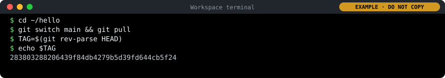

### 2. Change two lines for staging

In `deploy/staging/kustomization.yaml`, change:

```
images:
  - name: harbor.<lab domain>/teamNN/hello
    newTag: not-released-yet
replicas:
  - name: hello
    count: 0
```

to:

```
images:
  - name: harbor.<lab domain>/teamNN/hello
    newTag: 283803288206439f84db4279b5d39fd644cb5f24
replicas:
  - name: hello
    count: 1
```

```bash
git switch -c release-staging-$ME
sed -i "s/newTag: .*/newTag: $TAG/; s/count: 0/count: 1/" deploy/staging/kustomization.yaml
git diff
```

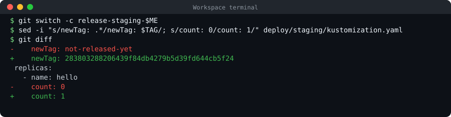

### 3. Propose the release; the reviewer approves

1. Paste the box to commit and push.

2. Open the pulls/new link it prints (Hold Ctrl (on a Mac Cmd) and click the link in the terminal) and click Create Pull Request.

   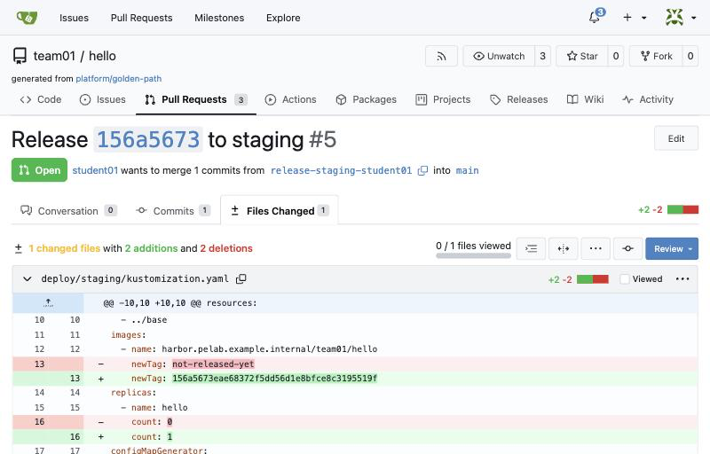

   *Files Changed of the release: in deploy/staging/kustomization.yaml, newTag becomes the commit id and count goes from 0 to 1. Nothing else. Your names, team, numbers and times are your own.*

3. Approve as reviewer: Open a private window (Edge or Chrome: Ctrl+Shift+N, on a Mac Cmd+Shift+N; Firefox: Ctrl+Shift+P, on a Mac Cmd+Shift+P), go to https://gitea.<lab domain>, click Sign In, and sign in with the other person's login: reviewer or platform-approver, with its password from cat /etc/pelab/logins.md in your workspace. Read Files Changed (two lines), then Review → Approve, and close the private window.

4. When "All checks were successful", merge with Create squash commit.

```bash
git commit -am "Release ${TAG:0:8} to staging"
git push -u origin release-staging-$ME
```

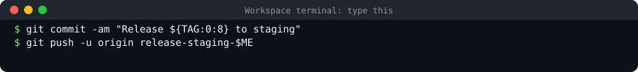

### 4. Watch staging update

1. Open https://argocd.<lab domain> (sign in as delegate if it asks) and click teamNN-hello-staging.

2. Within a minute of the merge it starts syncing.

   

   *teamNN-hello-staging after the release: Healthy, Synced to main, the comment of your release commit, and the tree: settings (cm), service (svc), the hello deployment (deploy) with its copies. In your lab the repository is https://gitea.<lab domain>/teamNN/hello.git, and the names, ids and times are your own.*

### 5. Check staging answers with the right version

1. Open https://hello-teamNN-staging.<lab domain>/ in a new tab (your team instead of teamNN).

```bash
curl -s https://hello-$TEAM-staging.$DOMAIN/
```

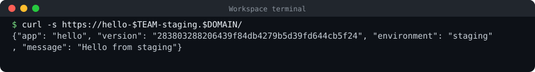

### 6. Do the same for prod, with two copies

1. Paste the box: from the updated main, the same two lines in deploy/prod, with count 2.

2. Pull request, approval, merge, as in step 3.

3. After the merge, call prod (the second box).

```bash
git switch main && git pull
git switch -c release-prod-$ME
sed -i "s/newTag: .*/newTag: $TAG/; s/count: 0/count: 2/" deploy/prod/kustomization.yaml
git diff
git commit -am "Release ${TAG:0:8} to prod"
git push -u origin release-prod-$ME
```

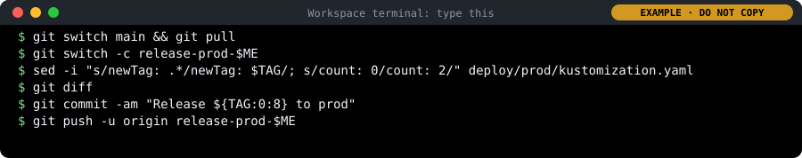

```bash
curl -s https://hello-$TEAM-prod.$DOMAIN/
kubectl -n $TEAM-prod get pods
```

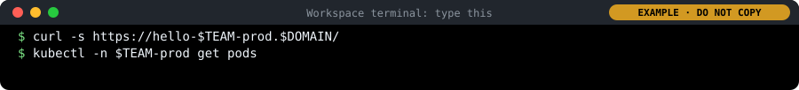

## Lab 2: read the dashboard

Read your service's health on the Golden path services dashboard: versions, traffic, errors and logs. Then write a short service-level report.

### 1. Open the dashboard

1. Open https://grafana.<lab domain> in a new tab. On the sign-in page, type delegate in Email or username, its password from cat /etc/pelab/logins.md in Password (the same read-only login as Argo CD), and click Log in.

2. Open the menu on the left (if it is closed, click the ☰ icon at the top left) and click Dashboards.

3. The list shows folders. Click the folder PE Lab to open it, then click Golden path services.

4. At the top left of the dashboard there are two lists. Team: choose your team, teamNN. Service: choose hello.

5. At the top right, leave the time range (Last 1 hour) and the refresh (30s) as they are: the dashboard updates itself every 30 seconds. The round arrow button refreshes it now.

### 2. Make some traffic

```bash
for i in $(seq 1 300); do curl -s -o /dev/null https://hello-$TEAM-staging.$DOMAIN/; sleep 0.2; done
```

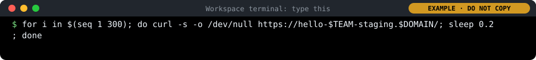

### 3. Make some errors

```bash
for i in $(seq 1 50); do curl -s -o /dev/null https://hello-$TEAM-staging.$DOMAIN/missing; done
```

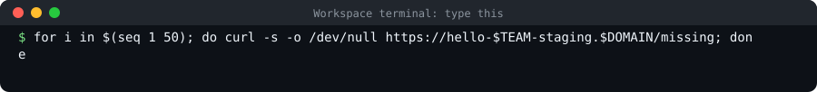

### 4. Find them in the logs

1. Scroll down to the Logs panel, at the bottom of the dashboard. The newest lines are at the top.

2. Press Ctrl+F (on a Mac Cmd+F) and type missing: the browser highlights the failed requests.

### 5. Write a service-level report

1. Write three lines: the promise (99% of requests succeed), today's measured success rate (100% minus the failed share on the dashboard), and the one alert that exists (it fires when hello has no healthy copy).

## Lab 3: load-test staging and watch the dashboard

Put real load on staging with k6, watch what it does on the dashboard, and turn the numbers into a decision.

### 1. Write the load test

```bash
mkdir -p ~/day6 && cd ~/day6
cat > load.js <<EOF
import http from 'k6/http';
import { check, sleep } from 'k6';

export const options = { vus: 20, duration: '2m' };

export default function () {
  const r = http.get('https://hello-$TEAM-staging.$DOMAIN/');
  check(r, { 'status is 200': (res) => res.status === 200 });
  sleep(0.5);
}
EOF
cat load.js
```

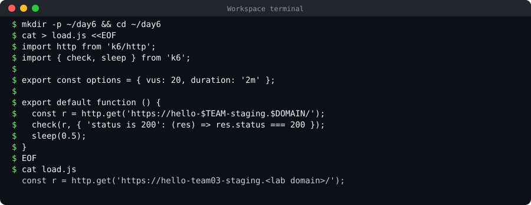

### 2. Run it

```bash
k6 run load.js
```

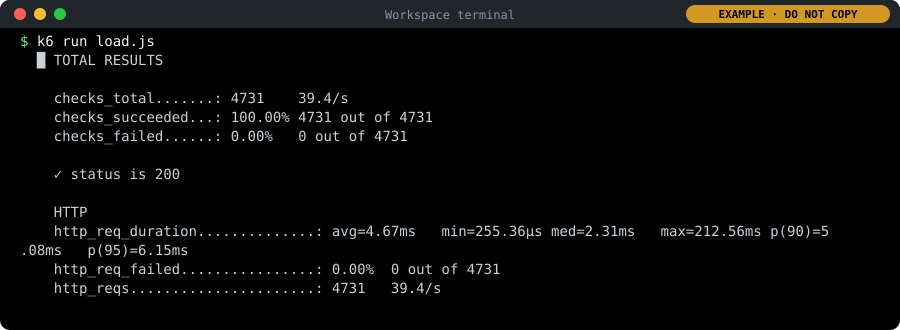

### 3. Watch the dashboard while it runs

1. Go to the Golden path services dashboard (Team: teamNN, Service: hello), and click the round arrow button at the top right to refresh it; it also refreshes itself every 30 seconds.

2. In Requests per second, each line is one environment: move the mouse over the lines to see which is staging.

3. In Failed requests (share of 4xx and 5xx), check the staging line stays at the bottom, at 0%.

### 4. Run it again with 100 users

1. Run the first box; it takes two minutes.

2. While it runs, open a second terminal (+) and run the second box a few times: it shows how much CPU and memory the staging pod uses right now.

```bash
k6 run --vus 100 load.js
```

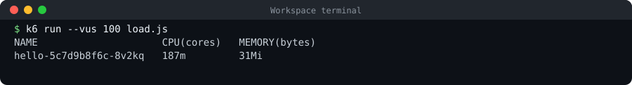

```bash
kubectl -n $TEAM-staging top pods
```

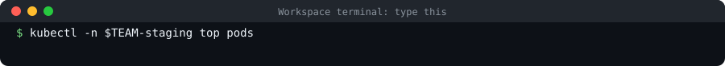

### 5. Turn the numbers into a decision

1. Write down p95 and the success rate at 20 and at 100 users.

2. Decide: does one copy keep the promise at 100 users? If not, what would you change: more copies, a bigger budget, or the code?

## Lab 4: break it, and watch the platform recover

Cause two incidents on purpose, a manual change and a bad release, and measure how the platform recovers from each. Note the clock time at every step.

### 1. Switch dev off by hand

```bash
date +%T
kubectl -n $TEAM-dev scale deployment hello --replicas=0
curl -s -o /dev/null -w "%{http_code}\n" https://hello-$TEAM-dev.$DOMAIN/
```

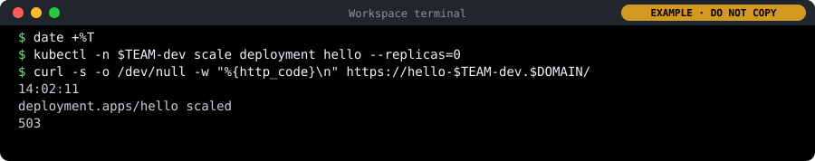

### 2. Do nothing, and watch

1. Run the command below: it keeps watching hello in dev and prints a line at every change.

2. When READY is 1/1 again, press Ctrl+C to stop watching, and note the time:

   ```bash
   date +%T
   ```

   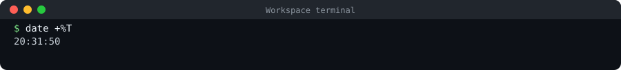

```bash
kubectl -n $TEAM-dev get deployment hello -w
```

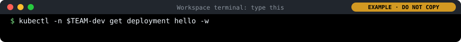

### 3. Release something broken to staging

1. Paste the box: it releases a tag that does not exist, on a branch.

2. Open the pull request, approve it as reviewer in a private window, merge. Note the time.

3. A minute after the merge, run:

   ```bash
   kubectl -n $TEAM-staging get pods
   ```

   

```bash
cd ~/hello
git switch main && git pull
git switch -c bad-release-$ME
sed -i "s/newTag: .*/newTag: does-not-exist/" deploy/staging/kustomization.yaml
git commit -am "Release a tag that does not exist"
git push -u origin bad-release-$ME
```

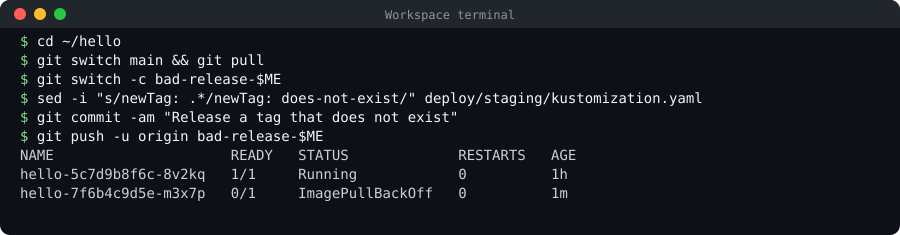

### 4. Recover through Git

1. Paste the box: it makes a branch, reverts the last change to the staging file, shows what the revert changed and pushes.

2. Pull request, approval, merge. Note the time.

3. A minute later, run this again: it shows one healthy pod.

   ```bash
   kubectl -n $TEAM-staging get pods
   ```

   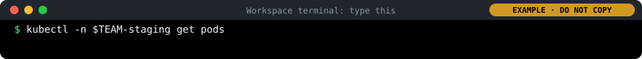

```bash
git switch main && git pull
git switch -c revert-bad-release-$ME
git revert --no-edit $(git log -1 --format=%H -- deploy/staging/kustomization.yaml)
git diff HEAD~1 --stat
git push -u origin revert-bad-release-$ME
```

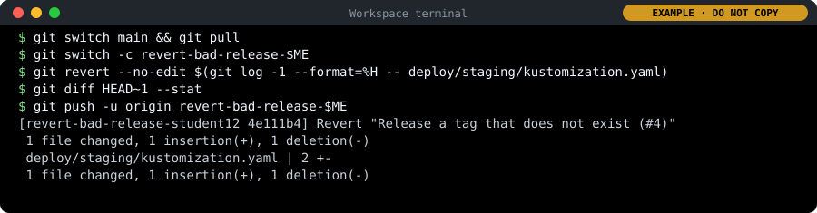

### 5. Read the incident timeline

1. Open teamNN-hello-staging in Argo CD and click History and Rollback (at the top).

   

   *History and Rollback: every sync, newest first, with when it was deployed, the commit, its author and its message. Here the revert, and under it the bad release. In your lab the repository is https://gitea.<lab domain>/teamNN/hello.git, and the names, ids and times are your own.*

## Capstone: your service to prod, with evidence

Take your Day 4 service (rates) from a real improvement to production, with the evidence a reviewer would ask for, and present it.

### 1. Make one real improvement

1. Agree on one improvement to rates, for example a new field in the answer, or a new test.

2. Get the latest rates and make a branch of your own:

   ```bash
   cd ~/rates
   git switch main && git pull
   git switch -c improvement-$ME
   ```

   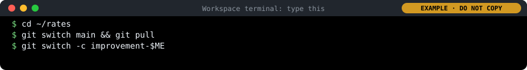

3. Make the change in the editor and save it. Then run the tests:

   ```bash
   pytest -q
   ```

   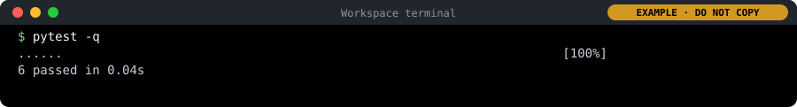

4. Commit and push:

   ```bash
   git add -A
   git commit -m "Improve rates"
   git push -u origin improvement-$ME
   ```

   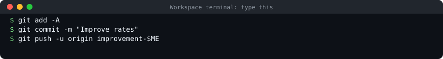

5. Pull request, review, approval, merge, as on Day 2 and in Day 4 Lab 4.

### 2. Release it to staging, then prod

1. In ~/rates, follow Lab 1 steps 1 to 6, with rates instead of hello in the addresses: deploy/staging with one copy, check it, then deploy/prod with two copies.

### 3. Measure it

1. Make a copy of the load test for rates:

   ```bash
   cd ~/day6
   cp load.js rates.js
   sed -i "s/hello-/rates-/" rates.js
   ```

   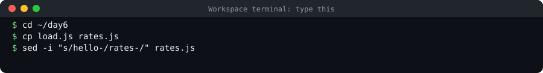

2. Run it. While it runs, open the Golden path services dashboard in Grafana, choose Service: rates at the top left, and read Requests per second and Failed requests for staging:

   ```bash
   k6 run rates.js
   ```

   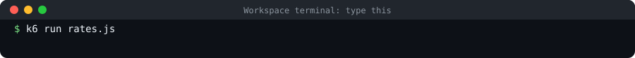

### 4. Assemble the evidence pack

1. Collect, as links or screenshots: the pull requests with their approvals; the pipeline runs; the image with its scan and SBOM; the environment request and its plan (Day 3); the guardrail refusals (Day 2 and Day 5); the release pull requests; the dashboard; the load-test numbers; your recovery times (Lab 4).

2. Tick each item off on the list as you add it.

### 5. Prepare five minutes

1. Plan five parts, one minute each: what you built; the path it took from commit to prod; the evidence; your charter from Day 2 against what you delivered; what you would add to the platform next.

### 6. Present to the panel

1. Present at your time slot, then answer the panel's questions.
